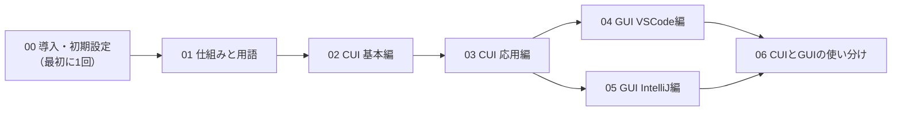
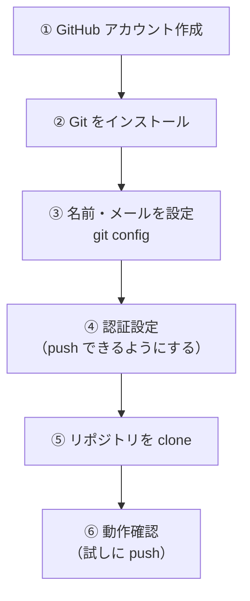
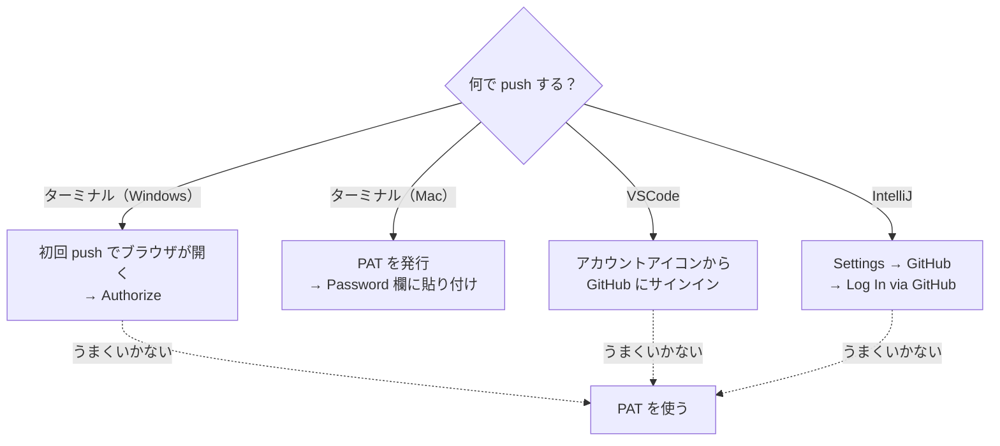

# 00. Git 導入・初期設定

[📚 Git資料の目次](#git-資料の構成) ｜ 次へ → [01. Git の仕組みと用語](./01_Gitの仕組みと用語.md)

Git / GitHub を使い始めるための**最初の1回だけ**行う準備です。終わったら、この資料はもう読まなくて大丈夫です（PC を買い替えたときなどに見返してください）。

## Git 資料の構成



| 資料 | 内容 |
|---|---|
| **00 導入・初期設定**（この資料） | インストール・アカウント・認証・clone |
| [01 Git の仕組みと用語](./01_Gitの仕組みと用語.md) | Git とは何か、用語、データの流れ |
| [02 CUI 基本編](./02_CUI基本編.md) | 毎日の作業（add / commit / push / pull / ブランチ） |
| [03 CUI 応用編](./03_CUI応用編.md) | main への追従、取り消し、プルリクエスト |
| [04 GUI VSCode編](./04_GUI_VSCode編.md) | VSCode のボタン操作で同じことをする |
| [05 GUI IntelliJ編](./05_GUI_IntelliJ編.md) | IntelliJ IDEA のボタン操作で同じことをする |
| [06 CUIとGUIの使い分け](./06_CUIとGUIの使い分け.md) | GUI でできないこと・困ったときの戻り方 |

> **学ぶ順番について**
> まず **CUI（コマンド）で仕組みを理解**し、ある程度慣れてから **GUI（ボタン操作）** に移ります。GUI はボタンの裏で同じコマンドを実行しているだけなので、コマンドを知っていると「今このボタンで何が起きたか」が分かり、迷わなくなります。

## 目次

1. [準備の全体像](#1-準備の全体像)
2. [GitHub アカウントの作成](#2-github-アカウントの作成)
3. [Git のインストール](#3-git-のインストール)
4. [名前とメールアドレスの設定](#4-名前とメールアドレスの設定)
5. [GitHub への認証設定](#5-github-への認証設定)
6. [リポジトリを clone する](#6-リポジトリを-clone-する)
7. [動作確認](#7-動作確認)
8. [おすすめ：練習用リポジトリを作る](#8-おすすめ練習用リポジトリを作る)
9. [管理者向け：main ブランチの保護設定](#9-管理者向けmain-ブランチの保護設定)

---

## 1. 準備の全体像



---

## 2. GitHub アカウントの作成

Git の設定（[4章](#4-名前とメールアドレスの設定)）で **GitHub に登録したメールアドレス**を使うため、先にアカウントを作成します。

1. https://github.com を開き、**Sign up** をクリックする。
2. **メールアドレス**・パスワード・ユーザー名を入力する。
3. 認証パズルを解き、メールに届く**確認コード**を入力する。
4. アンケート画面などは「Skip」でOK。
5. 作成したら、**ユーザー名**と**登録したメールアドレス**を控えておく。

> **メールアドレスを公開したくない場合**
> GitHub の **Settings → Emails** で「Keep my email addresses private」にチェックを入れると、`ユーザー名@users.noreply.github.com` 形式の非公開用アドレスが発行されます。4章ではこのアドレスを使ってもOKです。

---

## 3. Git のインストール

まず、すでにインストールされているか確認します。ターミナル（Windows は PowerShell）で次を実行し、バージョンが表示されればインストール済みです（[4章](#4-名前とメールアドレスの設定)へ進んでOK）。

```bash
git --version
```

「command not found」や「'git' は、内部コマンドまたは外部コマンド…として認識されていません」と出た場合は、下の手順でインストールします。

### Windows の場合

1. 公式サイト https://git-scm.com/download/win を開く（自動でダウンロードが始まります。始まらない場合は「Click here to download manually」をクリック）。
2. ダウンロードした `Git-x.x.x-64-bit.exe` を実行する。
3. インストーラーの画面は基本的にすべて **「Next」** のままでOK。最後に「Install」→「Finish」をクリック。
4. **開いているターミナル／VSCode／IntelliJ をいったんすべて閉じて、開き直す**（開き直さないと認識されません）。
5. `git --version` でバージョンが表示されれば完了。

> **winget を使う方法（コマンドでインストール）**
> ```powershell
> winget install --id Git.Git -e --source winget
> ```

### Mac の場合

**方法A：Xcode Command Line Tools（一番かんたん・おすすめ）**

1. ターミナルで `git --version` を実行する。
2. 未インストールの場合は「コマンドライン・デベロッパ・ツールが必要です」というダイアログが出るので **「インストール」** をクリックする（出ない場合は `xcode-select --install` を実行）。
3. 数分待ち、再度 `git --version` でバージョンが表示されれば完了。

**方法B：Homebrew を使う**

```bash
brew install git
```

> インストール後、ターミナルを開き直してから `git --version` で確認してください。

---

## 4. 名前とメールアドレスの設定

コミットに「誰が書いたか」が記録されるため、最初に登録します。メールアドレスは **2章で GitHub に登録したもの**を使います。

```bash
git config --global user.name "あなたの名前"
git config --global user.email "GitHubに登録したメールアドレス"
```

あわせて、最初のブランチ名を `main` にする設定もしておきます（新しくリポジトリを作るときに使われます）。

```bash
git config --global init.defaultBranch main
```

設定の確認:

```bash
git config --global --list
```

```
user.name=あなたの名前
user.email=xxxx@example.com
init.defaultbranch=main
```

---

## 5. GitHub への認証設定

GitHub は Git 操作での**パスワード認証を廃止**しています。そのため `git push` するには、次のいずれかで本人確認が必要です。**clone や pull だけなら（公開リポジトリは）不要**ですが、push の時点で必ず求められます。

**使う道具によって設定方法が違う**ので、自分が使うものの手順を読んでください。複数の道具を使う人は、それぞれ設定が必要になることがあります。

| 使う道具 | 認証の方法 | 難易度 |
|---|---|---|
| [ターミナル（Windows）](#5-1-ターミナルwindows) | Git Credential Manager（Git に同梱。初回 push 時にブラウザが開く） | ★ かんたん |
| [ターミナル（Mac）](#5-2-ターミナルmac) | Personal Access Token (PAT) を Password 欄に入力 → Keychain に保存 | ★★ やや手間 |
| [VSCode](#5-3-vscode) | VSCode から GitHub にサインイン（ブラウザで承認） | ★ かんたん |
| [IntelliJ IDEA](#5-4-intellij-idea) | 設定で GitHub アカウントを追加（ブラウザ or PAT） | ★ かんたん |

> どの道具でも、うまくいかないときの最終手段は **PAT**（[5-0](#5-0-personal-access-token-pat-の発行手順)）です。



### 5-0. Personal Access Token (PAT) の発行手順

パスワードの代わりに使う「合言葉」を自分で発行します。

1. GitHub にログインし、右上のアイコン → **Settings** を開く。
2. 左メニューの一番下 **Developer settings** → **Personal access tokens** → **Tokens (classic)** を選ぶ。
3. **Generate new token (classic)** をクリックする。
4. 次のように入力する。
   - **Note**：`講義用PC` など用途が分かる名前
   - **Expiration**：`90 days` など
   - **Select scopes**：**`repo`** にチェック（IntelliJ IDEA で使う場合は、加えて **`gist`**・**`read:org`** にもチェック）
5. **Generate token** をクリックする。
6. 表示された `ghp_xxxxxxxx...` を**必ずその場でコピー**する（**この画面を閉じると二度と表示されません**）。

> ⚠️ **トークンはパスワードと同じ扱いです**
> - 他人に教えない／ファイルやコミットに書かない／スクリーンショットに写さない
> - 流出したら、同じ画面から **Delete** してすぐ無効化する

### 5-1. ターミナル（Windows）

Git for Windows には **Git Credential Manager** が同梱されているため、特別な設定は不要です。

1. リポジトリのフォルダで `git push` を実行する。
2. 初回だけ **ブラウザのログイン画面（またはダイアログ）** が自動で開く。
3. **Sign in with your browser** を選び、GitHub にログインして **Authorize** をクリックする。
4. push が成功すれば完了。以降は入力不要。

> ログイン画面が出ずに失敗する場合は、Mac と同じく PAT を使います。

### 5-2. ターミナル（Mac）

Mac のターミナルでは多くの場合 **Password: と聞かれる**ので、PAT を使います。

1. [5-0](#5-0-personal-access-token-pat-の発行手順) の手順で PAT を発行し、コピーしておく。
2. `git push` を実行し、次のように聞かれたら入力する。

```
Username for 'https://github.com': GitHubのユーザー名
Password for 'https://...@github.com': ← ここにトークンを貼り付ける
```

**パスワードではなくトークンを貼り付けます**（入力しても画面には何も表示されませんが、貼り付けられています）。

3. Mac では **Keychain に保存**され、2回目以降は入力不要です。保存されない場合は次を確認します。

```bash
git config --global credential.helper               # osxkeychain と表示されればOK
git config --global credential.helper osxkeychain   # 何も表示されない場合に実行
```

> 認証情報が古くなってエラーが続くときは、「キーチェーンアクセス」アプリで `github.com` を検索して削除すると、次の push で再入力できます。

### 5-3. VSCode

1. VSCode の左下にある **アカウント** アイコン（人型）をクリックする。
2. **「GitHub でサインイン」**（Sign in with GitHub）を選ぶ。
   - 出てこない場合は、ソース管理で push / 同期を実行すると「GitHub にサインインしますか？」と出るので **許可** する。
3. ブラウザが開くので GitHub にログインし、**Authorize Visual Studio Code** をクリックする。
4. 「VS Code を開きますか？」と出たら **開く** を選ぶ。
5. アカウントアイコンに自分のユーザー名が表示されれば完了。

<!-- 📷 SS: /images/git/setup/setup-05-01-vscode-signin.png -->
> 📷 **スクショ指定：`setup-05-01-vscode-signin.png`**
> - 画面：VSCode 左下のアカウントアイコンをクリックしてメニューが開いた状態
> - 強調：アカウントアイコンと「GitHub でサインイン」の項目を赤枠で囲む

> VSCode の認証は基本的に **VSCode のボタン操作用**です。VSCode の統合ターミナルから `git push` する場合は、5-1 / 5-2 の設定が必要になることがあります。

### 5-4. IntelliJ IDEA

#### 方法1：ブラウザでログイン（おすすめ）

1. 設定画面を開く。
   - **Windows**：`File` → `Settings`（`Ctrl + Alt + S`）
   - **Mac**：`IntelliJ IDEA` → `Settings`（`⌘ + ,`）
2. 左メニューの **Version Control** → **GitHub** を開く。
3. **＋** ボタン → **Log In via GitHub** をクリックする。
4. ブラウザが開くので GitHub にログインし、**Authorize in GitHub** をクリックする。
5. アカウント一覧に自分のユーザー名が表示されれば完了。**OK** で閉じる。

<!-- 📷 SS: /images/git/setup/setup-05-02-intellij-github-account.png -->
> 📷 **スクショ指定：`setup-05-02-intellij-github-account.png`**
> - 画面：Settings → Version Control → GitHub で「＋」を押してメニューが出た状態
> - 強調：左メニューの「GitHub」、「＋」ボタン、「Log In via GitHub」を赤枠で囲む

#### 方法2：PAT でログイン（方法1がうまくいかない場合）

1. [5-0](#5-0-personal-access-token-pat-の発行手順) の手順で PAT を発行する（スコープは `repo`・`gist`・`read:org`）。
2. 手順 3 で **Log In with Token...** を選ぶ。
3. **Token** 欄に PAT を貼り付けて **Add Account** をクリックする。

---

## 6. リポジトリを clone する

GitHub 上のリポジトリを、自分の PC に丸ごとコピーします（**最初に1回だけ**）。

### ターミナルの場合

保存したい場所（例：`ドキュメント` フォルダ）に移動してから実行します。

```bash
cd ~/Documents
git clone https://github.com/YTS0418/PRMN_SYSTEM_Lecture.git
cd PRMN_SYSTEM_Lecture
```

> ⚠️ **OneDrive など同期フォルダの中に clone するのは避けましょう。** 同期のタイミングで Git の管理ファイルが壊れることがあります。

clone する URL は、GitHub のリポジトリページの緑色の **Code** ボタンから コピーできます。

<!-- 📷 SS: /images/git/setup/setup-06-01-github-code-button.png -->
> 📷 **スクショ指定：`setup-06-01-github-code-button.png`**
> - 画面：GitHub のリポジトリページで緑の「Code」ボタンを押し、HTTPS タブが開いた状態
> - 強調：「Code」ボタン、HTTPS タブ、URL 横のコピーボタンを赤枠で囲む

### VSCode / IntelliJ の場合

ボタン操作で clone することもできます。手順はそれぞれ [04 VSCode編](./04_GUI_VSCode編.md#2-clone-する) / [05 IntelliJ編](./05_GUI_IntelliJ編.md#2-clone-する) を参照してください。

---

## 7. 動作確認

clone したフォルダで次を実行し、エラーが出なければ準備完了です。

```bash
git status
```

```
On branch main
Your branch is up to date with 'origin/main'.

nothing to commit, working tree clean
```

push までできるか試したい場合は、[8章の練習用リポジトリ](#8-おすすめ練習用リポジトリを作る)で試すのがおすすめです。

---

## 8. おすすめ：練習用リポジトリを作る

講義資料のリポジトリでいきなり練習すると、他の人に影響が出るかもしれません。**自分専用の練習用リポジトリ**を作っておくと、取り消しやコンフリクトを安心して試せます。

1. GitHub 右上の **＋** → **New repository** をクリックする。
2. **Repository name** に `git-practice` などと入力する。
3. **Add a README file** にチェックを入れる。
4. **Create repository** をクリックする。
5. 6章と同じ手順で clone する。

```bash
git clone https://github.com/自分のユーザー名/git-practice.git
cd git-practice
```

---

## 9. 管理者向け：main ブランチの保護設定

> このセクションは**リポジトリの管理者（メンター）向け**です。学習者は読み飛ばしてOKです。

main に直接 push できる状態だと、うっかりミスで main が壊れることがあります。GitHub の **ブランチ保護ルール**で、main への変更を**プルリクエスト経由に限定**できます。

1. リポジトリの **Settings** → **Branches**（または **Rules** → **Rulesets**）を開く。
2. **Add branch ruleset**（または Add rule）をクリックし、対象に `main` を指定する。
3. 次の項目を有効にする。
   - **Require a pull request before merging**（PR を必須にする）
   - 必要に応じて **Require approvals**（レビューの承認を必須にする）
   - **Block force pushes**（force push を禁止する）
4. 保存する。

> 学習段階では「承認 1 人以上」を必須にしておくと、自然とレビューの文化が身につきます。

---

[📚 Git資料の目次](#git-資料の構成) ｜ 次へ → [01. Git の仕組みと用語](./01_Gitの仕組みと用語.md)
