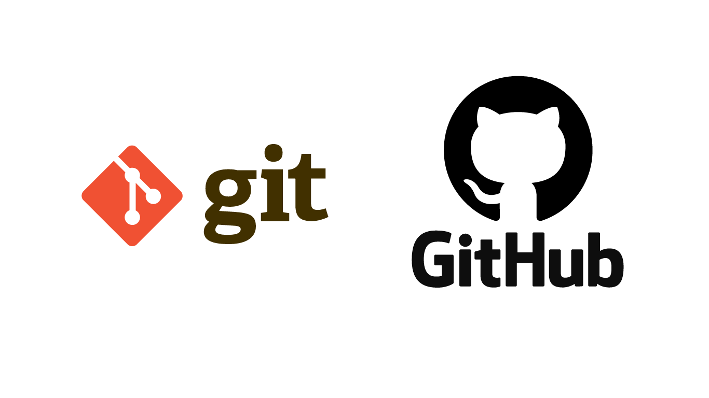
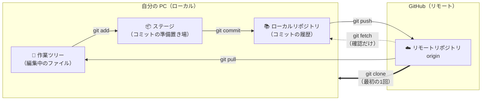
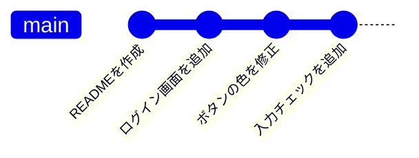
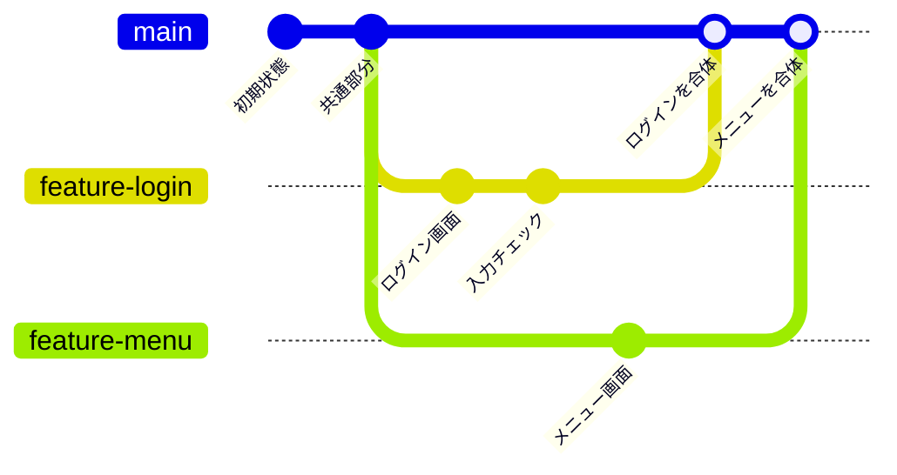
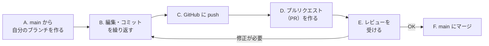
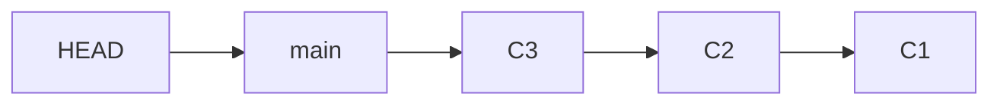
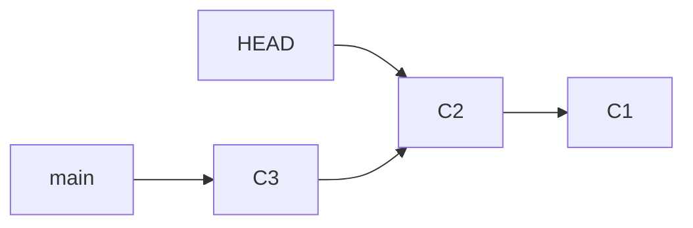

# 01. Git の仕組みと用語

← 前へ [00. 導入・初期設定](./00_Git導入・初期設定.md) ｜ 次へ → [02. CUI 基本編](./02_CUI基本編.md)

コマンドやボタンを覚える前に、**Git が何をしているのか**をざっくり理解しておきます。ここが分かっていると、CUI でも GUI でも迷いにくくなります。CUI 編・GUI 編を読んでいて言葉が分からなくなったら、ここに戻ってきてください。

## 目次

1. [Git と GitHub とは](#1-git-と-github-とは)
2. [3つの場所とデータの流れ](#2-3つの場所とデータの流れ)
3. [コミットとブランチ](#3-コミットとブランチ)
4. [用語集](#4-用語集)

---

## 1. Git と GitHub とは



### Git（ギット）

ファイルの**変更履歴を記録・管理するツール**（バージョン管理システム）です。自分の PC の中で動きます。

こんな経験はありませんか？

```
レポート.docx
レポート_最終.docx
レポート_最終_修正版.docx
レポート_最終_修正版_本当に最終.docx
```

Git を使うと、**ファイルは1つのまま**で「いつ・誰が・何を変えたか」が全部記録され、好きな時点に戻れます。

### GitHub（ギットハブ）

Git で管理しているデータを**インターネット上に保存・共有するサービス**です。

| | Git | GitHub |
|---|---|---|
| 正体 | 管理するための**ツール** | 共有するための**Web サービス** |
| 動く場所 | 自分の PC | インターネット上 |
| たとえ | 履歴管理の仕組み | Git の置き場所＋チーム作業の場 |

### 何が嬉しいの？

- 間違えても**元に戻せる**
- 複数人が**同じファイルを同時に**編集しても、あとで合体できる
- 誰がいつ何を変えたか**追跡できる**
- PC が壊れても GitHub にデータが残る

---

## 2. 3つの場所とデータの流れ

Git では、ファイルの変更が次の場所を順番に移動していきます。**この図が Git のすべての基本**です。



| 場所 | 何があるか | たとえ |
|---|---|---|
| **作業ツリー** | 今エディタで編集しているファイル | 机の上の下書き |
| **ステージ** | 「次のコミットに入れる」と選んだ変更 | 提出用の封筒に入れた書類 |
| **ローカルリポジトリ** | 自分の PC に保存された履歴 | 手元のファイル棚 |
| **リモートリポジトリ** | GitHub に保存された履歴（みんなで共有） | 共有の書類棚 |

> **なぜステージがあるの？**
> 10個のファイルを編集しても、「このうち3つだけを1つのまとまりとして記録したい」ことがあります。ステージで**コミットに含めるものを選べる**ので、意味のまとまりごとに記録できます。

---

## 3. コミットとブランチ

### コミット＝セーブポイント

コミットは、ゲームのセーブポイントのようなものです。コミットするたびに履歴が1つずつ積み重なっていきます。



それぞれのコミットには、「誰が・いつ・何を変えたか・メッセージ」が記録されています。いつでも過去のコミットの状態に戻ったり、比べたりできます。

### ブランチ＝履歴の枝分かれ

ブランチは、**本流（main）に影響を与えずに作業するための別ルート**です。



- 各自が**自分のブランチ**で自由に作業する
- 完成したら **main に合体（マージ）** する
- 失敗しても main は無傷


### チーム開発の全体の流れ



この流れのうち、02 CUI 基本編で A〜C を、03 CUI 応用編で D〜F を扱います。

---

## 4. 用語集

### 場所に関する用語

| 用語 | 意味 |
|---|---|
| **リポジトリ (repository / repo)** | 管理対象のフォルダ＋その変更履歴の全体 |
| **ローカルリポジトリ** | 自分の PC 内のリポジトリ |
| **リモートリポジトリ** | GitHub 上のリポジトリ |
| **origin** | リモートリポジトリにつけられた**標準の呼び名** |
| **作業ツリー（ワーキングツリー）** | 実際にファイルを編集している場所 |
| **ステージ（ステージングエリア / index）** | コミット前の「準備置き場」 |

### 履歴に関する用語

| 用語 | 意味 |
|---|---|
| **コミット (commit)** | 変更を「1つの記録」として保存すること。または、その記録そのもの |
| **コミットメッセージ** | コミットにつける「何を変えたか」の説明文 |
| **コミット ID（ハッシュ）** | コミットごとにつく固有の番号（例：`a1b2c3d`）。過去のコミットを指定するときに使う |
| **履歴 (log)** | コミットが時系列に並んだもの |
| **差分 (diff)** | 変更前と変更後の違い |
| **HEAD** | 「今自分がいる場所（今いるブランチの最新コミット）」を指す目印 |

### 操作に関する用語

| 用語 | 意味 |
|---|---|
| **clone（クローン）** | GitHub のリポジトリを PC に**丸ごとコピー**する（最初に1回だけ） |
| **add（ステージ）** | 変更をステージに載せる |
| **push（プッシュ）** | 自分のコミットを GitHub に**送る** |
| **pull（プル）** | GitHub の最新の内容を PC に**取り込む**（fetch ＋ merge） |
| **fetch（フェッチ）** | GitHub の最新情報を**確認だけ**する（自分のファイルは変わらない） |

### ブランチに関する用語

| 用語 | 意味 |
|---|---|
| **ブランチ (branch)** | 履歴の「枝分かれ」 |
| **main ブランチ** | 本流のブランチ。完成版を置く場所 |
| **switch / checkout** | ブランチを切り替える。切り替えると、作業ツリーのファイルがそのブランチの内容に置き換わる |
| **マージ (merge)** | 別のブランチの変更を合体させる |
| **リベース (rebase)** | 自分のコミットを、別のブランチの先端に付け替える（03 応用編で扱う） |
| **コンフリクト (conflict)** | 同じ場所を別々に編集して、**自動で合体できない**状態 |
| **プルリクエスト (Pull Request / PR)** | 「自分の変更を main に取り込んでください」と GitHub 上で依頼する機能 |

### 取り消し・退避に関する用語

| 用語 | 意味 |
|---|---|
| **未コミットの変更** | 編集したがまだコミットしていない変更 |
| **スタッシュ (stash)** | 未コミットの変更を**一時的に退避**させる（取り置き） |
| **apply / pop** | 退避した変更を戻す。pop は戻したあとスタッシュからも削除する |
| **シェルフ (shelve)** | IntelliJ IDEA 独自の退避機能。スタッシュとほぼ同じ働き |
| **restore** | 未コミットの変更を取り消す |
| **reset** | ブランチを過去のコミットまで巻き戻す（履歴が消える） |
| **revert** | 過去のコミットを「打ち消すコミット」を新しく作る（履歴は残る） |
| **reflog** | HEAD が動いた記録。消えたように見えるコミットを探すときに使う |

### 発展的な用語

最初は読み飛ばして構いません。エラーメッセージや解説記事で見かけたときの辞書として使ってください。

#### 内部の仕組み

| 用語 | 意味 |
|---|---|
| **ref（参照）** | コミットを指す「名前」の総称。ブランチやタグも、実体は特定のコミットを指す ref |
| **オブジェクト (object)** | Git が内部に保存するデータ。blob（ファイルの中身）、tree（フォルダ構造）、commit、tag の4種類 |
| **SHA-1 / ハッシュ** | オブジェクトの内容から計算される40桁の ID。コミット ID の正体（普段は先頭7桁ほどで指定する） |
| **親コミット (parent)** | あるコミットの1つ前のコミット。マージコミットだけは親を2つ持つ |
| **`HEAD~1` / `HEAD^`** | HEAD の1つ前のコミット。`HEAD~3` なら3つ前 |
| **追跡されている (tracked) / 未追跡 (untracked)** | Git の管理対象になっているファイル／まだ管理対象になっていない新規ファイル |
| **`.gitignore`** | 管理対象から除外するファイルのパターンを書く設定ファイル |
| **dangling commit** | どのブランチ・タグからも辿れなくなったコミット。reflog に残っている間は復元できるが、いずれ自動削除される |
| **ガベージコレクション (gc)** | 不要になったオブジェクトを整理・圧縮する処理。通常は自動で動く |

#### HEAD とブランチの状態

| 用語 | 意味 |
|---|---|
| **デタッチド HEAD (detached HEAD)** | HEAD がブランチではなく**コミットを直接指している状態**。過去のコミットやタグを `checkout` / `switch --detach` したときになる（下で詳しく解説） |
| **リモート追跡ブランチ (remote-tracking branch)** | `origin/main` のように、**リモートの最後に確認した状態**を手元に記録したもの。`fetch` / `pull` / `push` のときだけ更新される。自分では直接編集できない |
| **上流ブランチ (upstream)** | ローカルブランチと対応づけられたリモートのブランチ。設定すると、引数なしの `git push` / `git pull` が使える |
| **ahead / behind** | ローカルが上流より進んでいる（未 push のコミットがある）／遅れている（未 pull のコミットがある）状態 |
| **diverged（分岐）** | ローカルとリモートの**両方に互いにないコミットがある**状態。pull（マージ or リベース）で解消する |

#### マージ・履歴操作

| 用語 | 意味 |
|---|---|
| **fast-forward（早送り）** | 分岐していないとき、マージ先のブランチ名を**先に進めるだけ**で済むマージ。マージコミットは作られない |
| **マージコミット (merge commit)** | 2つのブランチを合体させたときに作られる、親を2つ持つコミット |
| **3-way マージ** | 2つのブランチの先端と、その共通の祖先（**マージベース**）の3つを比べて合体させる方式 |
| **squash（スカッシュ）** | 複数のコミットを**1つにまとめる**こと。GitHub の「Squash and merge」もこれ |
| **cherry-pick** | 別のブランチの**特定のコミットだけ**を、今のブランチにコピーして取り込む |
| **amend** | 直前のコミットを**作り直す**（メッセージの修正や、入れ忘れたファイルの追加）。コミット ID が変わる |
| **interactive rebase (`rebase -i`)** | コミットの並べ替え・統合・メッセージ変更をまとめて行うリベース |
| **ours / theirs** | コンフリクト解消時の呼び名。マージでは ours が「今いるブランチ」、theirs が「取り込む側」（リベースでは**逆になる**ので注意） |

#### リモート・共有に関する用語

| 用語 | 意味 |
|---|---|
| **フォーク (fork)** | 他人のリポジトリを**自分の GitHub アカウントにコピー**すること。OSS への貢献でよく使う |
| **upstream（リモート名）** | フォーク元のリポジトリにつける慣習的な名前。ブランチの「上流」とは別の意味で使われるので注意 |
| **force push (`--force`)** | リモートの履歴を**強制的に上書き**する push。他の人のコミットを消す危険がある。使うなら `--force-with-lease` が安全 |
| **protected branch** | 直接 push や force push を禁止し、PR とレビューを必須にできるブランチ（main によく設定する） |
| **タグ (tag)** | 特定のコミットに付ける**動かない目印**（例：`v1.0.0`）。ブランチと違い、コミットしても進まない |
| **シャロークローン (shallow clone)** | 履歴の一部だけを取得する軽量クローン（`--depth 1`）。CI でよく使われる |
| **サブモジュール (submodule)** | 別のリポジトリを、自分のリポジトリの中に**特定のコミットで固定して**埋め込む仕組み |
| **フック (hook)** | commit や push の前後に自動で実行されるスクリプト（例：コミット前に自動でコードを整形） |

#### 調査・便利機能

| 用語 | 意味 |
|---|---|
| **blame** | ファイルの**各行を最後に変更した人とコミット**を表示する。IntelliJ では「Annotate」 |
| **bisect** | 二分探索で「**どのコミットでバグが入ったか**」を効率よく特定する |
| **worktree** | 1つのリポジトリから、**複数のブランチを別フォルダで同時に**開く機能 |

### 補足：デタッチド HEAD とは

通常、HEAD は**ブランチを指し**、そのブランチが最新コミットを指しています。コミットするとブランチごと進みます。



過去のコミット（例：C2）を直接 `checkout` すると、**HEAD がブランチを経由せず、コミットを直接指す**状態になります。これが**デタッチド HEAD**（HEAD が切り離された状態）です。



**何が問題か**：この状態でコミットすると、そのコミットはどのブランチにも属しません。別のブランチに切り替えた瞬間に「誰からも指されないコミット」（dangling commit）になり、見失います。

**使いどころ**：「過去のある時点の状態を**見る・動かして確認するだけ**」なら、安全で便利です。

**抜け出し方**

| やりたいこと | 方法 |
|---|---|
| 何も変更していない、見終わった | `git switch main` など、元のブランチに戻る |
| デタッチ中にコミットしてしまい、残したい | **切り替える前に** `git switch -c 新しいブランチ名` でブランチを作る |
| 切り替えてしまって見失った | `git reflog` でコミット ID を探し、`git switch -c 新しいブランチ名 <コミットID>` で復活させる |

> **見分け方**：`git status` で `HEAD detached at ...` と表示されます。VS Code では左下のブランチ名の場所にコミット ID が表示され、IntelliJ では `HEAD (Detached)` と表示されます。

---

← 前へ [00. 導入・初期設定](./00_Git導入・初期設定.md) ｜ 次へ → [02. CUI 基本編](./02_CUI基本編.md)
