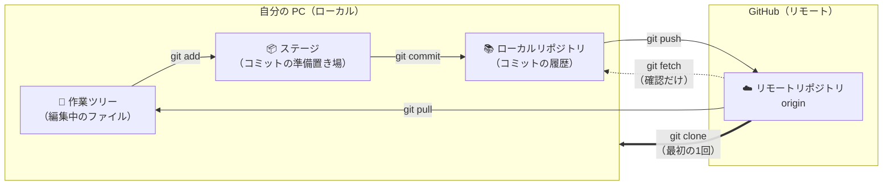
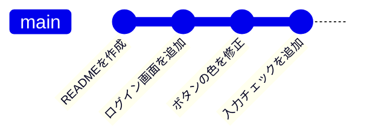
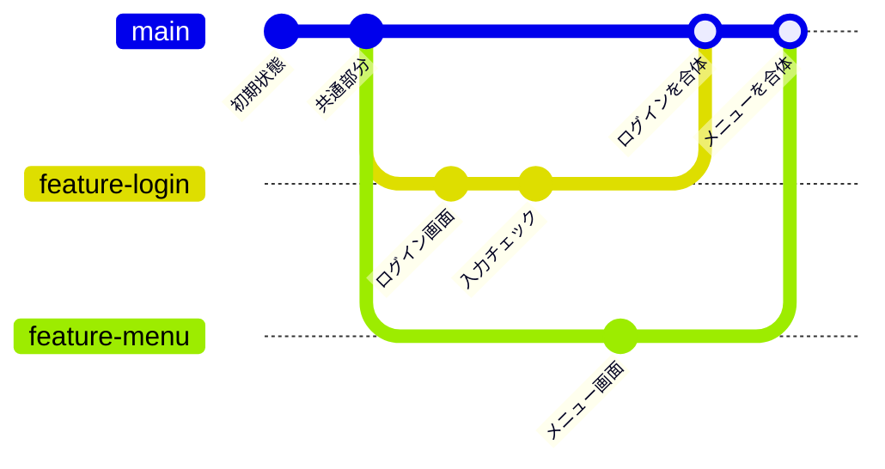
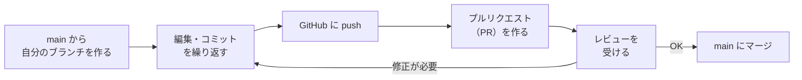

# 01. Git の仕組みと用語

← 前へ [00. 導入・初期設定](./00_Git導入・初期設定.md) ｜ 次へ → [02. CUI 基本編](./02_CUI基本編.md)

コマンドやボタンを覚える前に、**Git が何をしているのか**をざっくり理解しておきます。ここが分かっていると、CUI でも GUI でも迷いにくくなります。CUI 編・GUI 編を読んでいて言葉が分からなくなったら、ここに戻ってきてください。

## 目次

1. [Git と GitHub とは](#1-git-と-github-とは)
2. [3つの場所とデータの流れ](#2-3つの場所とデータの流れ)
3. [コミットとブランチ](#3-コミットとブランチ)
4. [用語集](#4-用語集)

---

## 1. Git と GitHub とは


### Git（ギット）

ファイルの**変更履歴を記録・管理するツール**（バージョン管理システム）です。自分の PC の中で動きます。

こんな経験はありませんか？

```
レポート.docx
レポート_最終.docx
レポート_最終_修正版.docx
レポート_最終_修正版_本当に最終.docx
```

Git を使うと、**ファイルは1つのまま**で「いつ・誰が・何を変えたか」が全部記録され、好きな時点に戻れます。

### GitHub（ギットハブ）

Git で管理しているデータを**インターネット上に保存・共有するサービス**です。

| | Git | GitHub |
|---|---|---|
| 正体 | 管理するための**ツール** | 共有するための**Web サービス** |
| 動く場所 | 自分の PC | インターネット上 |
| たとえ | 履歴管理の仕組み | Git の置き場所＋チーム作業の場 |

### 何が嬉しいの？

- 間違えても**元に戻せる**
- 複数人が**同じファイルを同時に**編集しても、あとで合体できる
- 誰がいつ何を変えたか**追跡できる**
- PC が壊れても GitHub にデータが残る

---

## 2. 3つの場所とデータの流れ

Git では、ファイルの変更が次の場所を順番に移動していきます。**この図が Git のすべての基本**です。



| 場所 | 何があるか | たとえ |
|---|---|---|
| **作業ツリー** | 今エディタで編集しているファイル | 机の上の下書き |
| **ステージ** | 「次のコミットに入れる」と選んだ変更 | 提出用の封筒に入れた書類 |
| **ローカルリポジトリ** | 自分の PC に保存された履歴 | 手元のファイル棚 |
| **リモートリポジトリ** | GitHub に保存された履歴（みんなで共有） | 共有の書類棚 |

> **なぜステージがあるの？**
> 10個のファイルを編集しても、「このうち3つだけを1つのまとまりとして記録したい」ことがあります。ステージで**コミットに含めるものを選べる**ので、意味のまとまりごとに記録できます。

参考：同じ内容を表した図


---

## 3. コミットとブランチ

### コミット＝セーブポイント

コミットは、ゲームのセーブポイントのようなものです。コミットするたびに履歴が1つずつ積み重なっていきます。



それぞれのコミットには、「誰が・いつ・何を変えたか・メッセージ」が記録されています。いつでも過去のコミットの状態に戻ったり、比べたりできます。

### ブランチ＝履歴の枝分かれ

ブランチは、**本流（main）に影響を与えずに作業するための別ルート**です。



- 各自が**自分のブランチ**で自由に作業する
- 完成したら **main に合体（マージ）** する
- 失敗しても main は無傷


### チーム開発の全体の流れ



この流れのうち、02 CUI 基本編で A〜C を、03 CUI 応用編で D〜F を扱います。

---

## 4. 用語集

### 場所に関する用語

| 用語 | 意味 |
|---|---|
| **リポジトリ (repository / repo)** | 管理対象のフォルダ＋その変更履歴の全体 |
| **ローカルリポジトリ** | 自分の PC 内のリポジトリ |
| **リモートリポジトリ** | GitHub 上のリポジトリ |
| **origin** | リモートリポジトリにつけられた**標準の呼び名** |
| **作業ツリー（ワーキングツリー）** | 実際にファイルを編集している場所 |
| **ステージ（ステージングエリア / index）** | コミット前の「準備置き場」 |

### 履歴に関する用語

| 用語 | 意味 |
|---|---|
| **コミット (commit)** | 変更を「1つの記録」として保存すること。または、その記録そのもの |
| **コミットメッセージ** | コミットにつける「何を変えたか」の説明文 |
| **コミット ID（ハッシュ）** | コミットごとにつく固有の番号（例：`a1b2c3d`）。過去のコミットを指定するときに使う |
| **履歴 (log)** | コミットが時系列に並んだもの |
| **差分 (diff)** | 変更前と変更後の違い |
| **HEAD** | 「今自分がいる場所（今いるブランチの最新コミット）」を指す目印 |

### 操作に関する用語

| 用語 | 意味 |
|---|---|
| **clone（クローン）** | GitHub のリポジトリを PC に**丸ごとコピー**する（最初に1回だけ） |
| **add（ステージ）** | 変更をステージに載せる |
| **push（プッシュ）** | 自分のコミットを GitHub に**送る** |
| **pull（プル）** | GitHub の最新の内容を PC に**取り込む**（fetch ＋ merge） |
| **fetch（フェッチ）** | GitHub の最新情報を**確認だけ**する（自分のファイルは変わらない） |

### ブランチに関する用語

| 用語 | 意味 |
|---|---|
| **ブランチ (branch)** | 履歴の「枝分かれ」 |
| **main ブランチ** | 本流のブランチ。完成版を置く場所 |
| **switch / checkout** | ブランチを切り替える。切り替えると、作業ツリーのファイルがそのブランチの内容に置き換わる |
| **マージ (merge)** | 別のブランチの変更を合体させる |
| **リベース (rebase)** | 自分のコミットを、別のブランチの先端に付け替える（03 応用編で扱う） |
| **コンフリクト (conflict)** | 同じ場所を別々に編集して、**自動で合体できない**状態 |
| **プルリクエスト (Pull Request / PR)** | 「自分の変更を main に取り込んでください」と GitHub 上で依頼する機能 |

### 取り消し・退避に関する用語

| 用語 | 意味 |
|---|---|
| **未コミットの変更** | 編集したがまだコミットしていない変更 |
| **スタッシュ (stash)** | 未コミットの変更を**一時的に退避**させる（取り置き） |
| **apply / pop** | 退避した変更を戻す。pop は戻したあとスタッシュからも削除する |
| **シェルフ (shelve)** | IntelliJ IDEA 独自の退避機能。スタッシュとほぼ同じ働き |
| **restore** | 未コミットの変更を取り消す |
| **reset** | ブランチを過去のコミットまで巻き戻す（履歴が消える） |
| **revert** | 過去のコミットを「打ち消すコミット」を新しく作る（履歴は残る） |
| **reflog** | HEAD が動いた記録。消えたように見えるコミットを探すときに使う |

---

← 前へ [00. 導入・初期設定](./00_Git導入・初期設定.md) ｜ 次へ → [02. CUI 基本編](./02_CUI基本編.md)
