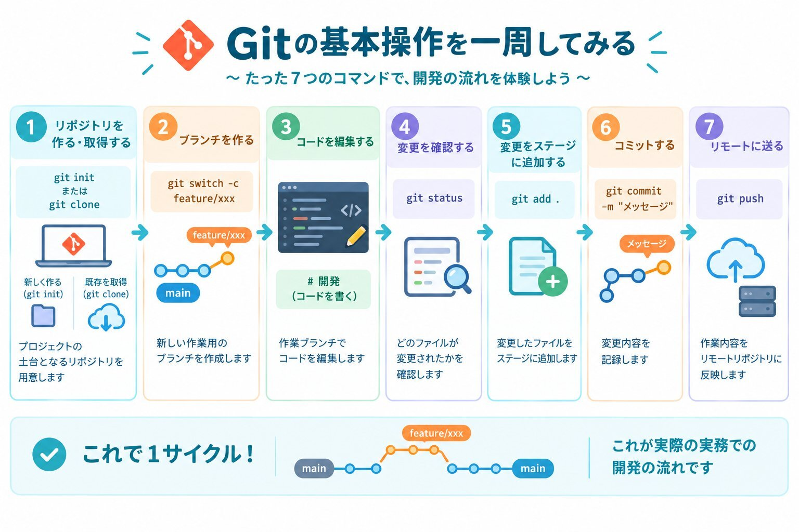
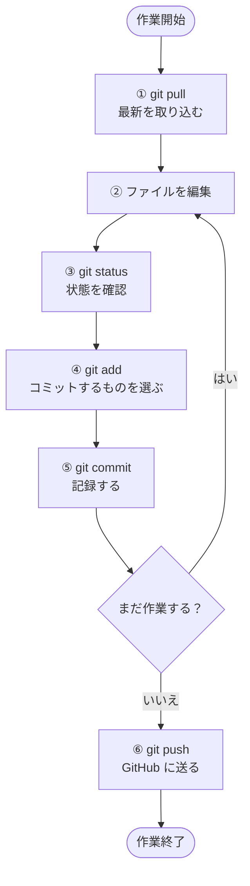
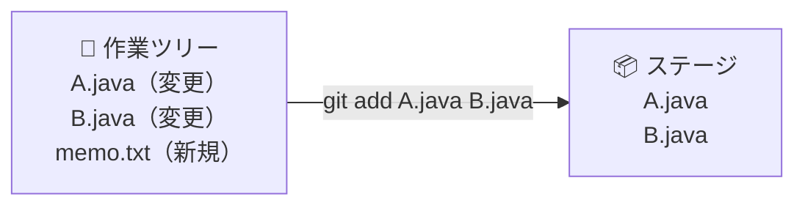
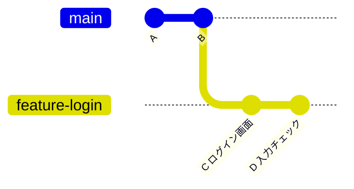
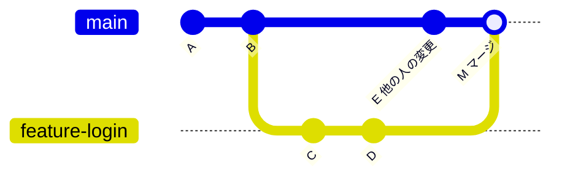
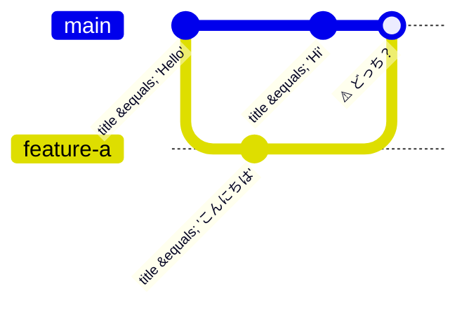
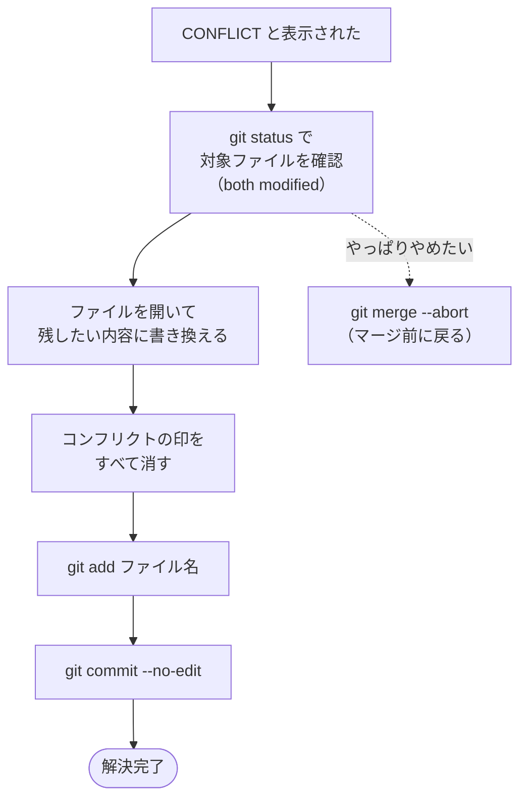

# 02. CUI 基本編

← 前へ [01. Git の仕組みと用語](./01_Gitの仕組みと用語.md) ｜ 次へ → [03. CUI 応用編](./03_CUI応用編.md)

コマンド（CUI）で、毎日の Git 作業ができるようになることが目標です。

> **ターミナルはどこで開く？**
> **VSCode や IntelliJ IDEA の中にあるターミナル**（統合ターミナル）を使うのがおすすめです。あとで GUI 編に進んだとき、同じ画面のまま「さっきのコマンドはこのボタン」と見比べられます。
> - VSCode：メニューの `ターミナル` → `新しいターミナル`（`` Ctrl + ` ``）
> - IntelliJ IDEA：左下の **Terminal** アイコン（`Alt + F12` / Mac は `⌥ + F12`）

## 目次

1. [毎回の作業の流れ](#1-毎回の作業の流れ)
2. [状態を確認する](#2-状態を確認する)
3. [変更を記録して送る](#3-変更を記録して送る)
4. [履歴と差分を見る](#4-履歴と差分を見る)
5. [ブランチを使う](#5-ブランチを使う)
6. [マージする](#6-マージする)
7. [コンフリクトを解決する](#7-コンフリクトを解決する)
8. [良いコミットメッセージの書き方](#8-良いコミットメッセージの書き方)
9. [やってはいけないこと](#9-やってはいけないこと)
10. [困ったときは](#10-困ったときは)
11. [コマンド早見表](#11-コマンド早見表)

---

## 1. 毎回の作業の流れ





```bash
git pull                          # ① 最新を取り込む
# ……ファイルを編集……              # ②
git status                        # ③ 状態確認
git add .                         # ④ 選ぶ
git commit -m "変更内容の説明"      # ⑤ 記録
git push                          # ⑥ 送る
```

> **作業を始める前に必ず pull、終わったら push** を習慣にしましょう。

---

## 2. 状態を確認する

```bash
git status
```

**迷ったらまず `git status`** です。今どのブランチにいるか、どのファイルが変更されたか、ステージ済みかが分かります。

```
On branch main
Changes to be committed:                    ← ステージ済み（次のコミットに入る）
  (use "git restore --staged <file>..." to unstage)
        modified:   README.md

Changes not staged for commit:              ← 変更したがステージしていない
  (use "git add <file>..." to update what will be committed)
        modified:   src/Main.java

Untracked files:                            ← 新しく作ったファイル（Git がまだ知らない）
  (use "git add <file>..." to include in what will be committed)
        memo.txt
```

| 表示 | 意味 | 01 の図でいうと |
|---|---|---|
| `Changes to be committed` | ステージ済み | ステージにある |
| `Changes not staged for commit` | 変更したがステージしていない | 作業ツリーにある |
| `Untracked files` | Git がまだ管理していない新規ファイル | 作業ツリーにある（未追跡） |
| `nothing to commit, working tree clean` | 変更なし | すべてコミット済み |

> Git は**次に使うべきコマンドのヒント**（`use "git ..."`）を表示してくれます。よく読みましょう。

---

## 3. 変更を記録して送る

### 3-1. 最新を取り込む（pull）

```bash
git pull
```

他の人が GitHub に送った変更を、自分の PC に取り込みます。

### 3-2. コミットするファイルを選ぶ（add）

```bash
git add ファイル名      # 特定のファイルだけ
git add .               # 変更したもの全部（. は「今のフォルダ以下すべて」）
```



> `git add .` は便利ですが、**入れたくないファイル（メモや設定ファイル）まで入ってしまう**ことがあります。`git add .` の前後に `git status` で確認しましょう。

### 3-3. 記録する（commit）

```bash
git commit -m "ログイン画面に入力チェックを追加"
```

`-m` の後ろがコミットメッセージです。ステージにある変更だけが記録されます。

### 3-4. GitHub に送る（push）

```bash
git push
```

ブランチを初めて push するときは、`-u origin ブランチ名` が必要です（[5章](#5-ブランチを使う)）。

### 3-5. 実行例

```bash
$ git status
On branch feature-login
Changes not staged for commit:
        modified:   src/Login.java

$ git add src/Login.java
$ git commit -m "ログイン画面に入力チェックを追加"
[feature-login 3f2a1c9] ログイン画面に入力チェックを追加
 1 file changed, 12 insertions(+), 2 deletions(-)

$ git push
To https://github.com/xxxx/yyyy.git
   8d4e2b1..3f2a1c9  feature-login -> feature-login
```

---

## 4. 履歴と差分を見る

### 履歴（log）

```bash
git log --oneline          # 1行ずつ簡潔に表示
git log --oneline --graph  # ブランチの分かれ方も表示
```

```
* 3f2a1c9 (HEAD -> feature-login, origin/feature-login) ログイン画面に入力チェックを追加
* 8d4e2b1 ログイン画面を追加
* 1a2b3c4 (origin/main, main) README を作成
```

- 左の英数字が**コミット ID**（取り消しなどで使います）
- `HEAD ->` が**今いる場所**
- `origin/〇〇` は**GitHub 上のブランチ**の位置

> 表示が長くて画面が切り替わったときは、`q` キーで終了します。

### 差分（diff）

```bash
git diff             # まだステージしていない変更
git diff --staged    # ステージ済み（次にコミットされる）変更
```

```diff
-    if (name == null) {
+    if (name == null || name.isEmpty()) {
         return false;
     }
```

`-` が削除された行、`+` が追加された行です。

---

## 5. ブランチを使う

自分専用のブランチで作業すると、main や他の人の作業を壊さずに済みます。

```bash
git branch                       # ブランチ一覧（* が今いる場所）
git switch -c feature-login      # ブランチを作って移動
git switch main                  # 既存ブランチへ移動
```



> **ブランチ名のつけ方**：`feature-機能名`、`fix-直す内容` のように、何の作業か分かる名前にします（英数字とハイフンがおすすめ）。

### ブランチを作るときは main を最新にしてから

```bash
git switch main          # ① main に移動
git pull                 # ② main を最新にする
git switch -c feature-login   # ③ 最新の main からブランチを作る
```

古い main からブランチを作ると、あとでコンフリクトが起きやすくなります。

### 初めて push するブランチ

```bash
git push -u origin feature-login
```

`-u` は「このブランチは GitHub 上の同じ名前のブランチと対応させる」という設定です。2回目以降は `git push` だけで済みます。

### 未コミットの変更があるときにブランチを切り替えると？

コミットしていない変更が残ったまま `git switch` すると、次のどちらかになります。

| 状況 | 何が起きるか |
|---|---|
| 切り替え先のブランチと**ぶつからない**変更 | 変更を持ったまま切り替わる（切り替え先のブランチで作業が続く） |
| 切り替え先のブランチと**ぶつかる**変更 | `error: Your local changes ... would be overwritten` と出て切り替えが止まる |

> **基本は「切り替える前にコミットする」**。コミットしたくない場合の退避方法（stash）は [03 応用編](./03_CUI応用編.md#5-作業を一時的に退避するstash)で扱います。

---

## 6. マージする

別のブランチの変更を、今いるブランチに取り込みます。

```bash
git merge 取り込みたいブランチ名
```

> **merge の向きに注意**：`git merge` は「**今いるブランチ**に、**指定したブランチ**の変更を取り込む」コマンドです。**先に取り込み先のブランチへ移動**してから実行します。

例：`feature-login` の作業を `main` に合体したい場合

```bash
git switch main            # ① 取り込み先（main）に移動
git merge feature-login    # ② feature-login の変更を main に取り込む
```



合体後、`main` は `feature-login` の内容を含み、`feature-login` 自体は変わりません。

> チーム開発では、main へのマージは**コマンドではなくプルリクエスト（PR）で行う**のが基本です。PR の使い方は [03 応用編](./03_CUI応用編.md#6-プルリクエストを使う)で扱います。

---

## 7. コンフリクトを解決する

### なぜ起きる？

**同じファイルの同じ場所**を、2つのブランチで別々に書き換えると、Git はどちらを残すべきか判断できません。これがコンフリクトです。



### 起きるとこう表示される

```
$ git merge feature-a
Auto-merging src/Main.java
CONFLICT (content): Merge conflict in src/Main.java
Automatic merge failed; fix conflicts and then commit the result.
```

ファイルを開くと、次のような**印**が入っています。

```
String title = "こんにちは";
```

| 印 | 意味 |
|---|---|
| `<<<<<<< HEAD` 〜 `=======` | **今いるブランチ**（自分側）の内容 |
| `=======` 〜 `>>>>>>> feature-a` | **取り込もうとしたブランチ**（相手側）の内容 |

### 解決の手順



1. `git status` で、コンフリクトしているファイル（`both modified`）を確認する。
2. ファイルを開き、**残したい内容に手動で書き換える**（片方を残す／両方を組み合わせる）。
3. 印（`<<<<<<<` `=======` `>>>>>>>`）を**すべて消す**。
4. `git add ファイル名` → `git commit --no-edit` で完了（`--no-edit` をつけると、自動で用意されたメッセージ「Merge branch ...」がそのまま使われます）。

書き換えた例：

```java
String title = "こんにちは";
```

> **どちらを残すべきか分からないときは、勝手に決めずに相手と相談しましょう。** 落ち着いてやり直したいときは `git merge --abort` でマージ前の状態に戻れます。

> GUI では、コンフリクトをボタンで解決できる専用の画面があります（[04 VSCode編](./04_GUI_VSCode編.md) / [05 IntelliJ編](./05_GUI_IntelliJ編.md)）。

---

## 8. 良いコミットメッセージの書き方

| 悪い例 | 良い例 |
|---|---|
| `変更` | `課題2のグラフ描画関数を追加` |
| `修正` | `ログイン画面の文字化けを修正` |
| `aaa` | `README に環境構築手順を追記` |

- **何をしたかが1行で分かる**ように書く
- コミットは**意味のまとまりごと**に小さく分ける（「ログイン画面の追加」と「README の修正」は別のコミットにする）
- 「1か月後の自分が見て分かるか？」を基準にする

---

## 9. やってはいけないこと

- ❌ **パスワードや API キーをコミットしない**（GitHub に上げると流出の恐れ。一度上げたら消しても履歴に残る）
- ❌ **`git push --force` を安易に使わない**（他人の履歴を上書きして壊す可能性がある。詳しくは [03 応用編](./03_CUI応用編.md#4-コミットやプッシュを取り消す)）
- ❌ **main ブランチで直接作業しない**（自分のブランチで作業してから PR で取り込む）
- ❌ 巨大なファイル（動画・データセットなど）を入れない
- ✅ 作業前に `git pull`、作業後に `git push`
- ✅ こまめにコミットする（セーブポイントは多いほうが安心）

---

## 10. 困ったときは

| 状況 | 対処 |
|---|---|
| 何が起きているか分からない | まず `git status`。表示されたヒントをよく読む |
| push が拒否された（rejected） | GitHub 側に自分が持っていない更新がある。`git pull` してから、もう一度 `git push` |
| 編集を取り消したい（コミット前） | `git restore ファイル名`（⚠️ 取り消した変更は元に戻せません） |
| add を取り消したい | `git restore --staged ファイル名` |
| 直前のコミットメッセージを間違えた（push 前） | `git commit --amend -m "正しいメッセージ"` |
| コミットや push を取り消したい | [03 応用編 4章](./03_CUI応用編.md#4-コミットやプッシュを取り消す) |
| log の画面から抜けられない | `q` キーを押す |
| コミット時に変な画面（Vim）が開いた | `Esc` → `:wq` → `Enter` で保存して閉じる（`-m` をつけ忘れると開く） |

---

## 11. コマンド早見表

| やりたいこと | コマンド |
|---|---|
| 状態を見る | `git status` |
| 最新を取り込む | `git pull` |
| 変更をステージに載せる | `git add ファイル名` / `git add .` |
| 記録する | `git commit -m "メッセージ"` |
| GitHub に送る | `git push` |
| 新しいブランチを初めて送る | `git push -u origin ブランチ名` |
| 履歴を見る | `git log --oneline --graph` |
| 差分を見る | `git diff` / `git diff --staged` |
| ブランチ一覧 | `git branch` |
| ブランチを作って移動 | `git switch -c 名前` |
| ブランチを移動 | `git switch 名前` |
| 今いるブランチに別のブランチを取り込む | `git merge ブランチ名` |
| マージを中止する | `git merge --abort` |

---

← 前へ [01. Git の仕組みと用語](./01_Gitの仕組みと用語.md) ｜ 次へ → [03. CUI 応用編](./03_CUI応用編.md)
