# 03. CUI 応用編

← 前へ [02. CUI 基本編](./02_CUI基本編.md) ｜ 次へ → [04. GUI VSCode編](./04_GUI_VSCode編.md) / [05. GUI IntelliJ編](./05_GUI_IntelliJ編.md)

チーム開発で必ず出会う「main が先に進んでしまった」「間違えてコミット／push してしまった」「プルリクエストってどう使うの？」に対応できるようになることが目標です。

> 取り消し操作は**練習用リポジトリ**（[00 導入編 8章](./00_Git導入・初期設定.md#8-おすすめ練習用リポジトリを作る)）で一度試してから、本番で使いましょう。

## 目次

1. [履歴を見る習慣をつける](#1-履歴を見る習慣をつける)
2. [自分のブランチを最新の main に合わせる](#2-自分のブランチを最新の-main-に合わせる)
3. [参考：rebase で合わせる](#3-参考rebase-で合わせる)
4. [コミットやプッシュを取り消す](#4-コミットやプッシュを取り消す)
5. [作業を一時的に退避する（stash）](#5-作業を一時的に退避するstash)
6. [プルリクエストを使う](#6-プルリクエストを使う)
7. [ブランチの整理と .gitignore](#7-ブランチの整理と-gitignore)
8. [応用コマンド早見表](#8-応用コマンド早見表)

---

## 1. 履歴を見る習慣をつける

応用操作で失敗する原因のほとんどは「**今どこにいて、履歴がどうなっているか**」を確認せずに操作することです。操作の前後に、次のコマンドで履歴を見る習慣をつけましょう。

```bash
git log --oneline --graph --all
```

```
* 9c1d2e3 (origin/main, main) メニュー画面を追加       ← 他の人が main に入れた変更
| * 3f2a1c9 (HEAD -> feature-login) 入力チェックを追加  ← 自分の作業
| * 8d4e2b1 ログイン画面を追加
|/
* 1a2b3c4 README を作成
```

`--all` をつけると、自分のブランチだけでなく **main や GitHub 上のブランチ（`origin/〇〇`）も**表示されます。

### fetch と pull の違い

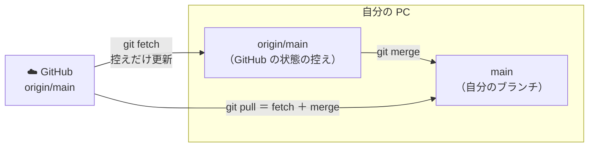

| コマンド | 何をする | 自分のファイルは変わる？ |
|---|---|---|
| `git fetch` | GitHub の最新状態を取ってきて、`origin/〇〇` を更新する | **変わらない**（確認だけ） |
| `git pull` | fetch したうえで、今いるブランチに merge する | 変わる |

> `git fetch` → `git log --oneline --graph --all` で「GitHub で何が起きたか」を先に見てから取り込むと、安全に作業できます。

---

## 2. 自分のブランチを最新の main に合わせる

### どんなときに必要？

自分が `feature-login` で作業している間に、他の人の PR が main にマージされることがあります。そのままにしておくと、

- 自分の PR にコンフリクトが表示される
- 他の人が作った新しい機能が、自分のブランチでは使えない

といった問題が起きます。そこで、**main の最新の変更を自分のブランチに取り込みます**。

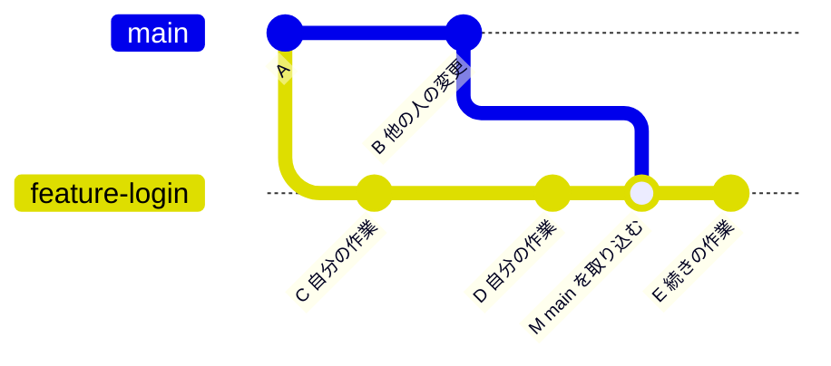

### 手順（おすすめ：merge）

```bash
git switch feature-login     # ① 自分のブランチにいることを確認
git status                   # ② 未コミットの変更がないことを確認（あればコミットする）
git fetch                    # ③ GitHub の最新を取ってくる
git merge origin/main        # ④ 最新の main を自分のブランチに取り込む
git push                     # ⑤ 取り込んだ結果を GitHub に送る
```

> `git fetch` と `git merge origin/main` は、`git pull origin main` の1行にまとめることもできます。

> **なぜ `main` ではなく `origin/main`？**
> 自分の PC の `main` は、最後に pull したときのままで古い可能性があります。`origin/main` は fetch 直後の **GitHub の最新の main** なので、確実に最新を取り込めます。

### コンフリクトが起きたら

[02 基本編 7章](./02_CUI基本編.md#7-コンフリクトを解決する) と同じ手順で解決します。

```bash
git status                    # both modified のファイルを確認
# ……ファイルを編集して印を消す……
git add ファイル名
git commit --no-edit          # マージコミットが作られる（メッセージは自動で入る）
git push
```

> やり直したいときは `git merge --abort` で、取り込む前の状態に戻れます。

### どのくらいの頻度で合わせる？

- **作業を始める前**（毎回）
- **PR を出す前**
- PR に「This branch has conflicts」と表示されたとき

こまめに合わせるほど、1回あたりのコンフリクトが小さくなります。

---

## 3. 参考：rebase で合わせる

> このセクションは**参考**です。慣れるまでは [2章の merge](#2-自分のブランチを最新の-main-に合わせる) を使ってください。

`rebase` は、自分のコミットを**最新の main の先端に付け替え**ます。マージコミットができないので、履歴が一直線できれいになります。

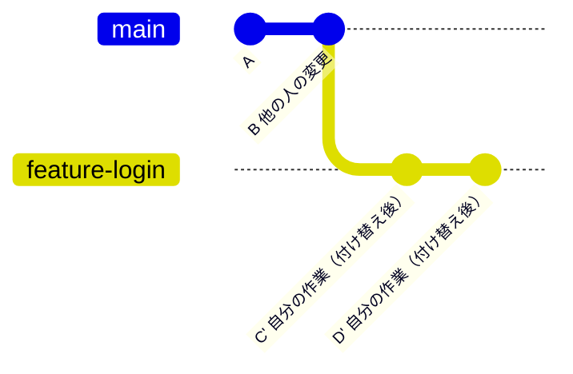

```bash
git fetch
git rebase origin/main
```

コンフリクトが起きたときは、ファイルを直して次を実行します（コミットごとに繰り返すことがあります）。

```bash
git add ファイル名
git rebase --continue     # 次のコミットへ進む
git rebase --abort        # やめて元に戻す
```

### merge と rebase の比較

| | merge | rebase |
|---|---|---|
| 履歴 | 枝分かれとマージコミットが残る | 一直線になる |
| 既存のコミット | そのまま | **作り直される**（コミット ID が変わる） |
| push 済みのブランチで使うと | 普通に `git push` できる | **`git push --force-with-lease` が必要** |
| コンフリクト解決 | 1回で済む | コミットごとに起きることがある |
| おすすめ | **初心者・チーム共有のブランチ** | 慣れた人が、自分だけのブランチで |

> ⚠️ **他の人も使っているブランチ（main など）では、絶対に rebase しないでください。** 他の人の履歴と食い違い、混乱の原因になります。

---

## 4. コミットやプッシュを取り消す

### まずはこの図で、使うコマンドを決める

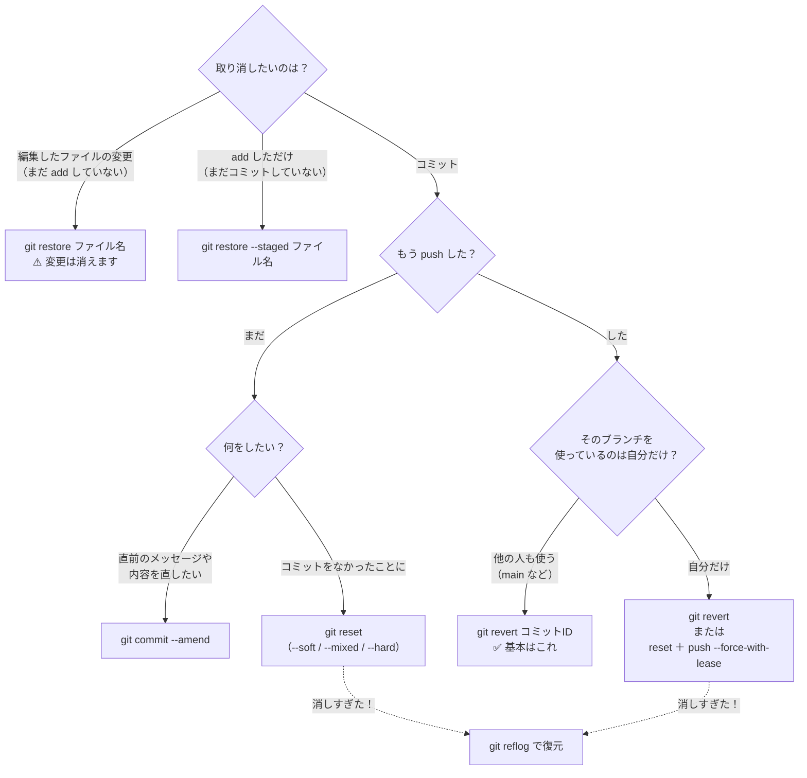

> **迷ったら `git revert`**。履歴を消さずに「打ち消すコミット」を足すだけなので、どんな状況でも安全です。

### 4-1. コミット前の変更を取り消す（restore）

```bash
git restore ファイル名           # 編集を取り消して、最後のコミットの状態に戻す
git restore --staged ファイル名  # add を取り消す（編集内容は残る）
```

> ⚠️ `git restore ファイル名` で取り消した編集は**元に戻せません**。

### 4-2. 直前のコミットを直す（amend）※push 前のみ

```bash
git commit --amend -m "正しいメッセージ"   # メッセージだけ直す
```

ファイルを入れ忘れたときは、add してから amend すると直前のコミットに追加できます。

```bash
git add 入れ忘れたファイル
git commit --amend --no-edit              # メッセージはそのままで追加
```

### 4-3. コミットをなかったことにする（reset）※push 前のみ

```bash
git reset --soft HEAD~1    # 直前の1コミットを取り消す
```

`HEAD~1` は「今の1つ前のコミット」という意味です。`HEAD~3` なら3つ前、コミット ID（例：`8d4e2b1`）を直接指定することもできます。

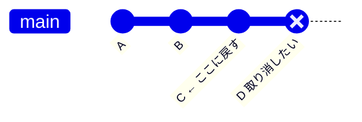

reset には3つのモードがあり、**取り消したコミットの変更がどこに残るか**が違います。

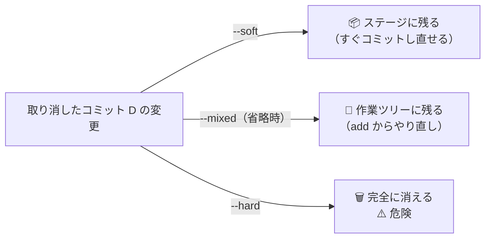

| モード            | コミット | ステージ      | 作業ツリー     | 使う場面                       |
| -------------- | ---- | --------- | --------- | -------------------------- |
| `--soft`       | 取り消す | 変更が**残る** | 変更が**残る** | コミットをまとめ直したい、メッセージから書き直したい |
| `--mixed`（省略時） | 取り消す | 空になる      | 変更が**残る** | add するファイルを選び直したい          |
| `--hard`       | 取り消す | 空になる      | **消える**   | 変更自体が不要（⚠️ 未コミットの変更も消えます）  |

> まずは `--soft` を使いましょう。変更が残るので、失敗しても困りません。

### 4-4. push 済みのコミットを取り消す（revert）

push 済みのコミットは、他の人がすでに pull しているかもしれません。履歴を消すのではなく、**「打ち消すコミット」を新しく作る** `revert` を使います。

```bash
git log --oneline              # 取り消したいコミットの ID を確認
git revert 3f2a1c9 --no-edit   # そのコミットを打ち消すコミットを作る
git push
```

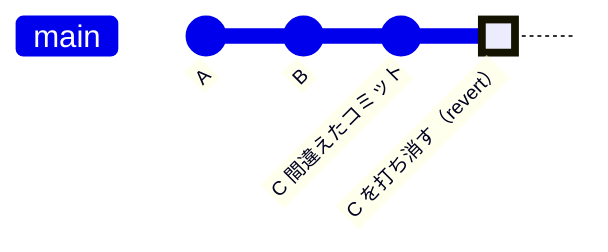

| | reset | revert |
|---|---|---|
| やり方 | 履歴を巻き戻す（コミットを消す） | 打ち消すコミットを足す |
| 履歴 | 消える | 残る（「取り消した」ことも記録される） |
| push 済みで使うと | force push が必要。他の人の環境と食い違う | 普通に push できる |
| 使う場面 | **push 前** | **push 後** |

> `--no-edit` をつけないと、メッセージを編集する画面（Vim など）が開きます。開いた場合は `Esc` → `:wq` → `Enter` で閉じます。

> マージコミットを revert するときは `git revert -m 1 コミットID` のように `-m 1` が必要です。迷ったらメンターに相談してください。

### 4-5. 自分だけのブランチで push を取り消す（reset ＋ force push）

**自分しか使っていないブランチ**なら、reset で履歴を巻き戻してから、GitHub 側も上書きできます。

```bash
git reset --soft HEAD~1           # 直前のコミットを取り消す
git push --force-with-lease       # GitHub 側を上書きする
```

> ⚠️ **`--force` ではなく `--force-with-lease` を使います。**
> `--force` は GitHub 側の内容を問答無用で上書きします。`--force-with-lease` は「自分が最後に見たときから GitHub 側が変わっていなければ上書きする」ので、他の人の push をうっかり消す事故を防げます。

> ⚠️ **main など、他の人も使うブランチでは force push しないでください。** その場合は 4-4 の revert を使います。

### 4-6. 消しすぎたときの最終手段（reflog）

`reset --hard` などで消してしまったコミットも、**しばらくの間は reflog に記録が残っています**。

```bash
git reflog
```

```
3f2a1c9 HEAD@{0}: reset: moving to HEAD~1
9e8d7c6 HEAD@{1}: commit: 入力チェックを追加     ← 消してしまったコミット
3f2a1c9 HEAD@{2}: commit: ログイン画面を追加
```

戻りたい時点のコミット ID を見つけたら、次のどちらかで復元します。

```bash
git reset --hard 9e8d7c6            # 今のブランチをその時点に戻す
git switch -c rescue 9e8d7c6        # その時点から新しいブランチを作る（安全）
```

> PowerShell で `HEAD@{1}` のような書き方を使うときは、`'HEAD@{1}'` のように引用符で囲みます。コミット ID を使えば引用符は不要です。

---

## 5. 作業を一時的に退避する（stash）

「作業の途中だけど、急いで別のブランチで作業したい」「コミットするほどではない変更がある」ときに、変更を**一時的に退避**できます。

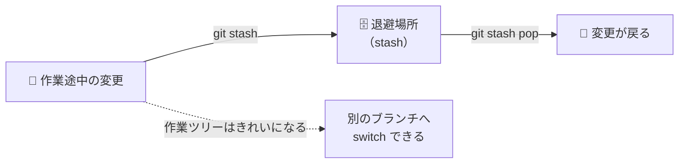

```bash
git stash                      # 変更を退避する
git stash -u                   # 新規ファイル（未追跡）も含めて退避する
git stash push -m "ログイン途中"  # メッセージをつけて退避する
git stash list                 # 退避した一覧
git stash pop                  # 最新の退避を戻す（一覧から消える）
git stash apply                # 最新の退避を戻す（一覧に残る）
git stash drop                 # 最新の退避を捨てる
```

### よくある使い方：急に別ブランチで作業する

```bash
git stash -u                  # ① 作業途中の変更を退避
git switch main               # ② 別のブランチへ
# ……急ぎの作業……
git switch feature-login      # ③ 元のブランチに戻る
git stash pop                 # ④ 退避した変更を戻す
```

### よくある使い方：間違ったブランチで作業を始めてしまった

```bash
git stash -u                  # ① 変更を退避
git switch 正しいブランチ      # ② 正しいブランチへ
git stash pop                 # ③ 正しいブランチで変更を戻す
```

> stash は「取り置き」なので、**長期間ためこまない**ようにしましょう。何を退避したか忘れがちです。

---

## 6. プルリクエストを使う

プルリクエスト（PR）は、「**自分のブランチの変更を main に取り込んでください**」と GitHub 上で依頼し、チームでレビューしてから取り込むための機能です。

### 全体の流れ

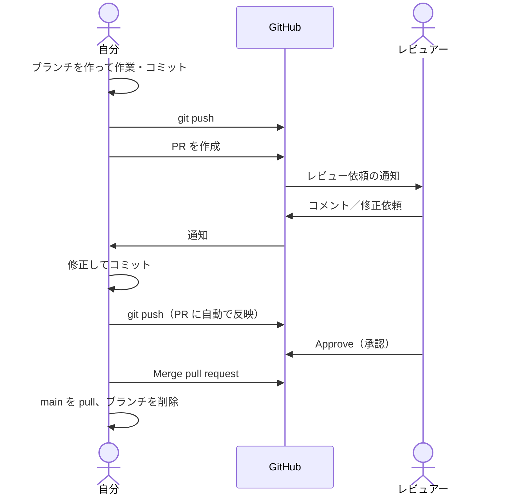

### 6-1. PR を出す前の準備

```bash
git switch feature-login
git fetch
git merge origin/main         # 最新の main を取り込んでおく（2章）
git push                      # 初回は git push -u origin feature-login
```

### 6-2. PR を作成する

1. GitHub のリポジトリページを開く。push 直後は黄色い帯に **Compare & pull request** ボタンが出るのでクリックする（出ない場合は **Pull requests** タブ → **New pull request**）。


2. 上部で **base: main ← compare: feature-login** になっていることを確認する（「どこに ← どこから」取り込むか）。
3. **タイトル**と**説明**を書く。
4. 右側の **Reviewers** でレビューしてほしい人を選ぶ。
5. **Create pull request** をクリックする。

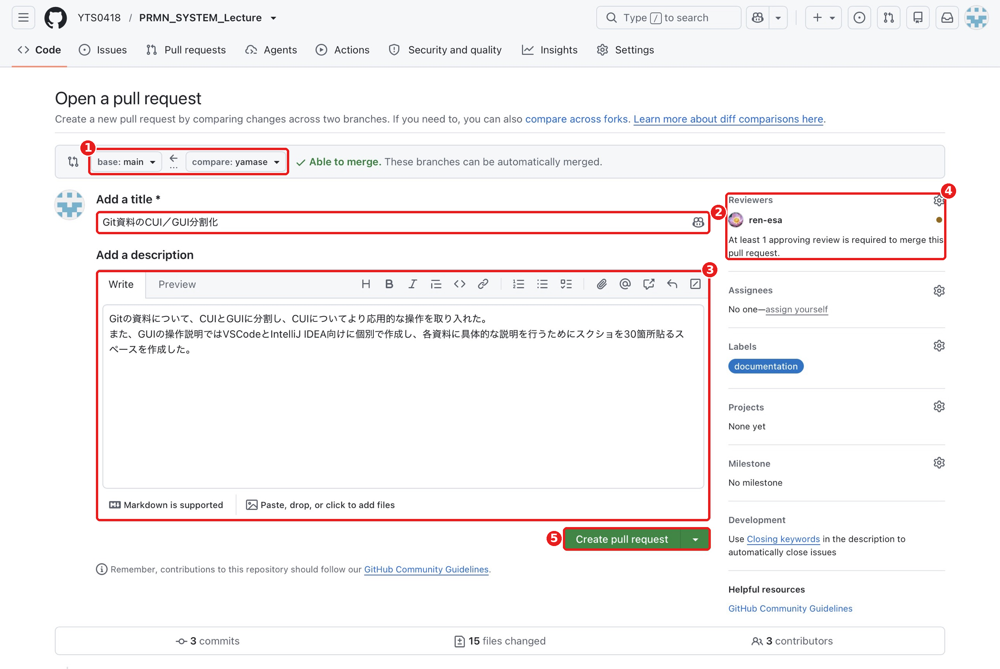

> **まだ作業途中だけど見てほしい**ときは、Create pull request の横の ▼ から **Create draft pull request** を選ぶと、下書きの PR になります。

#### PR の説明の書き方（例）

```markdown
## 概要
ログイン画面に入力チェックを追加しました。

## 変更内容
- ユーザー名が空のときにエラーメッセージを表示
- パスワードが8文字未満のときにエラーメッセージを表示

## 確認したこと
- 空のまま送信するとエラーが出ることを確認
- 正しく入力するとログインできることを確認

## レビューしてほしい点
- エラーメッセージの文言が分かりやすいか
```

> リポジトリに `.github/pull_request_template.md` を置くと、PR を作るときにこのひな形が自動で入ります。

### 6-3. レビューする（レビュアー側）

1. PR の **Files changed** タブを開く。
2. 気になる行の左にある **＋** をクリックしてコメントを書く。
   - 具体的な修正案を出したいときは、コメント欄の **Suggest changes**（±のアイコン）を使うと、修正後のコードを提案できる。
3. 全部見終わったら、右上の **Review changes** をクリックし、次のどれかを選んで **Submit review**。

| 選択肢 | 意味 |
|---|---|
| **Comment** | 質問や感想だけ（承認でも修正依頼でもない） |
| **Approve** | 承認（マージしてOK） |
| **Request changes** | 修正が必要 |

<!-- 📷 SS: /images/git/github/gh-06-03-files-changed-comment.png -->
> 📷 **スクショ指定：`gh-06-03-files-changed-comment.png`**
> - 画面：Files changed タブで、ある行に「＋」からコメントを書いている状態
> - 強調：Files changed タブ、行の「＋」ボタン、コメント入力欄、Suggest changes アイコンを枠で囲む

<!-- 📷 SS: /images/git/github/gh-06-04-review-changes.png -->
> 📷 **スクショ指定：`gh-06-04-review-changes.png`**
> - 画面：右上の「Review changes」を押して、Comment / Approve / Request changes の選択肢が出た状態
> - 強調：「Review changes」ボタン、3つの選択肢、「Submit review」ボタンを赤枠で囲む

> **レビューのマナー**：人ではなくコードについて書く／「なぜそうしたほうがいいか」を添える／良いところも伝える。

### 6-4. 指摘に対応する（自分側）

PR を作ったあとでも、**同じブランチにコミットして push するだけで、PR に自動で追加**されます。PR を作り直す必要はありません。

```bash
# ……指摘された箇所を修正……
git add .
git commit -m "レビュー指摘：エラーメッセージの文言を修正"
git push
```

対応したコメントには返信し、**Resolve conversation** を押して解決済みにします。Suggest changes で提案された修正は、**Commit suggestion** ボタンで GitHub 上から直接取り込むこともできます（その場合は、あとで手元で `git pull` してください）。

<!-- 📷 SS: /images/git/github/gh-06-05-resolve-conversation.png -->
> 📷 **スクショ指定：`gh-06-05-resolve-conversation.png`**
> - 画面：PR の Conversation タブで、レビューコメントに返信した状態
> - 強調：返信欄、「Resolve conversation」ボタン、（あれば）「Commit suggestion」ボタンを赤枠で囲む

### 6-5. マージする

承認されたら、PR の下部にある **Merge pull request** でマージします。▼ からマージ方式を選べます。

<!-- 📷 SS: /images/git/github/gh-06-06-merge-options.png -->
> 📷 **スクショ指定：`gh-06-06-merge-options.png`**
> - 画面：PR 下部のマージボタンの ▼ を開き、3つの方式が表示された状態
> - 強調：「Merge pull request」ボタンと3つの選択肢を赤枠で囲む

| 方式 | main の履歴 | 特徴 |
|---|---|---|
| **Create a merge commit** | ブランチのコミットがすべて残り、マージコミットができる | 何をしたか細かく追える |
| **Squash and merge** | ブランチのコミットを**1つにまとめて**追加 | main の履歴がすっきりする |
| **Rebase and merge** | ブランチのコミットを main の先端に付け替えて追加 | 一直線の履歴になる |

**Create a merge commit の場合**：C・D がそのまま残り、マージコミット M ができる

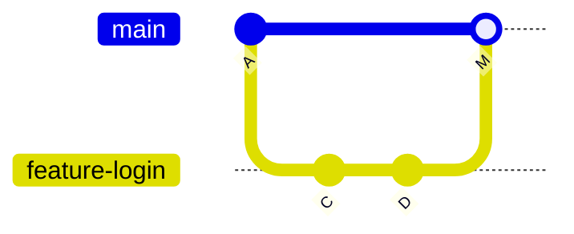

**Squash and merge の場合**：C・D をまとめた1つのコミット CD が main に追加される

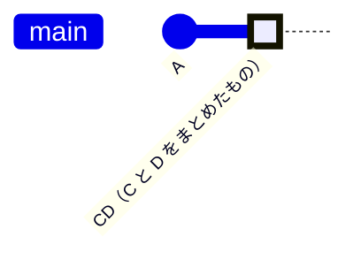

> **どの方式を使うかはチームで決めて統一**しましょう。迷ったら Create a merge commit が分かりやすいです。

マージ後、**Delete branch** ボタンで GitHub 上のブランチを削除します。

<!-- 📷 SS: /images/git/github/gh-06-07-delete-branch.png -->
> 📷 **スクショ指定：`gh-06-07-delete-branch.png`**
> - 画面：マージ完了後の PR 画面（紫の「Merged」ラベルが出ている状態）
> - 強調：「Merged」ラベルと「Delete branch」ボタンを赤枠で囲む

### 6-6. マージ後の後片付け（手元）

```bash
git switch main               # ① main に戻る
git pull                      # ② マージされた最新の main を取り込む
git branch -d feature-login   # ③ 手元のブランチを削除
git fetch --prune             # ④ GitHub で削除済みのブランチの控えを消す
```

> **Squash and merge** でマージした場合、`git branch -d` が「not fully merged」と拒否することがあります。GitHub で PR がマージ済み（Merged）になっていることを確認できたら、`git branch -D feature-login`（大文字）で削除します。

次の作業は、また **最新の main から新しいブランチを作る**ところから始めます。

### 6-7. PR にコンフリクトが表示されたら

PR の下部に **This branch has conflicts that must be resolved** と表示されることがあります。

<!-- 📷 SS: /images/git/github/gh-06-08-pr-conflict.png -->
> 📷 **スクショ指定：`gh-06-08-pr-conflict.png`**
> - 画面：PR の下部にコンフリクトの警告が出ている状態
> - 強調：「This branch has conflicts that must be resolved」のメッセージと、コンフリクトしているファイル名を赤枠で囲む

**手元で [2章の手順](#2-自分のブランチを最新の-main-に合わせる)** を行い、コンフリクトを解決して push すれば、PR の表示も自動で解消されます。

```bash
git switch feature-login
git fetch
git merge origin/main      # ここでコンフリクトが起きる → 解決する
git add .
git commit --no-edit
git push                   # PR のコンフリクト表示が消える
```

> 簡単なコンフリクトなら、PR 画面の **Resolve conflicts** ボタンから GitHub 上で直接解決することもできます。ただし、動作確認ができないので、手元で解決するほうが安全です。

---

## 7. ブランチの整理と .gitignore

### ブランチの一覧と削除

```bash
git branch                         # 手元のブランチ
git branch -a                      # GitHub 上のブランチ（remotes/origin/〇〇）も含めて表示
git branch -d ブランチ名            # 手元のブランチを削除（マージ済みのみ）
git push origin --delete ブランチ名  # GitHub 上のブランチを削除
git fetch --prune                  # GitHub で削除されたブランチの控えを手元からも消す
```

### 他の人のブランチを手元で動かす

```bash
git fetch
git switch 他の人のブランチ名      # origin に同じ名前があれば、自動で手元に作られる
```

> レビューのときに、実際に動かして確認したい場合に使います。

### .gitignore：Git で管理しないファイルを指定する

ビルドで生成されるファイルや、個人の設定ファイルは、リポジトリに入れないようにします。リポジトリの一番上に `.gitignore` というファイルを作り、無視したいファイルを書きます。

```gitignore
# Java のビルド成果物
*.class
out/
target/
build/

# IntelliJ IDEA の設定
.idea/
*.iml

# OS が作るファイル
.DS_Store
Thumbs.db

# 秘密情報
.env
```

> **すでにコミットしてしまったファイル**は、`.gitignore` に書いても無視されません。次のコマンドで Git の管理から外します（ファイル自体は PC に残ります）。
> ```bash
> git rm --cached ファイル名
> git rm -r --cached フォルダ名/
> git commit -m "不要なファイルを管理対象から外す"
> ```

---

## 8. 応用コマンド早見表

| やりたいこと | コマンド |
|---|---|
| 全ブランチの履歴をグラフで見る | `git log --oneline --graph --all` |
| GitHub の最新を確認だけする | `git fetch` |
| 自分のブランチに最新の main を取り込む | `git fetch` → `git merge origin/main` |
| （参考）最新の main に付け替える | `git fetch` → `git rebase origin/main` |
| 編集を取り消す（コミット前） | `git restore ファイル名` |
| add を取り消す | `git restore --staged ファイル名` |
| 直前のコミットを直す（push 前） | `git commit --amend` |
| 直前のコミットを取り消す（push 前） | `git reset --soft HEAD~1` |
| push 済みのコミットを打ち消す | `git revert コミットID` |
| 自分だけのブランチを上書き push | `git push --force-with-lease` |
| 消えたコミットを探す | `git reflog` |
| 変更を退避／戻す | `git stash -u` / `git stash pop` |
| 退避の一覧 | `git stash list` |
| GitHub 上のブランチも一覧表示 | `git branch -a` |
| 手元のブランチを削除 | `git branch -d 名前` |
| 削除済みブランチの控えを消す | `git fetch --prune` |
| 管理対象から外す | `git rm --cached ファイル名` |

---

← 前へ [02. CUI 基本編](./02_CUI基本編.md) ｜ 次へ → [04. GUI VSCode編](./04_GUI_VSCode編.md) / [05. GUI IntelliJ編](./05_GUI_IntelliJ編.md)
