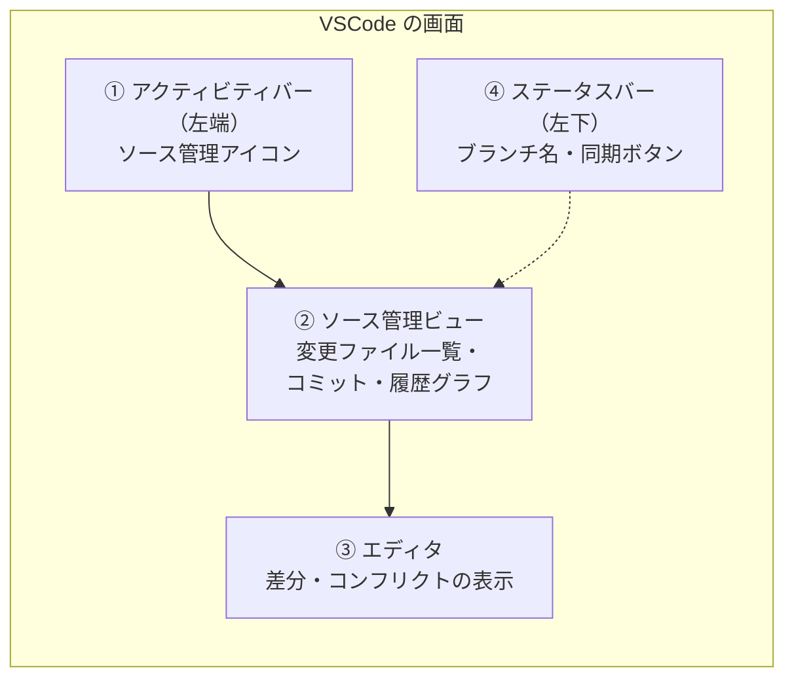

# 04. GUI VSCode編

← 前へ [03. CUI 応用編](./03_CUI応用編.md) ｜ IntelliJ を使う人は → [05. GUI IntelliJ編](./05_GUI_IntelliJ編.md) ｜ 次へ → [06. CUIとGUIの使い分け](./06_CUIとGUIの使い分け.md)

[02 CUI 基本編](./02_CUI基本編.md)・[03 CUI 応用編](./03_CUI応用編.md)でコマンドで行った操作を、**VSCode のボタン操作**で行います。各操作の見出しの下に「**CUI でいうと**」を書いているので、コマンドと見比べながら進めてください。

> **前提**
> - [00 導入編](./00_Git導入・初期設定.md#5-3-vscode)で VSCode から GitHub にサインイン済み
> - VSCode は日本語表示（Japanese Language Pack）を前提にしています。英語表示の場合は、各ボタンの英語名（カッコ内）を参考にしてください
> - VSCode のバージョンによって、ボタンの位置や名前が少し異なることがあります

> **GUI で分からなくなったら**
> 統合ターミナルを開いて `git status` を実行しましょう。今の状態がはっきり分かります。VSCode ではできない操作の一覧は [06 CUIとGUIの使い分け](./06_CUIとGUIの使い分け.md) にまとめています。

## 目次

1. [画面の見方](#1-画面の見方)
2. [clone する](#2-clone-する)
3. [変更と差分を確認する](#3-変更と差分を確認する)
4. [ステージしてコミットする](#4-ステージしてコミットする)
5. [push と pull（同期）](#5-push-と-pull同期)
6. [履歴を見る](#6-履歴を見る)
7. [ブランチを作る・切り替える](#7-ブランチを作る切り替える)
8. [最新の main を取り込む（マージ）](#8-最新の-main-を取り込むマージ)
9. [コンフリクトを解決する](#9-コンフリクトを解決する)
10. [取り消す](#10-取り消す)
11. [変更を退避する（スタッシュ）](#11-変更を退避するスタッシュ)
12. [プルリクエストを使う](#12-プルリクエストを使う)
13. [コマンドとの対応表](#13-コマンドとの対応表)

---

## 1. 画面の見方

Git の操作は、主に次の4か所で行います。

| 場所 | できること | CUI でいうと |
|---|---|---|
| ① ソース管理アイコン | ソース管理ビューを開く。数字は変更ファイルの数 | — |
| ② ソース管理ビュー | 変更の確認、ステージ、コミット、履歴グラフ、「…」メニューからほぼ全操作 | `status` / `add` / `commit` / `log` など |
| ③ エディタ | 差分の確認、コンフリクトの解決 | `diff` |
| ④ ステータスバー | 今のブランチの確認・切り替え、同期 | `branch` / `switch` / `pull` / `push` |

<!-- 📷 SS: /images/git/vscode/vsc-01-01-overview.png -->
> 📷 **スクショ指定：`vsc-01-01-overview.png`**
> - 画面：リポジトリを開き、ファイルを2つほど変更した状態で、ソース管理ビューを開いた VSCode 全体
> - 強調：①アクティビティバーのソース管理アイコン（数字バッジ）、②ソース管理ビュー、③エディタ、④左下のブランチ名と同期ボタン をそれぞれ赤枠で囲み、番号を振る

### 「…」メニュー（ビューとその他のアクション）

ソース管理ビューの上部にある **「…」** から、プル・プッシュ・ブランチ・スタッシュなど、ほとんどの Git 操作を選べます。**ボタンが見つからないときは「…」を探しましょう。**

<!-- 📷 SS: /images/git/vscode/vsc-01-02-more-actions-menu.png -->
> 📷 **スクショ指定：`vsc-01-02-more-actions-menu.png`**
> - 画面：ソース管理ビュー上部の「…」をクリックしてメニューを開いた状態
> - 強調：「…」ボタンと、メニュー内の「プル」「プッシュ」「ブランチ」「スタッシュ」などの項目を赤枠で囲む

> **コマンドパレット**（`Ctrl + Shift + P` / Mac は `⌘ + Shift + P`）で `git` と入力しても、すべての Git 操作を検索できます。

---

## 2. clone する

> **CUI でいうと**：`git clone URL`

1. VSCode を起動し、ウィンドウを何も開いていない状態でソース管理アイコンをクリックする。
2. **リポジトリのクローン**（Clone Repository）をクリックする。

<!-- 📷 SS: /images/git/vscode/vsc-02-01-clone-button.png -->
> 📷 **スクショ指定：`vsc-02-01-clone-button.png`**
> - 画面：フォルダを開いていない状態のソース管理ビュー
> - 強調：「リポジトリのクローン」ボタンを赤枠で囲む

3. 上部に入力欄が出るので、GitHub でコピーした URL を貼り付けて `Enter`（または **GitHub から複製** を選んでリポジトリ一覧から選ぶ）。

<!-- 📷 SS: /images/git/vscode/vsc-02-02-clone-url.png -->
> 📷 **スクショ指定：`vsc-02-02-clone-url.png`**
> - 画面：上部のクイック入力欄に URL を貼り付けた状態
> - 強調：入力欄と「GitHub から複製」の項目を赤枠で囲む

4. 保存先のフォルダを選び、**リポジトリの宛先として選択** をクリックする。
5. 「クローンしたリポジトリを開きますか？」と聞かれたら **開く** をクリックする。

---

## 3. 変更と差分を確認する

> **CUI でいうと**：`git status` / `git diff`

ファイルを編集すると、ソース管理ビューの **変更**（Changes）に一覧が表示されます。ファイル名の右の文字で状態が分かります。

| 表示 | 意味 | CUI の `status` でいうと |
|---|---|---|
| **M**（Modified） | 変更あり | `modified` |
| **U**（Untracked） | 新規ファイル（未追跡） | `Untracked files` |
| **D**（Deleted） | 削除した | `deleted` |
| **A**（Added） | 新規ファイルをステージした | `new file` |
| **C**（Conflict） | コンフリクト中 | `both modified` |

<!-- 📷 SS: /images/git/vscode/vsc-03-01-changes-list.png -->
> 📷 **スクショ指定：`vsc-03-01-changes-list.png`**
> - 画面：M・U・D のファイルがそれぞれ1つ以上ある「変更」一覧
> - 強調：各ファイル右側の M / U / D の文字を赤枠で囲む

ファイル名をクリックすると、**左に変更前・右に変更後**の差分が表示されます。

<!-- 📷 SS: /images/git/vscode/vsc-03-02-diff-view.png -->
> 📷 **スクショ指定：`vsc-03-02-diff-view.png`**
> - 画面：変更ファイルをクリックして開いた差分ビュー（数行の削除と追加がある状態）
> - 強調：左側（変更前・赤い行）と右側（変更後・緑の行）をそれぞれ枠で囲み、「変更前」「変更後」と注記する

> エディタの行番号の横にも、色の帯（緑：追加、青：変更、赤い三角：削除）が表示されます。クリックするとその場で差分を確認できます。

---

## 4. ステージしてコミットする

> **CUI でいうと**：`git add` → `git commit -m "メッセージ"`

### 4-1. ステージする（add）

1. **変更** の一覧で、ステージしたいファイルにマウスを乗せる。
2. 右に出る **＋**（変更をステージ）をクリックする。
   - すべてステージするときは、「変更」の見出しの横の **＋**（すべての変更をステージ）をクリック。
3. ファイルが **ステージされている変更**（Staged Changes）に移動する。

<!-- 📷 SS: /images/git/vscode/vsc-04-01-stage-button.png -->
> 📷 **スクショ指定：`vsc-04-01-stage-button.png`**
> - 画面：変更ファイルにマウスを乗せ、右側のボタンが表示された状態
> - 強調：ファイル行の「＋」ボタンと、「変更」見出しの「＋」（すべてステージ）を赤枠で囲む

<!-- 📷 SS: /images/git/vscode/vsc-04-02-staged-changes.png -->
> 📷 **スクショ指定：`vsc-04-02-staged-changes.png`**
> - 画面：1ファイルをステージし、「ステージされている変更」と「変更」に分かれて表示された状態
> - 強調：「ステージされている変更」の見出しと、そこに移動したファイルを赤枠で囲む

> **ステージを取り消す**（CUI の `git restore --staged`）：ステージされている変更のファイルの **−**（変更のステージング解除）をクリック。

> **行単位でステージする**：差分ビューで行を選択し、右クリック → **選択範囲をステージする**。1つのファイルの一部だけをコミットしたいときに便利です（CUI よりかんたんです）。

### 4-2. コミットする（commit）

1. 上部の **メッセージ** 欄にコミットメッセージを入力する。
2. **✓ コミット** ボタンをクリックする。

<!-- 📷 SS: /images/git/vscode/vsc-04-03-commit.png -->
> 📷 **スクショ指定：`vsc-04-03-commit.png`**
> - 画面：メッセージ欄に「ログイン画面に入力チェックを追加」と入力した状態のソース管理ビュー
> - 強調：メッセージ入力欄と「✓ コミット」ボタンを赤枠で囲む

> ⚠️ **ステージせずにコミットボタンを押すと**、「ステージされている変更がありません。すべての変更をステージしてコミットしますか？」と聞かれます。**はい** を選ぶと `git add .` と同じく全ファイルが入るので、入れたくないファイルがないか確認してから押しましょう。

> コミットボタンの ▼ から **コミットしてプッシュ** を選ぶと、push まで一度に行えます。

---

## 5. push と pull（同期）

> **CUI でいうと**：`git push` / `git pull`

### 同期ボタン

コミットすると、ソース管理ビューに **変更の同期**（Sync Changes）ボタンが表示されます。左下のステータスバーにも `↓1 ↑2` のような表示が出ます。

| 表示 | 意味 |
|---|---|
| `↑2` | GitHub に送っていないコミットが2つある（push 待ち） |
| `↓1` | GitHub にあって手元にないコミットが1つある（pull 待ち） |

**変更の同期** をクリックすると、**pull してから push** を続けて行います。

<!-- 📷 SS: /images/git/vscode/vsc-05-01-sync-button.png -->
> 📷 **スクショ指定：`vsc-05-01-sync-button.png`**
> - 画面：コミット後、push 前の状態のソース管理ビューとステータスバー
> - 強調：「変更の同期 ↑1」ボタンと、左下ステータスバーの「↓0 ↑1」表示を赤枠で囲む

### push・pull を個別に行う

「…」 → **プル**（Pull）／**プッシュ**（Push）を選びます。GitHub の状態を確認だけしたいときは **フェッチ**（Fetch）を選びます。

<!-- 📷 SS: /images/git/vscode/vsc-05-02-pull-push-menu.png -->
> 📷 **スクショ指定：`vsc-05-02-pull-push-menu.png`**
> - 画面：「…」メニューを開き、プル・プッシュ・フェッチが見えている状態
> - 強調：「プル」「プッシュ」「フェッチ」の項目を赤枠で囲む

### 初めて push するブランチ

新しいブランチでは、同期ボタンの代わりに **Branch の発行**（Publish Branch）ボタンが表示されます。クリックすると、`git push -u origin ブランチ名` と同じことが行われます。

<!-- 📷 SS: /images/git/vscode/vsc-05-03-publish-branch.png -->
> 📷 **スクショ指定：`vsc-05-03-publish-branch.png`**
> - 画面：新しく作ったブランチでコミットした直後のソース管理ビュー
> - 強調：「Branch の発行」ボタンを赤枠で囲む

---

## 6. 履歴を見る

> **CUI でいうと**：`git log --oneline --graph --all`

ソース管理ビューの下部にある **グラフ**（Graph）セクションに、コミットの履歴がブランチの線つきで表示されます。

<!-- 📷 SS: /images/git/vscode/vsc-06-01-source-control-graph.png -->
> 📷 **スクショ指定：`vsc-06-01-source-control-graph.png`**
> - 画面：main と feature ブランチが分かれている状態の、ソース管理ビュー下部のグラフ
> - 強調：グラフの線、ブランチ名のラベル（main / origin/main / feature-login）を赤枠で囲む

- コミットをクリックすると、そのコミットで変更されたファイルが表示されます。
- グラフに表示するブランチは、グラフ上部のボタンで切り替えられます（「すべてのブランチ」にすると `--all` と同じ）。

**ファイル単位の履歴**は、エクスプローラーの下部にある **タイムライン**（Timeline）で確認できます。

<!-- 📷 SS: /images/git/vscode/vsc-06-02-timeline.png -->
> 📷 **スクショ指定：`vsc-06-02-timeline.png`**
> - 画面：エクスプローラーでファイルを選択し、下部のタイムラインにコミット履歴が並んだ状態
> - 強調：「タイムライン」セクションとコミットの一覧を赤枠で囲む

---

## 7. ブランチを作る・切り替える

> **CUI でいうと**：`git switch -c 名前` / `git switch 名前`

### 7-1. ブランチを作る

> 作る前に、main に切り替えて **プル** し、最新にしておきましょう（[02 基本編 5章](./02_CUI基本編.md#5-ブランチを使う)）。

1. 左下のステータスバーの **ブランチ名**（例：`main`）をクリックする。
2. 上部に出るメニューから **＋ 新しいブランチの作成...**（Create new branch...）を選ぶ。
3. ブランチ名（例：`feature-login`）を入力して `Enter`。作成と同時にそのブランチに切り替わる。

<!-- 📷 SS: /images/git/vscode/vsc-07-01-branch-statusbar.png -->
> 📷 **スクショ指定：`vsc-07-01-branch-statusbar.png`**
> - 画面：VSCode 左下のステータスバー
> - 強調：ブランチ名（main）の部分を赤枠で囲み、「ここをクリック」と注記する

<!-- 📷 SS: /images/git/vscode/vsc-07-02-create-branch.png -->
> 📷 **スクショ指定：`vsc-07-02-create-branch.png`**
> - 画面：ブランチ名をクリックして上部にメニューが出た状態
> - 強調：「新しいブランチの作成...」の項目と、下に並ぶ既存ブランチ一覧を赤枠で囲む

### 7-2. ブランチを切り替える

1. 左下の **ブランチ名** をクリックする。
2. 一覧から移動したいブランチを選ぶ。
   - `origin/〇〇` と表示されているのは GitHub 上のブランチです。選ぶと、手元に同じ名前のブランチが作られて切り替わります。

### 7-3. 未コミットの変更があるときのダイアログ

未コミットの変更が切り替え先とぶつかる場合、次のようなダイアログが表示されます。

<!-- 📷 SS: /images/git/vscode/vsc-07-03-checkout-dialog.png -->
> 📷 **スクショ指定：`vsc-07-03-checkout-dialog.png`**
> - 画面：未コミットの変更があるまま別ブランチに切り替えようとしたときのダイアログ
> - 強調：「スタッシュしてチェックアウト」「変更の移行」「チェックアウトの強制」の各ボタンを赤枠で囲む

| 選択肢 | 何が起きるか | CUI でいうと | 使う場面 |
|---|---|---|---|
| **スタッシュしてチェックアウト** | 変更を退避してから切り替える。退避した変更は、元のブランチに戻って[11章](#11-変更を退避するスタッシュ)の手順で戻す | `git stash` → `git switch` | 変更を今のブランチに残したいとき |
| **変更の移行** | 変更を持ったまま切り替え、切り替え先のブランチに反映する | `git stash` → `git switch` → `git stash pop` | 間違ったブランチで作業を始めてしまったとき |
| **チェックアウトの強制** | 変更を**破棄**して切り替える | `git switch -f` | 変更が不要なとき**だけ** |
| **キャンセル** | 切り替えをやめる | — | 迷ったとき（先にコミットする） |

> ⚠️ **チェックアウトの強制で破棄した変更は、元に戻せません。** 迷ったら **キャンセル** して、先にコミットしましょう。

---

## 8. 最新の main を取り込む（マージ）

> **CUI でいうと**：`git fetch` → `git merge origin/main`（[03 応用編 2章](./03_CUI応用編.md#2-自分のブランチを最新の-main-に合わせる)）

1. 左下のブランチ名が **自分のブランチ**（例：`feature-login`）になっていることを確認する。
2. 「…」 → **フェッチ** を選ぶ（GitHub の最新を取ってくる）。
3. 「…」 → **ブランチ** → **ブランチをマージ...**（Merge Branch...）を選ぶ。
4. 一覧から **origin/main** を選ぶ。
5. コンフリクトがなければマージ完了。**変更の同期** で push する。

<!-- 📷 SS: /images/git/vscode/vsc-08-01-merge-branch-menu.png -->
> 📷 **スクショ指定：`vsc-08-01-merge-branch-menu.png`**
> - 画面：「…」→「ブランチ」のサブメニューを開いた状態
> - 強調：「ブランチ」と「ブランチをマージ...」の項目を赤枠で囲む

<!-- 📷 SS: /images/git/vscode/vsc-08-02-select-origin-main.png -->
> 📷 **スクショ指定：`vsc-08-02-select-origin-main.png`**
> - 画面：マージするブランチの選択一覧
> - 強調：「origin/main」を赤枠で囲む（「main」ではなく「origin/main」を選ぶことを注記）

> ⚠️ **向きに注意**：「今いるブランチ」に「選んだブランチ」が取り込まれます。main にいる状態で feature を選ぶと、逆向きになってしまいます。

---

## 9. コンフリクトを解決する

> **CUI でいうと**：ファイルを編集して印を消す → `git add` → `git commit`（[02 基本編 7章](./02_CUI基本編.md#7-コンフリクトを解決する)）

コンフリクトが起きると、ソース管理ビューに **マージの変更**（Merge Changes）として、該当ファイルが **C** マークつきで表示されます。

<!-- 📷 SS: /images/git/vscode/vsc-09-01-merge-changes.png -->
> 📷 **スクショ指定：`vsc-09-01-merge-changes.png`**
> - 画面：コンフリクト発生直後のソース管理ビュー
> - 強調：「マージの変更」の見出しと、C マークのついたファイルを赤枠で囲む

### 方法1：エディタ上のボタンで解決する（かんたん）

ファイルを開くと、コンフリクトした箇所の上に次のボタンが表示されます。

| ボタン | 意味 |
|---|---|
| **現在の変更を取り込む**（Accept Current Change） | 自分側（`HEAD`）を残す |
| **入力側の変更を取り込む**（Accept Incoming Change） | 取り込もうとしたブランチ側を残す |
| **両方の変更を取り込む**（Accept Both Changes） | 両方を残す（あとで手で整える） |
| **変更の比較**（Compare Changes） | 左右に並べて比べる |

<!-- 📷 SS: /images/git/vscode/vsc-09-02-conflict-inline.png -->
> 📷 **スクショ指定：`vsc-09-02-conflict-inline.png`**
> - 画面：コンフリクトしたファイルをエディタで開いた状態（色分けされた2つのブロックが見える）
> - 強調：上部の4つのボタン、緑のブロック（現在の変更）、青のブロック（入力側の変更）を赤枠で囲み、それぞれ「自分側」「相手側」と注記する

### 方法2：マージエディターで解決する

右下の **マージエディターで解決**（Resolve in Merge Editor）をクリックすると、3つに分かれた画面が開きます。

- 上左：**入力側**（相手の変更）　／　上右：**現在**（自分の変更）　／　下：**結果**（保存される内容）
- 上の画面のチェックボックスで、結果に取り込む変更を選ぶ。結果は直接編集もできる。
- 終わったら右下の **マージの完了**（Complete Merge）をクリックする。

<!-- 📷 SS: /images/git/vscode/vsc-09-03-merge-editor.png -->
> 📷 **スクショ指定：`vsc-09-03-merge-editor.png`**
> - 画面：マージエディターを開いた状態
> - 強調：「入力側」「現在」「結果」の3つの領域、各変更のチェックボックス、右下の「マージの完了」ボタンを赤枠で囲む

### 解決したら

1. ファイルを保存する。
2. ソース管理ビューで、ファイルの **＋** をクリックしてステージする（解決済みになる）。
3. メッセージ欄にマージのメッセージが自動で入っているので、そのまま **✓ コミット** をクリックする。
4. **変更の同期** で push する。

<!-- 📷 SS: /images/git/vscode/vsc-09-04-conflict-resolved-commit.png -->
> 📷 **スクショ指定：`vsc-09-04-conflict-resolved-commit.png`**
> - 画面：解決したファイルをステージし、メッセージ欄に「Merge remote-tracking branch 'origin/main' ...」が入っている状態
> - 強調：ステージ済みのファイル、自動入力されたメッセージ、「✓ コミット」ボタンを赤枠で囲む

> **マージをやめたい**（CUI の `git merge --abort`）：VSCode のボタンでは中止しにくいため、統合ターミナルで `git merge --abort` を実行します。

---

## 10. 取り消す

> **CUI でいうと**：`git restore` / `git restore --staged` / `git reset --soft HEAD~1`（[03 応用編 4章](./03_CUI応用編.md#4-コミットやプッシュを取り消す)）

| やりたいこと | VSCode での操作 | CUI でいうと |
|---|---|---|
| 編集を取り消す（コミット前） | 変更ファイルの **↶**（変更を破棄）をクリック ⚠️ 元に戻せません | `git restore ファイル名` |
| ステージを取り消す | ステージされている変更のファイルの **−** をクリック | `git restore --staged ファイル名` |
| 直前のコミットを取り消す（push 前） | 「…」 → **コミット** → **前回のコミットを元に戻す**（Undo Last Commit） | `git reset --soft HEAD~1` |
| 直前のコミットを直す（push 前） | コミットボタンの ▼ → **コミット (修正)**（Commit (Amend)） | `git commit --amend` |
| push 済みのコミットを打ち消す | 標準の機能ではできない → ターミナルで `git revert` | `git revert コミットID` |

<!-- 📷 SS: /images/git/vscode/vsc-10-01-discard-changes.png -->
> 📷 **スクショ指定：`vsc-10-01-discard-changes.png`**
> - 画面：変更ファイルにマウスを乗せ、右側のボタンが表示された状態
> - 強調：「↶」（変更を破棄）ボタンを赤枠で囲み、「⚠️ 元に戻せない」と注記する

<!-- 📷 SS: /images/git/vscode/vsc-10-02-undo-last-commit.png -->
> 📷 **スクショ指定：`vsc-10-02-undo-last-commit.png`**
> - 画面：「…」→「コミット」のサブメニューを開いた状態
> - 強調：「前回のコミットを元に戻す」の項目を赤枠で囲む

<!-- 📷 SS: /images/git/vscode/vsc-10-03-commit-amend.png -->
> 📷 **スクショ指定：`vsc-10-03-commit-amend.png`**
> - 画面：コミットボタンの ▼ を開いた状態
> - 強調：「コミット (修正)」と「コミットしてプッシュ」の項目を赤枠で囲む

> **前回のコミットを元に戻す** は `--soft` と同じで、取り消したコミットの変更は **ステージされている変更** に残ります。消えるわけではないので安心してください。

> revert、任意のコミットへの reset、reflog による復元は、VSCode の標準機能ではできません。[06 CUIとGUIの使い分け](./06_CUIとGUIの使い分け.md)を参照し、ターミナルで行ってください。

---

## 11. 変更を退避する（スタッシュ）

> **CUI でいうと**：`git stash -u` / `git stash pop`（[03 応用編 5章](./03_CUI応用編.md#5-作業を一時的に退避するstash)）

### 退避する

「…」 → **スタッシュ** → **スタッシュ (未追跡ファイルを含む)**（Stash (Include Untracked)）を選び、メッセージを入力して `Enter`。

<!-- 📷 SS: /images/git/vscode/vsc-11-01-stash-menu.png -->
> 📷 **スクショ指定：`vsc-11-01-stash-menu.png`**
> - 画面：「…」→「スタッシュ」のサブメニューを開いた状態
> - 強調：「スタッシュ」「スタッシュ (未追跡ファイルを含む)」「スタッシュを適用」「スタッシュのポップ」の項目を赤枠で囲む

### 戻す

「…」 → **スタッシュ** → **最新のスタッシュをポップ** または **スタッシュのポップ...**（一覧から選ぶ）を選ぶ。

| 操作 | 意味 | CUI でいうと |
|---|---|---|
| ポップ | 戻して、スタッシュの一覧から消す | `git stash pop` |
| 適用 | 戻して、スタッシュの一覧に残す | `git stash apply` |
| 削除 | 戻さずに捨てる | `git stash drop` |

---

## 12. プルリクエストを使う

> **CUI でいうと**：CUI ではなく GitHub の Web 画面で行う操作です（[03 応用編 6章](./03_CUI応用編.md#6-プルリクエストを使う)）。

PR は **GitHub の Web 画面で操作するのが基本**です（手順は 03 応用編を参照）。VSCode の拡張機能 **GitHub Pull Requests** を入れると、VSCode の中から PR の作成やレビューもできます。

### 拡張機能を入れる

1. 左端の **拡張機能** アイコンをクリックし、`GitHub Pull Requests` で検索する。
2. 発行元が **GitHub** のものを選び、**インストール** をクリックする。

<!-- 📷 SS: /images/git/vscode/vsc-12-01-install-pr-extension.png -->
> 📷 **スクショ指定：`vsc-12-01-install-pr-extension.png`**
> - 画面：拡張機能ビューで「GitHub Pull Requests」を検索した結果
> - 強調：検索欄、発行元「GitHub」の表示、「インストール」ボタンを赤枠で囲む

### PR を作る

1. 自分のブランチを push（Branch の発行）しておく。
2. ソース管理ビュー上部の **プル リクエストの作成** アイコン（または左端に追加された **GitHub** アイコン → **Create Pull Request**）をクリックする。
3. **base**（取り込み先：`main`）と **compare**（自分のブランチ）、タイトル・説明を入力して **作成**（Create）をクリックする。

<!-- 📷 SS: /images/git/vscode/vsc-12-02-create-pr.png -->
> 📷 **スクショ指定：`vsc-12-02-create-pr.png`**
> - 画面：PR 作成フォームを開いた状態（タイトル・説明を入力済み）
> - 強調：base / compare のブランチ指定、タイトル欄、説明欄、「作成」ボタンを赤枠で囲む

### PR をレビューする

1. 左端の **GitHub** アイコンをクリックし、PR の一覧から対象を選ぶ。
2. **Checkout** をクリックすると、その PR のブランチに切り替わり、手元で動かして確認できる。
3. 変更ファイルを開き、行番号の横の **＋** からコメントを書ける。

<!-- 📷 SS: /images/git/vscode/vsc-12-03-review-pr.png -->
> 📷 **スクショ指定：`vsc-12-03-review-pr.png`**
> - 画面：GitHub ビューで PR を開き、説明と変更ファイル一覧が表示された状態
> - 強調：PR 一覧、「Checkout」ボタン、変更ファイル一覧を赤枠で囲む

> マージ方式の選択やブランチの削除は、Web 画面のほうが分かりやすいです。慣れるまでは **作成は VSCode でも Web でもOK、レビューとマージは Web** がおすすめです。

---

## 13. コマンドとの対応表

| コマンド | VSCode での操作 |
|---|---|
| `git clone` | ソース管理 → **リポジトリのクローン** |
| `git status` | ソース管理ビューの **変更** / **ステージされている変更** の一覧 |
| `git diff` | 変更ファイルをクリック |
| `git add` | ファイルの **＋** |
| `git restore --staged` | ステージされている変更のファイルの **−** |
| `git restore` | ファイルの **↶**（変更を破棄） |
| `git commit -m` | メッセージを入力して **✓ コミット** |
| `git commit --amend` | コミットボタンの ▼ → **コミット (修正)** |
| `git reset --soft HEAD~1` | 「…」 → コミット → **前回のコミットを元に戻す** |
| `git push` / `git pull` | **変更の同期**、または「…」 → プッシュ / プル |
| `git push -u origin 名前` | **Branch の発行** |
| `git fetch` | 「…」 → **フェッチ** |
| `git log --graph` | ソース管理ビューの **グラフ** |
| `git switch -c 名前` | 左下のブランチ名 → **新しいブランチの作成** |
| `git switch 名前` | 左下のブランチ名 → ブランチを選ぶ |
| `git merge 名前` | 「…」 → ブランチ → **ブランチをマージ** |
| `git stash -u` / `pop` | 「…」 → スタッシュ → **スタッシュ (未追跡ファイルを含む)** / **ポップ** |
| `git revert`・`git reflog` など | できない → [06 CUIとGUIの使い分け](./06_CUIとGUIの使い分け.md) |

---

← 前へ [03. CUI 応用編](./03_CUI応用編.md) ｜ IntelliJ を使う人は → [05. GUI IntelliJ編](./05_GUI_IntelliJ編.md) ｜ 次へ → [06. CUIとGUIの使い分け](./06_CUIとGUIの使い分け.md)
