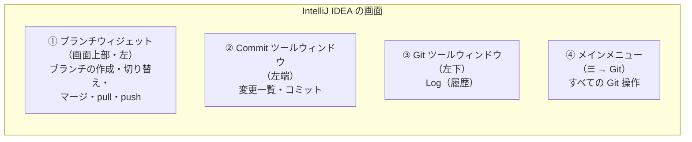

# 05. GUI IntelliJ編

← 前へ [03. CUI 応用編](./03_CUI応用編.md) ｜ VSCode を使う人は → [04. GUI VSCode編](./04_GUI_VSCode編.md) ｜ 次へ → [06. CUIとGUIの使い分け](./06_CUIとGUIの使い分け.md)

[02 CUI 基本編](./02_CUI基本編.md)・[03 CUI 応用編](./03_CUI応用編.md)でコマンドで行った操作を、**IntelliJ IDEA のボタン操作**で行います。各操作の見出しの下に「**CUI でいうと**」を書いているので、コマンドと見比べながら進めてください。

> **前提**
> - [00 導入編](./00_Git導入・初期設定.md#5-4-intellij-idea)で IntelliJ IDEA に GitHub アカウントを登録済み
> - **New UI**（2023.2 以降の標準の見た目）を前提にしています。Classic UI の場合は、上部メニューの `Git`（または `VCS`）から同じ操作を探してください
> - メニューは英語表示を前提にしています（日本語化している場合は、カッコ内の日本語名を参考にしてください）

> **GUI で分からなくなったら**
> 左下の **Terminal** を開いて `git status` を実行しましょう。今の状態がはっきり分かります。IntelliJ ではできない操作の一覧は [06 CUIとGUIの使い分け](./06_CUIとGUIの使い分け.md) にまとめています。

## 目次

1. [画面の見方](#1-画面の見方)
2. [clone する](#2-clone-する)
3. [変更と差分を確認する](#3-変更と差分を確認する)
4. [コミットする](#4-コミットする)
5. [push と pull](#5-push-と-pull)
6. [履歴を見る](#6-履歴を見る)
7. [ブランチを作る・切り替える](#7-ブランチを作る切り替える)
8. [最新の main を取り込む（マージ）](#8-最新の-main-を取り込むマージ)
9. [コンフリクトを解決する](#9-コンフリクトを解決する)
10. [取り消す](#10-取り消す)
11. [変更を退避する（スタッシュ・シェルフ）](#11-変更を退避するスタッシュシェルフ)
12. [プルリクエストを使う](#12-プルリクエストを使う)
13. [コマンドとの対応表](#13-コマンドとの対応表)

---

## 1. 画面の見方

Git の操作は、主に次の4か所で行います。

| 場所 | 開き方 | できること | CUI でいうと |
|---|---|---|---|
| ① ブランチウィジェット | 画面上部のブランチ名をクリック | ブランチの作成・切り替え、マージ、Update / Commit / Push | `switch` / `merge` / `pull` / `push` |
| ② Commit ツールウィンドウ | 左端のコミットアイコン（`Alt + 0` / Mac は `⌘ + 0`） | 変更の確認、コミット、Amend、Shelf | `status` / `add` / `commit` |
| ③ Git ツールウィンドウ | 左下の Git アイコン（`Alt + 9` / Mac は `⌘ + 9`） | 履歴（Log）、コミットの右クリックで取り消し操作 | `log` / `revert` / `reset` |
| ④ メインメニュー | 左上の **☰** → **Git** | すべての Git 操作 | — |

<!-- 📷 SS: /images/git/intellij/ij-01-01-overview.png -->
> 📷 **スクショ指定：`ij-01-01-overview.png`**
> - 画面：プロジェクトを開き、ファイルを2つほど変更した状態の IntelliJ IDEA 全体（Commit ツールウィンドウを開いた状態）
> - 強調：①上部のブランチウィジェット、②左端のコミットアイコンと Commit ツールウィンドウ、③左下の Git アイコン、④左上の ☰ をそれぞれ赤枠で囲み、番号を振る

<!-- 📷 SS: /images/git/intellij/ij-01-02-git-menu.png -->
> 📷 **スクショ指定：`ij-01-02-git-menu.png`**
> - 画面：☰ → Git メニューを開いた状態
> - 強調：「Commit...」「Push...」「Pull...」「Fetch」「Branches...」「Uncommitted Changes」の項目を赤枠で囲む

> **ボタンが見つからないとき**は、`Shift` を2回押して出る **Search Everywhere** で `push` や `branch` などと検索すると、操作を探せます。

### ファイルの色の意味

プロジェクトツリーや Commit ツールウィンドウでは、ファイル名の色で状態が分かります。

| 色 | 意味 | CUI の `status` でいうと |
|---|---|---|
| **青** | 変更あり | `modified` |
| **緑** | 新規追加（Git の管理対象に追加済み） | `new file` |
| **赤茶** | 未追跡（Git 管理外） | `Untracked files` |
| **灰色** | `.gitignore` で無視されている | （表示されない） |
| **赤** | コンフリクト中 | `both modified` |

---

## 2. clone する

> **CUI でいうと**：`git clone URL`

1. ウェルカム画面で **Clone Repository**（ウェルカム画面が出ない場合は ☰ → `File` → `New` → `Project from Version Control...`）をクリックする。
2. 左の **GitHub** を選ぶと、登録したアカウントのリポジトリ一覧が表示される（URL を直接入力する場合は **Repository URL** を選ぶ）。
3. 対象のリポジトリを選び、**Directory**（保存先）を指定して **Clone** をクリックする。

<!-- 📷 SS: /images/git/intellij/ij-02-01-welcome-clone.png -->
> 📷 **スクショ指定：`ij-02-01-welcome-clone.png`**
> - 画面：IntelliJ IDEA のウェルカム画面
> - 強調：「Clone Repository」ボタンを赤枠で囲む

<!-- 📷 SS: /images/git/intellij/ij-02-02-clone-dialog.png -->
> 📷 **スクショ指定：`ij-02-02-clone-dialog.png`**
> - 画面：Clone Repository ダイアログで GitHub を選び、リポジトリ一覧が表示された状態
> - 強調：左の「GitHub」、リポジトリ一覧、「Directory」欄、「Clone」ボタンを赤枠で囲み、番号①〜④を振る

> ⚠️ OneDrive などの同期フォルダの中は避けましょう（[00 導入編 6章](./00_Git導入・初期設定.md#6-リポジトリを-clone-する)）。

---

## 3. 変更と差分を確認する

> **CUI でいうと**：`git status` / `git diff`

左端の **コミットアイコン** をクリックして Commit ツールウィンドウを開くと、変更されたファイルが一覧で表示されます。

- **Changes**：変更したファイル
- **Unversioned Files**：新しく作った、まだ Git 管理外のファイル

<!-- 📷 SS: /images/git/intellij/ij-03-01-commit-window.png -->
> 📷 **スクショ指定：`ij-03-01-commit-window.png`**
> - 画面：Commit ツールウィンドウに Changes（青のファイル2つ）と Unversioned Files（赤茶のファイル1つ）がある状態
> - 強調：「Changes」と「Unversioned Files」の見出し、ファイル名の色を赤枠で囲む

ファイルを**ダブルクリック**すると、**左に変更前・右に変更後**の差分が表示されます。

<!-- 📷 SS: /images/git/intellij/ij-03-02-diff-view.png -->
> 📷 **スクショ指定：`ij-03-02-diff-view.png`**
> - 画面：変更ファイルをダブルクリックして開いた差分ビュー
> - 強調：左側（変更前）と右側（変更後）、色付きの変更箇所をそれぞれ枠で囲み、「変更前」「変更後」と注記する

> エディタの行番号の横にも、色の帯（緑：追加、青：変更、灰色の三角：削除）が表示されます。クリックすると、その場で差分の確認や取り消しができます。

---

## 4. コミットする

> **CUI でいうと**：`git add` → `git commit -m "メッセージ"`

IntelliJ では、**ステージの代わりにチェックボックス**でコミットするファイルを選びます。

1. Commit ツールウィンドウで、コミットしたいファイルに**チェックを入れる**（`git add` に相当）。
   - 新しく作ったファイルは **Unversioned Files** にあるので、チェックを入れる（またはファイルを右クリック → **Add to VCS**）。
   - ファイルを新規作成した直後に「Add file to Git?」と聞かれた場合は **Add** を選んでもよい。
2. 下の **コミットメッセージ** 欄に内容を書く。
3. **Commit** をクリックする（push まで行うなら **Commit and Push...**）。

<!-- 📷 SS: /images/git/intellij/ij-04-01-check-files.png -->
> 📷 **スクショ指定：`ij-04-01-check-files.png`**
> - 画面：Commit ツールウィンドウで、一部のファイルにだけチェックを入れた状態
> - 強調：チェックを入れたファイルのチェックボックスと、チェックを入れていないファイルを赤枠で囲み、「コミットされる」「コミットされない」と注記する

<!-- 📷 SS: /images/git/intellij/ij-04-02-commit-message.png -->
> 📷 **スクショ指定：`ij-04-02-commit-message.png`**
> - 画面：コミットメッセージ欄に「ログイン画面に入力チェックを追加」と入力した状態
> - 強調：メッセージ欄、「Commit」ボタン、「Commit and Push...」ボタン、「Amend」チェックボックスを赤枠で囲む

> **行単位でコミットする**：差分ビューで、変更ブロックの横にあるチェックボックスを外すと、その部分だけコミットから除外できます（CUI よりかんたんです）。

> **ステージを使いたい場合**：☰ → `Settings` → `Version Control` → `Git` の **Enable staging area** にチェックを入れると、VSCode や CUI と同じ「ステージ」方式に切り替えられます。CUI との対応を意識したい人は試してみてください。

---

## 5. push と pull

> **CUI でいうと**：`git push` / `git pull`

### push する

1. 上部のブランチウィジェット → **Push...**、または ☰ → `Git` → `Push...`（`Ctrl + Shift + K` / Mac は `⌘ + Shift + K`）。
2. 左に送るコミットの一覧、右にそのコミットで変わるファイルが表示される。内容を確認して **Push** をクリックする。

<!-- 📷 SS: /images/git/intellij/ij-05-01-push-dialog.png -->
> 📷 **スクショ指定：`ij-05-01-push-dialog.png`**
> - 画面：Push ダイアログ（送るコミットが2つある状態）
> - 強調：「feature-login → origin : feature-login」の表示、コミット一覧、「Push」ボタンを赤枠で囲む

> **初めて push するブランチ**も、同じ Push ダイアログでそのまま **Push** をクリックすれば OK です（`-u origin ブランチ名` 相当の設定は自動で行われます）。ダイアログ内に **New** と表示されます。

### pull する

上部のブランチウィジェット → **Update**（`Ctrl + T` / Mac は `⌘ + T`）、または ☰ → `Git` → `Pull...`。

- **Update Project**（Update）は、今いるブランチに GitHub の最新を取り込みます。初回は方式を聞かれるので **Merge** を選びます。

<!-- 📷 SS: /images/git/intellij/ij-05-02-update-project.png -->
> 📷 **スクショ指定：`ij-05-02-update-project.png`**
> - 画面：Update Project のダイアログ（Merge / Rebase の選択肢がある状態）
> - 強調：「Merge incoming changes into the current branch」を選んだ状態のラジオボタンと「OK」ボタンを赤枠で囲む

### fetch する

☰ → `Git` → **Fetch**。GitHub の状態を確認だけします（ファイルは変わりません）。

---

## 6. 履歴を見る

> **CUI でいうと**：`git log --oneline --graph --all`

左下の **Git** アイコン（`Alt + 9` / Mac は `⌘ + 9`）→ **Log** タブを開くと、すべてのブランチの履歴がグラフで表示されます。

- 左：ブランチの一覧（HEAD / Local / Remote）
- 中央：コミットの一覧とグラフ
- 右：選んだコミットで変更されたファイル

<!-- 📷 SS: /images/git/intellij/ij-06-01-git-log.png -->
> 📷 **スクショ指定：`ij-06-01-git-log.png`**
> - 画面：Git ツールウィンドウの Log タブ（main と feature ブランチが分かれている状態）
> - 強調：左のブランチ一覧、中央のグラフとコミット一覧、右の変更ファイル一覧をそれぞれ枠で囲み、番号を振る

> 上部の検索欄や **Branch** / **User** / **Date** / **Paths** のフィルターで、履歴を絞り込めます。

**ファイル単位の履歴**は、ファイルを右クリック → **Git** → **Show History** で確認できます。

---

## 7. ブランチを作る・切り替える

> **CUI でいうと**：`git switch -c 名前` / `git switch 名前`

### 7-1. ブランチを作る

> 作る前に、main に切り替えて **Update** し、最新にしておきましょう（[02 基本編 5章](./02_CUI基本編.md#5-ブランチを使う)）。

1. 画面上部の **ブランチ名**（例：`main`）をクリックする。
2. **New Branch...** を選ぶ。
3. ブランチ名（例：`feature-login`）を入力し、**Checkout branch** にチェックが入っていることを確認して **Create** をクリックする（作成と同時に切り替わる）。

<!-- 📷 SS: /images/git/intellij/ij-07-01-branch-widget.png -->
> 📷 **スクショ指定：`ij-07-01-branch-widget.png`**
> - 画面：上部のブランチ名をクリックして、ブランチのポップアップが開いた状態
> - 強調：上部のブランチ名、「New Branch...」、Local / Remote のブランチ一覧を赤枠で囲む

<!-- 📷 SS: /images/git/intellij/ij-07-02-new-branch-dialog.png -->
> 📷 **スクショ指定：`ij-07-02-new-branch-dialog.png`**
> - 画面：Create New Branch ダイアログにブランチ名を入力した状態
> - 強調：ブランチ名の入力欄、「Checkout branch」チェックボックス、「Create」ボタンを赤枠で囲む

### 7-2. ブランチを切り替える

1. 上部の **ブランチ名** をクリックする。
2. 一覧から移動したいブランチにマウスを乗せ、サブメニューから **Checkout** を選ぶ。
   - **Remote** にある `origin/〇〇` を Checkout すると、手元に同じ名前のブランチが作られて切り替わります。

<!-- 📷 SS: /images/git/intellij/ij-07-03-checkout-submenu.png -->
> 📷 **スクショ指定：`ij-07-03-checkout-submenu.png`**
> - 画面：ブランチ一覧で別のブランチにマウスを乗せ、サブメニューが開いた状態
> - 強調：「Checkout」と、同じサブメニュー内の「Merge '〇〇' into '△△'」を赤枠で囲む（8章で使うことを注記）

### 7-3. 未コミットの変更があるときのダイアログ

未コミットの変更が切り替え先とぶつかる場合、次のダイアログが表示されます。

<!-- 📷 SS: /images/git/intellij/ij-07-04-smart-checkout.png -->
> 📷 **スクショ指定：`ij-07-04-smart-checkout.png`**
> - 画面：未コミットの変更があるまま別ブランチに切り替えようとしたときのダイアログ
> - 強調：「Smart Checkout」「Force Checkout」「Don't Checkout」の各ボタンを赤枠で囲む

| 選択肢 | 何が起きるか | CUI でいうと | 使う場面 |
|---|---|---|---|
| **Smart Checkout** | 変更を退避して切り替え、**切り替え後に自動で戻す** | `git stash` → `git switch` → `git stash pop` | 変更を持ったまま移動したいとき |
| **Force Checkout** | 変更を**破棄**して切り替える | `git switch -f` | 変更が不要なとき**だけ** |
| **Don't Checkout** | 切り替えをやめる | — | 迷ったとき（先にコミットする） |

> ⚠️ **Force Checkout で破棄した変更は、Git では元に戻せません**（IntelliJ の **Local History** で救える場合があります → [06 CUIとGUIの使い分け](./06_CUIとGUIの使い分け.md)）。

> Smart Checkout で使う退避方式（スタッシュ / シェルフ）は、☰ → `Settings` → `Version Control` → `Git` の **Clean working tree using** で選べます。

---

## 8. 最新の main を取り込む（マージ）

> **CUI でいうと**：`git fetch` → `git merge origin/main`（[03 応用編 2章](./03_CUI応用編.md#2-自分のブランチを最新の-main-に合わせる)）

1. 上部のブランチ名が **自分のブランチ**（例：`feature-login`）になっていることを確認する。
2. ☰ → `Git` → **Fetch** で GitHub の最新を取ってくる。
3. 上部のブランチ名をクリックし、**Remote** → **origin/main** にマウスを乗せる。
4. サブメニューから **Merge 'origin/main' into 'feature-login'** を選ぶ。
5. コンフリクトがなければマージ完了。**Push...** で push する。

<!-- 📷 SS: /images/git/intellij/ij-08-01-merge-origin-main.png -->
> 📷 **スクショ指定：`ij-08-01-merge-origin-main.png`**
> - 画面：ブランチポップアップで Remote → origin/main のサブメニューを開いた状態
> - 強調：「origin/main」と「Merge 'origin/main' into 'feature-login'」を赤枠で囲む

> ⚠️ **向きに注意**：メニューの文字が「Merge '取り込むブランチ' into '今いるブランチ'」になっているか必ず確認しましょう。

> 同じサブメニューにある **Rebase 'feature-login' onto 'origin/main'** は、[03 応用編 3章](./03_CUI応用編.md#3-参考rebase-で合わせる)の rebase です。慣れるまでは Merge を使いましょう。

---

## 9. コンフリクトを解決する

> **CUI でいうと**：ファイルを編集して印を消す → `git add` → `git commit`（[02 基本編 7章](./02_CUI基本編.md#7-コンフリクトを解決する)）

マージや Update でコンフリクトが起きると、**Conflicts** ダイアログが表示されます。

<!-- 📷 SS: /images/git/intellij/ij-09-01-conflicts-dialog.png -->
> 📷 **スクショ指定：`ij-09-01-conflicts-dialog.png`**
> - 画面：Conflicts ダイアログ（コンフリクトしたファイルが一覧表示された状態）
> - 強調：ファイル一覧、「Accept Yours」「Accept Theirs」「Merge...」ボタンを赤枠で囲む

| ボタン | 意味 |
|---|---|
| **Accept Yours** | ファイル全体を自分側の内容にする |
| **Accept Theirs** | ファイル全体を相手側（取り込んだブランチ）の内容にする |
| **Merge...** | 3画面のエディタで、箇所ごとに選ぶ（おすすめ） |

### Merge... の3画面エディタ

1. 対象ファイルを選び、**Merge...** をクリックする。
2. 3つに分かれた画面が開く。
   - 左：**自分の変更**（Your version）　／　中央：**結果**（保存される内容）　／　右：**相手の変更**（Their version）
3. 各変更の横にある **»**（左の内容を採用）・**«**（右の内容を採用）・**×**（その変更を採用しない）をクリックして取り込む。中央の結果は直接編集もできる。
4. 上部の **Accept Left** / **Accept Right** で、まとめて片方を採用することもできる。
5. 内容を確認して **Apply** をクリックする。

<!-- 📷 SS: /images/git/intellij/ij-09-02-merge-editor.png -->
> 📷 **スクショ指定：`ij-09-02-merge-editor.png`**
> - 画面：3画面のマージエディタを開いた状態（コンフリクトが1〜2か所ある）
> - 強調：左（自分の変更）・中央（結果）・右（相手の変更）の3領域を枠で囲んで名前を注記し、「»」「«」「×」ボタンと「Apply」ボタンを赤枠で囲む

### 解決したら

すべてのファイルを解決すると、マージのコミットが作られます。コミットされずに Commit ツールウィンドウに変更が残っている場合は、メッセージ（自動で入っています）を確認して **Commit** します。最後に **Push...** で push します。

> **マージをやめたい**（CUI の `git merge --abort`）：☰ → `Git` → **Abort Merge** を選びます（コンフリクト中のみ表示されます）。

---

## 10. 取り消す

> **CUI でいうと**：`git restore` / `git commit --amend` / `git reset` / `git revert`（[03 応用編 4章](./03_CUI応用編.md#4-コミットやプッシュを取り消す)）

IntelliJ は、**Git ツールウィンドウの Log でコミットを右クリック**すると、多くの取り消し操作ができます。

<!-- 📷 SS: /images/git/intellij/ij-10-01-log-context-menu.png -->
> 📷 **スクショ指定：`ij-10-01-log-context-menu.png`**
> - 画面：Git ツールウィンドウの Log で、コミットを右クリックしてメニューを開いた状態
> - 強調：「Undo Commit...」「Revert Commit」「Reset Current Branch to Here...」「Edit Commit Message...」の項目を赤枠で囲む

| やりたいこと | IntelliJ での操作 | CUI でいうと |
|---|---|---|
| 編集を取り消す（コミット前） | Commit ツールウィンドウでファイルを右クリック → **Rollback...** ⚠️ | `git restore ファイル名` |
| コミットから外す（コミット前） | チェックを外す | `git restore --staged` |
| 直前のコミットを直す（push 前） | Commit ツールウィンドウの **Amend** にチェックを入れてコミット | `git commit --amend` |
| 直前のコミットのメッセージを直す（push 前） | Log でコミットを右クリック → **Edit Commit Message...** | `git commit --amend -m` |
| 直前のコミットを取り消す（push 前） | Log でコミットを右クリック → **Undo Commit...**（変更は残る） | `git reset --soft HEAD~1` |
| 任意のコミットまで戻す（push 前） | Log で戻したいコミットを右クリック → **Reset Current Branch to Here...** → モードを選ぶ | `git reset --soft / --mixed / --hard` |
| push 済みのコミットを打ち消す | Log でコミットを右クリック → **Revert Commit** → 自動で打ち消すコミットができるので Push | `git revert コミットID` |

<!-- 📷 SS: /images/git/intellij/ij-10-02-rollback.png -->
> 📷 **スクショ指定：`ij-10-02-rollback.png`**
> - 画面：Commit ツールウィンドウでファイルを右クリックし、Rollback... を選んだあとの確認ダイアログ
> - 強調：「Rollback」ボタンを赤枠で囲み、「⚠️ 元に戻せない」と注記する

<!-- 📷 SS: /images/git/intellij/ij-10-03-reset-dialog.png -->
> 📷 **スクショ指定：`ij-10-03-reset-dialog.png`**
> - 画面：Reset Current Branch to Here... のダイアログ（Soft / Mixed / Hard / Keep の選択肢）
> - 強調：4つのモードの選択肢と、それぞれの説明文を赤枠で囲む

> Reset のモードの意味は [03 応用編 4-3](./03_CUI応用編.md#4-3-コミットをなかったことにするresetpush-前のみ) と同じです（**Keep** は「未コミットの変更を残したまま、ぶつからない範囲で巻き戻す」モード）。まずは **Soft** を使いましょう。

### 自分だけのブランチで push を取り消す（force push）

> **CUI でいうと**：`git reset` → `git push --force-with-lease`（[03 応用編 4-5](./03_CUI応用編.md#4-5-自分だけのブランチで-push-を取り消すreset--force-push)）

1. Log で **Reset Current Branch to Here...**（または Undo Commit...）で取り消す。
2. **Push...** を開き、**Push** ボタンの横の ▼ → **Force Push** を選ぶ（IntelliJ は自動で `--force-with-lease` 相当の安全な方法で上書きします）。

<!-- 📷 SS: /images/git/intellij/ij-10-04-force-push.png -->
> 📷 **スクショ指定：`ij-10-04-force-push.png`**
> - 画面：Push ダイアログで Push ボタン横の ▼ を開いた状態
> - 強調：「Force Push」の項目を赤枠で囲み、「⚠️ 自分だけのブランチでのみ使う」と注記する

> ⚠️ main など他の人も使うブランチでは、Force Push せずに **Revert Commit** を使いましょう。IntelliJ は初期設定で main への Force Push を禁止しています（`Settings` → `Version Control` → `Git` の **Protected branches**）。

---

## 11. 変更を退避する（スタッシュ・シェルフ）

> **CUI でいうと**：`git stash -u` / `git stash pop`（[03 応用編 5章](./03_CUI応用編.md#5-作業を一時的に退避するstash)）

IntelliJ には、Git の **スタッシュ** と、IntelliJ 独自の **シェルフ** の2つの退避方法があります。どちらでもかまいませんが、CUI と対応させたい場合はスタッシュを使いましょう。

### スタッシュ

- **退避**：☰ → `Git` → `Uncommitted Changes` → **Stash Changes...** → メッセージを入力して **Create Stash**
- **戻す**：☰ → `Git` → `Uncommitted Changes` → **Unstash Changes...** → 一覧から選んで **Pop Stash**（戻して削除）または **Apply Stash**（戻して残す）

<!-- 📷 SS: /images/git/intellij/ij-11-01-stash-changes.png -->
> 📷 **スクショ指定：`ij-11-01-stash-changes.png`**
> - 画面：☰ → Git → Uncommitted Changes のサブメニューを開いた状態
> - 強調：「Stash Changes...」「Unstash Changes...」「Shelve Changes...」の項目を赤枠で囲む

<!-- 📷 SS: /images/git/intellij/ij-11-02-unstash-dialog.png -->
> 📷 **スクショ指定：`ij-11-02-unstash-dialog.png`**
> - 画面：Unstash Changes ダイアログ（スタッシュが1つ以上ある状態）
> - 強調：スタッシュの一覧、「Pop stash」チェックボックス（または Pop / Apply ボタン）を赤枠で囲む

### シェルフ（IntelliJ 独自）

- **退避**：Commit ツールウィンドウでファイルを右クリック → **Shelve Changes...**（ファイルを選んで退避できる）
- **戻す**：Commit ツールウィンドウの **Shelf** タブを開き、対象を右クリック → **Unshelve...**

<!-- 📷 SS: /images/git/intellij/ij-11-03-shelf-tab.png -->
> 📷 **スクショ指定：`ij-11-03-shelf-tab.png`**
> - 画面：Commit ツールウィンドウの Shelf タブで、退避した変更を右クリックした状態
> - 強調：「Shelf」タブと「Unshelve...」の項目を赤枠で囲む

---

## 12. プルリクエストを使う

> **CUI でいうと**：CUI ではなく GitHub の Web 画面で行う操作です（[03 応用編 6章](./03_CUI応用編.md#6-プルリクエストを使う)）。

PR は **GitHub の Web 画面で操作するのが基本**です（手順は 03 応用編を参照）。IntelliJ IDEA には GitHub 連携が標準で入っているので、IDE の中から PR の作成やレビューもできます。

### PR を作る

1. 自分のブランチを push しておく。
2. ☰ → `Git` → `GitHub` → **Create Pull Request...**（または左端の **Pull Requests** アイコン → **＋**）を選ぶ。
3. 取り込み先（**main**）と自分のブランチ、タイトル・説明を入力し、**Create Pull Request** をクリックする。

<!-- 📷 SS: /images/git/intellij/ij-12-01-create-pr.png -->
> 📷 **スクショ指定：`ij-12-01-create-pr.png`**
> - 画面：Pull Requests ツールウィンドウで PR 作成フォームを開いた状態（タイトル・説明を入力済み）
> - 強調：取り込み先と元のブランチの指定、タイトル欄、説明欄、「Create Pull Request」ボタンを赤枠で囲む

### PR をレビューする

1. 左端の **Pull Requests** アイコンをクリックし、一覧から対象の PR を選ぶ。
2. 変更ファイルをダブルクリックすると差分が開き、行の横の **＋**（吹き出し）からコメントを書ける。
3. **Checkout** で PR のブランチに切り替えると、手元で動かして確認できる。

<!-- 📷 SS: /images/git/intellij/ij-12-02-review-pr.png -->
> 📷 **スクショ指定：`ij-12-02-review-pr.png`**
> - 画面：Pull Requests ツールウィンドウで PR を開き、変更ファイル一覧と差分にコメントを書いている状態
> - 強調：左端の Pull Requests アイコン、PR 一覧、変更ファイル一覧、コメント入力欄を赤枠で囲む

> マージ方式の選択やブランチの削除は、Web 画面のほうが分かりやすいです。慣れるまでは **作成は IntelliJ でも Web でもOK、レビューとマージは Web** がおすすめです。

---

## 13. コマンドとの対応表

| コマンド | IntelliJ IDEA での操作 |
|---|---|
| `git clone` | ウェルカム画面の **Clone Repository** |
| `git status` | Commit ツールウィンドウの変更一覧・ファイルの色 |
| `git diff` | 変更ファイルをダブルクリック |
| `git add` | Commit ツールウィンドウでファイルに**チェック** |
| `git restore` | ファイルを右クリック → **Rollback...** |
| `git commit -m` | メッセージを入力して **Commit** |
| `git commit --amend` | **Amend** にチェックを入れてコミット |
| `git push` | ブランチウィジェット → **Push...**（`Ctrl + Shift + K`） |
| `git pull` | ブランチウィジェット → **Update**（`Ctrl + T`） |
| `git fetch` | ☰ → Git → **Fetch** |
| `git log --graph --all` | Git ツールウィンドウ → **Log** |
| `git switch -c 名前` | ブランチウィジェット → **New Branch...** |
| `git switch 名前` | ブランチウィジェット → ブランチ → **Checkout** |
| `git merge origin/main` | ブランチウィジェット → Remote → origin/main → **Merge into** |
| `git merge --abort` | ☰ → Git → **Abort Merge** |
| `git reset` | Log で右クリック → **Undo Commit...** / **Reset Current Branch to Here...** |
| `git revert` | Log で右クリック → **Revert Commit** |
| `git push --force-with-lease` | Push ダイアログの ▼ → **Force Push** |
| `git stash` / `pop` | ☰ → Git → Uncommitted Changes → **Stash Changes...** / **Unstash Changes...** |
| `git reflog` など | できない → [06 CUIとGUIの使い分け](./06_CUIとGUIの使い分け.md) |

---

← 前へ [03. CUI 応用編](./03_CUI応用編.md) ｜ VSCode を使う人は → [04. GUI VSCode編](./04_GUI_VSCode編.md) ｜ 次へ → [06. CUIとGUIの使い分け](./06_CUIとGUIの使い分け.md)
