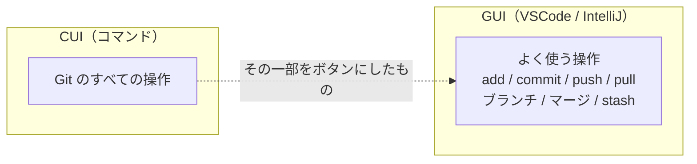
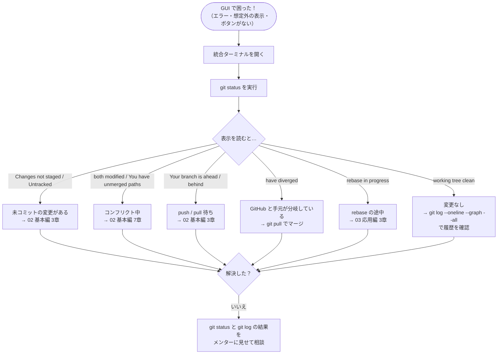
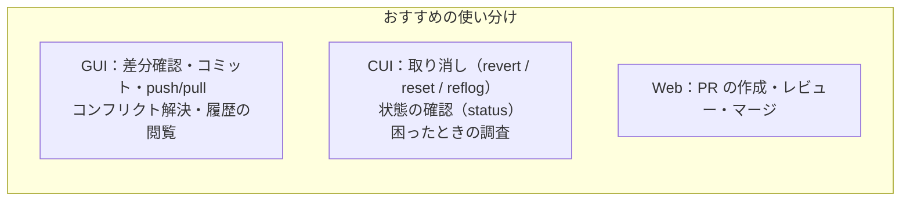

# 06. CUI と GUI の使い分け

← 前へ [04. GUI VSCode編](./04_GUI_VSCode編.md) / [05. GUI IntelliJ編](./05_GUI_IntelliJ編.md) ｜ 最初へ → [00. 導入・初期設定](./00_Git導入・初期設定.md#git-資料の構成)

GUI は便利ですが、**すべての Git 操作ができるわけではありません**。この資料では、GUI でできない（やりにくい）操作と、GUI で困ったときに CUI に戻る方法をまとめます。

<!--
【メンテナンス担当者へ】
下の対応表の ○△× は、VSCode・IntelliJ IDEA のバージョンアップで変わることがあります。
実機で確認したら、次の「確認したバージョン」を更新してください。
-->

> **確認したバージョン**：VSCode （未記入） ／ IntelliJ IDEA （未記入）
> バージョンによってメニューの名前や有無が変わることがあります。

## 目次

1. [基本の考え方](#1-基本の考え方)
2. [操作ごとの対応表](#2-操作ごとの対応表)
3. [GUI で困ったら CUI に戻る](#3-gui-で困ったら-cui-に戻る)
4. [GUI のほうが得意なこと](#4-gui-のほうが得意なこと)
5. [IntelliJ の Local History](#5-intellij-の-local-history)

---

## 1. 基本の考え方

- GUI のボタンは、**裏で Git のコマンドを実行しているだけ**です。
- **毎日の作業は GUI、特殊な操作や困ったときは CUI** と使い分けるのがおすすめです。
- VSCode と IntelliJ のどちらにも、**統合ターミナル**があります。GUI で作業していても、すぐに CUI に切り替えられます。

---

## 2. 操作ごとの対応表

**○**：ボタン操作でできる　**△**：設定や拡張機能が必要、または一部だけできる　**×**：標準機能ではできない（CUI を使う）

### 取り消し・履歴の書き換え

| やりたいこと | CUI | VSCode | IntelliJ |
|---|---|---|---|
| 直前のコミットを取り消す（push 前） | `git reset --soft HEAD~1` | ○ 前回のコミットを元に戻す | ○ Undo Commit |
| **任意のコミットまで** reset する（soft / mixed / hard） | `git reset --モード コミットID` | **×** | ○ Reset Current Branch to Here |
| push 済みのコミットを revert する | `git revert コミットID` | **×** | ○ Revert Commit |
| マージコミットを revert する | `git revert -m 1 コミットID` | **×** | △ 親を選ぶダイアログが出る |
| reflog で消えたコミットを復元する | `git reflog` | **×** | **×**（Local History で救える場合あり → [5章](#5-intellij-の-local-history)） |
| force push（`--force-with-lease`） | `git push --force-with-lease` | △ 設定 `git.allowForcePush` を有効にすると「プッシュ (強制)」が使える | ○ Force Push |
| 対話的 rebase（コミットの並べ替え・まとめ） | `git rebase -i` | **×** | ○ Interactively Rebase from Here |
| マージを中止する | `git merge --abort` | △ ボタンが見つけにくい → ターミナル推奨 | ○ Abort Merge |

### ブランチ・リモート

| やりたいこと | CUI | VSCode | IntelliJ |
|---|---|---|---|
| GitHub 上のブランチも一覧表示 | `git branch -a` | ○ ブランチ一覧に `origin/〇〇` が出る | ○ ブランチポップアップの Remote |
| GitHub で削除済みのブランチの控えを消す | `git fetch --prune` | ○ 「…」→ フェッチ (削除) | △ 設定や Fetch の挙動による |
| GitHub 上のブランチを削除する | `git push origin --delete 名前` | △ 「…」→ ブランチ → リモート ブランチの削除 | ○ Remote ブランチを右クリック → Delete |
| 別ブランチの特定のコミットだけ取り込む | `git cherry-pick コミットID` | △ コマンドパレットの「Git: チェリーピック」（ID を入力） | ○ Log で右クリック → Cherry-Pick |

### 退避・その他

| やりたいこと | CUI | VSCode | IntelliJ |
|---|---|---|---|
| 新規ファイルも含めて stash | `git stash -u` | ○ スタッシュ (未追跡ファイルを含む) | △ シェルフなら選べる |
| **特定のファイルだけ** 退避する | `git stash push -- ファイル名` | △ ステージ済みの変更だけ退避できる場合あり | ○ Shelve Changes でファイルを選ぶ |
| 未追跡ファイルをまとめて削除 | `git clean -fd` | △ 変更を破棄（未追跡ファイルを含めて全破棄） | △ Unversioned Files を選んで Delete |
| 名前・メールなどの設定を確認・変更 | `git config --list` | **×** | **×** |
| 履歴を作者・期間・ファイルで絞り込む | `git log --author=名前` など | △ ファイル単位はタイムライン | ○ Log のフィルター |
| バグが入ったコミットを探す | `git bisect` | **×** | **×** |

> **VSCode で×の操作を GUI でやりたい場合**は、拡張機能（例：**Git Graph**、**GitLens**）を入れるとできるようになるものもあります。ただし、まずは CUI で仕組みを理解してから使いましょう。

---

## 3. GUI で困ったら CUI に戻る

### 状況別：CUI に戻るべき場面

| 状況 | 使うコマンド | 詳しくは |
|---|---|---|
| push 済みのコミットを取り消したい（VSCode） | `git revert コミットID` | [03 応用編 4-4](./03_CUI応用編.md#4-4-push-済みのコミットを取り消すrevert) |
| 間違えて reset --hard してしまった | `git reflog` | [03 応用編 4-6](./03_CUI応用編.md#4-6-消しすぎたときの最終手段reflog) |
| マージを途中でやめたい（VSCode） | `git merge --abort` | [02 基本編 7章](./02_CUI基本編.md#7-コンフリクトを解決する) |
| GUI のエラーメッセージの意味が分からない | `git status` | [02 基本編 2章](./02_CUI基本編.md#2-状態を確認する) |
| 何がどうなっているか全体を見たい | `git log --oneline --graph --all` | [03 応用編 1章](./03_CUI応用編.md#1-履歴を見る習慣をつける) |

> **メンターに相談するときは**、`git status` と `git log --oneline --graph --all` の結果をそのまま貼り付けると、状況がすぐに伝わります。GUI のスクリーンショットだけより、ずっと早く解決できます。

---

## 4. GUI のほうが得意なこと

CUI でもできますが、GUI のほうが**ずっと分かりやすい**操作もあります。

| 操作 | GUI が得意な理由 |
|---|---|
| **差分の確認** | 変更前・変更後を左右に並べて、色付きで見られる |
| **コンフリクトの解決** | 3画面のエディタで、自分側・相手側・結果を見比べながらクリックで選べる |
| **行単位のコミット** | ファイルの一部だけをコミットに含めるのが、クリックだけでできる（CUI は `git add -p` で対話的に選ぶ必要がある） |
| **履歴グラフの閲覧** | ブランチの分かれ方をグラフで見て、クリックで中身を確認できる |
| **PR のレビュー** | コードの横にコメントを書ける（GitHub の Web 画面や拡張機能） |

---

## 5. IntelliJ の Local History

IntelliJ IDEA には、Git とは別に **Local History**（ローカル履歴）という機能があります。ファイルを保存するたびに、IntelliJ が自動で履歴を残しています。

- **Git にコミットしていない変更でも**、過去の状態に戻せる
- Rollback や Force Checkout で消してしまった変更を、救える場合がある

**使い方**：ファイル（またはフォルダ）を右クリック → **Local History** → **Show History** → 戻したい時点を選んで **Revert**。

<!-- 📷 SS: /images/git/intellij/ij-99-01-local-history.png -->
> 📷 **スクショ指定：`ij-99-01-local-history.png`**
> - 画面：Local History の画面（左に保存時刻の一覧、右に差分）
> - 強調：時刻の一覧、差分、「Revert」ボタンを赤枠で囲む

> ⚠️ Local History は**その PC の IntelliJ の中だけ**に残る一時的な記録です。期間が過ぎると消えるので、**大事な変更は必ずコミット**しましょう。VSCode では、エクスプローラーの **タイムライン** に「ファイルの保存」の履歴が残っていれば、同じように戻せる場合があります。

---

← 前へ [04. GUI VSCode編](./04_GUI_VSCode編.md) / [05. GUI IntelliJ編](./05_GUI_IntelliJ編.md) ｜ 最初へ → [00. 導入・初期設定](./00_Git導入・初期設定.md#git-資料の構成)
