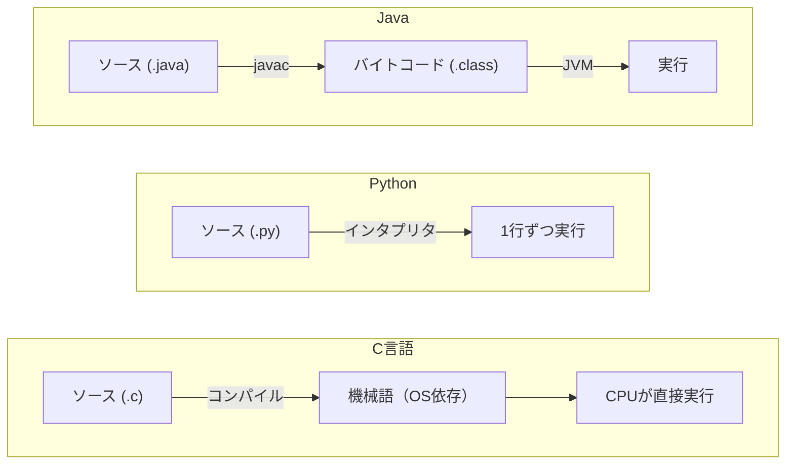
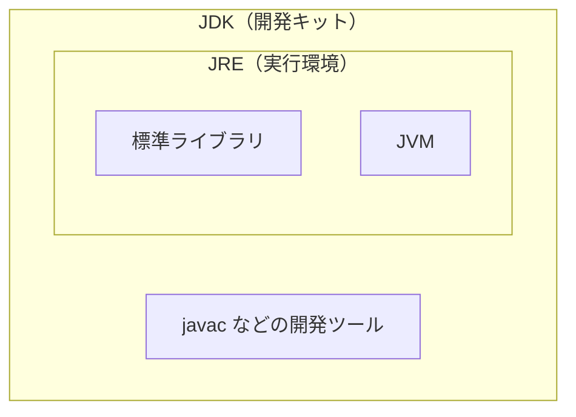

# 01. Javaとは・環境構築

[← 前へ：はじめに](00_はじめに.md) ｜ [次へ：02 基本文法・変数と型 →](02_基本文法・変数と型.md)

## この章のゴール
- Java がどんな言語か説明できる
- JDK をインストールして `Hello, World!` を実行できる
- 「コンパイル → 実行」の流れを理解する

## 目次

1. [Javaとは](#1-javaとは)
2. [JVM・JRE・JDK](#2-jvmjrejdk)
3. [JDKのインストール](#3-jdkのインストール)
4. [Hello World](#4-hello-world)
5. [IDEで実行する](#5-ideで実行する)
6. [Hello Worldを読み解く](#6-hello-worldを読み解く)
7. [よくあるミス](#7-よくあるミス)
8. [練習問題](#8-練習問題)

---

## 1. Javaとは

Java は 1995 年に登場したプログラミング言語で、業務システム、Android アプリ、Web サーバーなど幅広く使われています。

特徴は次のとおりです。

| 特徴 | 説明 |
|---|---|
| **静的型付け** | 変数に型を宣言する（C と同じ。Python とは違う） |
| **オブジェクト指向** | プログラムは**クラス**を単位として書く |
| **コンパイル型 + VM** | ソースを**バイトコード**に変換し、**JVM** が実行する |
| **ポインタなし** | C のようなポインタ操作はなく、メモリは自動管理される（ガベージコレクション） |
| **Write once, run anywhere** | 同じバイトコードが Windows / Mac / Linux で動く |

### C・Python との実行の仕組みの違い



Java は「コンパイルはするが、機械語ではなく JVM 用の中間コードにする」という中間的な方式です。そのおかげで OS が違っても同じ `.class` ファイルを動かせます。

## 2. JVM・JRE・JDK

| 用語 | 意味 |
|---|---|
| **JVM** (Java Virtual Machine) | バイトコードを実行する仮想マシン |
| **JRE** (Java Runtime Environment) | JVM + 標準ライブラリ。**実行だけ**ならこれで足りる |
| **JDK** (Java Development Kit) | JRE + コンパイラ(`javac`)など。**開発にはこれが必要** |



→ このプロジェクトでは **JDK** をインストールします。

## 3. JDKのインストール

### 3-1. すでに入っているか確認

ターミナル（Windows は PowerShell）で次を実行します。

```bash
java -version
javac -version
```

どちらもバージョンが表示されれば OK です。この資料は **Java 25** を前提にしているので、`25` と表示されることを確認してください（25 より古い場合は次の手順で入れ直します）。

### 3-2. インストール（Windows の場合）

1. [Adoptium (Eclipse Temurin)](https://adoptium.net/) から **JDK 25 (LTS)** のインストーラ（`.msi`）をダウンロード
2. インストール時に **「Set JAVA_HOME variable」「Add to PATH」** を有効にする
3. **新しいターミナルを開き直して**、3-1 のコマンドで確認

> macOS: `brew install --cask temurin@25`　／　Ubuntu: `sudo apt install openjdk-25-jdk`（ディストリビューションのリポジトリに無い場合は Adoptium の配布パッケージを使います）

### 3-3. 「コマンドが見つかりません」と出たら
- ターミナルを開き直したか（PATH は起動時に読み込まれる）
- インストール時に PATH の追加を選んだか

## 4. Hello World

適当なフォルダに `Hello.java` を作ります。

```java
public class Hello {
    public static void main(String[] args) {
        System.out.println("Hello, World!");
    }
}
```

ターミナルで、そのフォルダに移動して実行します。

```bash
javac Hello.java
java Hello
```

実行結果：

```
Hello, World!
```

`javac` を実行すると `Hello.class`（バイトコード）が作られます。`java Hello` は、その `Hello.class` を JVM で動かしています。


> ⚠️ **ファイル名は `Hello.java`、クラス名も `Hello`**。`public class` の名前とファイル名は**完全に一致**させる必要があります（大文字小文字も区別）。

### Java 25 の簡略記法（コンパクトソースファイル）

Java 25 では、小さなプログラムなら**クラス宣言や `public static`、`String[] args` を省略**できます（JEP 512）。次のコードは、上の `Hello.java` と同じ動作です。

```java
void main() {
    IO.println("Hello, World!");
}
```

- `IO.println` は `java.lang.IO` クラスの出力メソッドで、`import` なしで使えます（`IO.print` / `IO.readln` もあります。入力は 02 章で使います）
- `javac` でコンパイルせずに、`java Hello.java` で直接実行できます
- ファイル名がそのままクラス名になります

> 💡 本格的なプログラム（06 章以降）では、複数のクラスを使うため従来どおり `public class` を書きます。この資料では、**仕組みを理解しやすい従来形式を基本**にし、短いサンプルでは簡略記法も併記します。

> 💡 **Windows のターミナルで日本語が文字化けする場合**
> Java 18 以降はソースファイルやファイル入出力の既定文字コードが UTF-8 ですが、**コンソール側**の文字コードが UTF-8 でないと画面の表示が化けることがあります。次のどちらかで解消できます。
> - `chcp 65001` を実行してから `java` を実行する
> - `java -Dstdout.encoding=UTF-8 Hello` で実行する
>
> ソースファイルは **UTF-8** で保存してください。IDE（IntelliJ / VSCode）で実行する場合は、通常この問題は起きません。

## 5. IDEで実行する

### IntelliJ IDEA（推奨）
1. [IntelliJ IDEA Community](https://www.jetbrains.com/idea/download/) をインストール
2. **New Project** → Language: Java、Build system: **IntelliJ**、JDK: 25 を選択
3. `src` フォルダ内に `Hello` クラスを作成し、コードを貼る
4. `main` の横の緑の ▶ をクリック

### VSCode
1. 拡張機能 **Extension Pack for Java** をインストール
2. フォルダを開いて `Hello.java` を作成
3. `main` の上に表示される **Run** をクリック

## 6. Hello Worldを読み解く

```java
public class Hello {                                   // ①
    public static void main(String[] args) {           // ②
        System.out.println("Hello, World!");           // ③
    }
}
```

| 番号 | 説明 |
|---|---|
| ① | **クラスの宣言**。Java ではすべてのコードはクラスの中に書く |
| ② | **main メソッド**。プログラムはここから始まる（C の `main` と同じ役割）。`public static void` の意味は 05・06 章で説明するので、今は「おまじない」でOK |
| ③ | 画面に出力して改行（C の `printf` + `\n`、Python の `print` に近い） |

出力の書き方の比較：

| | 改行あり | 改行なし |
|---|---|---|
| Python | `print("A")` | `print("A", end="")` |
| C | `printf("A\n");` | `printf("A");` |
| Java | `System.out.println("A");` | `System.out.print("A");` |

その他の基本ルール：

- 文の終わりには **`;`** が必要（C と同じ。Python と違う）
- ブロックは **`{ }`** で囲む（インデントに意味はないが、読みやすさのため揃える）
- 文字列は **`" "`**（ダブルクォート）。`' '` は 1 文字用（02 章）
- コメントは `//` （1 行）と `/* ... */`（複数行）

## 7. よくあるミス

| エラーメッセージ | 原因 |
|---|---|
| `class Hello is public, should be declared in a file named Hello.java` | ファイル名とクラス名が違う |
| `';' expected` | 行末の `;` 忘れ |
| `cannot find symbol` | スペルミス（`System` を `system` と書くなど）。Java は**大文字小文字を区別** |
| `error: Could not find or load main class Hello` | `java Hello.class` と書いた、または別フォルダで実行している |
| `'javac' は、内部コマンドまたは外部コマンド…` | JDK が未インストール、または PATH 未設定 |

## 8. 練習問題

**問1.** 自己紹介（名前・所属）を 2 行で表示するプログラム `Intro` を作成してください。

**問2.** `System.out.println` を `System.out.print` に変えると、出力はどう変わりますか？ 試してください。

**問3.** わざと `;` を消してコンパイルし、エラーメッセージを読んでみましょう。

<details>
<summary>解答例</summary>

**問1**
```java
public class Intro {
    public static void main(String[] args) {
        System.out.println("名前：山田太郎");
        System.out.println("所属：システム班");
    }
}
```

**問2** `print` は改行しないので、複数回呼ぶと同じ行につながって表示されます。

**問3** `Intro.java:3: error: ';' expected` のように、**行番号**と原因が表示されます。エラーが出たらまず行番号を見る習慣をつけましょう。
</details>

---

[← 前へ：はじめに](00_はじめに.md) ｜ [次へ：02 基本文法・変数と型 →](02_基本文法・変数と型.md)
