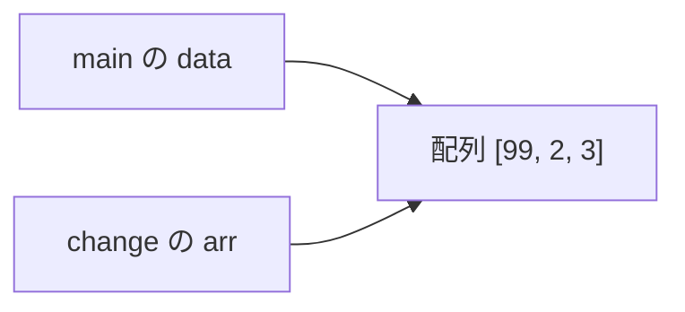
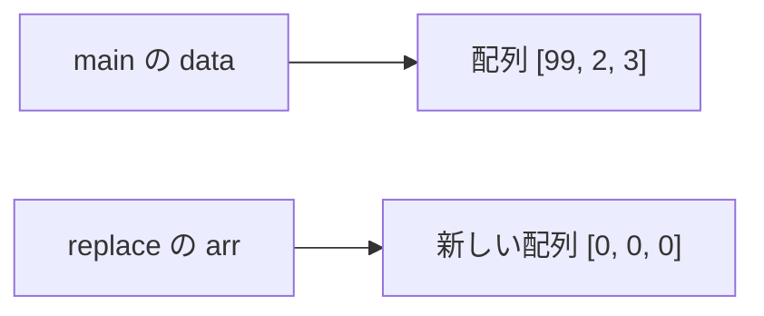

# 05. メソッド

[← 前へ：04 配列とコレクション](04_配列とコレクション.md) ｜ [次へ：06 クラスとオブジェクト →](06_クラスとオブジェクト.md)

## この章のゴール
- メソッド（関数）を定義して呼び出せる
- オーバーロードを理解する
- `static` の意味と、Java の「値渡し」を説明できる

## 目次

1. [メソッドとは](#1-メソッドとは)
2. [メソッドの定義と呼び出し](#2-メソッドの定義と呼び出し)
3. [戻り値がない場合 void](#3-戻り値がない場合-void)
4. [オーバーロード](#4-オーバーロード)
5. [static とは](#5-static-とは)
6. [値渡しと参照](#6-値渡しと参照)
7. [再帰](#7-再帰)
8. [よくあるミス](#8-よくあるミス)
9. [練習問題](#9-練習問題)

---

## 1. メソッドとは

C や Python の**関数**にあたるものを、Java では**メソッド**と呼びます。Java ではすべてクラスの中に書くので、「クラスに属する関数」という扱いです。

| | 定義の書き方 |
|---|---|
| Python | `def add(a, b):` |
| C | `int add(int a, int b) { ... }` |
| Java | `static int add(int a, int b) { ... }` |

## 2. メソッドの定義と呼び出し

```
修飾子  戻り値の型  メソッド名(引数の型 引数名, ...) {
    処理
    return 戻り値;
}
```

```java
public class MethodSample {

    // 2つの整数の和を返す
    static int add(int a, int b) {
        return a + b;
    }

    // 配列の平均を返す
    static double average(int[] values) {
        int sum = 0;
        for (int v : values) {
            sum += v;
        }
        return (double) sum / values.length;
    }

    public static void main(String[] args) {
        int result = add(3, 5);
        System.out.println(result);                    // 8

        int[] scores = {80, 65, 92};
        System.out.println(average(scores));           // 79.0
    }
}
```

ポイント：

- 引数にも戻り値にも**型を必ず書く**
- メソッドは `main` の**前に書いても後に書いてもよい**（C のようなプロトタイプ宣言は不要）
- 戻り値を返すメソッドは、すべての経路で `return` が必要

## 3. 戻り値がない場合 void

戻り値がないときは型に `void` を書きます（C と同じ）。

```java
static void greet(String name) {
    System.out.println("こんにちは、" + name + "さん");
}

public static void main(String[] args) {
    greet("Taro");     // こんにちは、Taroさん
}
```

## 4. オーバーロード

Java では、**同じ名前でも引数の型や個数が違えば、複数のメソッドを定義できます**。これを**オーバーロード**と呼びます（C や Python にはない機能です）。

```java
public class Overload {
    static int add(int a, int b) {
        return a + b;
    }

    static double add(double a, double b) {
        return a + b;
    }

    static int add(int a, int b, int c) {
        return a + b + c;
    }

    public static void main(String[] args) {
        System.out.println(add(1, 2));        // 3      → (int, int)
        System.out.println(add(1.5, 2.5));    // 4.0    → (double, double)
        System.out.println(add(1, 2, 3));     // 6      → (int, int, int)
    }
}
```

実際に `System.out.println` も、`int`、`String`、`double` など様々な型に対応するオーバーロードを持っています。

> Python の「デフォルト引数 `def f(a, b=0)`」は Java にはありません。同じ目的のためにオーバーロードを使います。
> 戻り値の型だけが違うメソッドはオーバーロードできません。

## 5. static とは

`public static void main` に出てきた `static` を説明します。

| | 意味 | 呼び出し方 |
|---|---|---|
| `static` あり | **クラスに属する**。オブジェクトを作らなくても呼べる | `クラス名.メソッド名()` |
| `static` なし | **オブジェクトに属する**。オブジェクトを作ってから呼ぶ | `オブジェクト.メソッド名()` |

`static` なしのメソッドは、次の [06 章](06_クラスとオブジェクト.md) で扱います。今は「**`main` から直接呼ぶメソッドには `static` を付ける**」と覚えておけば大丈夫です。

```java
public class MathUtil {
    static int square(int x) {
        return x * x;
    }

    public static void main(String[] args) {
        System.out.println(square(4));            // 同じクラス内ならそのまま呼べる
        System.out.println(MathUtil.square(5));   // クラス名を付けても呼べる
        System.out.println(Math.sqrt(16));        // 標準ライブラリの static メソッドの例 → 4.0
    }
}
```

`Math.sqrt()`、`Integer.parseInt()`、`Arrays.sort()` などは、すべて `static` メソッドです。

> `static` メソッドの中から、`static` でないメソッドを直接呼ぶことはできません（オブジェクトがまだ存在しないため）。

> 💡 **Java 25 の簡略記法との関係**：01 章で紹介した `void main() { ... }`（コンパクトソースファイル）では、`main` が `static` でない**インスタンスメソッド**になります。同じファイルに書くメソッドも、`static` を付けずに呼べます。ただし、この資料では従来どおり `public static void main` を基本にします。

```java
// Java 25 の簡略記法（static なしで書ける）
int square(int x) {
    return x * x;
}

void main() {
    IO.println(square(4));   // 16
}
```

## 6. 値渡しと参照

Java の引数は、**常に値のコピー**が渡されます（値渡し）。ただし、渡されるものが基本型かオブジェクトかで動作が変わります。

### 基本型：コピーが渡される

```java
static void inc(int x) {
    x = x + 1;           // コピーを変更しているだけ
}

public static void main(String[] args) {
    int a = 10;
    inc(a);
    System.out.println(a);   // 10  （変わらない）
}
```

### 配列・オブジェクト：「参照（アドレス）」のコピーが渡される

```java
import java.util.Arrays;

public class Reference {
    static void change(int[] arr) {
        arr[0] = 99;                 // 同じ配列を指しているので、元の配列が変わる
    }

    static void replace(int[] arr) {
        arr = new int[]{0, 0, 0};    // 参照を付け替えても、呼び出し元には影響しない
    }

    public static void main(String[] args) {
        int[] data = {1, 2, 3};

        change(data);
        System.out.println(Arrays.toString(data));   // [99, 2, 3]

        replace(data);
        System.out.println(Arrays.toString(data));   // [99, 2, 3]  （変わらない）
    }
}
```

図にすると：

`change(data)` では、`data` と `arr` が**同じ配列**を指しているので、中身の書き換えが `main` 側にも反映されます。



`replace(data)` では、`arr` の向き先を新しい配列に付け替えただけなので、`data` は影響を受けません。



| 比較 | 動作 |
|---|---|
| Python | オブジェクトへの参照を渡す（`list` を変更すれば呼び出し元も変わる） → **Java の配列・オブジェクトと同じ** |
| C | 値渡し。変更したければポインタを渡す |
| Java | **ポインタを書かなくても**、配列・オブジェクトは参照が渡される |

> `String` は変更不可なので、メソッド内で変更しても呼び出し元には影響しません。

### 使わない変数は `_` で受ける

Java 22 以降、使わない変数（引数以外のローカル変数・ループ変数・`catch` の変数など）には名前の代わりに `_`（**無名変数**）を書けます。「使わない」ことが読み手に伝わります。

```java
int count = 0;
for (String _ : List.of("a", "b", "c")) {   // 中身は使わず、回数だけ数える
    count++;
}
System.out.println(count);   // 3
```

## 7. 再帰

自分自身を呼ぶ再帰も、C / Python と同じです。

```java
public class Recursion {
    static int factorial(int n) {
        if (n <= 1) return 1;
        return n * factorial(n - 1);
    }

    public static void main(String[] args) {
        System.out.println(factorial(5));   // 120
    }
}
```

## 8. よくあるミス

| エラー | 原因 |
|---|---|
| `missing return statement` | 戻り値ありのメソッドで、`return` を通らない経路がある |
| `non-static method xxx cannot be referenced from a static context` | `static` な `main` から、`static` でないメソッドを呼んだ |
| `incompatible types: possible lossy conversion from double to int` | `double` の戻り値を `int` 変数に代入した |
| 引数の個数・型が違う | `method xxx cannot be applied to given types`。引数を確認する |

## 9. 練習問題

**問1.** 整数 `n` を受け取り、偶数なら `true` を返すメソッド `isEven` を作成してください。

**問2.** 整数配列の最大値を返すメソッド `max(int[] a)` を作成してください。

**問3.** 2 つの整数の**最大公約数**を返すメソッド `gcd(int a, int b)` を再帰で作成してください。

**問4.** 配列の中身を逆順に並べ替える `void reverse(int[] a)` を作成し、`main` で呼んで結果を確認してください。（引数の配列が書き換わることの確認）

<details>
<summary>解答例</summary>

**問1**
```java
static boolean isEven(int n) {
    return n % 2 == 0;
}
```

**問2**
```java
static int max(int[] a) {
    int m = a[0];
    for (int v : a) {
        if (v > m) m = v;
    }
    return m;
}
```

**問3**
```java
static int gcd(int a, int b) {
    if (b == 0) return a;
    return gcd(b, a % b);
}
// gcd(48, 18) → 6
```

**問4**
```java
import java.util.Arrays;

public class Reverse {
    static void reverse(int[] a) {
        for (int i = 0; i < a.length / 2; i++) {
            int tmp = a[i];
            a[i] = a[a.length - 1 - i];
            a[a.length - 1 - i] = tmp;
        }
    }

    public static void main(String[] args) {
        int[] data = {1, 2, 3, 4, 5};
        reverse(data);
        System.out.println(Arrays.toString(data));   // [5, 4, 3, 2, 1]
    }
}
```
</details>

---

[← 前へ：04 配列とコレクション](04_配列とコレクション.md) ｜ [次へ：06 クラスとオブジェクト →](06_クラスとオブジェクト.md)
