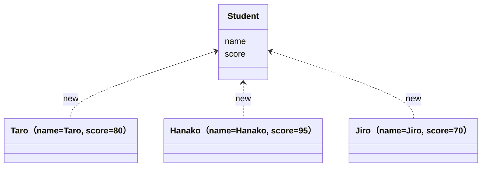

# 06. クラスとオブジェクト

[← 前へ：05 メソッド](05_メソッド.md) ｜ [次へ：07 継承とポリモーフィズム →](07_継承とポリモーフィズム.md)

## この章のゴール
- クラスとオブジェクト（インスタンス）の違いを説明できる
- フィールド・コンストラクタ・メソッドを持つクラスを定義できる
- カプセル化（`private` + getter / setter）の意味が分かる
- `toString` / `equals` の役割を理解する

## 目次

1. [オブジェクト指向とは](#1-オブジェクト指向とは)
2. [クラスの定義](#2-クラスの定義)
3. [オブジェクトの生成と使用](#3-オブジェクトの生成と使用)
4. [コンストラクタ](#4-コンストラクタ)
5. [this](#5-this)
6. [カプセル化](#6-カプセル化)
7. [toString と equals](#7-tostring-と-equals)
8. [static フィールド](#8-static-フィールド)
9. [record（補足）](#9-record補足)
10. [複数ファイルに分ける](#10-複数ファイルに分ける)
11. [よくあるミス](#11-よくあるミス)
12. [練習問題](#12-練習問題)

---

## 1. オブジェクト指向とは

これまでは「データ」と「処理（関数）」を別々に書いていました。**オブジェクト指向**では、**データと、そのデータを扱う処理をひとまとめ**にして考えます。

- **クラス**：オブジェクトの**設計図**
- **オブジェクト（インスタンス）**：設計図から作られた**実体**



| | 考え方 |
|---|---|
| C | `struct`（データ）+ 関数を別々に持つ |
| Python | `class` を使って書く（`self`） |
| Java | **すべてがクラス**の中。`struct` に相当するものはなく、データと処理を持つクラスを作る |

## 2. クラスの定義

学生を表す `Student` クラスを作ります。

```java
public class Student {
    // フィールド（データ）
    String name;
    int score;

    // メソッド（処理）
    void introduce() {
        System.out.println("私は" + name + "です。点数は" + score + "点です。");
    }

    boolean isPassed() {
        return score >= 60;
    }
}
```

- **フィールド**：オブジェクトが持つデータ（変数）。Python の `self.name`、C の構造体メンバに相当
- **メソッド**：オブジェクトに対する操作。**`static` を付けない**（付けると「クラスの」メソッドになる）

## 3. オブジェクトの生成と使用

`new` でオブジェクトを作り、`.` でフィールドやメソッドを使います。

```java
public class Main {
    public static void main(String[] args) {
        Student s1 = new Student();    // オブジェクト生成
        s1.name = "Taro";
        s1.score = 80;

        Student s2 = new Student();
        s2.name = "Hanako";
        s2.score = 45;

        s1.introduce();                      // 私はTaroです。点数は80点です。
        s2.introduce();                      // 私はHanakoです。点数は45点です。
        System.out.println(s1.isPassed());   // true
        System.out.println(s2.isPassed());   // false
    }
}
```

> `Student s1 = new Student();` は、「`Student` 型の変数 `s1` を用意して、そこに新しい `Student` オブジェクトの**参照（場所）**を入れる」という意味です。[05 章](05_メソッド.md) の参照の話と同じです。

```java
Student a = new Student();
Student b = a;        // b は a と同じオブジェクトを指す（コピーではない）
b.name = "X";
System.out.println(a.name);   // X
```

## 4. コンストラクタ

`new` のたびに 1 つずつフィールドを代入するのは面倒です。オブジェクトを作る瞬間に**初期化する特別なメソッド**が**コンストラクタ**です（Python の `__init__` に相当）。

```java
public class Student {
    String name;
    int score;

    // コンストラクタ：クラス名と同じ名前で、戻り値の型は書かない
    Student(String name, int score) {
        this.name = name;
        this.score = score;
    }

    void introduce() {
        System.out.println("私は" + name + "です。点数は" + score + "点です。");
    }
}
```

```java
Student s = new Student("Taro", 80);   // 作成と同時に初期化
s.introduce();                         // 私はTaroです。点数は80点です。
```

- コンストラクタを**1つも書かない**と、引数なしの空のコンストラクタが自動で用意される
- コンストラクタを**1つでも書く**と、自動のものは消える（`new Student()` はエラーになる）
- メソッドと同じく**オーバーロード**できる

```java
Student(String name) {
    this(name, 0);      // 別のコンストラクタを呼ぶ
}
```

> 💡 **Java 25：コンストラクタ内で `super(...)` / `this(...)` の前に処理を書ける**（柔軟なコンストラクタ本体、JEP 513）
> これまでは、`super(...)` や `this(...)` がコンストラクタの**最初の文**でなければならず、引数の検査が書きにくい問題がありました。Java 25 では、それらの呼び出しの**前**に、引数の検査や計算を書けます（ただし、作成中のオブジェクトの `this` は、呼び出しの前には使えません）。継承（`super`）は [07 章](07_継承とポリモーフィズム.md) で説明します。
>
> ```java
> Student(String name) {
>     if (name == null || name.isBlank()) {          // this(...) の前で検査できる
>         throw new IllegalArgumentException("名前は必須です");
>     }
>     this(name, 0);
> }
> ```

## 5. this

`this` は「**このオブジェクト自身**」を指します（Python の `self`）。Python と違い、**メソッドの引数に書かなくてよい**のが特徴です。

引数名とフィールド名が同じとき、`this.` を付けるとフィールドを指します。

```java
Student(String name, int score) {
    this.name = name;     // 左：フィールド  右：引数
    this.score = score;
}
```

`this.` を付けないと、引数同士の代入（`name = name;`）になり、フィールドが初期化されません。

| Python | Java |
|---|---|
| `def __init__(self, name):` | `Student(String name) {` |
| `self.name = name` | `this.name = name;` |
| `def introduce(self):` | `void introduce() {` |

## 6. カプセル化

`s.score = -100;` のように、**外から勝手に不正な値を入れられてしまう**のは危険です。そこで、フィールドを `private`（クラスの外から見えない）にして、**メソッドを通してだけ**操作させます。これが**カプセル化**です。

### アクセス修飾子

| 修飾子 | どこからアクセスできるか |
|---|---|
| `public` | どこからでも |
| `private` | **そのクラスの中だけ** |
| （なし） | 同じパッケージ（フォルダ）内 |
| `protected` | 同じパッケージ + 子クラス（07 章） |

### getter / setter

```java
public class Student {
    private String name;
    private int score;

    public Student(String name, int score) {
        this.name = name;
        setScore(score);        // 検査付きの setter を使う
    }

    // getter：値を取得する
    public String getName() {
        return name;
    }

    public int getScore() {
        return score;
    }

    // setter：検査してから値を設定する
    public void setScore(int score) {
        if (score < 0 || score > 100) {
            System.out.println("点数は0〜100にしてください");
            return;
        }
        this.score = score;
    }
}
```

```java
Student s = new Student("Taro", 80);
// s.score = 500;        // エラー：score は private
s.setScore(500);         // 点数は0〜100にしてください
s.setScore(90);
System.out.println(s.getName() + ":" + s.getScore());   // Taro:90
```

| 言語 | 隠蔽の仕組み |
|---|---|
| Python | `_name` と書く慣習（実際にはアクセスできる） |
| C | 構造体のメンバは全部見える |
| Java | `private` で**文法として禁止**できる |

> 💡 基本方針：**フィールドは `private`、外から使うメソッドは `public`**。IDE では「getter/setter を自動生成」する機能が使えます（IntelliJ: `Alt + Insert`）。

## 7. toString と equals

### toString：オブジェクトを文字列にする

そのまま `println` すると `Student@1b6d3586` のような意味のない文字列になります。`toString` を定義すると、好きな表示にできます（Python の `__str__` に相当）。

```java
@Override
public String toString() {
    return "Student{name=" + name + ", score=" + score + "}";
}
```

```java
System.out.println(new Student("Taro", 80));   // Student{name=Taro, score=80}
```

`@Override` は「親クラスのメソッドを上書きしている」という印です（[07 章](07_継承とポリモーフィズム.md) で説明）。

### equals：「中身が同じか」を判定する

`==` は「同じオブジェクトか」、`equals` は「中身が同じか」の比較です。自作クラスで `equals` を定義しないと、`==` と同じ動作になります。

```java
@Override
public boolean equals(Object o) {
    if (this == o) return true;
    return o instanceof Student other        // 型の判定と変数の宣言を同時に行う
            && this.name.equals(other.name)
            && this.score == other.score;
}
```

`o instanceof Student other` は、「`o` が `Student` なら、`Student` 型の変数 `other` として使う」という書き方です（**パターンマッチング**。キャストを別に書かなくてよい）。詳しくは [07 章](07_継承とポリモーフィズム.md) で説明します。

> `equals` を定義したときは、`hashCode` も定義する必要があります（`HashMap` や `HashSet` で正しく動かすため）。IDE の自動生成を使うか、次の [record](#9-record補足) を使うと簡単です。

## 8. static フィールド

`static` を付けたフィールドは、**全オブジェクトで共通の 1 つ**です。

```java
public class Counter {
    private static int count = 0;   // 全オブジェクトで共有
    private final int id;           // オブジェクトごとに別

    public Counter() {
        count++;
        this.id = count;
    }

    public int getId() { return id; }
    public static int getCount() { return count; }   // static メソッド
}
```

```java
new Counter();
new Counter();
Counter c3 = new Counter();
System.out.println(c3.getId());          // 3
System.out.println(Counter.getCount());  // 3   （クラス名で呼ぶ）
```

## 9. record（補足）

「データを持つだけ」のクラスは、`record` で非常に短く書けます。コンストラクタ、getter、`toString`、`equals`、`hashCode` が自動で作られます。

```java
public record Point(int x, int y) { }
```

```java
Point p = new Point(3, 4);
System.out.println(p);               // Point[x=3, y=4]
System.out.println(p.x());           // 3   （getter は x() の形）
System.out.println(p.equals(new Point(3, 4)));   // true
```

`record` のフィールドは変更できません（イミュータブル）。変更が必要なら通常の `class` を使います。

### record に検査やメソッドを追加する

**コンパクトコンストラクタ**（引数リストを省略した形）を使うと、作成時の検査を書けます。メソッドや `static` メソッドも追加できます。

```java
public record Score(String name, int value) {
    // コンパクトコンストラクタ：代入は自動で行われるので、検査だけ書く
    public Score {
        if (value < 0 || value > 100) {
            throw new IllegalArgumentException("点数は0〜100にしてください: " + value);
        }
    }

    public boolean isPassed() {
        return value >= 60;
    }

    public static Score of(String name, int value) {
        return new Score(name, value);
    }
}
```

### record パターン

`record` は、`instanceof` や `switch` で**中身を取り出しながら**判定できます（**レコードパターン**）。

```java
Object obj = new Point(3, 4);

if (obj instanceof Point(int x, int y)) {
    System.out.println("x=" + x + ", y=" + y);   // x=3, y=4
}
```

`switch` との組み合わせは [07 章](07_継承とポリモーフィズム.md) で扱います。

## 10. 複数ファイルに分ける

通常は **1 つの `public class` につき 1 ファイル**にします。

```
src/
├── Student.java    ← public class Student
└── Main.java       ← public class Main （main メソッドを持つ）
```

同じフォルダにあれば `import` なしで使えます。

```bash
javac Student.java Main.java
java Main
```

## 11. よくあるミス

| ミス | 原因・対処 |
|---|---|
| `constructor Student in class Student cannot be applied to given types` | コンストラクタの引数が合っていない。あるいは引数なしのコンストラクタを消してしまった |
| `score has private access in Student` | `private` なフィールドに外から直接アクセスしている。getter / setter を使う |
| `NullPointerException` | オブジェクトを作る前（`null`）のまま、メソッドを呼んだ。`Student s;` だけでは作られていない |
| `this.name = name` を `name = name` と書いた | フィールドが初期化されない（`null` のまま） |
| コンストラクタに `void` を書いた | 通常のメソッド扱いになり、コンストラクタとして動かない |

## 12. 練習問題

**問1.** 次のフィールドをもつ `Book` クラスを作成してください。
- `title`（String）, `price`（int）をコンストラクタで初期化
- `private` フィールドと getter
- `toString` を定義し、`Book{title=Java入門, price=2500}` の形式で出力

**問2.** 銀行口座 `Account` クラスを作成してください。
- フィールド：`owner`（String）、`balance`（int、`private`）
- メソッド：`deposit(int amount)`（入金）、`withdraw(int amount)`（出金。残高不足なら出金せずメッセージを表示）、`getBalance()`

**問3.** `Student` の `equals` を定義して、名前と点数が同じ 2 つのオブジェクトが `equals` で `true` になることを確認してください。

<details>
<summary>解答例</summary>

**問1**
```java
public class Book {
    private String title;
    private int price;

    public Book(String title, int price) {
        this.title = title;
        this.price = price;
    }

    public String getTitle() { return title; }
    public int getPrice() { return price; }

    @Override
    public String toString() {
        return "Book{title=" + title + ", price=" + price + "}";
    }

    public static void main(String[] args) {
        Book b = new Book("Java入門", 2500);
        System.out.println(b);   // Book{title=Java入門, price=2500}
    }
}
```

**問2**
```java
public class Account {
    private String owner;
    private int balance;

    public Account(String owner, int balance) {
        this.owner = owner;
        this.balance = balance;
    }

    public void deposit(int amount) {
        if (amount <= 0) {
            System.out.println("金額が不正です");
            return;
        }
        balance += amount;
    }

    public void withdraw(int amount) {
        if (amount > balance) {
            System.out.println("残高不足です");
            return;
        }
        balance -= amount;
    }

    public int getBalance() { return balance; }

    public static void main(String[] args) {
        Account a = new Account("Taro", 1000);
        a.deposit(500);
        a.withdraw(2000);                       // 残高不足です
        System.out.println(a.getBalance());     // 1500
    }
}
```

**問3**（06 章の `Student` に `equals` を追加し、以下で確認）
```java
Student a = new Student("Taro", 80);
Student b = new Student("Taro", 80);
System.out.println(a == b);        // false
System.out.println(a.equals(b));   // true
```
</details>

---

[← 前へ：05 メソッド](05_メソッド.md) ｜ [次へ：07 継承とポリモーフィズム →](07_継承とポリモーフィズム.md)
