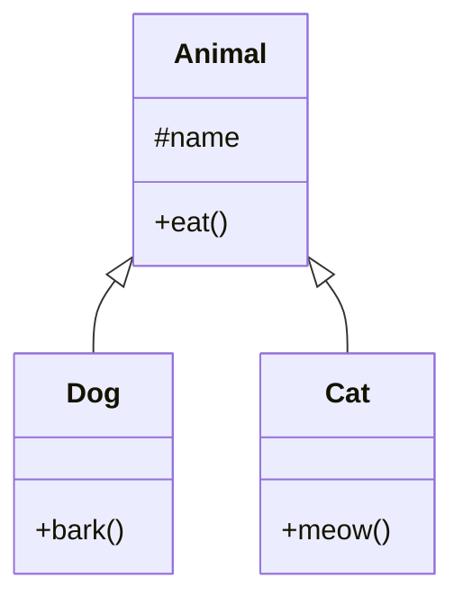
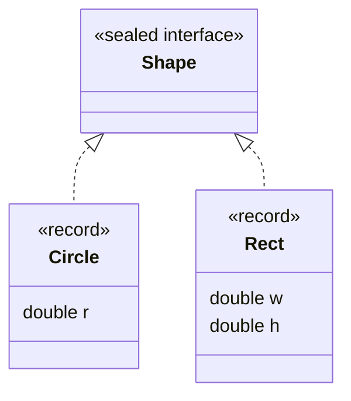

# 07. 継承とポリモーフィズム

[← 前へ：06 クラスとオブジェクト](06_クラスとオブジェクト.md) ｜ [次へ：08 例外処理 →](08_例外処理.md)

## この章のゴール
- 継承（`extends`）を使ってクラスを拡張できる
- オーバーライドとポリモーフィズムを説明できる
- 抽象クラスとインタフェースの違いが分かる

## 目次

1. [継承とは](#1-継承とは)
2. [オーバーライド](#2-オーバーライド)
3. [ポリモーフィズム（多態性）](#3-ポリモーフィズム多態性)
4. [抽象クラス](#4-抽象クラス)
5. [インタフェース](#5-インタフェース)
6. [抽象クラスとインタフェースの使い分け](#6-抽象クラスとインタフェースの使い分け)
7. [Object クラスと instanceof](#7-object-クラスと-instanceof)
8. [よくあるミス](#8-よくあるミス)
9. [練習問題](#9-練習問題)

---

## 1. 継承とは

すでにあるクラスの機能を**引き継いで**、新しいクラスを作る仕組みです。



`Animal` が親クラス（スーパークラス）、`Dog` と `Cat` が子クラス（サブクラス）です。

`extends` で親クラスを指定します。

```java
public class Animal {
    protected String name;       // protected: 子クラスからもアクセスできる

    public Animal(String name) {
        this.name = name;
    }

    public void eat() {
        System.out.println(name + "が食べています");
    }
}
```

```java
public class Dog extends Animal {
    public Dog(String name) {
        super(name);             // 親のコンストラクタを呼ぶ
    }

    public void bark() {
        System.out.println(name + "：ワン！");
    }
}
```

```java
Dog d = new Dog("ポチ");
d.eat();     // ポチが食べています  ← 親から引き継いだメソッド
d.bark();    // ポチ：ワン！
```

- `super(...)`：親クラスのコンストラクタを呼ぶ。Java 25 では、`super(...)` の**前**に引数の検査や計算を書ける（06 章の補足と同じ。ただし `super(...)` より前に `this` のフィールドやメソッドは使えない）
- `Dog` は `Animal` の機能をすべて持つ（**is-a 関係**：犬は動物である）
- Java は**単一継承**：親クラスは 1 つだけ（C++ や Python のような多重継承はできない）

| | 継承の書き方 |
|---|---|
| Python | `class Dog(Animal):` / `super().__init__(name)` |
| Java | `class Dog extends Animal` / `super(name);` |

## 2. オーバーライド

親のメソッドを、子クラスで**上書き**して別の動作にすることができます。

```java
public class Animal {
    protected String name;
    public Animal(String name) { this.name = name; }

    public void speak() {
        System.out.println(name + "：...");
    }
}

public class Dog extends Animal {
    public Dog(String name) { super(name); }

    @Override
    public void speak() {
        System.out.println(name + "：ワン！");
    }
}

public class Cat extends Animal {
    public Cat(String name) { super(name); }

    @Override
    public void speak() {
        System.out.println(name + "：ニャー");
    }
}
```

- **`@Override`** は必ず付ける。付けておくと、メソッド名や引数を間違えたときにコンパイラが教えてくれる
- 親の処理も使いたいときは `super.speak();` を呼ぶ

> **オーバーロードとの違い**
> - オーバーロード：同じクラスで、**同じ名前・違う引数**
> - オーバーライド：親子で、**同じ名前・同じ引数**で中身を置き換える

## 3. ポリモーフィズム（多態性）

**親クラスの型の変数に、子クラスのオブジェクトを入れられます。** そして呼び出したメソッドは、**実際のオブジェクトの種類に応じた動作**になります。これを**ポリモーフィズム**と呼びます。

```java
public class Main {
    public static void main(String[] args) {
        Animal[] animals = {
            new Dog("ポチ"),
            new Cat("タマ"),
            new Animal("ナニカ")
        };

        for (Animal a : animals) {
            a.speak();         // 実際の型に応じたメソッドが呼ばれる
        }
    }
}
```

実行結果：

```
ポチ：ワン！
タマ：ニャー
ナニカ：...
```

`for` の中では `Animal` として扱っていますが、`speak()` は `Dog`、`Cat` それぞれの動作になります。呼ぶ側は**相手が犬か猫かを知らなくてよい**ため、動物の種類が増えても呼び出し側のコードを変えずに済みます。これが多態性の最大のメリットです。

### キャスト

親型の変数からは、子クラス独自のメソッドは呼べません。必要なら型を確認して**ダウンキャスト**します。

```java
Animal a = new Dog("ポチ");
// a.bark();                      // エラー：Animal には bark がない
if (a instanceof Dog) {
    Dog d = (Dog) a;
    d.bark();                      // ポチ：ワン！
}
```

`instanceof` と変数宣言をまとめて書く**パターンマッチング**を使うと、キャストを別に書かずに済みます。**こちらが現在の標準の書き方**です。

```java
if (a instanceof Dog d) {
    d.bark();                      // d は Dog 型として使える
}
```

## 4. 抽象クラス

「**共通部分は書くが、中身は子クラスに任せたい**」というときに使います。`abstract` を付けたクラスは `new` できません。

```java
public abstract class Shape {
    protected String name;

    public Shape(String name) {
        this.name = name;
    }

    // 抽象メソッド：中身を書かない。子クラスで必ず実装する
    public abstract double area();

    // 通常のメソッドも持てる
    public void print() {
        System.out.printf("%s の面積: %.2f%n", name, area());
    }
}
```

```java
public class Circle extends Shape {
    private double r;
    public Circle(double r) {
        super("円");
        this.r = r;
    }
    @Override
    public double area() { return Math.PI * r * r; }
}

public class Rectangle extends Shape {
    private double w, h;
    public Rectangle(double w, double h) {
        super("長方形");
        this.w = w;
        this.h = h;
    }
    @Override
    public double area() { return w * h; }
}
```

```java
Shape[] shapes = { new Circle(1.0), new Rectangle(3, 4) };
for (Shape s : shapes) {
    s.print();
}
// 円 の面積: 3.14
// 長方形 の面積: 12.00
// new Shape("x");   // エラー：抽象クラスはインスタンス化できない
```

## 5. インタフェース

**「できること（ルール）」だけを定義した設計図**です。フィールドは持たず、メソッドの宣言だけを書きます。クラスは `implements` で実装します。

```java
public interface Flyable {
    void fly();               // 自動的に public abstract になる
}

public interface Swimmable {
    void swim();
}
```

```java
public class Duck implements Flyable, Swimmable {   // 複数実装できる
    @Override
    public void fly() { System.out.println("バタバタ飛ぶ"); }

    @Override
    public void swim() { System.out.println("スイスイ泳ぐ"); }
}
```

```java
Flyable f = new Duck();
f.fly();                      // バタバタ飛ぶ
Swimmable s = new Duck();
s.swim();                     // スイスイ泳ぐ
```

- 1 つのクラスが**複数のインタフェース**を実装できる（単一継承の制約を補う）
- インタフェースを型として使える（`Flyable f = ...`）

### デフォルトメソッド

インタフェースにも**デフォルトの実装**を書けます。

```java
public interface Greeter {
    String name();
    default void hello() {
        System.out.println("こんにちは、" + name());
    }
}
```

### 標準ライブラリでの例

04 章で `ArrayList<String> list = new ArrayList<>();` と書きましたが、実は次のように書くのが一般的です。

```java
List<String> list = new ArrayList<>();   // List はインタフェース
Map<String, Integer> map = new HashMap<>();
Set<Integer> set = new HashSet<>();
```

変数の型に**インタフェース**を使うと、あとで `ArrayList` を `LinkedList` に変えるときも、`new` の 1 箇所を書き換えるだけで済みます。

## 6. 抽象クラスとインタフェースの使い分け

| | 抽象クラス | インタフェース |
|---|---|---|
| キーワード | `abstract class` / `extends` | `interface` / `implements` |
| フィールド | 持てる | 持てない（定数のみ） |
| 実装を持てるか | 持てる | デフォルトメソッドのみ |
| 継承できる数 | **1 つだけ** | **複数OK** |
| 意味 | 「〜である」（is-a）の共通部分 | 「〜ができる」（can-do）の約束 |

目安：
- 親子で**共通のデータ・処理**があるなら → 抽象クラス
- **役割（できること）**を決めたいだけなら → インタフェース

## 7. Object クラスと instanceof

Java のすべてのクラスは、暗黙的に **`Object` クラスを継承**しています。06 章の `toString()` や `equals()` は、実は `Object` のメソッドを**オーバーライド**していたのです。

```java
Object o = "文字列";     // 何でも Object 型に入る
System.out.println(o.toString());
```

### sealed interface + record + switch（発展）

「**この型には、これらの種類しかない**」と決めたいときは、`sealed`（封印）を使います。`permits` に並べたクラス以外は実装できません。`record` と、03 章の**パターンマッチング switch** を組み合わせると、種類ごとの処理をすっきり書けます。

```java
public sealed interface Shape permits Circle, Rect { }

public record Circle(double r) implements Shape { }
public record Rect(double w, double h) implements Shape { }
```

```java
static double area(Shape shape) {
    return switch (shape) {
        case Circle(double r) -> Math.PI * r * r;     // record の中身を取り出せる
        case Rect(double w, double h) -> w * h;
        // default は不要：Shape の種類は Circle と Rect だけと分かっている
    };
}

public static void main(String[] args) {
    System.out.println(area(new Rect(3, 4)));   // 12.0
}
```



`sealed` にすると、あとで `Shape` の種類を増やして `switch` を直し忘れたとき、**コンパイルエラーで気づけます**。抽象クラスのように「種類が増え続ける」場合は抽象クラス、「種類が決まっている」場合は `sealed` が向いています。

## 8. よくあるミス

| ミス | 原因・対処 |
|---|---|
| `constructor Animal in class Animal cannot be applied to given types` | 子のコンストラクタの最初で `super(...)` を呼んでいない（親に引数なしのコンストラクタがない場合） |
| `X is abstract; cannot be instantiated` | 抽象クラス・インタフェースを `new` した |
| `X is not abstract and does not override abstract method` | 抽象メソッド / インタフェースのメソッドを実装していない |
| `attempting to assign weaker access privileges` | オーバーライド時に `public` を付け忘れた（インタフェースのメソッドは `public`） |
| `ClassCastException` | ダウンキャストする前に `instanceof` で確認していない |
| `@Override` を付け忘れ | スペルミスで「新しいメソッド」になってしまい、多態性が働かない |

## 9. 練習問題

**問1.** `Employee`（名前、基本給）を親クラスとし、`getSalary()` が基本給を返すようにしてください。`Manager` はこれを継承して、`getSalary()` を「基本給 + 管理手当 50000」にオーバーライドしてください。

**問2.** `Shape` 抽象クラスに `Triangle`（底辺・高さ）を追加し、`Circle`・`Rectangle` と一緒に配列に入れて、面積の合計を求めてください。

**問3.** インタフェース `Playable`（メソッド `play()`）を作り、`Piano`・`Guitar` クラスで実装してください。`Playable[]` に入れて順に `play()` を呼んでください。

<details>
<summary>解答例</summary>

**問1**
```java
public class Employee {
    protected String name;
    protected int baseSalary;

    public Employee(String name, int baseSalary) {
        this.name = name;
        this.baseSalary = baseSalary;
    }

    public int getSalary() { return baseSalary; }
}

public class Manager extends Employee {
    public Manager(String name, int baseSalary) {
        super(name, baseSalary);
    }

    @Override
    public int getSalary() {
        return super.getSalary() + 50000;
    }
}

// Employee e = new Manager("Taro", 300000);
// System.out.println(e.getSalary());   // 350000
```

**問2**
```java
public class Triangle extends Shape {
    private double base, height;
    public Triangle(double base, double height) {
        super("三角形");
        this.base = base;
        this.height = height;
    }
    @Override
    public double area() { return base * height / 2; }
}

// Shape[] shapes = { new Circle(1), new Rectangle(3, 4), new Triangle(4, 5) };
// double total = 0;
// for (Shape s : shapes) total += s.area();
// System.out.println(total);   // 3.14159... + 12 + 10 = 25.14159...
```

**問3**
```java
public interface Playable { void play(); }

public class Piano implements Playable {
    @Override public void play() { System.out.println("ポロン♪"); }
}

public class Guitar implements Playable {
    @Override public void play() { System.out.println("ジャーン♪"); }
}

// Playable[] ps = { new Piano(), new Guitar() };
// for (Playable p : ps) p.play();
```
</details>

---

[← 前へ：06 クラスとオブジェクト](06_クラスとオブジェクト.md) ｜ [次へ：08 例外処理 →](08_例外処理.md)
