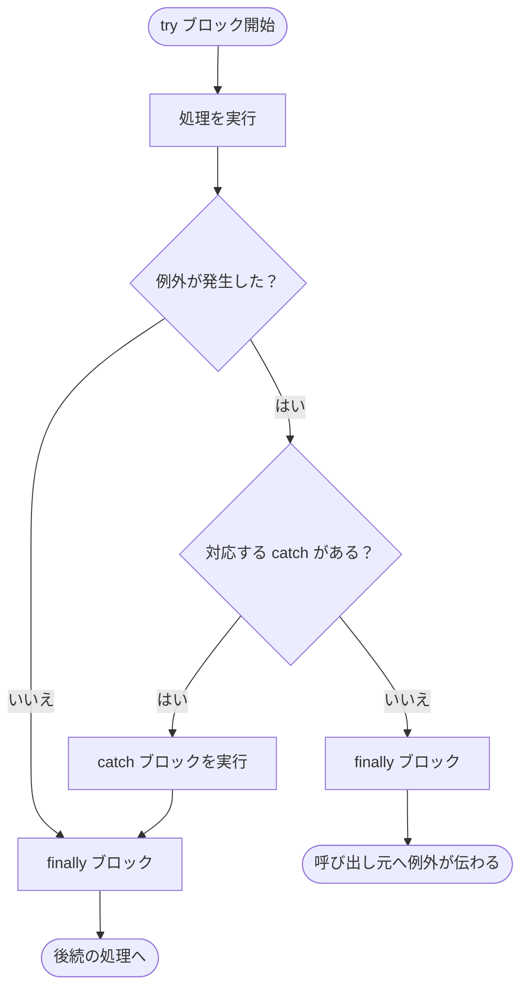
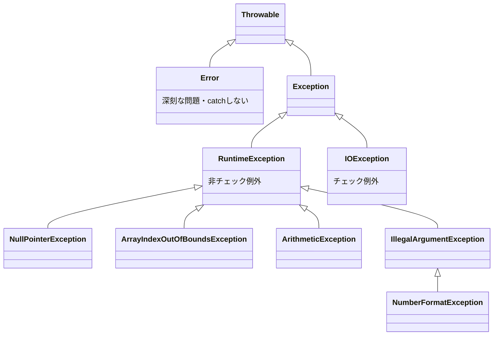

# 08. 例外処理

[← 前へ：07 継承とポリモーフィズム](07_継承とポリモーフィズム.md) ｜ [次へ：09 ファイル入出力・標準ライブラリ →](09_ファイル入出力・標準ライブラリ.md)

## この章のゴール
- 例外とは何か、なぜ必要かを説明できる
- `try-catch-finally` で例外を処理できる
- チェック例外と非チェック例外の違いが分かる
- 自分で例外を投げる（`throw`）、宣言する（`throws`）ことができる

## 目次

1. [例外とは](#1-例外とは)
2. [try-catch](#2-try-catch)
3. [finally](#3-finally)
4. [例外の種類](#4-例外の種類)
5. [チェック例外と throws](#5-チェック例外と-throws)
6. [throw で例外を投げる](#6-throw-で例外を投げる)
7. [独自の例外クラス](#7-独自の例外クラス)
8. [try-with-resources](#8-try-with-resources)
9. [スタックトレースの読み方](#9-スタックトレースの読み方)
10. [よくあるミス](#10-よくあるミス)
11. [練習問題](#11-練習問題)

---

## 1. 例外とは

プログラムの実行中に起きる**異常事態**（0 での割り算、存在しないファイルを開く、配列の範囲外アクセスなど）を**例外（Exception）**と呼びます。

```java
public class NoHandle {
    public static void main(String[] args) {
        int[] a = {1, 2, 3};
        System.out.println("開始");
        System.out.println(a[5]);            // 例外発生！
        System.out.println("終了");          // ここは実行されない
    }
}
```

実行結果：

```
開始
Exception in thread "main" java.lang.ArrayIndexOutOfBoundsException: Index 5 out of bounds for length 3
	at NoHandle.main(NoHandle.java:5)
```

例外を処理しないとプログラムは途中で停止します。

| 言語 | エラー処理の方法 |
|---|---|
| C | 戻り値（`-1` や `NULL`）や `errno` を確認 |
| Python | `try / except` |
| Java | `try / catch`（Python とほぼ同じ考え方） |

## 2. try-catch

```java
public class TryCatch {
    public static void main(String[] args) {
        int[] a = {1, 2, 3};

        try {
            System.out.println(a[5]);       // 例外が起きる可能性のある処理
        } catch (ArrayIndexOutOfBoundsException e) {
            System.out.println("範囲外です: " + e.getMessage());
        }

        System.out.println("プログラムは継続します");
    }
}
```

実行結果：

```
範囲外です: Index 5 out of bounds for length 3
プログラムは継続します
```

| Python | Java |
|---|---|
| `try:` | `try {` |
| `except IndexError as e:` | `} catch (ArrayIndexOutOfBoundsException e) {` |
| `finally:` | `} finally {` |

### 複数の catch

```java
import java.util.Scanner;

public class MultiCatch {
    public static void main(String[] args) {
        Scanner sc = new Scanner(System.in);
        System.out.print("割る数を入力: ");
        String input = sc.nextLine();

        try {
            int n = Integer.parseInt(input);
            System.out.println(100 / n);
        } catch (NumberFormatException e) {
            System.out.println("数字を入力してください");
        } catch (ArithmeticException e) {
            System.out.println("0 では割れません");
        }
    }
}
```

実行例：

| 入力 | 出力 |
|---|---|
| `5` | `20` |
| `abc` | `数字を入力してください` |
| `0` | `0 では割れません` |

- 例外が発生した場所以降の `try` ブロックは**実行されない**
- 複数の例外を同じ処理にしたい場合は `catch (A | B e)` と書ける
- 親クラスの例外は**最後**に書く（先に書くと子の `catch` に到達しない）
- 例外の変数を使わないときは、名前の代わりに `_` と書ける（Java 22 以降）：`catch (NumberFormatException _) { ... }`

## 3. finally

**例外が起きても起きなくても必ず実行される**ブロックです。後片付け（ファイルを閉じるなど）に使います。

```java
try {
    System.out.println("処理");
    int x = 10 / 0;
} catch (ArithmeticException e) {
    System.out.println("エラー");
} finally {
    System.out.println("必ず実行される");
}
// 処理
// エラー
// 必ず実行される
```

try / catch / finally の流れは次のとおりです。



## 4. 例外の種類

例外もクラスで、継承関係があります。



- `Error`：深刻な問題（`OutOfMemoryError` など）。`catch` しない
- `RuntimeException` 系：**非チェック例外**
- `IOException` など（`RuntimeException` 以外の `Exception`）：**チェック例外**

| 種類 | 例 | 扱い |
|---|---|---|
| **非チェック例外**（`RuntimeException` 系） | `NullPointerException`, `ArithmeticException` など | `catch` は**任意**。プログラムの書き方で防げるバグが多い |
| **チェック例外** | `IOException`, `FileNotFoundException` など | `catch` するか `throws` で宣言することが**必須**（しないとコンパイルエラー） |

### よく見る例外

| 例外 | 原因 |
|---|---|
| `NullPointerException` | `null` のオブジェクトのメソッドを呼んだ |
| `ArrayIndexOutOfBoundsException` | 配列の範囲外 |
| `ArithmeticException` | 整数を 0 で割った |
| `NumberFormatException` | 数字でない文字列を `parseInt` した |
| `ClassCastException` | 不正なキャスト |
| `IllegalArgumentException` | 引数が不正 |
| `InputMismatchException` | `Scanner.nextInt()` に数字以外が入力された |
| `FileNotFoundException`（チェック） | ファイルが存在しない |
| `IOException`（チェック） | 入出力エラー |

## 5. チェック例外と throws

チェック例外を起こす可能性があるメソッドを呼ぶときは、次のどちらかが必要です。

**① その場で `catch` する**

```java
import java.io.FileReader;
import java.io.IOException;

public class CheckedCatch {
    public static void main(String[] args) {
        try {
            FileReader fr = new FileReader("not_exist.txt");
            fr.close();
        } catch (IOException e) {
            System.out.println("ファイルを開けません: " + e.getMessage());
        }
    }
}
```

**② `throws` で呼び出し元に任せる**

```java
public class CheckedThrows {
    static void read() throws IOException {      // 「この中でIOExceptionが起きるかも」と宣言
        FileReader fr = new FileReader("not_exist.txt");
        fr.close();
    }

    public static void main(String[] args) {
        try {
            read();
        } catch (IOException e) {
            System.out.println("エラー: " + e.getMessage());
        }
    }
}
```

> ここで Python と大きく違います。Python には「`except` を書かないとコンパイルエラー」はありません。Java は**「失敗しうる処理は、失敗した時のことを必ず考えさせる」**という設計です。

`catch` すべきか `throws` すべきか迷ったら、「**その場で適切に対処できるか？**」で決めます。対処できるなら `catch`、できないなら呼び出し元に任せる (`throws`) のが基本です。

## 6. throw で例外を投げる

自分で例外を**発生させる**には `throw` を使います（Python の `raise`）。

```java
public class ThrowSample {
    static void setAge(int age) {
        if (age < 0) {
            throw new IllegalArgumentException("年齢は0以上にしてください: " + age);
        }
        System.out.println("年齢を設定: " + age);
    }

    public static void main(String[] args) {
        setAge(20);
        try {
            setAge(-5);
        } catch (IllegalArgumentException e) {
            System.out.println("エラー: " + e.getMessage());
        }
    }
}
```

実行結果：

```
年齢を設定: 20
エラー: 年齢は0以上にしてください: -5
```

[06 章](06_クラスとオブジェクト.md) の setter で「メッセージを表示して `return`」していた箇所は、本来は**例外を投げる**のが適切です。呼び出し側に失敗を確実に知らせられるからです。

| | |
|---|---|
| `throw` | 例外を**発生させる**（文） |
| `throws` | メソッドが例外を**投げうることを宣言**する（メソッド宣言に付ける） |

## 7. 独自の例外クラス

意味のわかる名前の例外を自作できます。`Exception`（チェック）または `RuntimeException`（非チェック）を継承します。

```java
public class InsufficientBalanceException extends Exception {
    private final int shortage;

    public InsufficientBalanceException(String message, int shortage) {
        super(message);
        this.shortage = shortage;
    }

    public int getShortage() { return shortage; }
}
```

```java
public class Account {
    private int balance;
    public Account(int balance) { this.balance = balance; }

    public void withdraw(int amount) throws InsufficientBalanceException {
        if (amount > balance) {
            throw new InsufficientBalanceException("残高不足", amount - balance);
        }
        balance -= amount;
    }

    public static void main(String[] args) {
        Account a = new Account(1000);
        try {
            a.withdraw(1500);
        } catch (InsufficientBalanceException e) {
            System.out.println(e.getMessage() + "（" + e.getShortage() + "円不足）");
        }
    }
}
// 残高不足（500円不足）
```

## 8. try-with-resources

ファイルなど「使い終わったら閉じる」リソースは、`finally` で `close()` を書くのは面倒です。**`try (...)`** の中で作ると、自動で閉じてくれます（Python の `with` 文に相当）。

```java
import java.io.BufferedReader;
import java.io.FileReader;
import java.io.IOException;

public class TryWith {
    public static void main(String[] args) {
        try (BufferedReader br = new BufferedReader(new FileReader("sample.txt"))) {
            String line;
            while ((line = br.readLine()) != null) {
                System.out.println(line);
            }
        } catch (IOException e) {
            System.out.println("読み込みエラー: " + e.getMessage());
        }
        // br は自動的に close される
    }
}
```

| Python | Java |
|---|---|
| `with open("a.txt") as f:` | `try (BufferedReader br = ...) {` |

`Scanner` も同様に書けます。

```java
try (Scanner sc = new Scanner(System.in)) {
    // ...
}
```

## 9. スタックトレースの読み方

エラーが出たら、まず**エラーメッセージの最初の 2 行**を読みます。

```
Exception in thread "main" java.lang.NullPointerException: Cannot invoke "String.length()" because "s" is null
	at Sample.printLength(Sample.java:8)
	at Sample.main(Sample.java:4)
```

| 部分 | 意味 |
|---|---|
| `NullPointerException` | **例外の種類** |
| `Cannot invoke ... because "s" is null` | **原因**（`s` が null だった） |
| `at Sample.printLength(Sample.java:8)` | **発生した場所**（クラス・メソッド・行番号） |
| `at Sample.main(Sample.java:4)` | それを**呼び出した場所** |

一番上の行が原因の場所、下に向かって呼び出し元をたどれます。`e.printStackTrace()` でこの情報を表示できます。

## 10. よくあるミス

| ミス | 対処 |
|---|---|
| `unreported exception IOException; must be caught or declared to be thrown` | チェック例外を `catch` も `throws` もしていない |
| `exception IOException is never thrown in body of try` | 起きない例外を `catch` している |
| `catch (Exception e) {}` と空にする | エラーを握りつぶすと原因が分からなくなる。最低でもログを出す |
| 親クラスの例外を先に書く | `exception X has already been caught`。**子 → 親**の順に書く |
| 何でも `catch (Exception e)` | 例外ごとに対処を分けるほうが良い |
| 条件チェックで防げるのに例外処理だけで済ませる | `if (n != 0)` で防げるなら、先にチェックする |

## 11. 練習問題

**問1.** 次のコードを実行したときにどうなるか予想し、`try-catch` で例外を処理するよう修正してください。

```java
String s = null;
System.out.println(s.length());
```

**問2.** キーボードから整数を読み、数字以外が入力されたら「整数を入力してください」と表示して、**正しく入力されるまで繰り返す**プログラムを作成してください。（ヒント：`Integer.parseInt` と `while (true)`）

**問3.** `withdraw(int amount)` で、`amount` が 0 以下のとき `IllegalArgumentException`、残高不足のとき独自の `InsufficientBalanceException` を投げる `Account` クラスを作ってください。

<details>
<summary>解答例</summary>

**問1**

`NullPointerException` で異常終了します。

```java
String s = null;
try {
    System.out.println(s.length());
} catch (NullPointerException e) {
    System.out.println("null です");
}
```
（本来は `if (s != null)` で先に確認するほうが望ましい）

**問2**
```java
import java.util.Scanner;

public class ReadInt {
    public static void main(String[] args) {
        Scanner sc = new Scanner(System.in);
        int n;
        while (true) {
            System.out.print("整数を入力: ");
            String line = sc.nextLine();
            try {
                n = Integer.parseInt(line);
                break;                         // 成功したらループを抜ける
            } catch (NumberFormatException e) {
                System.out.println("整数を入力してください");
            }
        }
        System.out.println("入力値: " + n);
    }
}
```

**問3**
```java
public void withdraw(int amount) throws InsufficientBalanceException {
    if (amount <= 0) {
        throw new IllegalArgumentException("金額は正の数にしてください");
    }
    if (amount > balance) {
        throw new InsufficientBalanceException("残高不足", amount - balance);
    }
    balance -= amount;
}
```
</details>

---

[← 前へ：07 継承とポリモーフィズム](07_継承とポリモーフィズム.md) ｜ [次へ：09 ファイル入出力・標準ライブラリ →](09_ファイル入出力・標準ライブラリ.md)
