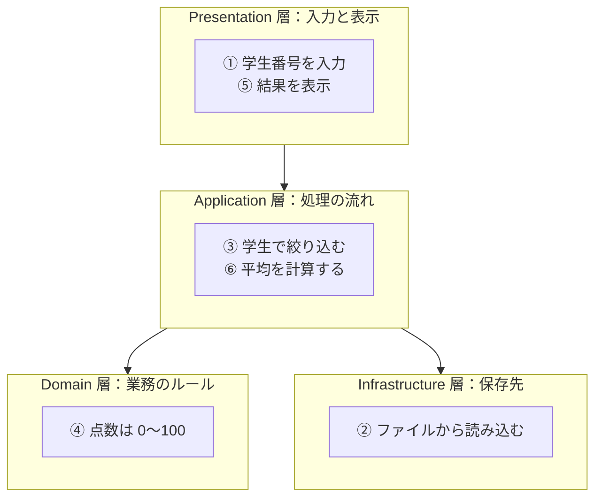

# 01. なぜ層に分けるのか

[← 前へ：00 はじめに](00_はじめに.md) ｜ [次へ：02 4層の役割 →](02_4層の役割.md)

## この章のゴール
- 1 つのクラスに何でも書いたコードで、何が困るのかを具体的に説明できる
- 「関心の分離」の意味が分かる
- 層に分けると何が嬉しいのかを、変更・テスト・分担の 3 つの観点で言える

## 目次

1. [何でも詰め込んだコード](#1-何でも詰め込んだコード)
2. [困りごと 1：変更が怖い](#2-困りごと-1変更が怖い)
3. [困りごと 2：テストできない](#3-困りごと-2テストできない)
4. [困りごと 3：分担できない](#4-困りごと-3分担できない)
5. [関心の分離](#5-関心の分離)
6. [層に分ける](#6-層に分ける)
7. [層に分けるデメリット](#7-層に分けるデメリット)
8. [よくあるミス](#8-よくあるミス)

---

## 1. 何でも詰め込んだコード

「学生の成績一覧を表示する」機能を、1 つのメソッドに全部書くとどうなるでしょうか。入力、検査、データの取得、計算、表示を、すべて `main` に書いた例です。

```java
public static void main(String[] args) throws Exception {
    int studentId = Integer.parseInt(new Scanner(System.in).nextLine());   // ① 入力を受け取る
    int sum = 0, count = 0;
    for (String line : Files.readAllLines(Path.of("enrollments.csv"))) {   // ② ファイルから読み込む
        String[] p = line.split(",");                                       //    （学生番号,科目名,点数）
        if (Integer.parseInt(p[0]) != studentId) continue;                  // ③ 学生で絞り込む
        int score = Integer.parseInt(p[2]);
        if (score < 0 || score > 100) continue;                             // ④ 業務ルール（点数の範囲）
        System.out.println(p[1] + " : " + score + "点");                    // ⑤ 表示する
        sum += score;
        count++;
    }
    System.out.println("平均: " + (double) sum / count);                    // ⑥ 計算する
}
```

動きはしますが、この 1 つのメソッドが、**性質の違う 6 つの仕事**を同時に抱えています。

| 番号 | 仕事 | 性質 |
|---|---|---|
| ① ⑤ | 入力と表示 | 画面・ユーザーとのやり取り |
| ② | ファイルの読み込み | データの保存先 |
| ③ ⑥ | 絞り込みと平均の計算 | アプリケーションの処理 |
| ④ | 点数は 0〜100 | 業務のルール |

## 2. 困りごと 1：変更が怖い

次のような変更が来たとします。

- **保存先をファイルからデータベースに変えたい** → ② を書き直す。しかし、②と③⑥が絡み合っているので、**計算のコードまで壊すかもしれない**
- **コンソールではなく Web 画面にしたい** → ① ⑤ を書き直す。しかし、`System.out.println` の中で計算もしているので、**計算ロジックを取り出せない**
- **合格点を 60 点から変えたい** → ルールがあちこちに散らばっていて、**全部探して直す**必要がある

> 1 つの変更理由に対して、**直す場所が 1 か所**であるのが理想です。上のコードでは、直す場所が絡み合っています。

## 3. 困りごと 2：テストできない

「平均点の計算が正しいか」を確かめたいとき、上のコードでは次のようなことをしないとテストできません。

- キーボードから学生番号を入力する
- `enrollments.csv` というファイルを用意する
- 画面に出た文字を目で見て確認する

計算だけをテストしたいのに、**入力・ファイル・表示が一緒についてくる**からです。計算が独立したメソッドであれば、`average(List.of(80, 90))` が `85.0` を返すか、すぐに確かめられます。

## 4. 困りごと 3：分担できない

複数人で開発するとき、全員が同じファイルを編集すると、Git の**コンフリクト**が頻発します（[Git 資料](../00_ドキュメント/Git/02_CUI基本編.md) で学んだ問題です）。

「画面担当」「データベース担当」「業務ロジック担当」で作業を分けたくても、1 つのクラスに全部が入っていると分けられません。

## 5. 関心の分離

困りごとの原因は、**性質の違う仕事（関心事）が 1 か所に混ざっている**ことでした。これを、性質ごとに分けて別々の場所に書く考え方を**関心の分離**（Separation of Concerns）と呼びます。

Java 入門 10 章で「1 つのクラスは 1 つの責任だけを持たせる」と学んだ**単一責任の原則**と、同じ発想です。クラス単位で責任を分けるのが単一責任の原則、**クラスの集まり（層）単位で責任を分ける**のが、この資料の「層構造」です。

## 6. 層に分ける

先ほどの 6 つの仕事を、性質ごとに 4 つのグループ（**層**）に分けます。



分けると、先ほどの困りごとはこう変わります。

| 困りごと | 層に分けたあと |
|---|---|
| 保存先をデータベースに変えたい | **Infrastructure 層だけ**を書き換える。他の層は触らない |
| Web 画面にしたい | **Presentation 層だけ**を作り直す。計算は再利用できる |
| 合格点を変えたい | **Domain 層の 1 か所**を直す |
| 平均点をテストしたい | Application 層のメソッドを呼ぶだけ。入力・ファイルは不要 |
| 分担したい | 層ごと（ファイルごと）に担当を分けられる |

## 7. 層に分けるデメリット

層に分けるとよいことばかりではありません。

- **ファイルとクラスが増える**：小さなプログラムでは、かえって読みにくくなる
- **受け渡しのコードが増える**：層の間でデータを渡す書き方が必要になる
- **設計の知識が必要**：「これはどの層に書くのか」を判断する力が要る

> 💡 数十行の使い捨てのプログラムなら、層に分ける必要はありません。**長く使う・複数人で作る・変更が入る**アプリケーションで効果を発揮する考え方です。

## 8. よくあるミス

| ミス | 原因・対処 |
|---|---|
| 層の数が「4 つ」であることだけを覚える | 大事なのは**数ではなく、関心を分けること**。次章で各層の「責任」を押さえる |
| とりあえず全部の処理を新しいクラスに移す | 層は「クラスを増やすこと」が目的ではない。**何が変わりやすいか**を基準に分ける |
| 小さなプログラムまで無理に層に分ける | 規模に見合った設計にする |

---

[← 前へ：00 はじめに](00_はじめに.md) ｜ [次へ：02 4層の役割 →](02_4層の役割.md)
