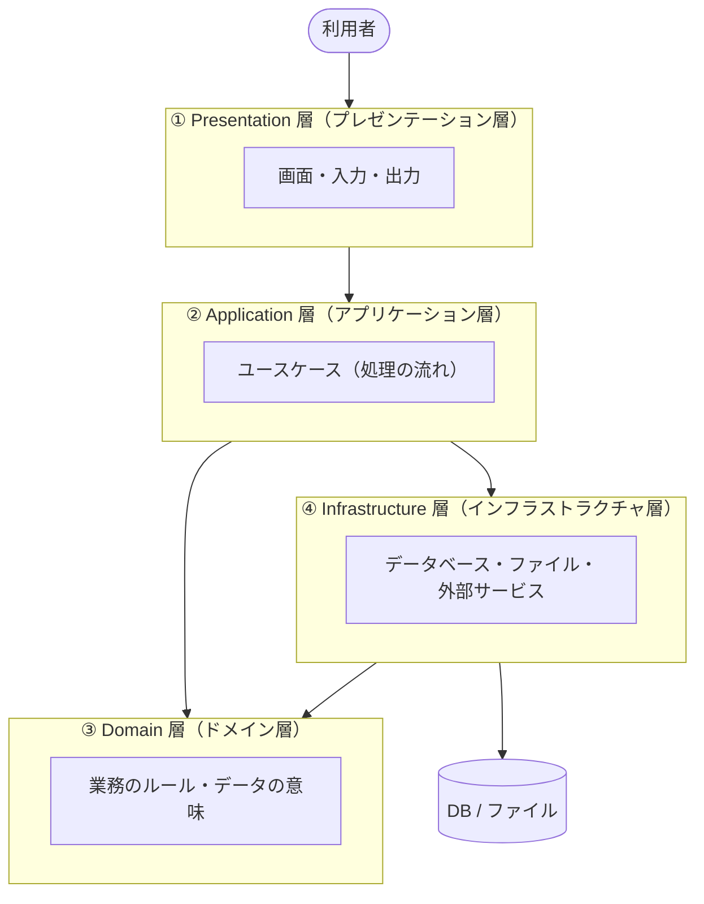
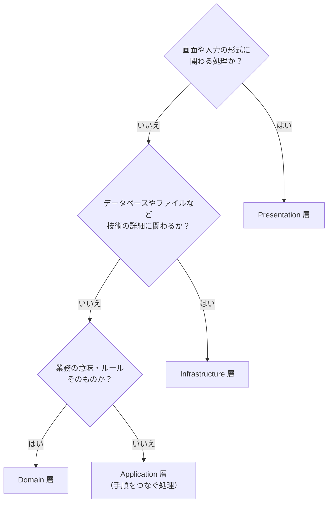
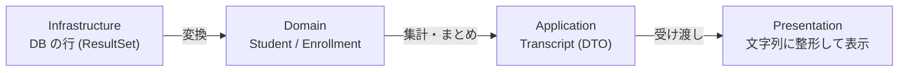

# 02. 4層の役割

[← 前へ：01 なぜ層に分けるのか](01_なぜ層に分けるのか.md) ｜ [次へ：03 依存の向きとインタフェース →](03_依存の向きとインタフェース.md)

## この章のゴール
- 4 つの層（Presentation / Application / Domain / Infrastructure）の責任を説明できる
- 「この処理はどの層に書くか」を判断できる
- 層をまたいでデータを渡すときの考え方が分かる
- Spring で使われる呼び名（Controller / Service / Entity / Repository）との対応が分かる

## 目次

1. [4層の全体像](#1-4層の全体像)
2. [Presentation 層：入出力を担当する](#2-presentation-層入出力を担当する)
3. [Application 層：ユースケースを実現する](#3-application-層ユースケースを実現する)
4. [Domain 層：業務のルールを表現する](#4-domain-層業務のルールを表現する)
5. [Infrastructure 層：外の世界とつなぐ](#5-infrastructure-層外の世界とつなぐ)
6. [どの層に書くか迷ったとき](#6-どの層に書くか迷ったとき)
7. [層をまたぐデータ](#7-層をまたぐデータ)
8. [Spring での呼び方との対応](#8-spring-での呼び方との対応)
9. [パッケージ構成](#9-パッケージ構成)
10. [よくあるミス](#10-よくあるミス)

---

## 1. 4層の全体像



| 層 | 一言でいうと | 成績管理での例 |
|---|---|---|
| **Presentation** | 利用者とのやり取り | メニュー表示、`Scanner` での入力、結果の表示 |
| **Application** | 「やりたいこと」の手順 | 「成績を登録する」「成績一覧を作る」 |
| **Domain** | 業務の意味とルール | 点数は 0〜100、60 点以上で合格 |
| **Infrastructure** | 技術的な詳細 | データベースへの SQL、ファイルの読み書き |

> **ドメイン**とは、そのアプリケーションが扱う業務や世界のことです。成績管理なら「学生・科目・履修・成績」がドメインです。

## 2. Presentation 層：入出力を担当する

**責任：利用者から入力を受け取り、結果を見せる。**

- 入力の読み取り（`Scanner`、Web なら HTTP リクエスト）
- 入力文字列を数値などに**変換**する、形式の検査（「数字が入力されたか」）
- Application 層を**呼び出す**
- 結果を表示用に整える（`printf`、HTML、JSON）

```java
int score = Integer.parseInt(sc.nextLine());                // 文字列 → 数値に変換
gradeService.recordScore(studentId, courseId, 2025, score); // Application 層を呼ぶだけ
```

**書かないもの**：業務のルール（点数の範囲など）、SQL、ファイル操作。

## 3. Application 層：ユースケースを実現する

**責任：「ユーザーがやりたいこと（ユースケース）」を、手順として実現する。** 自分で業務ルールは決めず、Domain 層と Infrastructure 層を**組み合わせて**処理を進めます。

- ユースケース 1 つにつき、メソッドを 1 つ用意する（`registerStudent`、`recordScore` など）
- 「学生が存在するか確認 → 履修を作る → 保存する」のような**手順**を書く
- **トランザクションの範囲**を決める（データベース編 11 章）
- 結果を Presentation 層に返す（必要なら、表示用のデータにまとめる）

```java
// 手順を並べるだけ。細かいルールや SQL は書かない
studentRepository.findById(studentId);   // 学生がいるか確認
courseRepository.findById(courseId);     // 科目があるか確認
enrollmentRepository.save(enrollment);   // 保存
```

**書かないもの**：画面の表示（`println`）、SQL、点数の範囲検査のような業務ルールそのもの。

## 4. Domain 層：業務のルールを表現する

**責任：業務の「もの」と「ルール」を、Java のクラスで表現する。** 他の層に依存しない、このアプリケーションの**中心**です。

- 学生、科目、履修といった**概念をクラス（`record`）にする**
- 「点数は 0〜100」「60 点以上が合格」といった**ルールをクラスの中に持たせる**
- データの保存方法は知らない（保存の**窓口をインタフェースとして宣言する**だけ。03 章）

```java
// ルールが「データ」のそばにある
public record Enrollment(int studentId, int courseId, int academicYear, Integer score) {
    public Enrollment {
        if (score != null && (score < 0 || score > 100)) {
            throw new IllegalArgumentException("点数は0〜100にしてください: " + score);
        }
    }
    // …（isPassed() など）
}
```

> 📦 **サンプル**：[`step1-memory/src/grades/domain/Enrollment.java`](https://github.com/<ORG>/PRMN_SYSTEM_Sample/blob/main/step1-memory/src/grades/domain/Enrollment.java)

**書かないもの**：画面、SQL、ファイル、`Scanner` など、技術的な詳細は一切書かない。

> 💡 Java 入門 06 章の `Student`（`private` + 検査つき）は、すでに Domain 層のクラスの考え方になっています。

## 5. Infrastructure 層：外の世界とつなぐ

**責任：データベース、ファイル、外部 API など、技術的な詳細を担当する。**

- SQL を実行してデータを保存・取得する（JDBC）
- ファイルの読み書き
- 取得したデータを Domain 層のオブジェクトに**変換して返す**

**書かないもの**：業務ルールの判断（「合格か不合格か」など）。

この資料のデータベース編で詳しく学ぶのは、この層です。

## 6. どの層に書くか迷ったとき

次の質問に順番に答えると、判断しやすくなります。



成績管理での例：

| 処理 | 層 | 理由 |
|---|---|---|
| 「点数 > 」と表示して入力を待つ | Presentation | 画面とのやり取り |
| 入力された `"abc"` を数値に変換できず、エラーメッセージを出す | Presentation | 入力形式の検査 |
| 点数が 0〜100 の範囲か検査する | Domain | 業務のルール |
| 60 点以上なら合格と判定する | Domain | 業務のルール |
| 学生の履修を全部集めて平均点を求める | Application | 複数のオブジェクトを使った手順 |
| `SELECT ... FROM enrollments WHERE ...` | Infrastructure | データベースの詳細 |
| `students.csv` を読み込む | Infrastructure | ファイルの詳細 |

> 💡 **「点数の範囲検査」と「入力が数字かの検査」は別物**です。前者は「点数とは何か」という業務のルールなので Domain 層、後者は「入力された文字をどう解釈するか」なので Presentation 層です。Web 画面になっても、点数の範囲は変わりません。

## 7. 層をまたぐデータ

層の間でデータを受け渡すとき、どんな形のオブジェクトを使うかも設計の一部です。

| 種類 | 役割 | この資料での例 |
|---|---|---|
| **Domain のオブジェクト** | 業務の概念そのもの（エンティティ） | `Student`、`Enrollment` |
| **DTO**（Data Transfer Object） | 層の間で運ぶだけの入れ物。表示用にまとめたもの | `Transcript`（成績一覧の表示用データ） |



- **Infrastructure → Domain**：`ResultSet`（データベースの結果）を、そのまま上の層に渡さない。必ず Domain のオブジェクトに変換する。そうしないと、上の層が「SQL の都合」を知ってしまう
- **Application → Presentation**：画面に必要な形にまとめたデータ（DTO）を返す。Java では `record` が DTO に向いている

## 8. Spring での呼び方との対応

Spring Boot でよく見る名前と、この資料の 4 層は次のように対応します（[04 章](04_フレームワークとSpring.md) で Spring を説明し、[06 章](06_Spring_Bootで書き直す.md) で実際に書きます）。

| この資料の層 | Spring での呼び名 | 付けるアノテーション |
|---|---|---|
| Presentation | **Controller** | `@RestController` / `@Controller` |
| Application | **Service** | `@Service` |
| Domain | **Entity**（Model） | （通常は不要） |
| Domain（保存の窓口） / Infrastructure（実装） | **Repository** | `@Repository` |

> 💡 現場では「Controller → Service → Repository の 3 層」と呼ぶことも多いです。この資料の 4 層は、Service（Application 層）と Entity（Domain 層）を分けて、**業務のルールの置き場所をはっきりさせた**形です。

## 9. パッケージ構成

層ごとに**パッケージ（フォルダ）**を分けると、「この処理はどの層か」がファイルの場所で分かります。この資料の最終的な構成は次のとおりです。

```
src/grades/
├── Main.java                          ← 全部を組み立てて起動する
├── presentation/
│   └── ConsoleApp.java                ← メニューと入出力
├── application/
│   ├── GradeService.java              ← ユースケース
│   └── Transcript.java                ← 表示用データ（DTO）
├── domain/
│   ├── Student.java                   ← エンティティ
│   ├── Course.java
│   ├── Enrollment.java
│   ├── StudentRepository.java         ← 保存の窓口（インタフェース）
│   ├── CourseRepository.java
│   └── EnrollmentRepository.java
└── infrastructure/
    └── memory/                        ← メモリに保存する実装（05 章）
        ├── InMemoryStudentRepository.java
        └── ...
    （jdbc/ ← データベース編 12 章で追加）
```

> ⚠️ `Main` は、全部の層を知っている唯一のクラスです。「どの実装を使うか」を決めて部品をつなぐ役割を持ちます（03 章）。Spring では、この組み立てを **DI コンテナ**が肩代わりします（03・04 章）。

> 📦 **サンプル**：実際のフォルダ構成は [`step1-memory/src/grades/`](https://github.com/<ORG>/PRMN_SYSTEM_Sample/tree/main/step1-memory/src/grades) で確認できます。

## 10. よくあるミス

| ミス | 原因・対処 |
|---|---|
| Presentation 層に `if (score < 0 ...)` と点数の検査を書く | 業務のルールは Domain 層へ。Web 版を作ると、同じ検査をもう一度書くことになる |
| Domain 層のクラスに `println` や SQL を書く | Domain 層は技術に依存させない。表示は Presentation、SQL は Infrastructure |
| `ResultSet` を Application 層や Presentation 層に渡す | Infrastructure 層で Domain のオブジェクトに変換してから返す |
| Application 層に何も業務ルールがなく、全部 Domain に押し込んでしまう | 「手順（流れ）」は Application、「ルール（意味）」は Domain。分けて考える |
| 層の名前が違うだけで、実質 1 クラスにまとめている | クラスを分けても、中で他の層の仕事をしていたら意味がない。**責任**で判断する |

---

[← 前へ：01 なぜ層に分けるのか](01_なぜ層に分けるのか.md) ｜ [次へ：03 依存の向きとインタフェース →](03_依存の向きとインタフェース.md)
