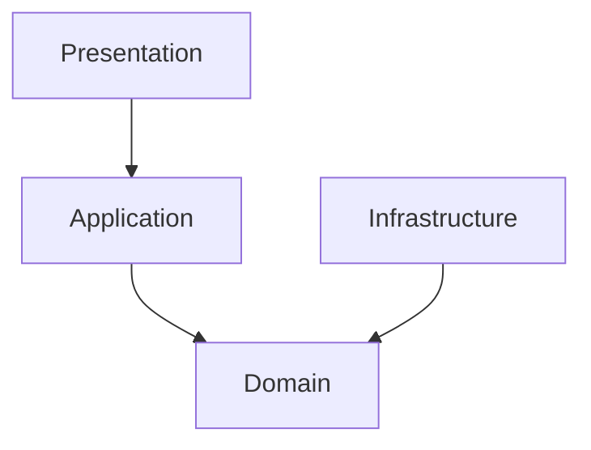
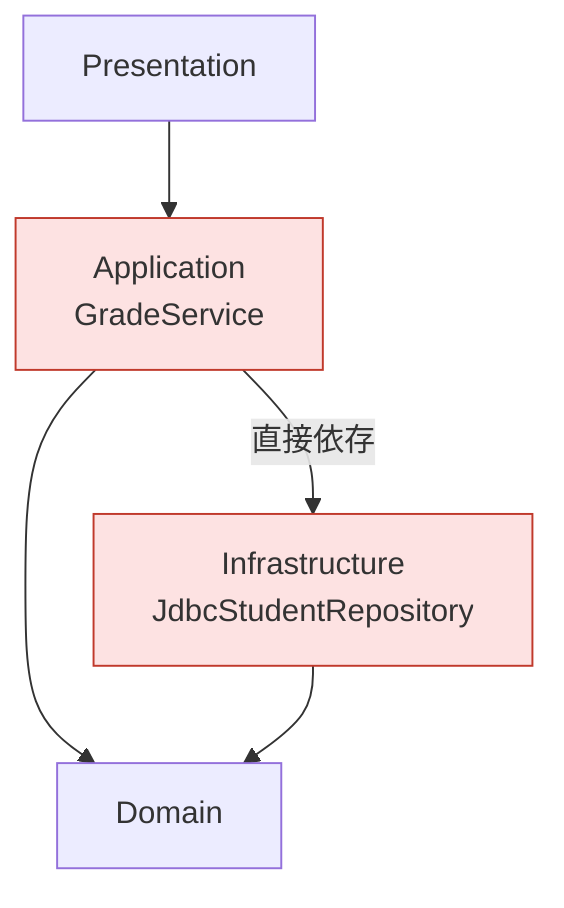
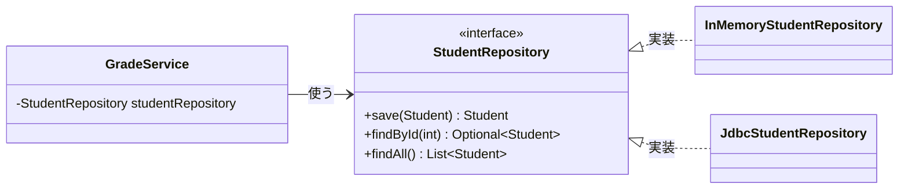
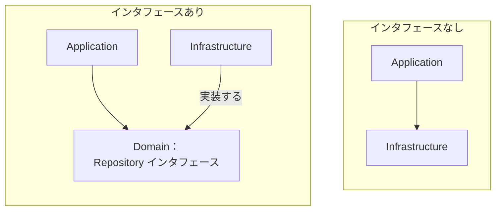
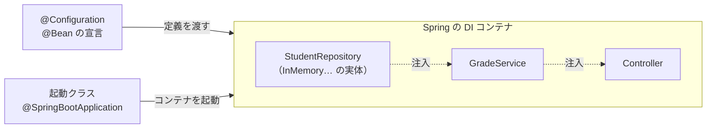

# 03. 依存の向きとインタフェース

[← 前へ：02 4層の役割](02_4層の役割.md) ｜ [次へ：04 フレームワークとSpring →](04_フレームワークとSpring.md)

## この章のゴール
- 「依存」とは何か、層の間でどちら向きの依存が許されるかを説明できる
- Application 層が Infrastructure 層に直接依存すると何が困るのか分かる
- インタフェースを使った**依存性逆転**の仕組みを説明できる
- コンストラクタ注入で部品をつなげる仕組みと、Spring ではそれをコンテナが肩代わりすることが分かる

## 目次

1. [依存とは](#1-依存とは)
2. [許される依存の向き](#2-許される依存の向き)
3. [困る例：Application が Infrastructure に依存する](#3-困る例application-が-infrastructure-に依存する)
4. [解決：インタフェースを間に置く](#4-解決インタフェースを間に置く)
5. [依存性逆転とは](#5-依存性逆転とは)
6. [コンストラクタ注入](#6-コンストラクタ注入)
7. [部品をつなぐ場所](#7-部品をつなぐ場所)
    - [Spring の場合：DI コンテナが行う](#spring-の場合di-コンテナが行う)
    - [素の Java の場合：Main が行う](#素の-java-の場合main-が行う)
8. [差し替えられると嬉しいこと](#8-差し替えられると嬉しいこと)
9. [よくあるミス](#9-よくあるミス)

---

## 1. 依存とは

クラス A のコードの中に、クラス B の名前が出てくるとき、**A は B に依存している**といいます。B を変更すると、A も影響を受ける（直さなければならないかもしれない）関係です。

たとえば、`GradeService` が `new JdbcStudentRepository()` と書いていたら、`GradeService` は `JdbcStudentRepository` に依存しています。

クラス図では、依存する側から依存される側へ矢印を引きます。


> 変更の影響は**矢印の逆向き**に伝わります。B を変えると A が影響を受けます。

## 2. 許される依存の向き

層構造では、依存の向きを**一方向に揃える**のがルールです。



- 上から下（Presentation → Application → Domain）へ依存する
- **Domain 層は、どの層にも依存しない**（一番内側。全員から依存される）
- **Infrastructure 層は Domain 層に依存する**（Domain のオブジェクトやインタフェースを使う）
- **逆向き（下から上）の依存は禁止**。Domain が Application を使ってはいけない

| 依存 | 可否 | 理由 |
|---|---|---|
| Presentation → Application | ○ | 画面がユースケースを呼ぶ |
| Application → Domain | ○ | 手順が、業務のオブジェクトを使う |
| Infrastructure → Domain | ○ | 実装が、Domain のオブジェクトを返す |
| Application → Infrastructure（具体クラス） | ✕ | 後述。保存先が変わるたびに Application を直すことになる |
| Domain → Application / Infrastructure | ✕ | 業務ルールが技術に縛られる |
| Presentation → Infrastructure | ✕ | 層を飛ばして、画面からデータベースを直接触ってしまう |

## 3. 困る例：Application が Infrastructure に依存する

素直に作ると、Application 層は「データを保存・取得するために」Infrastructure 層のクラスを直接使いたくなります。

たとえば、`GradeService`（Application 層）に `import grades.infrastructure.jdbc.JdbcStudentRepository;` と `new JdbcStudentRepository()` が書かれている状態です。



これだと、次のような問題が起こります。

- 保存先をファイルに変えたい → `GradeService` の中の `JdbcStudentRepository` を書き換える。**層に分けたのに、保存先を変えるたびに Application 層も直す**ことになる
- `GradeService` のテストに**本物のデータベースが必要**になる
- Application 層が `java.sql.*` のような技術の詳細を知ることになってしまう

## 4. 解決：インタフェースを間に置く

Java 入門 07 章で学んだ**インタフェース**を使います。

1. 保存の「窓口」を**インタフェース**として **Domain 層**に宣言する（`StudentRepository`）
2. Application 層は、**インタフェースだけ**を知っていて使う
3. Infrastructure 層が、そのインタフェースを**実装する**（`JdbcStudentRepository`、`InMemoryStudentRepository`）

```java
// Domain 層：「こういう保存の窓口がほしい」と宣言するだけ。どう保存するかは書かない
public interface StudentRepository {
    Student save(Student student);
    Optional<Student> findById(int id);
    List<Student> findAll();
}
```

> 📦 **サンプル**：[`step1-memory/src/grades/domain/StudentRepository.java`](https://github.com/<ORG>/PRMN_SYSTEM_Sample/blob/main/step1-memory/src/grades/domain/StudentRepository.java)

- **Application 層**（`GradeService`）は、このインタフェースの型で変数を持ち、使う
- **Infrastructure 層**（`InMemoryStudentRepository`、`JdbcStudentRepository`）は、このインタフェースを `implements` する



- `GradeService` は、実体がメモリなのかデータベースなのかを**知らない**
- 実装クラスは `StudentRepository` を実装するだけなので、**差し替えても `GradeService` は変わらない**

> Java 入門の 10 章で `List<Student> students = new ArrayList<>();` と書いたのも同じ発想です。変数の型は**インタフェース**（`List`）、実体は `ArrayList`。`LinkedList` に変えても使う側は変わりません。

## 5. 依存性逆転とは

インタフェースを置くことで、**依存の向きが逆転**しました。



| | 依存の向き |
|---|---|
| なし | Application → Infrastructure（上が下の具体クラスに依存） |
| あり | Application → **インタフェース** ← Infrastructure（**下が上の宣言に合わせる**） |

Infrastructure 層から Application / Domain 層への矢印になったため、これを**依存性逆転の原則**（Dependency Inversion Principle）と呼びます。

> 💡 インタフェースは**使う側（Domain 層）が持つ**のがポイントです。「Application が欲しい窓口の形」を Application 側が決め、Infrastructure はそれに合わせます。もしインタフェースを Infrastructure 側に置いたら、結局 Application が Infrastructure に依存してしまいます。

## 6. コンストラクタ注入

では、`GradeService` は**実装クラスをどうやって手に入れる**のでしょうか。`new JdbcStudentRepository()` と書いたら、また具体クラスに依存してしまいます。

答えは、**外から渡してもらう**ことです。コンストラクタの引数で受け取る方法を**コンストラクタ注入**といいます（**DI**：Dependency Injection の一種）。

```java
public class GradeService {
    private final StudentRepository studentRepository;      // 型は「インタフェース」

    // 必要な部品を、コンストラクタの引数で受け取る
    public GradeService(StudentRepository studentRepository /* , … */) {
        this.studentRepository = studentRepository;
    }
}
```

> 📦 **サンプル**：[`step1-memory/src/grades/application/GradeService.java`](https://github.com/<ORG>/PRMN_SYSTEM_Sample/blob/main/step1-memory/src/grades/application/GradeService.java)

`GradeService` の中には `new` が 1 つもありません。「何を使うか」は**作る側が決める**、「どう使うか」は `GradeService` が決める、という分担です。

| 書き方 | `GradeService` が知っていること |
|---|---|
| `new JdbcStudentRepository()` を中で書く | 具体的な実装クラスまで知っている（強く結びついている） |
| コンストラクタで受け取る | **インタフェースだけ**知っている |

> 💡 Spring（[04 章](04_フレームワークとSpring.md)）でも、**コンストラクタ注入が推奨**されています。ここで書いた `GradeService` は、Spring でも（`@Service` を付けるだけで）ほぼそのまま使えます。

## 7. 部品をつなぐ場所

では、実装クラスを選んで `GradeService` に渡す（= 部品をつなぐ）のは**誰**でしょうか。

### Spring の場合：DI コンテナが行う

Spring では、この組み立てを **DI コンテナ**（Spring が起動時に作る、部品の管理役）が**自動で**行います。開発者が書くのは、次の 2 つだけです。

1. 起動クラスに `@SpringBootApplication` を付ける
2. 「どの実装を使うか」を `@Configuration` と `@Bean` で宣言する（クラスに `@Repository` を付けて、自動で見つけさせる方法もあります）

```java
@SpringBootApplication
public class GradesApplication {
    public static void main(String[] args) {
        SpringApplication.run(GradesApplication.class, args);   // コンテナを起動する
    }
}

@Configuration
class RepositoryConfig {
    @Bean                                                       // 「この戻り値を部品として管理して」
    StudentRepository studentRepository() {
        return new InMemoryStudentRepository();                 // ここで保存先を決める
    }
    // …（他の Repository も同様）
}
```

`GradeService` や `ConsoleApp`（Spring では Controller）に相当するクラスは、**コンストラクタの引数の型を見て**、コンテナが適切な部品を渡します。`new GradeService(...)` を、開発者は書きません。



> Spring でのくわしい仕組みは [04 章](04_フレームワークとSpring.md)、実際の書き方は [06 章](06_Spring_Bootで書き直す.md) で説明します。

### 素の Java の場合：`Main` が行う

フレームワークを使わない場合は、プログラムの出発点である **`Main`** が `new` でつなぎます。Spring のコンテナが肩代わりしているのは、まさにこの作業です。

```java
public static void main(String[] args) {
    StudentRepository studentRepo = new InMemoryStudentRepository();   // 1. 保存先を決めて作る
    GradeService service = new GradeService(studentRepo);              // 2. Application 層に渡す
    new ConsoleApp(service).run();                                     // 3. Presentation 層に渡して起動
}
```

> 📦 **サンプル**：[`step1-memory/src/grades/Main.java`](https://github.com/<ORG>/PRMN_SYSTEM_Sample/blob/main/step1-memory/src/grades/Main.java)（サンプルの step1 は、仕組みが見えるように素の Java で書いています。Spring 版は `step3-spring` です）

| | 素の Java | Spring |
|---|---|---|
| 部品を作る人 | `Main`（`new` で書く） | DI コンテナ |
| 「何を使うか」を決める場所 | `Main` | `@Configuration` / `@Bean`（または `@Repository` の付いたクラス） |
| 渡す方法 | コンストラクタの引数に自分で渡す | コンストラクタの引数の型を見て、コンテナが渡す |
| 全部の層を知っているのは | `Main` | 設定クラスと起動クラス（コンテナが仲介） |

## 8. 差し替えられると嬉しいこと

### 保存先の切り替え

保存先を変えたいときに書き換えるのは、**部品をつなぐ場所の数行だけ**です。

| | 書き換える場所 |
|---|---|
| 素の Java | `Main` の `new InMemory…` を `new Jdbc…` に変える |
| Spring | `@Bean` の戻り値を `Jdbc…` に変える（実装ごとに切り替える `@Profile` という仕組みもあります） |

他のクラスは変更不要です。データベース編 12 章では、実際にそうします。

### テストが書ける

本物のデータベースが無くても、メモリ実装を渡して `GradeService` をテストできます。

> 💡 テストの書き方（JUnit）は、この資料の範囲外です。「差し替えられるからテストしやすい」という点だけ押さえておけば十分です。

## 9. よくあるミス

| ミス | 原因・対処 |
|---|---|
| `GradeService` の中で `new InMemoryStudentRepository()` と書く | 具体クラスに依存する。コンストラクタで**インタフェース型**を受け取る |
| `StudentRepository` を Infrastructure 層のパッケージに置く | 使う側（Domain 層）に置く。置き場所を間違えると依存が逆転しない |
| `import grades.infrastructure...` が Application や Domain にある | 依存の向きが逆。インタフェースの経由に直す |
| 「インタフェースが多すぎて面倒」と全クラスに作る | **差し替える可能性がある境界**（保存先、外部サービス）だけに作る。Domain のクラスには不要 |
| 実装が 1 つしかないのにインタフェースを作る意味が分からない | 「今は 1 つ」でも、メモリ → DB に差し替える。テスト用の実装も作れる |

---

[← 前へ：02 4層の役割](02_4層の役割.md) ｜ [次へ：04 フレームワークとSpring →](04_フレームワークとSpring.md)
