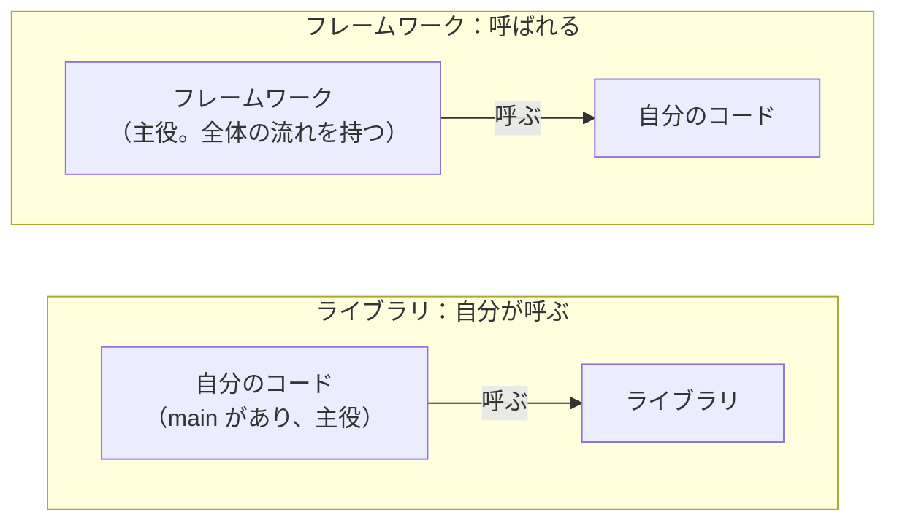
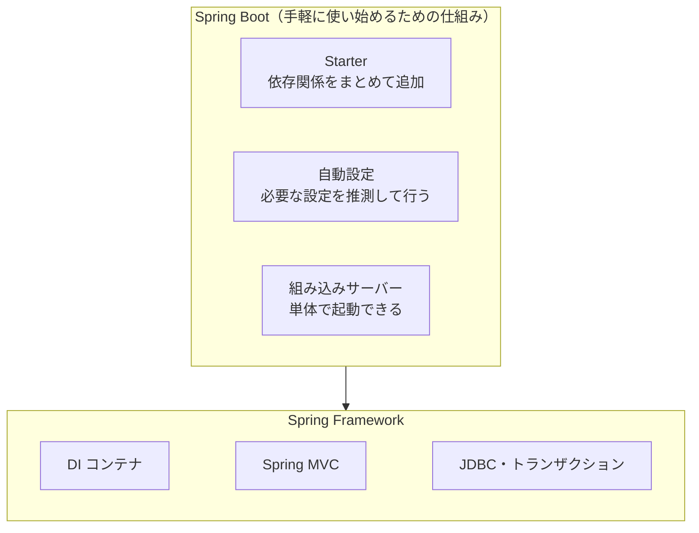
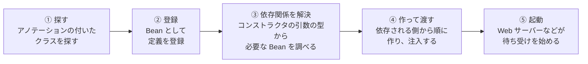
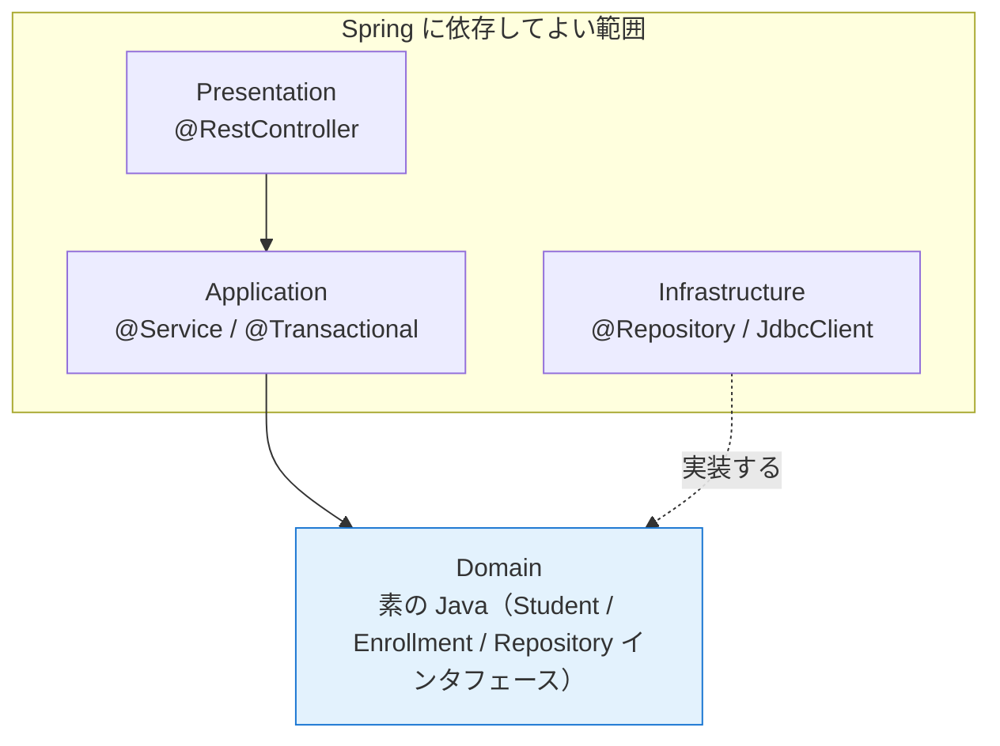

# 04. フレームワークとSpring

[← 前へ：03 依存の向きとインタフェース](03_依存の向きとインタフェース.md) ｜ [次へ：05 サンプル実装の読み方 →](05_サンプル実装の読み方.md)

## この章のゴール
- **ライブラリ**と**フレームワーク**の違い（制御の反転）を説明できる
- フレームワークを使う理由と、注意点が分かる
- **Spring Framework** と **Spring Boot** の役割、**DI コンテナ**と **Bean** を説明できる
- 4 層の各層が、Spring のどの機能に対応するかを言える
- 他の Java フレームワーク、他言語の代表的な Web フレームワークとの違いを説明できる

## 目次

1. [ライブラリとフレームワークの違い](#1-ライブラリとフレームワークの違い)
2. [フレームワークを使う理由と注意点](#2-フレームワークを使う理由と注意点)
3. [Spring とは](#3-spring-とは)
4. [Spring Boot とは](#4-spring-boot-とは)
5. [DI コンテナと Bean](#5-di-コンテナと-bean)
6. [4層を Spring で作ると](#6-4層を-spring-で作ると)
7. [他の Java フレームワークとの違い](#7-他の-java-フレームワークとの違い)
8. [他言語のフレームワークと比べる](#8-他言語のフレームワークと比べる)
9. [この資料の前提バージョン](#9-この資料の前提バージョン)
10. [よくあるミス](#10-よくあるミス)

---

## 1. ライブラリとフレームワークの違い

どちらも「誰かが作った部品の集まり」ですが、**プログラムの主導権がどちらにあるか**が違います。



| | ライブラリ | フレームワーク |
|---|---|---|
| 主導権 | **自分のコード**が持つ | **フレームワーク**が持つ |
| 使い方 | 必要なときに、自分で**呼び出す** | 決まった場所にコードを書くと、**向こうから呼ばれる** |
| 例え | 道具箱（必要な道具を取り出す） | 建物の骨組み（部屋の中身を、決められた場所に作る） |
| 学ぶもの | 関数やクラスの使い方（API） | **作法**（どこに何を書くか、どう動くか） |
| 入れ替え | 比較的かんたん | 全体に影響するので、大変 |

この、「呼ぶ側」と「呼ばれる側」が逆転することを**制御の反転**（IoC：Inversion of Control）といいます。「こちらから呼ぶな、あちらから呼ぶ」（Hollywood の原則）とも言われます。

### 例

| | Java | Python |
|---|---|---|
| ライブラリ | `Files`、`Scanner`、`java.time` | `requests`、`NumPy`、`pandas` |
| フレームワーク | **Spring** | **Django**、Flask |

`Files.readAllLines(path)` は、**自分が呼んだ**ときだけ動きます。一方、Spring の Web アプリケーションでは、自分で `main` から Controller を呼ぶことはしません。**リクエストが届いたら、Spring が自分のメソッドを呼びます**。

```java
@RestController
class StudentController {
    @GetMapping("/students/{id}/transcript")      // 「このURLにアクセスされたら、このメソッドを呼んで」
    Transcript transcript(@PathVariable int id) {
        // …（GradeService を呼んで結果を返す）
    }
}
```

> 前の章の DI も、制御の反転の一種です。`GradeService` は「自分で部品を作る」のをやめ、**部品を渡される側**になりました。フレームワークは、それをさらに押し進めたものです。

> 💡 実際には、境目はあいまいです。ライブラリでも、コールバック（呼び返される処理）を登録するものがあります。「**全体の流れを握っているのは誰か**」で考えると分かりやすくなります。

## 2. フレームワークを使う理由と注意点

### 理由

Web アプリケーションには、どんなシステムでも必要になる**共通の作業**があります。フレームワークは、それを肩代わりします。

| 共通の作業 | フレームワークがやってくれること |
|---|---|
| 部品の組み立て | DI コンテナが、`new` と受け渡しを自動で行う（03 章） |
| HTTP の処理 | URL と Java のメソッドの対応づけ、リクエストの解釈、JSON への変換 |
| データベース接続 | 接続の設定、接続の使い回し（コネクションプール） |
| 設定の管理 | 設定ファイルの読み込み、環境ごとの切り替え |
| トランザクション | 開始・コミット・ロールバックを、アノテーションで指示するだけ |
| 層構造の約束 | 「Controller / Service / Repository」という共通の型が定着している |

「層構造の約束が共有されている」ことは、チーム開発では特に効果があります。**初めて見るプロジェクトでも、どこに何があるかの見当がつきます**。

### 注意点

| 注意点 | 内容 |
|---|---|
| **学習コスト** | 作法を覚える必要がある。覚える量が多い |
| **見えない動き** | アノテーション 1 つの裏で多くの処理が動く。エラーの原因が分かりにくいことがある |
| **フレームワークへの依存** | 乗り換えが難しい。だから、**業務のルール（Domain 層）はフレームワークに依存させない**（6 節） |
| **バージョンの追従** | 数年ごとの大きな更新で、書き方が変わることがある |

## 3. Spring とは

**Spring Framework** は、Java で最も広く使われているフレームワークの 1 つです。2000 年代前半に登場し、当時の Java の企業向け標準（Java EE）が複雑だったことへの代替として広まりました。

核となる機能は、前の章で見た **DI コンテナ**（部品を作って、必要な場所に渡す管理役）です。その上に、Web、データベース、セキュリティなどの機能が、**プロジェクト**として用意されています。

| プロジェクト | 役割 | 4層との関係 |
|---|---|---|
| **Spring Framework** | DI コンテナ、トランザクション、JDBC、Web（Spring MVC）などの土台 | 全層 |
| **Spring Boot** | Spring を**手軽に使い始めて動かす**ための仕組み（4. 参照） | 全層 |
| **Spring MVC** | Web アプリケーション・REST API を作る | Presentation |
| **Spring Data** | データベースアクセスを簡単にする（JPA、JDBC など） | Infrastructure |
| **Spring Security** | 認証・認可（ログイン、権限） | Presentation 周辺 |
| **Spring Batch** | 大量データの一括処理（バッチ） | Application |
| **Spring Cloud** | マイクロサービスの連携 | 全体 |

> この資料で使うのは、**Spring Boot、Spring MVC、JDBC まわり**（JdbcClient）です。

## 4. Spring Boot とは

Spring Framework は高機能ですが、使い始めるまでの**設定が多く**、大変でした。それを解決するのが **Spring Boot** です。Spring Boot は、Spring Framework を**すぐ使える状態に整えて**くれます。



| Spring Boot の機能 | 内容 |
|---|---|
| **Starter** | 「Web アプリを作りたい」「JDBC を使いたい」といった目的ごとに、必要なライブラリをまとめて追加できる |
| **自動設定** | クラスパスにあるライブラリを見て、**必要な設定を自動で行う**。たとえば PostgreSQL のドライバがあれば、データベース接続の部品（DataSource）を自動で用意する |
| **組み込みサーバー** | Tomcat などの Web サーバーを内蔵しており、`java -jar` で**単体で起動**できる（別途サーバーをインストールしなくてよい） |
| **設定ファイル** | `application.properties`（または `application.yml`）に、接続先などを書く |
| **Initializr** | 必要なライブラリを選ぶと、プロジェクトの雛形を作ってくれる Web サイト（06 章） |

設定ファイルのイメージです。データベースの接続先を書くだけで、あとは自動設定が接続を用意します。

```properties
spring.datasource.url=jdbc:postgresql://localhost:5432/grades_db
spring.datasource.username=postgres
```

> 💡 **Spring Framework と Spring Boot の関係**：Boot は Framework の「代わり」ではなく、Framework を**使いやすくした入口**です。Spring Boot で作ったアプリケーションの中身は、Spring Framework で動いています。現在、新しく始めるプロジェクトは、ほとんどが Spring Boot を使います。

> 「規約が設定に勝る」（Convention over Configuration）という考え方が、Spring Boot の基本です。標準的な設定は自動で行い、**変えたい部分だけ**自分で書きます。

## 5. DI コンテナと Bean

### Bean とは

Spring が作って管理するオブジェクトを **Bean**（ビーン）といいます。Bean を作って保管し、必要な場所に渡す管理役が **DI コンテナ**（`ApplicationContext`）です。

03 章で `Main` が行っていた「`new` で作って、コンストラクタに渡す」作業を、コンテナが**起動時に自動で**行います。



- ①で、`@Service` や `@Repository` などの付いたクラスを、起動クラスのパッケージ以下から探します（**コンポーネントスキャン**）
- ③で、`GradeService` が `StudentRepository` を必要としていれば、**`StudentRepository` を実装した Bean** を探して渡します
- Bean は、既定では**アプリケーション全体で 1 つだけ**作られ、共有されます

> ⚠️ Bean は共有されるため、**フィールドに利用者ごとの状態（ログイン中のユーザーなど）を持たせてはいけません**。`GradeService` のように、状態を持たず、必要な部品だけを持つ作りにします。

### 主なアノテーション

| アノテーション | 役割 | 4層での対応 |
|---|---|---|
| `@SpringBootApplication` | 起動クラスに付ける。スキャン・自動設定を有効にする | （起動） |
| `@Controller` / `@RestController` | リクエストの受け口 | Presentation |
| `@Service` | ユースケースの処理 | Application |
| `@Repository` | データの保存・取得 | Infrastructure |
| `@Component` | 上のどれにも当てはまらない、汎用の部品 | － |
| `@Configuration` + `@Bean` | **メソッドの戻り値**を Bean として登録する（実装の選択に便利） | （組み立て） |
| `@Transactional` | メソッド全体を 1 つのトランザクションにする（DB 編 11 章） | Application |

`@Controller`・`@Service`・`@Repository` は、どれも `@Component` の一種で、**役割を表す名札**の意味が強いものです。名前を見るだけで、4 層のどこに属するか分かります。

### コンストラクタ注入

```java
@Service                                          // 「この部品を Bean にして」
public class GradeService {
    private final StudentRepository studentRepository;

    // コンストラクタが 1 つだけなら、@Autowired は書かなくてよい
    public GradeService(StudentRepository studentRepository) {
        this.studentRepository = studentRepository;
    }
}
```

03 章の `GradeService` に `@Service` を付けただけです。**`GradeService` のコードは、Spring を使っても使わなくても、ほとんど変わりません**。

> 💡 `private @Autowired StudentRepository repo;` のように、**フィールドに直接 `@Autowired` を付ける**書き方（フィールド注入）も存在しますが、推奨されません。`final` にできず、テストで差し替えにくく、依存が見えにくいためです。**コンストラクタ注入を使いましょう**。

## 6. 4層を Spring で作ると

| 層 | Spring での姿 | 主な機能 |
|---|---|---|
| Presentation | `@RestController` | Spring MVC：URL とメソッドの対応づけ、JSON の変換 |
| Application | `@Service` | `@Transactional`：トランザクションの範囲 |
| Domain | **素の Java**（`record`、インタフェース） | **Spring に依存させない** |
| Infrastructure | `@Repository` | `JdbcClient`（JDBC の簡単な呼び出し）、Spring Data など |

最も大切なのは、**Domain 層に Spring を持ち込まない**ことです。



| 理由 | 内容 |
|---|---|
| 業務のルールは長く使う | フレームワークが変わる・古くなっても、Domain 層はそのまま使い続けられる |
| テストしやすい | Spring を起動しなくても、`new Enrollment(...)` だけでテストできる |
| 04 章までの設計がそのまま使える | 素の Java 版（`step1`）の Domain 層は、Spring 版でも **1 行も変えずに**使える |

> 💡 `import org.springframework...` が書かれているのが、`presentation`、`application`、`infrastructure` のパッケージだけで、**`domain` には 1 つも無い**。これが、Spring を使うときの 4 層の約束です。

## 7. 他の Java フレームワークとの違い

Java には、Spring 以外にも、Web アプリケーションを作るためのフレームワークがあります。

| 名前 | 位置づけ | 部品の組み立て（DI） | 起動・メモリの傾向 | 向く場面 |
|---|---|---|---|---|
| **Spring Boot** | 最も広く使われる総合フレームワーク | 実行時にコンテナが解決する | 標準的（高速化の仕組みも整備中） | 業務システム全般、REST API、バッチ |
| **Jakarta EE**（旧 Java EE） | Java の**標準仕様**の集まり。実装は複数（WildFly、Payara、Open Liberty など） | 標準仕様（CDI）。実行時に解決する | 実装による | 標準への準拠が重要な大規模システム、既存の Java EE 資産 |
| **Quarkus** | クラウド・コンテナ向けの新しいフレームワーク | **ビルド時**にできるだけ解決する | 起動が速く、メモリが少ない傾向。ネイティブイメージにも対応 | クラウド、コンテナ、サーバーレス |
| **Micronaut** | マイクロサービス向けの新しいフレームワーク | **コンパイル時**に解決する（リフレクションを避ける） | 起動が速く、メモリが少ない傾向 | マイクロサービス、サーバーレス |
| **Helidon** | Oracle が開発する軽量なマイクロサービス向け | 方式により異なる | 軽量 | マイクロサービス |
| **Google Guice / Dagger** | **DI だけ**を提供するライブラリ（Web などの機能は無い） | Guice は実行時、Dagger は**コンパイル時** | 軽量 | 小規模、Android（Dagger） |

> この表は、**2026 年時点の一般的な傾向**です。実際の性能は、作るアプリケーションの内容や設定によって変わります。

### 見方のポイント

| 観点 | 説明 |
|---|---|
| **標準か、製品か** | Jakarta EE は「仕様」で、実装を選べる。Spring・Quarkus・Micronaut は「製品」として実装を提供する |
| **いつ依存関係を解決するか** | Spring は主に**実行時**（起動のたびに、リフレクションで調べる）。Quarkus・Micronaut は**ビルド時・コンパイル時**に済ませ、起動を速くする |
| **情報量・採用実績** | Spring は圧倒的に多い。書籍・記事・求人も多く、困ったときに調べやすい |
| **機能の範囲** | Spring は周辺プロジェクトが豊富で、ほとんどの用途に対応できる |

> 💡 Jakarta EE と Spring は対立するものではありません。Spring Framework 6 以降は、Jakarta EE の API（Servlet、JPA など）の上で動いています。

### この資料で Spring Boot を使う理由

- **情報が最も多く**、学習しやすい
- **採用実績が多い**（実務や、プロジェクトでの共同作業で出会う可能性が高い）
- 4 層の考え方（Controller / Service / Repository）が、**標準的な構成として定着している**

> 💡 どのフレームワークを選んでも、**4 層の考え方は共通**です。Quarkus や Micronaut で作る場合も、Domain 層は素の Java のまま、Presentation / Application / Infrastructure 層を、そのフレームワークの書き方で作ります。

## 8. 他言語のフレームワークと比べる

Python など、他の言語を学んだ人向けに、代表的な Web フレームワークとの対応を示します。**役割は共通で、名前と書き方が違う**だけです。

### 代表的なフレームワーク

| フレームワーク | 言語 | 型 | 特徴 |
|---|---|---|---|
| **Django** | Python | フルスタック | ORM、管理画面、認証、テンプレートなどが**最初から揃っている**（「バッテリー同梱」） |
| **Flask** | Python | 軽量 | 最小限の機能だけ。必要なものを自分で足す |
| **FastAPI** | Python | 軽量 | 型ヒントで入力検査と API 文書を自動生成。DI の仕組み（`Depends`）がある |
| **Ruby on Rails** | Ruby | フルスタック | 規約優先（Convention over Configuration）の代表。ORM（Active Record）を内蔵 |
| **Laravel** | PHP | フルスタック | ORM（Eloquent）、DI コンテナ（サービスコンテナ）を内蔵 |
| **Express** | JavaScript（Node.js） | 軽量 | 最小限。ミドルウェアを組み合わせて作る |
| **ASP.NET Core** | C# | フルスタック寄り | **DI コンテナが標準で組み込まれ**、構成が Spring に近い |
| **Spring Boot** | Java | フルスタック寄り | DI コンテナが中心。設定の自由度が高い |

- **フルスタック型**：ひと通りの機能が揃っていて、すぐ作り始められる。作法が決まっている
- **軽量型**：最小限の機能だけ。自由度が高いが、層の分け方などは**自分で決める**必要がある

### 同じ役割は、何と呼ばれるか

| 役割 | Spring Boot | Django | Rails | Laravel | Express | ASP.NET Core |
|---|---|---|---|---|---|---|
| URL と処理の対応 | `@GetMapping` | `urls.py` | `routes.rb` | `routes/web.php` | `app.get(...)` | `[HttpGet]` / `MapGet` |
| リクエストの受け口 | `@RestController` | View | Controller | Controller | ルートハンドラ | Controller |
| データベース（ORM） | JdbcClient / Spring Data JPA | Django ORM（Model） | Active Record | Eloquent | 別途ライブラリを選ぶ | Entity Framework Core |
| 設定ファイル | `application.properties` | `settings.py` | `config/` | `.env`・`config/` | 自分で用意（dotenv など） | `appsettings.json` |
| DI コンテナ | **中心**（標準） | 標準では無し | 標準では無し | あり（サービスコンテナ） | 標準では無し | あり（標準） |

### 共通する考え方と、違い

**共通すること**

- URL に応じて処理を呼び分ける（ルーティング）
- 画面・業務処理・データ保存の**役割を分ける**（MVC に近い層分け）
- ORM でデータベースを扱う
- 標準的な構成を決めて、**設定を減らす**

**Spring（Java）ならではの点**

- **静的型付け**と**DI コンテナ**が中心。部品の関係が、型で明確になる
- 設定の自由度が高く、**大規模で長く使うシステム**に向く（その分、覚える量が多い）

**Django・Rails・Laravel との設計の違い**

これらの ORM は、データと保存の処理を**同じクラスに持つ**（**Active Record**）のが基本です。たとえば Django の Model は、「学生」というデータ（Domain 層に相当）と、データベースへの保存（Infrastructure 層に相当）が、1 つのクラスになっています。

| | Active Record（Django・Rails・Laravel） | この資料の 4 層 |
|---|---|---|
| データと保存 | **1 つのクラス**にまとまる | Domain（データ）と Infrastructure（保存）に**分ける** |
| 書きやすさ | 少ないコードで済む。小〜中規模に向く | クラスは増えるが、業務ルールを保存方法から独立させられる |
| 向く場面 | 画面とデータが近い、素早く作りたいアプリ | 業務ルールが複雑で、保存先やフレームワークの変更に備えたいアプリ |

> 💡 どちらが優れているということではありません。**規模・変更の見込み・チームの経験**で選びます。この資料は、業務システムを長く育てることを想定して、4 層に分ける設計を学びます。

> **言語が違っても、4 層の考え方は共通**です。Python（Django や FastAPI）でも、ルールを Domain に、保存を Infrastructure に分けて設計することはできます。

## 9. この資料の前提バージョン

| 項目 | バージョン |
|---|---|
| Java | **25**（LTS） |
| Spring Boot | **4.0 系**（2025 年 11 月に公開） |
| Spring Framework | **7.0 系**（Spring Boot 4.0 が内蔵） |
| 対応する Java | Spring Boot 4.0 は Java 17 以上（Java 25 も対応） |

> ⚠️ これらは、執筆時点の情報です。実機での動作確認は行っていません。新しい版が出ている場合は、[Spring Boot 公式サイト](https://spring.io/projects/spring-boot)で最新の情報を確認してください。

### 参考リンク

| 名前 | URL |
|---|---|
| Spring Boot | <https://spring.io/projects/spring-boot> |
| Spring Initializr | <https://start.spring.io/> |
| Jakarta EE | <https://jakarta.ee/> |
| Quarkus | <https://quarkus.io/> |
| Micronaut | <https://micronaut.io/> |
| Django | <https://www.djangoproject.com/> |
| Ruby on Rails | <https://rubyonrails.org/> |
| Laravel | <https://laravel.com/> |
| Express | <https://expressjs.com/> |
| ASP.NET Core | <https://dotnet.microsoft.com/apps/aspnet> |

## 10. よくあるミス

| ミス | 原因・対処 |
|---|---|
| ライブラリとフレームワークを「大きさの違い」だと思う | 大きさではなく、**主導権の違い**。自分が呼ぶか、呼ばれるか |
| Spring Framework と Spring Boot を別物だと思う | Boot は Framework を使いやすくした入口。中身は Framework で動いている |
| `@Autowired` をフィールドに付ける | **コンストラクタ注入**にする。コンストラクタが 1 つなら `@Autowired` は不要 |
| Domain 層のクラスに `@Component` や `@Entity` を付ける | Domain は Spring に依存させない。DB との対応づけが必要なら、Infrastructure 層に別のクラスを用意する |
| アノテーションの意味を調べずにコピーする | 「何のための名札か」を確認する。4 層のどこかを意識する |
| Bean のフィールドに、利用者ごとのデータを保存する | Bean は全員で共有される。状態を持たせない |
| Quarkus や Micronaut は Spring より優れていると断定する | 得意な場面が違う。起動の速さが重要か、情報量が重要かなど、目的で選ぶ |
| 「Django は DI が無いから設計が悪い」と考える | 言語の特性が違う。Python は動的型付けで、引数渡しで十分なことも多い |

---

[← 前へ：03 依存の向きとインタフェース](03_依存の向きとインタフェース.md) ｜ [次へ：05 サンプル実装の読み方 →](05_サンプル実装の読み方.md)
