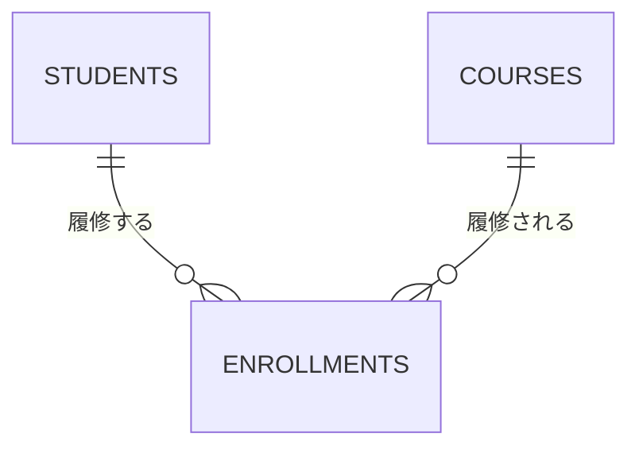
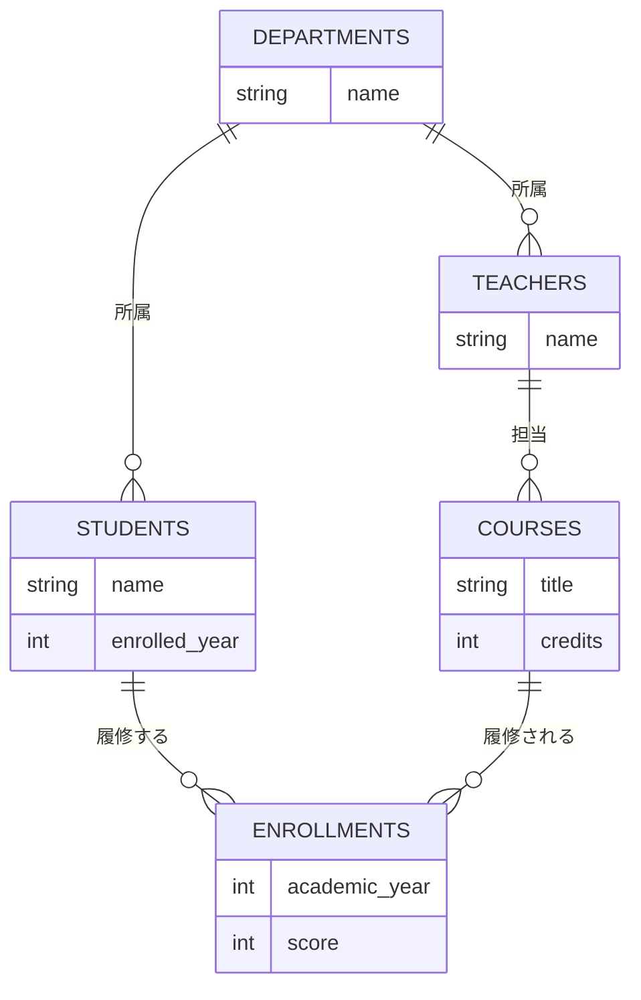
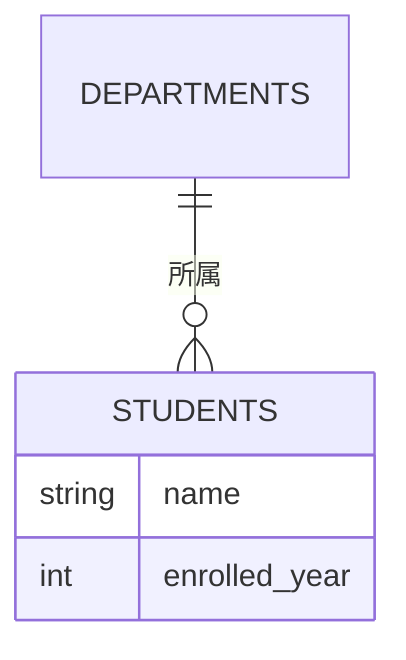

# 03. 概念設計とER図

[← 前へ：02 データベース設計の流れ](02_データベース設計の流れ.md) ｜ [次へ：04 論理設計 →](04_論理設計.md)

## この章のゴール
- 要件の文章から、エンティティ・属性・リレーションシップを拾い出せる
- カーディナリティ（1 対 1、1 対多、多対多）を判断できる
- 多対多の関係を、関連エンティティで解消できる
- mermaid の `erDiagram` で ER 図を描ける

## 目次

1. [概念設計とは](#1-概念設計とは)
2. [要件から候補を拾う](#2-要件から候補を拾う)
3. [ER 図の要素](#3-er-図の要素)
4. [カーディナリティ](#4-カーディナリティ)
5. [多対多の解消](#5-多対多の解消)
6. [成績管理の ER 図](#6-成績管理の-er-図)
7. [mermaid の erDiagram の書き方](#7-mermaid-の-erdiagram-の書き方)
8. [概念設計のチェックポイント](#8-概念設計のチェックポイント)
9. [よくあるミス](#9-よくあるミス)

---

## 1. 概念設計とは

**概念設計**は、データベースで管理したい**「もの」と、その「関係」**を洗い出して、**ER 図**（Entity-Relationship Diagram）で表す作業です。テーブルや型のことはまだ考えません。「学生」「科目」といった**業務の言葉**だけで考えます。

## 2. 要件から候補を拾う

[02 章](02_データベース設計の流れ.md#3-題材の要件)の要件文から、**名詞**と**動詞**に注目します。

| 要件の表現 | 種類 | 候補 |
|---|---|---|
| 学科、学生、教員、科目 | 名詞（独立して存在するもの） | **エンティティ** |
| 名前、入学年度、単位数、科目名 | 名詞（そのものの性質） | **属性** |
| 学生は学科に**所属**する | 動詞 | **リレーションシップ**（学生 — 学科） |
| 教員は学科に**所属**する | 動詞 | リレーションシップ（教員 — 学科） |
| 科目は教員が**担当**する | 動詞 | リレーションシップ（教員 — 科目） |
| 学生は科目を**履修**する | 動詞 | リレーションシップ（学生 — 科目）… ただし年度と点数がある |

「年度」と「点数」は、学生の性質でも科目の性質でもありません。「**学生が、その科目を、その年度に履修したときの点数**」です。この扱いは、[5. 多対多の解消](#5-多対多の解消)で考えます。

## 3. ER 図の要素

| 要素 | 意味 | 成績管理の例 | 図での表し方 |
|---|---|---|---|
| **エンティティ** | 管理したい「もの」。区別できる存在 | 学生、科目、学科、教員 | 長方形（テーブルのような箱） |
| **属性** | エンティティの性質 | 学生の名前、科目の単位数 | 箱の中の項目 |
| **リレーションシップ** | エンティティ同士の関係 | 学生は学科に**所属**する | エンティティをつなぐ線 |

> エンティティは、後で**テーブル**になります。属性は**列**に、リレーションシップは**外部キー**や**中間テーブル**になります（04 章）。

## 4. カーディナリティ

リレーションシップで、「**1 つに対していくつ対応するか**」を**カーディナリティ**（多重度）といいます。**両方向**から確認するのがコツです。

| 種類 | 意味 | 成績管理の例 |
|---|---|---|
| **1 対 1** | 一方が 1 つに対し、他方も 1 つ | （例：学生と学生証。今回は無し） |
| **1 対 多** | 一方が 1 つに対し、他方は複数 | 学科 1 つに、学生は**複数**所属。学生 1 人の学科は**1 つ** |
| **多 対 多** | どちらも複数 | 学生 1 人が複数の科目を履修し、科目 1 つを複数の学生が履修する |

確認のしかた（学生と学科）：

- 「**1 つの学科**に、学生は何人所属するか？」→ 複数（0 人以上）
- 「**1 人の学生**は、何個の学科に所属するか？」→ 1 つだけ

→ 学科 : 学生 ＝ **1 対 多**

### 必須か任意か

もう 1 つ、**最低でも関連があるか**（必須か任意か）も区別します。

| 記号（mermaid） | 意味 |
|---|---|
| `\|\|` | ちょうど 1 つ（必ず 1 つ） |
| `o\|` | 0 または 1 つ |
| `}o` / `o{` | 0 以上（いくつでも、なくてもよい） |
| `}\|` / `\|{` | 1 以上（最低 1 つ） |

例：学科（`||`）と学生（`o{`）なら、「学生は必ず 1 つの学科に所属し、学科には 0 人以上の学生がいる」。

## 5. 多対多の解消

学生と科目は、**多対多**です。


しかし、リレーショナルデータベースでは、**多対多を直接表せません**（1 つの列に複数の値を入れられないため）。そこで、間に**関連エンティティ**を置き、**2 つの 1 対多**に分解します。



この `ENROLLMENTS`（履修）は、単なる「つなぎ」ではありません。**自分自身の属性**（年度、点数）を持つ、れっきとしたエンティティです。

| ENROLLMENTS の属性 | 説明 |
|---|---|
| academic_year | 履修した年度 |
| score | 点数（履修中は NULL） |

> 💡 **関連が属性を持つなら、関連をエンティティにする**。「年度」「点数」は、学生にも科目にも属さない、「履修」という出来事の性質です。再履修（同じ学生が同じ科目を別の年度に履修）も、履修を 1 件ずつ記録すれば自然に表せます。

## 6. 成績管理の ER 図

要件から導いた、概念設計の成果物です。属性は、キー（ID）を除いて書きます（キーは論理設計：04 章）。



エンティティと日本語の対応：

| エンティティ | 意味 | 属性 |
|---|---|---|
| DEPARTMENTS | 学科 | name（学科名） |
| TEACHERS | 教員 | name（名前） |
| STUDENTS | 学生 | name（名前）、enrolled_year（入学年度） |
| COURSES | 科目 | title（科目名）、credits（単位数） |
| ENROLLMENTS | 履修 | academic_year（年度）、score（点数） |

線の読み方：`DEPARTMENTS ||--o{ STUDENTS : "所属"` は、「学科 1 つに対して、学生は 0 人以上所属する。学生 1 人は、ちょうど 1 つの学科に所属する」です。

## 7. mermaid の erDiagram の書き方

GitHub の Markdown では、`erDiagram` を使って ER 図を描けます。

````markdown

````

| 書き方 | 意味 |
|---|---|
| `A ||--o{ B : "ラベル"` | A と B の関係。左右の記号がカーディナリティ |
| `\|\|--\|\|` | 1 対 1 |
| `\|\|--o{` | 1 対 多（多の側は 0 以上） |
| `}o--o{` | 多 対 多 |
| `ENTITY { 型 属性名 }` | 属性の定義（`PK` `FK` `UK` も付けられる：04 章） |

> ⚠️ **属性名とエンティティ名は、英数字で書きます**。日本語の説明は、関係のラベル（`"所属"` の部分）や、図の外の表に書くと、確実に表示されます。

> 💡 ER 図の表記法には、この資料で使う「**鳥の足**」記法（線の端が `o{` のような形）のほか、Chen 記法（四角形・ひし形・楕円）など、いくつかの流儀があります。意味は同じなので、1 つ覚えれば他の図も読めます。

## 8. 概念設計のチェックポイント

ER 図ができたら、次の点を確認します。

- **エンティティは「1 種類のもの」を表しているか**：1 つの箱に複数種類のものを詰め込んでいないか
- **すべての線に、両方向のカーディナリティがあるか**
- **多対多が残っていないか**（関連エンティティで解消済みか）
- **要件の文章と見比べて、取りこぼしがないか**（要件の 1〜8 が全部図で表せているか）
- **同じ情報が、複数のエンティティに重複していないか**

## 9. よくあるミス

| ミス | 原因・対処 |
|---|---|
| 「点数」を学生の属性にしてしまう | 点数は、**学生 × 科目 × 年度**で決まる。学生だけでは決まらない。履修エンティティの属性にする |
| 多対多の線を引いたまま終わる | 関連エンティティで 2 つの 1 対多に分ける |
| 「学科名」を学生の属性にしてしまう | 学科は独立した「もの」。学科のエンティティを作り、学生は学科に所属する関係にする（正規化：05 章） |
| 線の一方のカーディナリティしか考えない | 「A から見て B はいくつ」と「B から見て A はいくつ」を両方確認する |
| 概念設計で ID や型まで決めようとする | ID（キー）は論理設計、型は物理設計。ここでは「何を管理するか」に集中する |

---

[← 前へ：02 データベース設計の流れ](02_データベース設計の流れ.md) ｜ [次へ：04 論理設計 →](04_論理設計.md)
