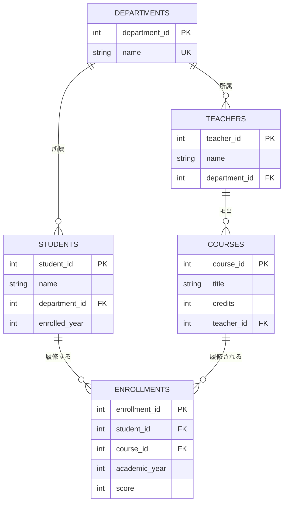
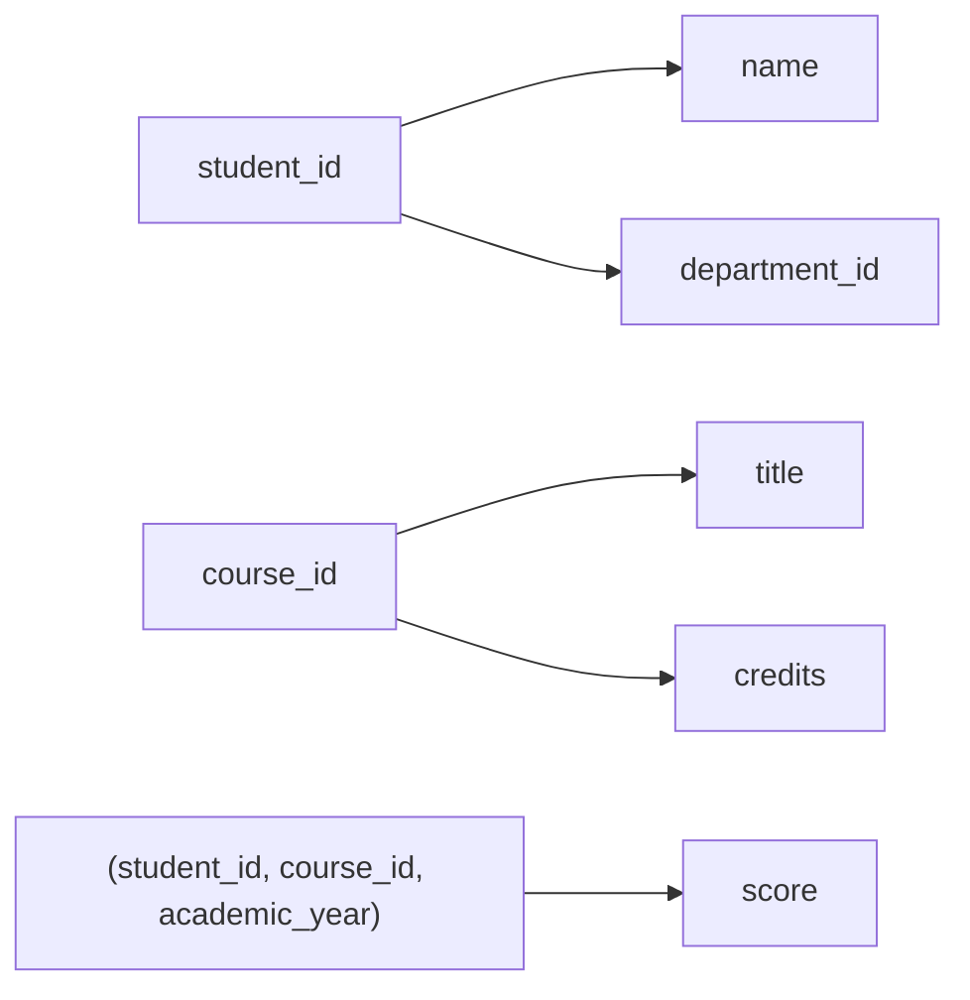

# 04. 論理設計

[← 前へ：03 概念設計とER図](03_概念設計とER図.md) ｜ [次へ：05 正規化 →](05_正規化.md)

## この章のゴール
- ER 図をテーブルに変換するルールを使える
- 主キー・候補キー・外部キー・複合キー・代理キーの違いを説明できる
- 履修テーブルの主キーを、理由をつけて選べる
- 関数従属の考え方が分かる（正規化の準備）

## 目次

1. [論理設計とは](#1-論理設計とは)
2. [ER 図からテーブルへの変換ルール](#2-er-図からテーブルへの変換ルール)
3. [キーの種類](#3-キーの種類)
4. [主キーの選び方](#4-主キーの選び方)
5. [論理 ER 図](#5-論理-er-図)
6. [テーブル定義書](#6-テーブル定義書)
7. [参照整合性](#7-参照整合性)
8. [関数従属](#8-関数従属)
9. [よくあるミス](#9-よくあるミス)

---

## 1. 論理設計とは

**論理設計**は、概念設計の ER 図を、**リレーショナルデータベースのテーブル**に変換する作業です。

- 決めるのは、**テーブル名、列、キー（主キー・外部キー）、テーブル間の関連**
- まだ DBMS には依存しません。**データ型の細かい指定（VARCHAR の長さなど）は物理設計（06 章）**に回します
- 作ったテーブルが「良い形」かを検査し、直す作業が**正規化**です（05 章）

## 2. ER 図からテーブルへの変換ルール

| ER 図の要素 | テーブルでは |
|---|---|
| **エンティティ** | 1 つのテーブルにする |
| **属性** | テーブルの列にする |
| **1 対 多のリレーションシップ** | 「多」の側のテーブルに、「1」の側の主キーを**外部キーとして追加**する |
| **多 対 多**（関連エンティティで解消済み） | 関連エンティティを**中間テーブル**にする。2 つの外部キーを持つ |
| **1 対 1** | どちらかのテーブルに外部キーを追加する（`UNIQUE` を付ける） |
| 各テーブル | **主キー**を決める（ER 図にはなかった ID を、ここで追加する） |

成績管理の変換例：

| ER 図 | テーブル |
|---|---|
| 学科 1 — 多 学生 | `students` に `department_id`（外部キー）を追加 |
| 学科 1 — 多 教員 | `teachers` に `department_id`（外部キー）を追加 |
| 教員 1 — 多 科目 | `courses` に `teacher_id`（外部キー）を追加 |
| 学生 1 — 多 履修 | `enrollments` に `student_id`（外部キー）を追加 |
| 科目 1 — 多 履修 | `enrollments` に `course_id`（外部キー）を追加 |

> 外部キーを置く側は、**必ず「多」の側**です。「学科の側に学生の ID を並べる」ことはできません（1 つの列に複数の値は入らないため）。

## 3. キーの種類

| キー | 意味 | 例 |
|---|---|---|
| **候補キー** | 行を 1 つに特定できる、**最小の**列（の組）。主キーになりうるもの | `student_id`（学籍番号があれば、それも候補） |
| **主キー**（PK） | 候補キーのうち、**代表として選んだ 1 つ**。重複しない、`NULL` にならない | `student_id` |
| **代替キー** | 候補キーのうち、主キーに選ばなかったもの | （学籍番号を別に持つ場合の学籍番号） |
| **外部キー**（FK） | **他のテーブルの主キーを参照する列** | `students.department_id` |
| **複合キー** | **複数の列を組み合わせた**キー | （学生, 科目, 年度） |
| **代理キー** | 業務上の意味を持たない、**システムが付ける連番**のキー | `student_id`（自動採番） |
| **自然キー** | 業務上の意味を持つ値を使ったキー | 学籍番号、メールアドレス |

## 4. 主キーの選び方

### 代理キーか、自然キーか

| | 代理キー（連番） | 自然キー（業務の値） |
|---|---|---|
| 長所 | 変わらない、短い、重複しない。外部キーで参照しやすい | 意味が分かりやすい |
| 短所 | 意味がない（見ただけでは何か分からない） | **変わる可能性がある**（メールアドレス変更、学籍番号の体系変更） |

この資料では、**代理キー**（`student_id` など、自動採番の連番）を主キーにします。業務上の値（学籍番号など）が必要になったら、別の列に持ち、`UNIQUE` を付けます。

### 履修テーブルの主キー

`enrollments` は、「学生・科目・年度」の 3 つで 1 行が決まります（再履修があるため、年度も必要です）。主キーには 2 つの選択肢があります。

| | 案 A：複合キー | 案 B：代理キー + UNIQUE |
|---|---|---|
| 主キー | (`student_id`, `course_id`, `academic_year`) | `enrollment_id`（連番） |
| 二重履修の防止 | 主キー自体が保証する | 別途 `UNIQUE (student_id, course_id, academic_year)` を付けて保証する |
| 他のテーブルから参照する | 3 列を持つ必要がある | `enrollment_id` 1 列で済む |
| Java から扱う | キーが 3 つの値になる | キーは 1 つの値 |

**この資料では案 B を採用**します。他のテーブル（たとえば将来追加するレポート提出テーブル）から履修を参照しやすく、アプリケーションのコードも書きやすいためです。**二重履修の防止は、`UNIQUE` 制約で必ず保証します**（06 章）。

> 💡 案 A も正しい設計です。どちらが良いかは、参照のされ方で決まります。「主キーを 1 列にしたい」場合は案 B、「余計な列を増やしたくない」場合は案 A、と考えてください。

## 5. 論理 ER 図

概念 ER 図に、**主キー（PK）、外部キー（FK）、一意制約（UK）**を書き加えたものが、論理設計の成果物です。

> `UNIQUE (student_id, course_id, academic_year)` のような**複数列の一意制約**は、図に書きにくいので、次のテーブル定義書に書きます。

## 6. テーブル定義書

論理設計では、ER 図に加えて、テーブルごとの**定義書**を作ります。ここでは、データ型は「文字」「整数」程度にとどめます（具体的な型は 06 章）。

**departments（学科）**

| 列 | 意味 | キー | 空（NULL） | 備考 |
|---|---|---|---|---|
| department_id | 学科 ID | PK | 不可 | 自動採番 |
| name | 学科名 | UK | 不可 | 重複不可 |

**teachers（教員）**

| 列 | 意味 | キー | 空（NULL） | 備考 |
|---|---|---|---|---|
| teacher_id | 教員 ID | PK | 不可 | 自動採番 |
| name | 名前 | | 不可 | |
| department_id | 所属学科 | FK → departments | 不可 | |

**students（学生）**

| 列 | 意味 | キー | 空（NULL） | 備考 |
|---|---|---|---|---|
| student_id | 学生 ID | PK | 不可 | 自動採番 |
| name | 名前 | | 不可 | |
| department_id | 所属学科 | FK → departments | 不可 | |
| enrolled_year | 入学年度 | | 不可 | 2000 以上 |

**courses（科目）**

| 列 | 意味 | キー | 空（NULL） | 備考 |
|---|---|---|---|---|
| course_id | 科目 ID | PK | 不可 | 自動採番 |
| title | 科目名 | | 不可 | |
| credits | 単位数 | | 不可 | 1〜4 |
| teacher_id | 担当教員 | FK → teachers | 不可 | |

**enrollments（履修）**

| 列 | 意味 | キー | 空（NULL） | 備考 |
|---|---|---|---|---|
| enrollment_id | 履修 ID | PK | 不可 | 自動採番 |
| student_id | 学生 | FK → students | 不可 | |
| course_id | 科目 | FK → courses | 不可 | |
| academic_year | 履修した年度 | | 不可 | |
| score | 点数 | | **可** | 0〜100。NULL は履修中（未評価） |
| （複数列） | | UK | | (student_id, course_id, academic_year) の組は重複不可 |

> 要件 6「履修中で、まだ点数がないこともある」が、`score` を **NULL 可**にする根拠です。要件がテーブル定義書のどこに現れているかを、確認する習慣をつけましょう。

## 7. 参照整合性

**外部キー**には、「**存在しないものを指してはいけない**」というルールがあります。これを**参照整合性**といいます。

- `students.department_id = 99` なのに、学科 99 が無い → **登録できない**
- 学生がいる学科を削除しようとする → **削除できない**（または、設定によって学生も一緒に削除される）

論理設計では、「**外部キーが指す先がなくなったとき、どうするか**」も決めておきます。

| 方針 | 意味 | 成績管理での例 |
|---|---|---|
| 禁止（RESTRICT） | 参照されている行は削除できない | 履修者がいる科目は削除できない |
| 連動して削除（CASCADE） | 参照している行も一緒に削除する | 学生を削除したら、その学生の履修も削除する |

この方針は、物理設計で外部キー制約に指定します（06 章）。4層アーキテクチャ編では、`InMemory…Repository` が存在確認をコードで行っていましたが、データベースでは**DBMS が自動で守ってくれます**。

## 8. 関数従属

論理設計の最後に、**関数従属**という考え方を知っておきます。次章の正規化は、この考え方が土台です。

> 列 X の値が決まると、列 Y の値が**ただ 1 つに決まる**とき、「Y は X に**関数従属**する」といい、`X → Y` と書く。

成績管理の例：

| 関数従属 | 意味 |
|---|---|
| `student_id` → `name`, `department_id`, `enrolled_year` | 学生 ID が決まれば、名前・学科・入学年度が決まる |
| `department_id` → `name`（学科名） | 学科 ID が決まれば、学科名が決まる |
| `course_id` → `title`, `credits`, `teacher_id` | 科目 ID が決まれば、科目名・単位数・担当教員が決まる |
| (`student_id`, `course_id`, `academic_year`) → `score` | 学生・科目・年度の 3 つが決まれば、点数が決まる |

**逆は成り立ちません**。点数 80 から、どの学生かは決まりません。

> 💡 **良いテーブルとは、「主キーが決まれば、他の列が全部決まる」テーブル**です。逆にいえば、「主キーの一部だけで決まる列」や「主キー以外の列から決まる列」が混ざっていると、不具合の原因になります。これが次の 05 章のテーマです。

論理設計で作ったこの 5 つのテーブルは、05 章で**正規化を行った結果と一致する**ことを確認します。

## 9. よくあるミス

| ミス | 原因・対処 |
|---|---|
| 外部キーを「1」の側のテーブルに置く | 外部キーは**必ず「多」の側**に置く |
| 履修テーブルの主キーに (`student_id`, `course_id`) だけを使う | 再履修で、同じ学生が同じ科目を別の年度に履修できなくなる。年度も含める |
| 学生の主キーにメールアドレスなど、変わりうる値を使う | 変わらない代理キーを主キーにして、メールは `UNIQUE` にする |
| 名前など、重複しうる値を主キーにする | 同姓同名で破綻する。名前は主キーに向かない |
| 「点数が無い」を 0 で表す | 0 点（評価済み）と未評価は別の意味。NULL を使う（09 章） |

---

[← 前へ：03 概念設計とER図](03_概念設計とER図.md) ｜ [次へ：05 正規化 →](05_正規化.md)
