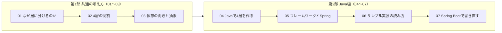
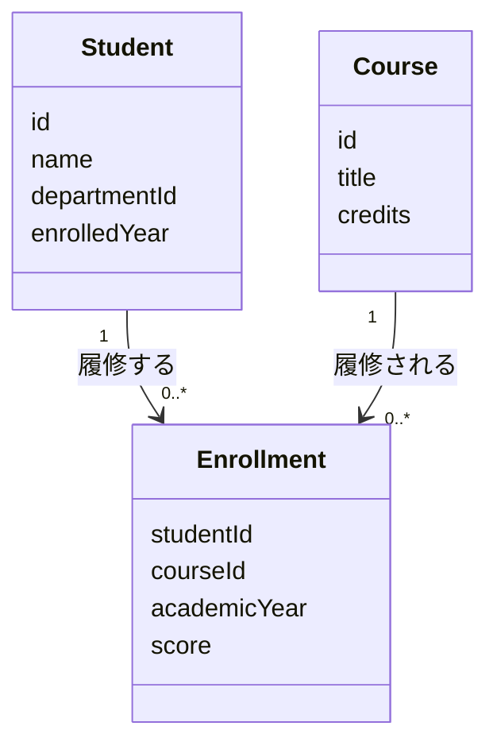
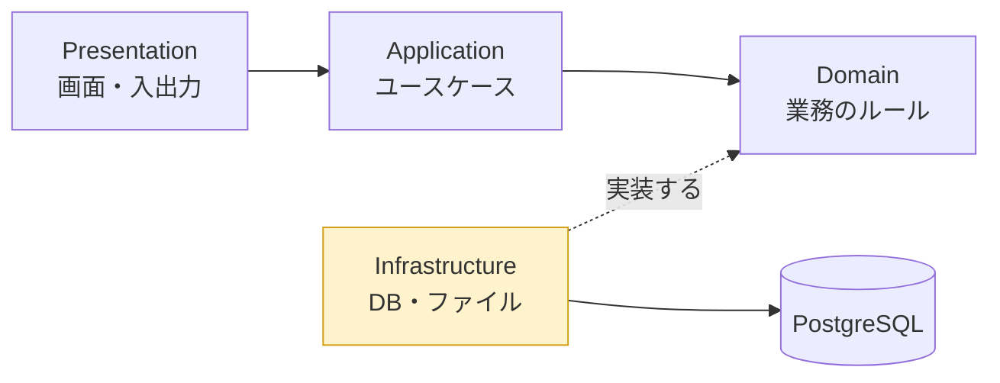

# 4層アーキテクチャ — はじめに

[📖 4層アーキテクチャの目次](./00_はじめに.md#目次) ｜ [🏠 全体の目次](../README.md#目次)

プログラムが大きくなると、「どこに何を書くか」が分からなくなります。この資料では、アプリケーションを **4 つの層（レイヤー）に分けて設計する考え方**を学びます。まず**言語を問わず共通の考え方**（第 1 部）を学び、そのうえで **Java ではどう書くか**（第 2 部）を学ぶ、という順で進みます。題材は、Java 入門の総合演習で作った**成績管理プログラム**を発展させたものです。

## 目次

1. [この資料について](#1-この資料について)
2. [章の構成](#2-章の構成)
3. [前提知識](#3-前提知識)
4. [題材：成績管理システム](#4-題材成績管理システム)
5. [データベース編との関係](#5-データベース編との関係)
6. [サンプルリポジトリと資料の役割分担](#6-サンプルリポジトリと資料の役割分担)
7. [各章の書き方](#7-各章の書き方)

---

## 1. この資料について

- 対象：
  - 第 1 部（01〜03 章）：プログラミングの経験がある人。**特定の言語の知識は不要**です
  - 第 2 部（04〜07 章）：Java の基礎（クラス・継承・インタフェース・例外）を理解している人。必要なら [付録：Java入門](../付録/Java入門/00_はじめに.md) の 06〜08 章を参照してください
- 使用バージョン：**Java 25（LTS）**、**Spring Boot 4.x**（05・07 章）。コードは実機での動作確認は行っていません
- ゴール：
  - アプリケーションを **Presentation / Application / Domain / Infrastructure** の 4 層に分ける理由と、各層の役割を説明できる（言語共通）
  - 「どの処理をどの層に書くか」を判断できる（言語共通）
  - 層の間の**依存の向き**と、インタフェース（抽象）の役割が分かる（言語共通）
  - 素の Java で 4 層のアプリケーションを組み立てられ、Spring Boot での書き方との対応が分かる（Java 編）

## 2. 章の構成

### 第 1 部：共通の考え方（言語に依存しない）

| 章 | タイトル | 内容 | 目安時間 |
|---|---|---|---|
| 01 | [なぜ層に分けるのか](01_なぜ層に分けるのか.md) | 1 つにまとめたコードの問題点、関心の分離 | 1 時間 |
| 02 | [4層の役割](02_4層の役割.md) | 各層の責務、置くもの・置かないもの、他の呼び名との対応 | 1.5 時間 |
| 03 | [依存の向きと抽象](03_依存の向きとインタフェース.md) | 依存の方向、依存性逆転、依存性の注入、部品をつなぐ場所 | 1.5 時間 |

### 第 2 部：Java 編

| 章 | タイトル | 内容 | 目安時間 |
|---|---|---|---|
| 04 | [Javaで4層を作る](04_Javaで4層を作る.md) | 共通の考え方を Java の機能で表す（パッケージ、`record`、`interface`、コンストラクタ注入、`Main`） | 1.5 時間 |
| 05 | [フレームワークとSpring](05_フレームワークとSpring.md) | ライブラリとの違い、Spring / Spring Boot、他のフレームワークとの比較 | 2 時間 |
| 06 | [サンプル実装の読み方](06_サンプル実装の読み方.md) | 4 層で作った成績管理（保存先はメモリ）を読み解く | 1.5 時間 |
| 07 | [Spring Bootで書き直す](07_Spring_Bootで書き直す.md) | 同じ構造を Spring Boot で書く | 2 時間 |

## 3. 前提知識

- （第 2 部のみ）クラス、コンストラクタ、カプセル化（付録 Java入門 06 章）
- （第 2 部のみ）継承、**インタフェース**、ポリモーフィズム（付録 Java入門 07 章）。この資料では、インタフェースが重要な役割を果たします
- （第 2 部のみ）例外処理（付録 Java入門 08 章）
- （第 2 部のみ）`List` / `Map`（付録 Java入門 04 章）

07 章（Spring Boot）では、SQL と JDBC の知識（[データベース編](../データベース/00_はじめに.md)）を使います。

## 4. 題材：成績管理システム

Java 入門の総合演習では、「名前と点数」だけの簡単な成績管理を作りました。この資料では、現実の大学に少し近づけて、次のデータを扱います。

| データ | 内容 |
|---|---|
| 学生（Student） | 学生番号、名前、所属学科、入学年度 |
| 科目（Course） | 科目番号、科目名、単位数 |
| 履修（Enrollment） | どの学生が、どの科目を、何年度に履修し、何点だったか |

アプリケーションが提供する機能（ユースケース）は次の 3 つです。

1. **学生を登録する**
2. **成績を登録する**（学生・科目・年度・点数を指定）
3. **学生の成績一覧を表示する**（科目ごとの点数と、平均点）

## 5. データベース編との関係

2 つの資料は、同じ題材（成績管理）でつながっています。

| 4層アーキテクチャ編 | データベース編 |
|---|---|
| 保存先を**メモリ**にして、4 層の構造に集中する（サンプルの step1、04・06 章） | データベースの設計（概念・論理・物理）と SQL を学ぶ |
| 保存先を**差し替えられる**作りにしておく（03・04 章） | 12 章で、保存先を**データベース（JDBC）に差し替える**（サンプルの step2） |
| 07 章で Spring Boot に書き直す（サンプルの step3） | 12 章までのテーブルをそのまま使う |

4 層のうち、データベースを直接扱うのは **Infrastructure 層だけ**です。データベース編は、4 層の中の「Infrastructure 層」を詳しく掘り下げる資料と考えてください。

黄色の部分が、データベース編で詳しく扱う範囲です。

## 6. サンプルリポジトリと資料の役割分担

4 層のアプリケーションは、クラスの数が多くなります。すべてのコードを資料に載せると、肝心の「考え方」が読みにくくなってしまいます。そこで、**動く完成コードは別のリポジトリ（サンプルシステム）にまとめ**、この資料では考え方の説明に集中します。

| 置き場所 | 役割 | 内容 |
|---|---|---|
| **この資料** | **なぜ・何を・どこに** | 考え方、判断の基準、図、表、短いコードの抜粋 |
| **サンプルリポジトリ** | **どう書くか** | 段階ごとの完成コード、実行方法、SQL |
| 演習（別途） | 手を動かす | 資料とは別に出題 |

サンプルリポジトリは、同じ成績管理システムを**3 段階**に分けて置いています。

| フォルダ | 内容 | 対応する資料 |
|---|---|---|
| `step1-memory/` | 4 層に分けた成績管理。保存先は**メモリ** | 4層編 04・06 章 |
| `step2-jdbc/` | step1 の保存先を**PostgreSQL（JDBC）**に差し替えたもの | データベース編 12 章 |
| `step3-spring/` | **Spring Boot** で書き直したもの | 4層編 07 章 |
| `db/` | テーブル定義とサンプルデータ（SQL） | データベース編 |

> 📦 **サンプルリポジトリ**：[PRMN_SYSTEM_Sample](https://github.com/<ORG>/PRMN_SYSTEM_Sample)（URL は仮置きです。公開先が決まり次第、差し替えます）

資料の中で、サンプルのファイルを案内するときは、次の形式で書きます。

> 📦 **サンプル**：[`step1-memory/src/grades/application/GradeService.java`](https://github.com/<ORG>/PRMN_SYSTEM_Sample/blob/main/step1-memory/src/grades/application/GradeService.java)

> 💡 **おすすめの読み方**：資料を読みながら、サンプルのコードを別のウィンドウ（または IDE）で開いておきます。資料では**抜粋だけ**を示すので、全体の中でその部分がどこにあるかを、サンプルで確認してください。

## 7. 各章の書き方

各章は次の順で進みます。

1. **この章のゴール**：何ができるようになるか
2. **説明、図、表**：図（mermaid）を見ながら、構造を頭に入れる。コードは要点の抜粋だけ（第 1 部は疑似コード、第 2 部は Java）
3. **サンプルへのリンク**：全体のコードはサンプルリポジトリで確認する
4. **よくあるミス**

---

[次へ：01 なぜ層に分けるのか →](01_なぜ層に分けるのか.md)

[📖 4層アーキテクチャの目次](./00_はじめに.md#目次) ｜ [🏠 全体の目次](../README.md#目次)
