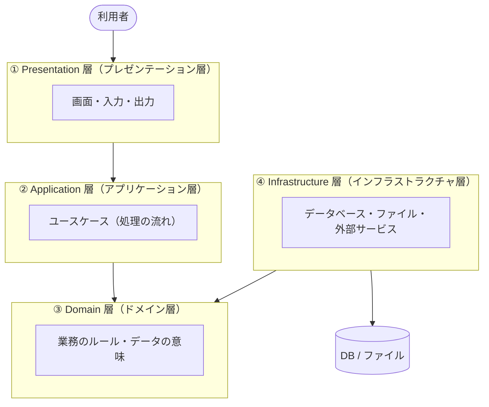
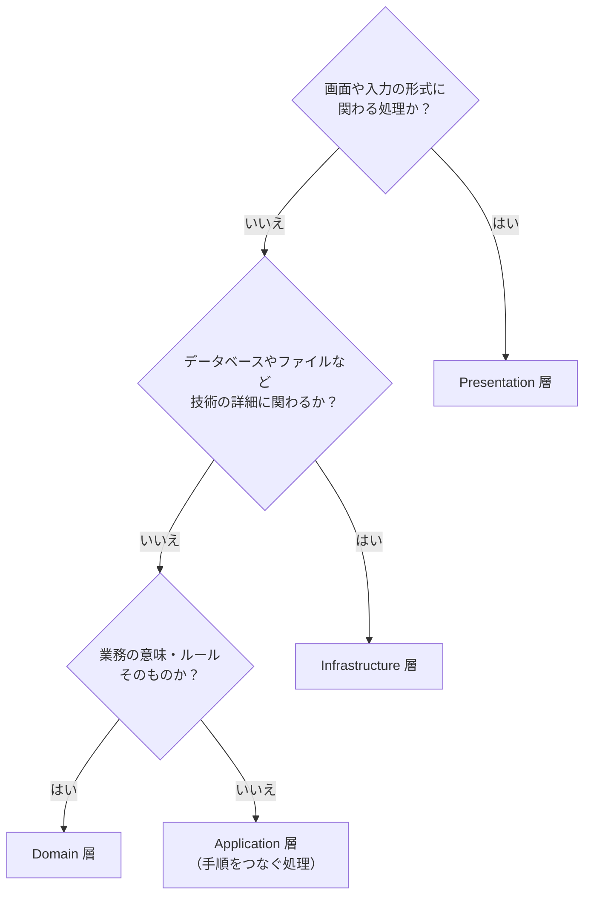
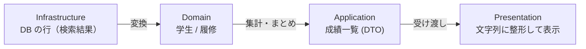

# 02. 4層の役割

[📖 4層アーキテクチャの目次](./00_はじめに.md#目次) ｜ [🏠 全体の目次](../README.md#目次)

[← 前へ：01 なぜ層に分けるのか](01_なぜ層に分けるのか.md) ｜ [次へ：03 依存の向きと抽象 →](03_依存の向きとインタフェース.md)

## この章のゴール
- 4 つの層（Presentation / Application / Domain / Infrastructure）の責任を説明できる
- 「この処理はどの層に書くか」を判断できる
- 層をまたいでデータを渡すときの考え方が分かる
- 3 層・MVC など、他の呼び名との対応が分かる

## 目次

1. [4層の全体像](#1-4層の全体像)
2. [Presentation 層：入出力を担当する](#2-presentation-層入出力を担当する)
3. [Application 層：ユースケースを実現する](#3-application-層ユースケースを実現する)
4. [Domain 層：業務のルールを表現する](#4-domain-層業務のルールを表現する)
5. [Infrastructure 層：外の世界とつなぐ](#5-infrastructure-層外の世界とつなぐ)
6. [どの層に書くか迷ったとき](#6-どの層に書くか迷ったとき)
7. [層をまたぐデータ](#7-層をまたぐデータ)
8. [他の呼び名との対応](#8-他の呼び名との対応)
9. [フォルダ（モジュール）の分け方](#9-フォルダモジュールの分け方)
10. [よくあるミス](#10-よくあるミス)

---

## 1. 4層の全体像



| 層 | 一言でいうと | 成績管理での例 |
|---|---|---|
| **Presentation** | 利用者とのやり取り | メニュー表示、キーボードや Web フォームからの入力、結果の表示 |
| **Application** | 「やりたいこと」の手順 | 「成績を登録する」「成績一覧を作る」 |
| **Domain** | 業務の意味とルール | 点数は 0〜100、60 点以上で合格 |
| **Infrastructure** | 技術的な詳細 | データベースへの SQL、ファイルの読み書き |

> [!NOTE]
> **ドメイン**とは、そのアプリケーションが扱う業務や世界のことです。成績管理なら「学生・科目・履修・成績」がドメインです。

> [!NOTE]
> この章の内容は、言語やフレームワークによらず共通です。コードは疑似コードで示し、Java での書き方は [04 章](04_Javaで4層を作る.md) で扱います。

## 2. Presentation 層：入出力を担当する

**責任：利用者から入力を受け取り、結果を見せる。**

- 入力の読み取り（コンソールならキーボード入力、Web なら HTTP リクエスト）
- 入力文字列を数値などに**変換**する、形式の検査（「数字が入力されたか」）
- Application 層を**呼び出す**
- 結果を表示用に整える（文字列の整形、HTML、JSON）

```text
点数 = 入力文字列を数値に変換する(入力)                   // 文字列 → 数値に変換
成績を登録する.実行する(学生ID, 科目ID, 2025, 点数)          // Application 層（ユースケース）を呼ぶだけ
```

**書かないもの**：業務のルール（点数の範囲など）、SQL、ファイル操作。

> [!CAUTION]
> **セキュリティの視点**：Web アプリでは、ブラウザの画面で行う入力チェックは、**利用者が自由に書き換えられます**（ブラウザの開発者ツールや、画面を通さずにリクエストを直接送るなど）。画面のチェックは使いやすさのためと考え、**サーバー側（Domain 層、データベースの制約）で必ず検査**します（データベース編 [06 章 7 節](../データベース/06_物理設計.md#7-制約をデータベースに持たせる理由)）。

> [!NOTE]
> **この層を詳しく学ぶ資料**：フロントエンド編（Vaadin）（作成予定）

## 3. Application 層：ユースケースを実現する

**責任：「ユーザーがやりたいこと（ユースケース）」を、手順として実現する。** 自分で業務ルールは決めず、Domain 層と Infrastructure 層を**組み合わせて**処理を進めます。ただし、Infrastructure 層は**直接は呼ばず**、Domain 層に置いたインタフェースを通して使います（[03 章](03_依存の向きとインタフェース.md)）。

- ユースケース 1 つにつき、**クラス（または関数）を 1 つ**用意する（「学生を登録する」「成績を登録する」など）。サンプルでは、ユースケースの名前がそのままクラス名で、メソッドは `実行する` の 1 つだけ
- 「学生が存在するか確認 → 履修を作る → 保存する」のような**手順**を書く
- **トランザクションの範囲**を決める（データベース編 11 章）
- 結果を Presentation 層に返す（必要なら、表示用のデータにまとめる）

```text
// 手順を並べるだけ。細かいルールや SQL は書かない
学生リポジトリ.探す(学生ID)                // 学生がいるか確認
科目リポジトリ.探す(科目ID)                // 科目があるか確認
履修リポジトリ.保存する(履修)              // 保存
```

**書かないもの**：画面の表示、SQL、点数の範囲検査のような業務ルールそのもの。

> [!NOTE]
> **この層を詳しく学ぶ資料**：[上流工程](../上流工程/00_はじめに.md)、ドメイン設計・実装編（作成予定）

## 4. Domain 層：業務のルールを表現する

**責任：業務の「もの」と「ルール」を、プログラムの部品（クラスや構造体）で表現する。** 他の層に依存しない、このアプリケーションの**中心**です。

- 学生、科目、履修といった**概念を部品にする**
- 「点数は 0〜100」「60 点以上が合格」といった**ルールをその部品の中に持たせる**
- データの保存方法は知らない（保存の**窓口を抽象（約束）として宣言する**だけ。03 章）

> [!NOTE]
> 以下の `text` のコードは、特定のプログラミング言語ではない**疑似コード**です。言語の細かい書き方ではなく、「どの層に何を書くか」を見てください。

```text
// ルールが「データ」のそばにある
型 履修(学生ID, 科目ID, 年度, 点数):
    作るとき:
        もし 点数 があり、かつ (点数 < 0 または 点数 > 100) なら
            エラー「点数は0〜100にしてください」
    合格している():  点数 ≥ 60

型 履修一覧(履修のリスト):                           // 「履修の集まり」に対するルールも Domain 層に置く
    平均点を計算する():  点数のある履修だけの平均    // 履修中は含めない
```

**書かないもの**：画面、SQL、ファイル、キーボード入力など、技術的な詳細は一切書かない。

> [!NOTE]
> Java での書き方（`record` とコンパクトコンストラクタ）は [04 章](04_Javaで4層を作る.md) で扱います。

> [!NOTE]
> **この層を詳しく学ぶ資料**：ドメイン設計・実装編（作成予定）

## 5. Infrastructure 層：外の世界とつなぐ

**責任：データベース、ファイル、外部 API など、技術的な詳細を担当する。**

- SQL を実行してデータを保存・取得する
- ファイルの読み書き、外部サービス（API）の呼び出し
- 取得したデータを Domain 層のオブジェクトに**変換して返す**

**書かないもの**：業務ルールの判断（「合格か不合格か」など）。

> [!NOTE]
> **この層を詳しく学ぶ資料**：[データベース編](../データベース/00_はじめに.md)

## 6. どの層に書くか迷ったとき

次の質問に順番に答えると、判断しやすくなります。



成績管理での例：

| 処理 | 層 | 理由 |
|---|---|---|
| 「点数 > 」と表示して入力を待つ（Web なら入力フォームの表示） | Presentation | 画面とのやり取り |
| 入力された `"abc"` を数値に変換できず、エラーメッセージを出す | Presentation | 入力形式の検査 |
| 点数が 0〜100 の範囲か検査する | Domain | 業務のルール |
| 60 点以上なら合格と判定する | Domain | 業務のルール |
| 学生の履修を全部集めて平均点を求める | Application | 複数のオブジェクトを使った手順 |
| `SELECT ... FROM enrollments WHERE ...` | Infrastructure | データベースの詳細 |
| `students.csv` を読み込む | Infrastructure | ファイルの詳細 |

> [!TIP]
> **「点数の範囲検査」と「入力が数字かの検査」は別物**です。前者は「点数とは何か」という業務のルールなので Domain 層、後者は「入力された文字をどう解釈するか」なので Presentation 層です。Web 画面になっても、点数の範囲は変わりません。

## 7. 層をまたぐデータ

層の間でデータを受け渡すとき、どんな形のオブジェクトを使うかも設計の一部です。

| 種類 | 役割 | この資料での例 |
|---|---|---|
| **Domain のオブジェクト** | 業務の概念そのもの（エンティティ） | `学生`、`履修` |
| **DTO**（Data Transfer Object） | 層の間で運ぶだけの入れ物。表示用にまとめたもの | `成績一覧`（成績一覧の表示用データ） |



- **Infrastructure → Domain**：DB の行（検索結果）を、そのまま上の層に渡さない。必ず Domain のオブジェクトに変換する。そうしないと、上の層が「SQL の都合」を知ってしまう
- **Application → Presentation**：画面に必要な形にまとめたデータ（DTO）を返す。データだけを持つ軽い入れ物の仕組みは、多くの言語に用意されている（Java なら `record`。04 章）

## 8. 他の呼び名との対応

「層に分ける」考え方には、いくつもの呼び名があります。この資料の 4 層は、次のように対応づけられます。

| この資料の層 | 3 層（現場でよく使う呼び名） | MVC | 呼び名の例 |
|---|---|---|---|
| Presentation | プレゼンテーション層 | View / Controller | Controller、UI |
| Application | ビジネスロジック層 | （Controller の一部） | Service、Use Case |
| Domain | ビジネスロジック層 | Model | Entity、Model |
| Infrastructure | データアクセス層 | （Model の保存部分） | Repository、DAO |

- 現場では「**Controller → Service → Repository の 3 層**」と呼ぶことが多い。この資料の 4 層は、Service（Application 層）と Entity（Domain 層）を分けて、**業務のルールの置き場所をはっきりさせた**形
- **クリーンアーキテクチャ**・**オニオンアーキテクチャ**・**ヘキサゴナルアーキテクチャ**も、「Domain（業務のルール）を中心に置き、技術の詳細を外側にする」という同じ発想に基づく（03 章の依存の向きがその核心）
- 名前や層の数は違っても、**「何を、どこに分けるか」の考え方は共通**

> [!NOTE]
> Spring Boot での呼び名（`@Controller`・`@Service`・`@Repository`）との対応は、[05 章](05_フレームワークとSpring.md) で扱います。

## 9. フォルダ（モジュール）の分け方

層ごとに**フォルダ**（言語によってはパッケージ・モジュール・名前空間）を分けると、「この処理はどの層か」がファイルの場所で分かります。言語によらず、次のような構成が基本です。

```text
プロジェクト/
├── 起動処理                           ← 全部を組み立てて起動する
├── presentation/                      ← メニュー・画面・入出力
├── application/                       ← ユースケース（1 つにつき クラス 1 つ）
├── domain/                            ← エンティティ、ルール、保存の窓口（抽象）
└── infrastructure/                    ← 保存の実装（DB、ファイル、メモリ…）
```

> [!NOTE]
> サンプルでは、プロメンのガイドラインに合わせて、`application` を **`usecase`**、`infrastructure` を **`dataaccess`** というパッケージ名にしています。また、表示用データ（DTO）の `成績一覧` と `成績明細` は、ユースケースの結果をまとめる入れ物なので、`usecase` パッケージに置いています。

> [!WARNING]
> 「起動処理」は、全部の層を知っている唯一の場所です。「どの実装を使うか」を決めて部品をつなぐ役割を持ちます（03 章）。

> [!NOTE]
> Java でのパッケージ構成（ファイル名つき）は [04 章](04_Javaで4層を作る.md) で、サンプルは [`step1-memory/src/grades/`](https://github.com/YTS0418/PRMN_SYSTEM_Sample/tree/main/step1-memory/src/grades) で確認できます。

## 10. よくあるミス

| ミス | 原因・対処 |
|---|---|
| Presentation 層に `if (score < 0 ...)` と点数の検査を書く | 業務のルールは Domain 層へ。Web 版を作ると、同じ検査をもう一度書くことになる |
| Domain 層の部品に画面表示や SQL を書く | Domain 層は技術に依存させない。表示は Presentation、SQL は Infrastructure |
| DB の検索結果（行）をそのまま Application 層や Presentation 層に渡す | Infrastructure 層で Domain のオブジェクトに変換してから返す |
| Application 層に何も業務ルールがなく、全部 Domain に押し込んでしまう | 「手順（流れ）」は Application、「ルール（意味）」は Domain。分けて考える |
| 層の名前が違うだけで、実質 1 つの部品にまとめている | 部品を分けても、中で他の層の仕事をしていたら意味がない。**責任**で判断する |

---

[← 前へ：01 なぜ層に分けるのか](01_なぜ層に分けるのか.md) ｜ [次へ：03 依存の向きと抽象 →](03_依存の向きとインタフェース.md)

[📖 4層アーキテクチャの目次](./00_はじめに.md#目次) ｜ [🏠 全体の目次](../README.md#目次)
