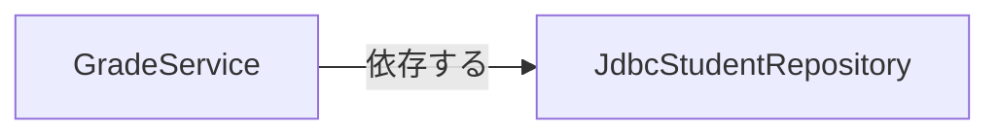
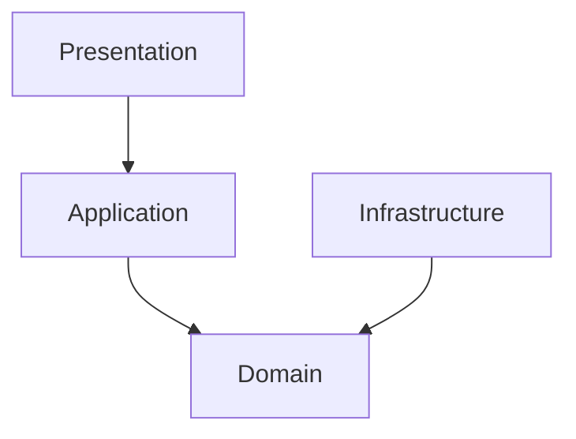
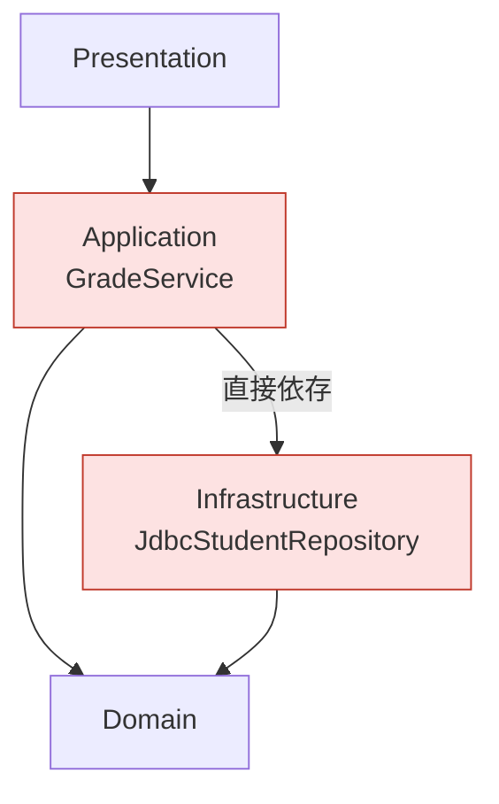
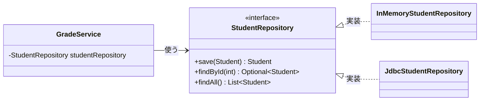
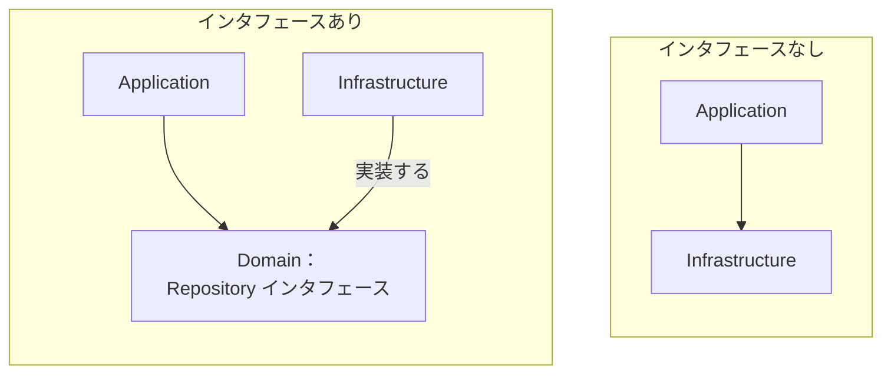
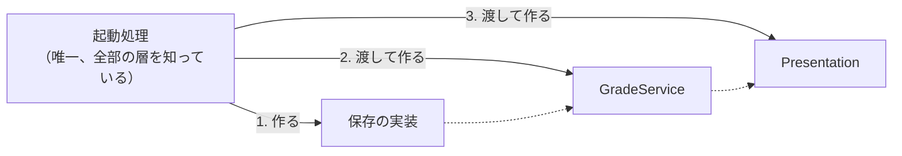

# 03. 依存の向きと抽象（インタフェース）

[📖 4層アーキテクチャの目次](./00_はじめに.md#目次) ｜ [🏠 全体の目次](../README.md#目次)

[← 前へ：02 4層の役割](02_4層の役割.md) ｜ [次へ：04 Javaで4層を作る →](04_Javaで4層を作る.md)

## この章のゴール
- 「依存」とは何か、層の間でどちら向きの依存が許されるかを説明できる
- Application 層が Infrastructure 層に直接依存すると何が困るのか分かる
- 抽象（インタフェース）を使った**依存性逆転**の仕組みを説明できる
- 「外から渡してもらう」（依存性の注入）と、部品をつなぐ場所の考え方が分かる

> [!NOTE]
> この章は言語に依存しない内容です。コードは疑似コードで示し、Java での書き方は [04 章](04_Javaで4層を作る.md) で扱います。

## 目次

1. [依存とは](#1-依存とは)
2. [許される依存の向き](#2-許される依存の向き)
3. [困る例：Application が Infrastructure に依存する](#3-困る例application-が-infrastructure-に依存する)
4. [解決：抽象を間に置く](#4-解決抽象を間に置く)
5. [依存性逆転とは](#5-依存性逆転とは)
6. [外から渡してもらう（依存性の注入）](#6-外から渡してもらう依存性の注入)
7. [部品をつなぐ場所](#7-部品をつなぐ場所)
8. [差し替えられると嬉しいこと](#8-差し替えられると嬉しいこと)
9. [よくあるミス](#9-よくあるミス)

---

## 1. 依存とは

部品 A のコードの中に、部品 B の名前が出てくる（呼ぶ・作る・取り込む）とき、**A は B に依存している**といいます。B を変更すると、A も影響を受ける（直さなければならないかもしれない）関係です。

たとえば、成績サービス（`GradeService`）が「データベース版の学生保存クラス（`JdbcStudentRepository`）を作って使う」と書いていたら、`GradeService` は `JdbcStudentRepository` に依存しています。

依存関係を図にするときは、依存する側から依存される側へ矢印を引きます。



> [!NOTE]
> 変更の影響は**矢印の逆向き**に伝わります。B を変えると A が影響を受けます。

## 2. 許される依存の向き

層構造では、依存の向きを**一方向に揃える**のがルールです。



- 上から下（Presentation → Application → Domain）へ依存する
- **Domain 層は、どの層にも依存しない**（一番内側。全員から依存される）
- **Infrastructure 層は Domain 層に依存する**（Domain のオブジェクトや抽象を使う）
- **逆向き（下から上）の依存は禁止**。Domain が Application を使ってはいけない

| 依存 | 可否 | 理由 |
|---|---|---|
| Presentation → Application | ○ | 画面がユースケースを呼ぶ |
| Application → Domain | ○ | 手順が、業務のオブジェクトを使う |
| Infrastructure → Domain | ○ | 実装が、Domain のオブジェクトを返す |
| Application → Infrastructure（具体的な部品） | ✕ | 後述。保存先が変わるたびに Application を直すことになる |
| Domain → Application / Infrastructure | ✕ | 業務ルールが技術に縛られる |
| Presentation → Infrastructure | ✕ | 層を飛ばして、画面からデータベースを直接触ってしまう |

## 3. 困る例：Application が Infrastructure に依存する

素直に作ると、Application 層は「データを保存・取得するために」Infrastructure 層の部品を直接使いたくなります。

たとえば、`GradeService`（Application 層）の中に「データベース版の学生保存クラスを取り込み、それを作って使う」という記述がある状態です。



これだと、次のような問題が起こります。

- 保存先をファイルに変えたい → `GradeService` の中の保存クラスを書き換える。**層に分けたのに、保存先を変えるたびに Application 層も直す**ことになる
- `GradeService` のテストに**本物のデータベースが必要**になる
- Application 層が、データベース接続のライブラリなど**技術の詳細**を知ることになってしまう

## 4. 解決：抽象を間に置く

間に**抽象**（「こういう機能を持つ部品がほしい」という約束・契約）を置きます。多くの言語に、この「約束」を書くための仕組みがあります。

| 言語 | 約束を書く仕組みの例 |
|---|---|
| Java | `interface` |
| C# | `interface` |
| TypeScript | `interface` / `type` |
| Python | 抽象基底クラス（`abc`）/ `Protocol` |
| Go | `interface`（実装を宣言しなくても、メソッドが合えば満たす） |

この資料では、この仕組みを総称して**インタフェース**と呼びます。手順は 3 つです。

1. 保存の「窓口」を**インタフェース**として **Domain 層**に宣言する（`StudentRepository`）
2. Application 層は、**インタフェースだけ**を知っていて使う
3. Infrastructure 層が、そのインタフェースを**実装する**（`JdbcStudentRepository`、`InMemoryStudentRepository`）

```text
// Domain 層：「こういう保存の窓口がほしい」と宣言するだけ。どう保存するかは書かない
インタフェース 学生保存庫:
    保存する(学生) -> 学生
    番号で探す(番号) -> 学生（または「いない」）
    全件取得する() -> 学生のリスト
```



- `GradeService` は、実体がメモリなのかデータベースなのかを**知らない**
- 実装は「約束」を満たすだけなので、**差し替えても `GradeService` は変わらない**

> [!NOTE]
> 身近な例：多くの言語で、リストを使うときに「リストという約束（List）」で変数を宣言し、中身が配列でも連結リストでも使う側は同じように使えます。

## 5. 依存性逆転とは

インタフェースを置くことで、**依存の向きが逆転**しました。



| | 依存の向き |
|---|---|
| なし | Application → Infrastructure（上が下の具体的な部品に依存） |
| あり | Application → **インタフェース** ← Infrastructure（**下が上の宣言に合わせる**） |

Infrastructure 層から Application / Domain 層への矢印になったため、これを**依存性逆転の原則**（Dependency Inversion Principle）と呼びます。

> [!TIP]
> インタフェースは**使う側（Domain 層）が持つ**のがポイントです。「Application が欲しい窓口の形」を Application 側が決め、Infrastructure はそれに合わせます。もしインタフェースを Infrastructure 側に置いたら、結局 Application が Infrastructure に依存してしまいます。

## 6. 外から渡してもらう（依存性の注入）

では、`GradeService` は**実装をどうやって手に入れる**のでしょうか。中で「データベース版を作る」と書いたら、また具体的な部品に依存してしまいます。

答えは、**外から渡してもらう**ことです。部品を作る側が決めて、使う側に渡します。これを**依存性の注入**（**DI**：Dependency Injection）といいます。最も基本的な方法は、部品を作るときの引数（コンストラクタ）で受け取る**コンストラクタ注入**です。

```text
クラス 成績サービス:
    保持する 学生保存庫: 学生保存庫インタフェース      // 型は「インタフェース」

    作るとき(学生保存庫):                              // 必要な部品を、作るときの引数で受け取る
        this.学生保存庫 = 学生保存庫
```

`GradeService` の中には、実装クラスを作る記述が 1 つもありません。「何を使うか」は**作る側が決める**、「どう使うか」は `GradeService` が決める、という分担です。

| 書き方 | `GradeService` が知っていること |
|---|---|
| 中で `JdbcStudentRepository` を作る | 具体的な実装まで知っている（強く結びついている） |
| 作るときの引数で受け取る | **インタフェースだけ**知っている |

> [!TIP]
> 現在の主要なフレームワーク（Spring など）も、**コンストラクタ注入を推奨**しています。

## 7. 部品をつなぐ場所

では、実装を選んで `GradeService` に渡す（= 部品をつなぐ）のは**誰**でしょうか。それは、プログラムの出発点にある**起動処理**（Composition Root ともいいます）です。



起動処理の仕事は、次の 3 つです。

1. 保存先などの**実装を選んで作る**
2. それを Application 層の部品に**渡す**
3. Application 層の部品を Presentation 層に**渡して、起動する**

部品をつなぐ方法には、大きく 2 通りあります。

| 方法 | 内容 |
|---|---|
| **手で組み立てる** | 起動処理に、部品を作って渡すコードを自分で書く。仕組みが見えやすく、小さなアプリケーション向き |
| **DI コンテナに任せる** | 「どの実装を使うか」だけを宣言し、部品を作って渡す作業はフレームワーク（DI コンテナ）が自動で行う。部品が増えても楽 |

> [!NOTE]
> Java では、手で組み立てる場合は `Main`（[04 章](04_Javaで4層を作る.md)）、DI コンテナに任せる場合は Spring（[05 章](05_フレームワークとSpring.md)）を使います。

## 8. 差し替えられると嬉しいこと

### 保存先の切り替え

保存先を変えたいときに書き換えるのは、**起動処理（部品をつなぐ場所）の数行だけ**です。他の部品は変更不要です。データベース編 12 章では、実際にそうします。

### テストが書ける

本物のデータベースが無くても、メモリ上の実装（テスト用の偽物）を渡して `GradeService` をテストできます。

> [!NOTE]
> テストの書き方は、この資料の範囲外です。「差し替えられるからテストしやすい」という点だけ押さえておけば十分です。

## 9. よくあるミス

| ミス | 原因・対処 |
|---|---|
| `GradeService` の中で、メモリ版の保存クラスを直接作っている | 具体的な部品に依存する。作るときの引数で**インタフェース型**を受け取る |
| 保存の窓口（インタフェース）を Infrastructure 層に置く | 使う側（Domain 層）に置く。置き場所を間違えると依存が逆転しない |
| 内側の層（Application / Domain）が、外側の層（Infrastructure）の部品を取り込んでいる | 依存の向きが逆。インタフェースの経由に直す |
| 「インタフェースが多すぎて面倒」と全部の部品に作る | **差し替える可能性がある境界**（保存先、外部サービス）だけに作る。Domain の部品には不要 |
| 実装が 1 つしかないのにインタフェースを作る意味が分からない | 「今は 1 つ」でも、メモリ → DB に差し替える。テスト用の実装も作れる |

---

[← 前へ：02 4層の役割](02_4層の役割.md) ｜ [次へ：04 Javaで4層を作る →](04_Javaで4層を作る.md)

[📖 4層アーキテクチャの目次](./00_はじめに.md#目次) ｜ [🏠 全体の目次](../README.md#目次)
