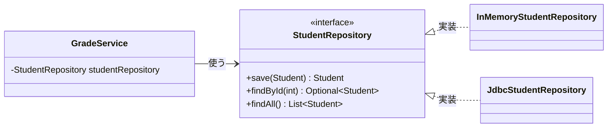

# 04. Javaで4層を作る

[📖 4層アーキテクチャの目次](./00_はじめに.md#目次) ｜ [🏠 全体の目次](../README.md#目次)

[← 前へ：03 依存の向きと抽象](03_依存の向きとインタフェース.md) ｜ [次へ：05 フレームワークとSpring →](05_フレームワークとSpring.md)

ここからは**第 2 部**（Java 編）です。01〜03 章で学んだ「言語に依存しない 4 層の考え方」を、Java の言語機能でどう表現するかを見ていきます。

## この章のゴール
- 第 1 部の概念（層・抽象・依存性の注入・組み立て）が、Java のどの機能に対応するか言える
- 4 層をパッケージとして構成できる
- `record`・`interface`・コンストラクタ注入・`Main` を使って、各層を Java で書く方針が分かる
- Java 特有の「やりがちなミス」を避けられる

## 目次

1. [第 1 部の概念と Java の対応](#1-第-1-部の概念と-java-の対応)
2. [パッケージ構成](#2-パッケージ構成)
3. [Domain 層：record でルールを持たせる](#3-domain-層record-でルールを持たせる)
4. [保存の窓口：interface で宣言する](#4-保存の窓口interface-で宣言する)
5. [Application 層：コンストラクタ注入](#5-application-層コンストラクタ注入)
6. [Presentation 層：入力を変換して呼ぶ](#6-presentation-層入力を変換して呼ぶ)
7. [Infrastructure 層：外の型を出さない](#7-infrastructure-層外の型を出さない)
8. [Main で部品をつなぐ](#8-main-で部品をつなぐ)
9. [import で依存の向きを確かめる](#9-import-で依存の向きを確かめる)
10. [よくあるミス](#10-よくあるミス)

---

## 1. 第 1 部の概念と Java の対応

| 第 1 部の概念 | Java での表現 |
|---|---|
| 層 | **パッケージ**（`presentation` / `application` / `domain` / `infrastructure`） |
| Domain のデータとルール | `record`（またはクラス）。コンストラクタで値を検査する |
| 抽象（保存の窓口の約束） | **`interface`**（Domain 層のパッケージに置く） |
| 抽象の実装 | `implements` したクラス（Infrastructure 層） |
| 依存（A が B を名指しで使う） | `import` と `new`、フィールドや引数の**型** |
| 依存性の注入（DI） | **コンストラクタの引数**で受け取る |
| 起動処理（組み立てる場所） | **`Main`** の `main` メソッド（Spring では DI コンテナ。05 章） |
| 層をまたぐ入れ物（DTO） | `record` |

> 💡 Java 入門の [06 章（クラス）](../付録/Java入門/06_クラスとオブジェクト.md)・[07 章（継承とインタフェース）](../付録/Java入門/07_継承とポリモーフィズム.md) の知識を使います。分からなくなったら、そちらに戻ってください。

## 2. パッケージ構成

層ごとに**パッケージ**（フォルダ）を分けると、「この処理はどの層か」がファイルの場所で分かります。この資料の最終的な構成は次のとおりです。

```
src/grades/
├── Main.java                          ← 全部を組み立てて起動する
├── presentation/
│   └── ConsoleApp.java                ← メニューと入出力
├── application/
│   ├── GradeService.java              ← ユースケース
│   └── Transcript.java                ← 表示用データ（DTO）
├── domain/
│   ├── Student.java                   ← エンティティ
│   ├── Course.java
│   ├── Enrollment.java
│   ├── StudentRepository.java         ← 保存の窓口（インタフェース）
│   ├── CourseRepository.java
│   └── EnrollmentRepository.java
└── infrastructure/
    └── memory/                        ← メモリに保存する実装（06 章）
        ├── InMemoryStudentRepository.java
        └── ...
    （jdbc/ ← データベース編 12 章で追加）
```

> [!WARNING]
> `Main` は、全部の層を知っている唯一のクラスです。「どの実装を使うか」を決めて部品をつなぐ役割を持ちます（8 節）。Spring では、この組み立てを **DI コンテナ**が肩代わりします（05 章）。

> 📦 **サンプル**：実際のフォルダ構成は [`step1-memory/src/grades/`](https://github.com/<ORG>/PRMN_SYSTEM_Sample/tree/main/step1-memory/src/grades) で確認できます。

## 3. Domain 層：record でルールを持たせる

Domain 層では、業務の概念を `record` で表し、**ルールをコンストラクタの中に持たせます**。ルールが「データ」のそばにあるので、どこで `Enrollment` を作っても、必ず検査が通ります。

```java
public record Enrollment(int studentId, int courseId, int academicYear, Integer score) {
    public Enrollment {                                   // コンパクトコンストラクタ
        if (score != null && (score < 0 || score > 100)) {
            throw new IllegalArgumentException("点数は0〜100にしてください: " + score);
        }
    }
    // …（isPassed() など）
}
```

> 📦 **サンプル**：[`step1-memory/src/grades/domain/Enrollment.java`](https://github.com/<ORG>/PRMN_SYSTEM_Sample/blob/main/step1-memory/src/grades/domain/Enrollment.java)

- `score` を `int` ではなく `Integer` にしているのは、**「まだ点数が無い（履修中）」を `null` で表す**ためです（データベース編 06 章・12 章）
- Domain 層には `println`・SQL・`Scanner` を書きません

> 💡 フィールドを `private` にして、作るときに値を検査するクラスは、Domain 層のクラスの考え方そのものです（付録 Java 入門 06 章でも、同じ書き方を扱っています）。

## 4. 保存の窓口：interface で宣言する

03 章の「抽象（約束）」を、Java では **`interface`** で書きます。**Domain 層のパッケージ**に置き、どう保存するかは書きません。

```java
// Domain 層：「こういう保存の窓口がほしい」と宣言するだけ
public interface StudentRepository {
    Student save(Student student);
    Optional<Student> findById(int id);
    List<Student> findAll();
}
```

> 📦 **サンプル**：[`step1-memory/src/grades/domain/StudentRepository.java`](https://github.com/<ORG>/PRMN_SYSTEM_Sample/blob/main/step1-memory/src/grades/domain/StudentRepository.java)

- **Application 層**（`GradeService`）は、このインタフェースの型で変数を持ち、使う
- **Infrastructure 層**（`InMemoryStudentRepository`、`JdbcStudentRepository`）は、これを `implements` する



- `GradeService` は、実体がメモリなのかデータベースなのかを**知らない**
- 実装クラスは `StudentRepository` を実装するだけなので、**差し替えても `GradeService` は変わらない**

> Java の標準ライブラリにも同じ発想があります。`List<Student> students = new ArrayList<>();` と書くとき、変数の型は**インタフェース**（`List`）、実体は `ArrayList` です。`LinkedList` に変えても、使う側は変わりません。

## 5. Application 層：コンストラクタ注入

03 章の「外から渡してもらう」は、Java では**コンストラクタの引数**で受け取ります。フィールドの型は**インタフェース**にします。

```java
public class GradeService {
    private final StudentRepository studentRepository;      // 型は「インタフェース」

    // 必要な部品を、コンストラクタの引数で受け取る
    public GradeService(StudentRepository studentRepository /* , … */) {
        this.studentRepository = studentRepository;
    }
}
```

> 📦 **サンプル**：[`step1-memory/src/grades/application/GradeService.java`](https://github.com/<ORG>/PRMN_SYSTEM_Sample/blob/main/step1-memory/src/grades/application/GradeService.java)

`GradeService` の中には `new` が 1 つもありません。「何を使うか」は**作る側が決める**、「どう使うか」は `GradeService` が決める、という分担です。

ユースケースの中身は、手順を並べるだけです。細かいルールや SQL は書きません。

```java
studentRepository.findById(studentId);   // 学生がいるか確認
courseRepository.findById(courseId);     // 科目があるか確認
enrollmentRepository.save(enrollment);   // 保存
```

> 💡 Spring（[05 章](05_フレームワークとSpring.md)）でも、**コンストラクタ注入が推奨**されています。ここで書いた `GradeService` は、Spring でも（`@Service` を付けるだけで）ほぼそのまま使えます。

## 6. Presentation 層：入力を変換して呼ぶ

Presentation 層は、入力（`Scanner` など）を**文字列から数値などへ変換**し、Application 層を呼びます。

```java
int score = Integer.parseInt(sc.nextLine());                // 文字列 → 数値に変換
gradeService.recordScore(studentId, courseId, 2025, score); // Application 層を呼ぶだけ
```

「数字が入力されたか」の検査は Presentation 層の仕事ですが、「点数が 0〜100 か」は Domain 層の仕事です（02 章）。

## 7. Infrastructure 層：外の型を出さない

Infrastructure 層は、JDBC やファイル API などの**技術の型を、層の外に出さない**のが約束です。

- `ResultSet`（データベースの結果）は、そのまま上の層に渡さず、必ず Domain の `Student` などに**変換して返す**
- `SQLException` も、Domain 層の例外（`RepositoryException` など）に包み直す

くわしい書き方は [データベース編 12 章](../データベース/12_JavaからDBを使う_JDBC.md) で学びます。

## 8. Main で部品をつなぐ

03 章の「起動処理（組み立てる場所）」は、素の Java ではプログラムの出発点である **`Main`** が `new` でつなぎます。

```java
public static void main(String[] args) {
    StudentRepository studentRepo = new InMemoryStudentRepository();   // 1. 保存先を決めて作る
    GradeService service = new GradeService(studentRepo);              // 2. Application 層に渡す
    new ConsoleApp(service).run();                                     // 3. Presentation 層に渡して起動
}
```

> 📦 **サンプル**：[`step1-memory/src/grades/Main.java`](https://github.com/<ORG>/PRMN_SYSTEM_Sample/blob/main/step1-memory/src/grades/Main.java)（サンプルの step1 は、仕組みが見えるように素の Java で書いています。Spring 版は `step3-spring` です）

保存先を変えたいときに書き換えるのは、**`Main` の `new InMemory…` を `new Jdbc…` に変える数行だけ**です。他のクラスは変更不要です。データベース編 12 章では、実際にそうします。

本物のデータベースが無くても、メモリ実装を渡して `GradeService` をテストできます。

> 💡 テストの書き方（JUnit）は、この資料の範囲外です。「差し替えられるからテストしやすい」という点だけ押さえておけば十分です。

## 9. import で依存の向きを確かめる

03 章の「依存の向き」は、Java では **`import` 文を見れば確認できます**。

| パッケージ | `import` してよいもの |
|---|---|
| `presentation` | `application`、（必要なら）`domain` |
| `application` | `domain` |
| `domain` | **何も import しない**（標準ライブラリのみ） |
| `infrastructure` | `domain` |

`domain` の中に `import grades.infrastructure...` や `import java.sql...` が見つかったら、依存の向きが崩れています。くわしくは [06 章](06_サンプル実装の読み方.md) で、サンプルを使って確認します。

## 10. よくあるミス

| ミス | 原因・対処 |
|---|---|
| `GradeService` の中で `new InMemoryStudentRepository()` と書く | 具体クラスに依存する。コンストラクタで**インタフェース型**を受け取る |
| `StudentRepository` を `infrastructure` パッケージに置く | 使う側（Domain 層）に置く。置き場所を間違えると依存が逆転しない |
| `import grades.infrastructure...` が `application` や `domain` にある | 依存の向きが逆。インタフェースの経由に直す |
| `domain` のクラスに `println` や SQL を書く | 表示は Presentation、SQL は Infrastructure |
| `ResultSet` を Application 層や Presentation 層に渡す | Infrastructure 層で Domain のオブジェクトに変換してから返す |
| `Enrollment.score` を `int` にしてしまう | 「点数なし」を表せない。`NULL` を許す列は `Integer` で受ける |
| 「インタフェースが多すぎて面倒」と全クラスに作る | **差し替える可能性がある境界**（保存先、外部サービス）だけに作る |

---

[← 前へ：03 依存の向きと抽象](03_依存の向きとインタフェース.md) ｜ [次へ：05 フレームワークとSpring →](05_フレームワークとSpring.md)

[📖 4層アーキテクチャの目次](./00_はじめに.md#目次) ｜ [🏠 全体の目次](../README.md#目次)
