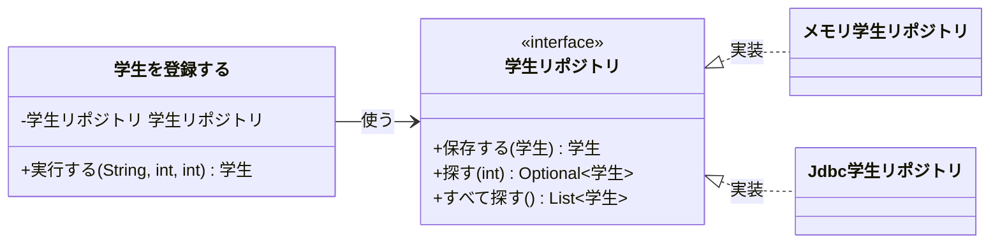

# 04. Javaで4層を作る

[📖 4層アーキテクチャの目次](./00_はじめに.md#目次) ｜ [🏠 全体の目次](../README.md#目次)

[← 前へ：03 依存の向きと抽象](03_依存の向きとインタフェース.md) ｜ [次へ：05 フレームワークとSpring →](05_フレームワークとSpring.md)

ここからは**第 2 部**（Java 編）です。01〜03 章で学んだ「言語に依存しない 4 層の考え方」を、Java の言語機能でどう表現するかを見ていきます。

## この章のゴール
- 第 1 部の概念（層・抽象・依存性の注入・組み立て）が、Java のどの機能に対応するか言える
- 4 層をパッケージとして構成できる
- `record`・`interface`・コンストラクタ注入・`Main` を使って、各層を Java で書く方針が分かる
- Java 特有の「やりがちなミス」を避けられる

## 目次

1. [第 1 部の概念と Java の対応](#1-第-1-部の概念と-java-の対応)
2. [パッケージ構成](#2-パッケージ構成)
3. [Domain 層：record でルールを持たせる](#3-domain-層record-でルールを持たせる)
4. [保存の窓口：interface で宣言する](#4-保存の窓口interface-で宣言する)
5. [Application 層：ユースケースごとのクラスとコンストラクタ注入](#5-application-層ユースケースごとのクラスとコンストラクタ注入)
6. [Presentation 層：入力を変換して呼ぶ](#6-presentation-層入力を変換して呼ぶ)
7. [Infrastructure 層：外の型を出さない](#7-infrastructure-層外の型を出さない)
8. [Main で部品をつなぐ](#8-main-で部品をつなぐ)
9. [import で依存の向きを確かめる](#9-import-で依存の向きを確かめる)
10. [よくあるミス](#10-よくあるミス)

---

## 1. 第 1 部の概念と Java の対応

| 第 1 部の概念 | Java での表現 |
|---|---|
| 層 | **パッケージ**（`presentation` / `usecase` / `domain` / `dataaccess`） |
| Domain のデータとルール | `record`（またはクラス）。コンストラクタで値を検査する |
| 抽象（保存の窓口の約束） | **`interface`**（Domain 層のパッケージに置く） |
| 抽象の実装 | `implements` したクラス（Infrastructure 層＝`dataaccess` パッケージ） |
| 依存（A が B を名指しで使う） | `import` と `new`、フィールドや引数の**型** |
| 依存性の注入（DI） | **コンストラクタの引数**で受け取る |
| 起動処理（組み立てる場所） | **`Main`** の `main` メソッド（Spring では DI コンテナ。05 章） |
| 層をまたぐ入れ物（DTO） | `record` |

> [!NOTE]
> **層とパッケージ名の対応**：この資料の「Application 層」は `usecase` パッケージ、「Infrastructure 層」は `dataaccess` パッケージです（プロメンのガイドラインでは、それぞれ「ビジネスロジック層」「データアクセス層」と呼びます）。
>
> **日本語プログラミング**：サンプルでは、パッケージ名は英語、**クラス名・メソッド名・変数名は日本語**で書いています。ユースケース記述の言葉（学生、履修、点数、保存する など）を、そのままコードの名前にするためです。`Main` / `main` のように Java の決まりで英語の名前もあります。

> [!NOTE]
> Java 入門の [06 章（クラス）](../付録/Java入門/06_クラスとオブジェクト.md)・[07 章（継承とインタフェース）](../付録/Java入門/07_継承とポリモーフィズム.md) の知識を使います。分からなくなったら、そちらに戻ってください。

## 2. パッケージ構成

層ごとに**パッケージ**（フォルダ）を分けると、「この処理はどの層か」がファイルの場所で分かります。この資料の最終的な構成は次のとおりです。

```
src/grades/
├── Main.java                          ← 全部を組み立てて起動する
├── presentation/
│   └── コンソール画面.java             ← メニューと入出力
├── usecase/                           ← Application 層（ユースケース 1 つ = クラス 1 つ）
│   ├── 学生を登録する.java
│   ├── 成績を登録する.java
│   ├── 成績一覧を取得する.java
│   ├── 学生一覧を取得する.java
│   ├── 科目一覧を取得する.java
│   ├── 成績明細.java                  ← 表示用データ（DTO）
│   └── 成績一覧.java                  ← 表示用データ（DTO）
├── domain/
│   ├── 学生.java                      ← エンティティ
│   ├── 科目.java
│   ├── 履修.java
│   ├── 履修一覧.java                  ← 履修の集まりに対するルール（平均点）
│   ├── 学生リポジトリ.java            ← 保存の窓口（インタフェース）
│   ├── 科目リポジトリ.java
│   ├── 履修リポジトリ.java
│   └── 保存失敗例外.java
└── dataaccess/                        ← Infrastructure 層
    └── memory/                        ← メモリに保存する実装（06 章）
        ├── メモリ学生リポジトリ.java
        └── ...
    （jdbc/ ← データベース編 12 章で追加）
```

> [!WARNING]
> `Main` は、全部の層を知っている唯一のクラスです。「どの実装を使うか」を決めて部品をつなぐ役割を持ちます（8 節）。Spring では、この組み立てを **DI コンテナ**が肩代わりします（05 章）。

> [!NOTE]
> **サンプル**：実際のフォルダ構成は [`step1-memory/src/grades/`](https://github.com/YTS0418/PRMN_SYSTEM_Sample/tree/main/step1-memory/src/grades) で確認できます。

## 3. Domain 層：record でルールを持たせる

Domain 層では、業務の概念を `record` で表し、**ルールをコンストラクタの中に持たせます**。ルールが「データ」のそばにあるので、どこで `履修` を作っても、必ず検査が通ります。

```java
public record 履修(int 学生ID, int 科目ID, int 年度, Integer 点数) {
    public 履修 {                                         // コンパクトコンストラクタ
        if (点数 != null && (点数 < 0 || 点数 > 100)) {
            throw new IllegalArgumentException("点数は0〜100にしてください: " + 点数);
        }
    }
    // …（合格している() など）
}
```

> [!NOTE]
> **サンプル**：[`step1-memory/src/grades/domain/履修.java`](https://github.com/YTS0418/PRMN_SYSTEM_Sample/blob/main/step1-memory/src/grades/domain/履修.java)

- `点数` を `int` ではなく `Integer` にしているのは、**「まだ点数が無い（履修中）」を `null` で表す**ためです（データベース編 06 章・12 章）
- Domain 層には `println`・SQL・`Scanner` を書きません

「履修の集まり」に対するルールも、Domain 層に置きます。たとえば「平均点は、点数のある履修だけで求める（履修中は含めない）」は業務のルールなので、ユースケースではなく `履修一覧` のメソッドにします。

```java
public record 履修一覧(List<履修> 履修リスト) {
    public double 平均点を計算する() {
        int 合計 = 0;
        int 件数 = 0;
        for (履修 履修 : 履修リスト) {
            if (履修.履修中である()) {
                continue;                       // 履修中は数えない
            }
            合計 += 履修.点数();
            件数++;
        }
        if (件数 == 0) {
            return 0.0;
        }
        return (double) 合計 / 件数;
    }
}
```

> [!NOTE]
> **サンプル**：[`step1-memory/src/grades/domain/履修一覧.java`](https://github.com/YTS0418/PRMN_SYSTEM_Sample/blob/main/step1-memory/src/grades/domain/履修一覧.java)

> [!TIP]
> フィールドを `private` にして、作るときに値を検査するクラスは、Domain 層のクラスの考え方そのものです（付録 Java 入門 06 章でも、同じ書き方を扱っています）。

## 4. 保存の窓口：interface で宣言する

03 章の「抽象（約束）」を、Java では **`interface`** で書きます。**Domain 層のパッケージ**に置き、どう保存するかは書きません。

```java
// Domain 層：「こういう保存の窓口がほしい」と宣言するだけ
public interface 学生リポジトリ {
    学生 保存する(学生 学生);
    Optional<学生> 探す(int 学生ID);
    List<学生> すべて探す();
}
```

> [!NOTE]
> **サンプル**：[`step1-memory/src/grades/domain/学生リポジトリ.java`](https://github.com/YTS0418/PRMN_SYSTEM_Sample/blob/main/step1-memory/src/grades/domain/学生リポジトリ.java)

- **Application 層**（`usecase` パッケージの `学生を登録する` など）は、このインタフェースの型で変数を持ち、使う
- **Infrastructure 層**（`dataaccess` パッケージの `メモリ学生リポジトリ`、`Jdbc学生リポジトリ`）は、これを `implements` する



- `学生を登録する` は、実体がメモリなのかデータベースなのかを**知らない**
- 実装クラスは `学生リポジトリ` を実装するだけなので、**差し替えても `学生を登録する` は変わらない**

> [!NOTE]
> Java の標準ライブラリにも同じ発想があります。`List<学生> 学生リスト = new ArrayList<>();` と書くとき、変数の型は**インタフェース**（`List`）、実体は `ArrayList` です。`LinkedList` に変えても、使う側は変わりません。

## 5. Application 層：ユースケースごとのクラスとコンストラクタ注入

Application 層（`usecase` パッケージ）には、**ユースケース 1 つにつきクラスを 1 つ**作ります。クラス名はユースケースの名前（`学生を登録する`、`成績を登録する` など）、メソッドは**どのクラスも `実行する` の 1 つだけ**です。

1 つのクラスにユースケースを全部まとめると、「学生の登録を直したいのに、成績一覧のコードも同じファイルにある」状態になります。クラスを分けておけば、変更の影響が 1 つのユースケースに収まります（単一責任の原則）。

03 章の「外から渡してもらう」は、Java では**コンストラクタの引数**で受け取ります。フィールドの型は**インタフェース**にします。

```java
public class 学生を登録する {
    private final 学生リポジトリ 学生リポジトリ;             // 型は「インタフェース」

    // 必要な部品を、コンストラクタの引数で受け取る
    public 学生を登録する(学生リポジトリ 学生リポジトリ) {
        this.学生リポジトリ = 学生リポジトリ;
    }

    public 学生 実行する(String 氏名, int 学科ID, int 入学年度) {
        学生 登録する学生 = new 学生(null, 氏名, 学科ID, 入学年度);   // 1. 学生を作る（検査は 学生 が行う）
        return 学生リポジトリ.保存する(登録する学生);                // 2. 学生を学生リポジトリで保存する
    }
}
```

> [!NOTE]
> **サンプル**：[`step1-memory/src/grades/usecase/学生を登録する.java`](https://github.com/YTS0418/PRMN_SYSTEM_Sample/blob/main/step1-memory/src/grades/usecase/学生を登録する.java)

`学生を登録する` の中には、`学生リポジトリ` の実装クラスを `new` する行が 1 つもありません。「何を使うか」は**作る側が決める**、「どう使うか」は `学生を登録する` が決める、という分担です。

ユースケースの中身（`実行する`）は、手順を並べるだけです。細かいルールや SQL は書きません。`成績を登録する` なら、次のようになります。

```java
学生リポジトリ.探す(学生ID);                         // 学生がいるか確認
科目リポジトリ.探す(科目ID);                         // 科目があるか確認
履修リポジトリ.保存する(new 履修(学生ID, 科目ID, 年度, 点数));   // 履修を作って保存
```

> [!TIP]
> Spring（[05 章](05_フレームワークとSpring.md)）でも、**コンストラクタ注入が推奨**されています。ここで書いた `学生を登録する` は、Spring でも（`@Service` を付けるだけで）ほぼそのまま使えます。

## 6. Presentation 層：入力を変換して呼ぶ

Presentation 層は、入力（`Scanner` など）を**文字列から数値などへ変換**し、Application 層（ユースケース）を呼びます。

```java
int 点数 = Integer.parseInt(入力.nextLine());                  // 文字列 → 数値に変換
成績を登録する.実行する(学生ID, 科目ID, 2025, 点数);             // ユースケースを呼ぶだけ
```

「数字が入力されたか」の検査は Presentation 層の仕事ですが、「点数が 0〜100 か」は Domain 層の仕事です（02 章）。

## 7. Infrastructure 層：外の型を出さない

Infrastructure 層は、JDBC やファイル API などの**技術の型を、層の外に出さない**のが約束です。

- `ResultSet`（データベースの結果）は、そのまま上の層に渡さず、必ず Domain の `学生` などに**変換して返す**
- `SQLException` も、Domain 層の例外（`保存失敗例外`）に包み直す

くわしい書き方は [データベース編 12 章](../データベース/12_JavaからDBを使う_JDBC.md) で学びます。

## 8. Main で部品をつなぐ

03 章の「起動処理（組み立てる場所）」は、素の Java ではプログラムの出発点である **`Main`** が `new` でつなぎます。

```java
public static void main(String[] args) {
    学生リポジトリ 学生リポジトリ = new メモリ学生リポジトリ();           // 1. 保存先を決めて作る
    学生を登録する 学生を登録する = new 学生を登録する(学生リポジトリ);   // 2. ユースケース（Application 層）に渡す
    new コンソール画面(学生を登録する, /* …ほかのユースケース */).開始する();   // 3. Presentation 層に渡して起動
}
```

> [!NOTE]
> **サンプル**：[`step1-memory/src/grades/Main.java`](https://github.com/YTS0418/PRMN_SYSTEM_Sample/blob/main/step1-memory/src/grades/Main.java)（サンプルの step1 は、仕組みが見えるように素の Java で書いています。Spring 版は `step3-spring` です）

保存先を変えたいときに書き換えるのは、**`Main` の `new メモリ…` を `new Jdbc…` に変える数行だけ**です。他のクラスは変更不要です。データベース編 12 章では、実際にそうします。

本物のデータベースが無くても、メモリ実装を渡して `学生を登録する` などのユースケースをテストできます。

> [!NOTE]
> テストの書き方（JUnit）は、この資料の範囲外です。「差し替えられるからテストしやすい」という点だけ押さえておけば十分です。

## 9. import で依存の向きを確かめる

03 章の「依存の向き」は、Java では **`import` 文を見れば確認できます**。

| パッケージ | `import` してよいもの |
|---|---|
| `presentation` | `usecase`、（必要なら）`domain` |
| `usecase` | `domain` |
| `domain` | **何も import しない**（標準ライブラリのみ） |
| `dataaccess` | `domain` |

`domain` の中に `import grades.dataaccess...` や `import java.sql...` が見つかったら、依存の向きが崩れています。くわしくは [06 章](06_サンプル実装の読み方.md) で、サンプルを使って確認します。

## 10. よくあるミス

| ミス | 原因・対処 |
|---|---|
| `学生を登録する` の中で `new メモリ学生リポジトリ()` と書く | 具体クラスに依存する。コンストラクタで**インタフェース型**を受け取る |
| `学生リポジトリ` を `dataaccess` パッケージに置く | 使う側（Domain 層）に置く。置き場所を間違えると依存が逆転しない |
| `import grades.dataaccess...` が `usecase` や `domain` にある | 依存の向きが逆。インタフェースの経由に直す |
| `domain` のクラスに `println` や SQL を書く | 表示は Presentation、SQL は Infrastructure |
| `ResultSet` を Application 層（`usecase`）や Presentation 層に渡す | Infrastructure 層で Domain のオブジェクトに変換してから返す |
| `履修.点数` を `int` にしてしまう | 「点数なし」を表せない。`NULL` を許す列は `Integer` で受ける |
| 平均点の求め方など、業務のルールをユースケースの中に書く | 「履修の集まり」のルールは `履修一覧` など Domain 層のクラスに置く |
| 「インタフェースが多すぎて面倒」と全クラスに作る | **差し替える可能性がある境界**（保存先、外部サービス）だけに作る |

---

[← 前へ：03 依存の向きと抽象](03_依存の向きとインタフェース.md) ｜ [次へ：05 フレームワークとSpring →](05_フレームワークとSpring.md)

[📖 4層アーキテクチャの目次](./00_はじめに.md#目次) ｜ [🏠 全体の目次](../README.md#目次)
