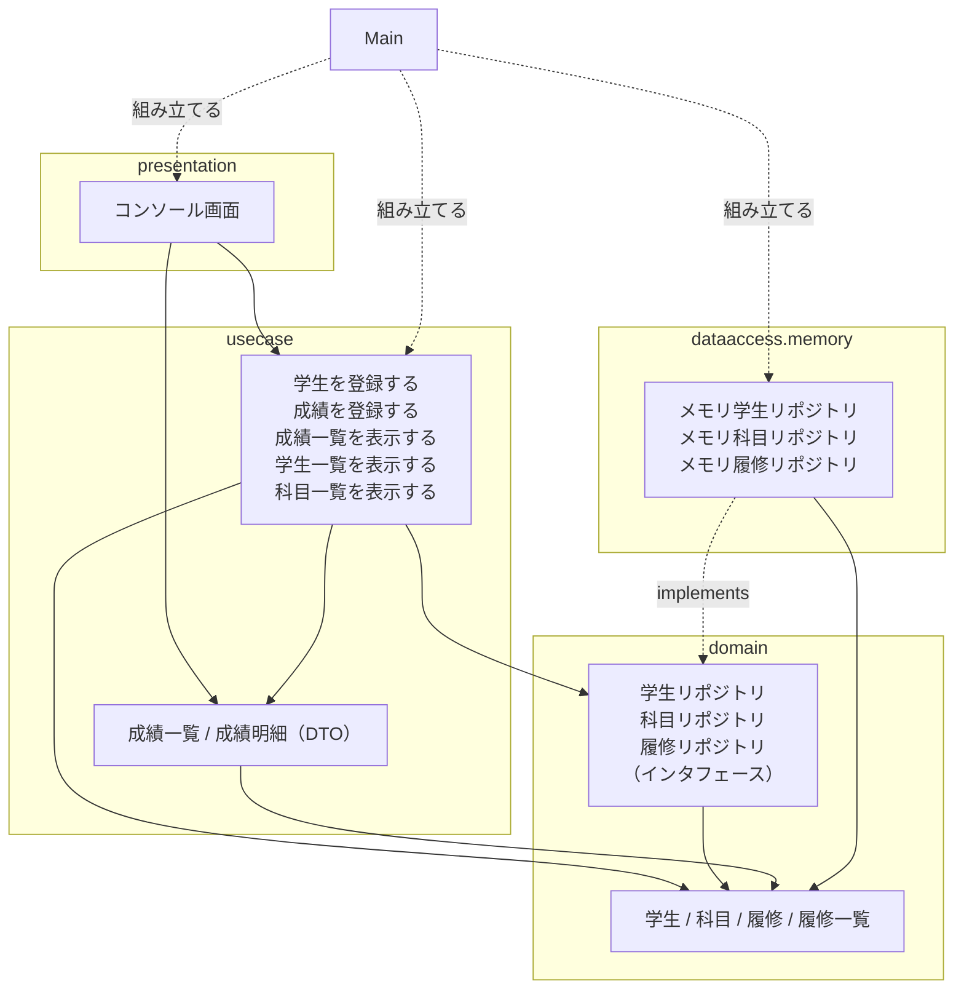
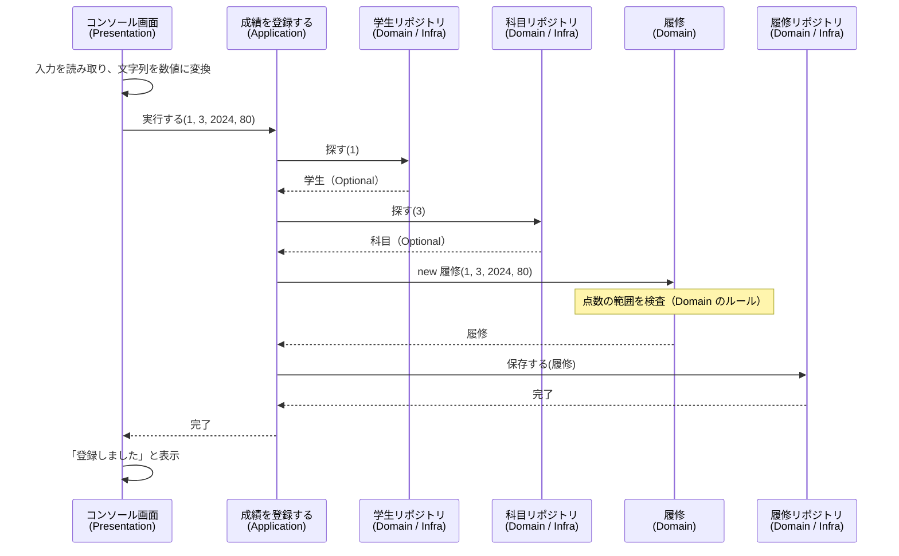

# 06. サンプル実装の読み方

[📖 4層アーキテクチャの目次](./00_はじめに.md#目次) ｜ [🏠 全体の目次](../README.md#目次)

[← 前へ：05 フレームワークとSpring](05_フレームワークとSpring.md) ｜ [次へ：07 Spring Bootで書き直す →](07_Spring_Bootで書き直す.md)

## この章のゴール
- サンプルシステム（`step1-memory`）の全体構成を、パッケージと図で説明できる
- どのクラスがどの層に属し、層の境目で何を受け渡しているか説明できる
- コードを読むときに、「層の約束」を守れているかを確認できる

## 目次

1. [サンプルシステムの概要](#1-サンプルシステムの概要)
2. [層とパッケージの対応](#2-層とパッケージの対応)
3. [全体の構成図](#3-全体の構成図)
4. [読む順番と注目ポイント](#4-読む順番と注目ポイント)
    - [Domain 層](#domain-層)
    - [Application 層](#application-層)
    - [Infrastructure 層](#infrastructure-層)
    - [Presentation 層](#presentation-層)
    - [Main](#main)
5. [処理の流れを追う](#5-処理の流れを追う)
6. [層の約束を確認する](#6-層の約束を確認する)
7. [次のステップ](#7-次のステップ)
8. [よくあるミス](#8-よくあるミス)

---

## 1. サンプルシステムの概要

[00 はじめに](00_はじめに.md#4-題材成績管理システム) で紹介した成績管理システムを、4 層に分けて実装したものです。保存先は**メモリ**（`Map` / `List`）なので、アプリを終了するとデータは消えます。そのかわり、データベースなどの準備がいらず、4 層の構造だけに集中できます。

| 項目 | 内容 |
|---|---|
| 場所 | サンプルリポジトリの `step1-memory/` |
| ユースケース | 学生を登録する / 成績を登録する / 成績一覧を表示する（画面で選ぶための「学生一覧を表示する」「科目一覧を表示する」もあります） |
| 画面 | コンソール（メニューを選んで入力する） |
| 実行方法 | サンプルリポジトリの README を参照 |

> [!NOTE]
> **サンプル**：[`step1-memory/`](https://github.com/YTS0418/PRMN_SYSTEM_Sample/tree/main/step1-memory)（実行方法は [README](https://github.com/YTS0418/PRMN_SYSTEM_Sample/blob/main/README.md)）

> [!TIP]
> この章は**読み物**です。コードを書き写すのではなく、サンプルを IDE で開いて、この章の順に読み進めてください。

## 2. 層とパッケージの対応

| 層 | パッケージ | 主なファイル | 一言でいうと |
|---|---|---|---|
| Presentation | `presentation` | `コンソール画面` | メニューと入出力 |
| Application | `usecase` | `学生を登録する`、`成績を登録する`、`成績一覧を表示する` など 5 つ<br>`成績明細`、`成績一覧` | ユースケース 1 つ = クラス 1 つ。手順を並べる。結果をまとめる表示用データ（DTO） |
| Domain | `domain` | `学生`、`科目`、`履修`、`履修一覧`<br>`学生リポジトリ` など 3 つ | 業務のもの・ルール、保存の窓口 |
| Infrastructure | `dataaccess.memory` | `メモリ学生リポジトリ` など 3 つ | 窓口の実装（メモリ） |
| （組み立て） | `grades` | `Main` | 部品をつないで起動する |

> [!NOTE]
> 資料では層を「Application 層」「Infrastructure 層」と呼びますが、サンプルのパッケージ名は、プロメンのガイドラインに合わせて `usecase`・`dataaccess` です（ガイドラインでは「ビジネスロジック層」「データアクセス層」）。クラス名・メソッド名・変数名は日本語です（04 章 1 節）。

## 3. 全体の構成図

クラスの関係を、パッケージ（層）ごとにまとめた図です。矢印の向きは**依存の向き**（03 章）を表します。



- 矢印が**必ず Domain の方向**を向いていて、Domain からは外へ矢印が出ていません
- `usecase` の各クラスから `メモリ…` への矢印はありません（インタフェースだけを知っている）
- `Main` だけが、全部の層のクラスを知っています

## 4. 読む順番と注目ポイント

**内側（Domain）から外側へ**の順に読むと、依存の少ない部分から理解できます。

### Domain 層

読む順番：`学生` → `科目` → `履修` → `履修一覧` → `…リポジトリ`（3 つ）

| ファイル | 注目ポイント |
|---|---|
| `学生`、`科目` | `record` で書かれている。コンパクトコンストラクタで**作成時に検査**している |
| `履修` | 点数の範囲検査（0〜100）と合格判定（60 点以上）が**ここにある**。`点数` は `null` なら「履修中」 |
| `履修一覧` | 「平均点は、点数のある履修だけで求める」という**業務のルール**が `平均点を計算する` にある |
| `…リポジトリ` | **メソッド宣言だけ**。`探す` は、見つからない場合を `Optional` で表す |

> [!NOTE]
> [`step1-memory/src/grades/domain/`](https://github.com/YTS0418/PRMN_SYSTEM_Sample/tree/main/step1-memory/src/grades/domain)

確認すること：**`import` に `grades.usecase` などが無い**こと（標準ライブラリの `java.util` のみ）。

### Application 層

読む順番：`学生を登録する` → `成績を登録する` → `成績一覧を表示する`

`usecase` パッケージには、**ユースケース 1 つにつきクラスが 1 つ**あります。どのクラスも、メソッドは `実行する` だけです。

| クラス | ユースケース |
|---|---|
| `学生を登録する` | 学生を登録する |
| `成績を登録する` | 成績を登録する |
| `成績一覧を表示する` | 成績一覧を作る |
| `学生一覧を表示する`、`科目一覧を表示する` | 画面で選ぶための一覧（読み取りだけ） |

`usecase` パッケージには、ユースケースのクラスのほかに、結果を入れる `成績一覧`、`成績明細`（DTO）があります。`成績明細` は 1 科目分の行です。ユースケースの引数や戻り値になる入れ物は、`usecase` パッケージに置きます。

```java
public void 実行する(int 学生ID, int 科目ID, int 年度, Integer 点数) {
    // 1. 学生を学生リポジトリで探す（いなければ、ここで終わり）
    if (学生リポジトリ.探す(学生ID).isEmpty()) {
        throw new NoSuchElementException("学生が見つかりません: " + 学生ID);
    }
    // 2. 科目を科目リポジトリで探す（なければ、ここで終わり）
    if (科目リポジトリ.探す(科目ID).isEmpty()) {
        throw new NoSuchElementException("科目が見つかりません: " + 科目ID);
    }
    履修 登録する履修 = new 履修(学生ID, 科目ID, 年度, 点数);   // 3. 履修を作る（点数の検査は 履修 が行う）
    履修リポジトリ.保存する(登録する履修);                      // 4. 履修を履修リポジトリで保存する
}
```

注目ポイント：

- **手順を並べているだけ**。点数の範囲検査は書かれていない（`new 履修(…)` の中で行われる）
- 使っているのは `…リポジトリ`（インタフェース）だけ。`new メモリ…` は無い
- `System.out.println` が無い。結果は戻り値で返す

`成績一覧を表示する` は、画面に必要な形にまとめて `成績一覧`（DTO）で返します。ここでも、合格かどうかの判断や平均点の求め方は書かず、Domain 層の `履修` と `履修一覧` に頼みます。

```java
// 3. 履修 1 件ごとに、科目を探して、成績明細にする
List<成績明細> 明細リスト = new ArrayList<>();
for (履修 履修 : 履修一覧.履修リスト()) {
    科目 科目 = 科目リポジトリ.探す(履修.科目ID())
            .orElseThrow(() -> new NoSuchElementException("科目が見つかりません: " + 履修.科目ID()));
    明細リスト.add(履修.成績明細にする(科目));      // 合格かどうかの判断は 履修 が持っている
}

// 4. 平均点を履修一覧で計算する
double 平均点 = 履修一覧.平均点を計算する();       // 求め方（履修中を除く）は 履修一覧 が持っている
```

```java
public record 成績一覧(String 氏名, List<成績明細> 明細リスト, double 平均点) { }

public record 成績明細(String 科目名, int 単位数, int 年度, Integer 点数, boolean 合格) { }
```

> [!NOTE]
> [`step1-memory/src/grades/usecase/`](https://github.com/YTS0418/PRMN_SYSTEM_Sample/tree/main/step1-memory/src/grades/usecase)

### Infrastructure 層

読む順番：`メモリ学生リポジトリ` → 他の 2 つ

```java
public 学生 保存する(学生 学生) {
    学生 保存する学生 = 学生;
    if (学生.学生ID() == null) {                           // まだ学生ID がない（新しい学生）なら、採番する
        保存する学生 = 学生.学生IDを付ける(次の学生ID);
        次の学生ID++;
    }
    保存先.put(保存する学生.学生ID(), 保存する学生);
    return 保存する学生;                                    // 学生ID が付いた方を返す（record は変更できないため）
}
```

注目ポイント：

- `implements 学生リポジトリ`（Domain のインタフェース）になっている
- `学生ID` の採番を、実装クラスが担当している。データベースでは、データベース自身が自動採番する（データベース編）
- 「同じ（学生, 科目, 年度）は 1 件だけ」というルールを `メモリ履修リポジトリ` が**コードで**守っている。データベースでは**制約**で守る（データベース編 06 章）

> [!NOTE]
> [`step1-memory/src/grades/dataaccess/memory/`](https://github.com/YTS0418/PRMN_SYSTEM_Sample/tree/main/step1-memory/src/grades/dataaccess/memory)

### Presentation 層

`コンソール画面` を読みます。

```java
try {
    // …（メニューの選択に応じて、ユースケースの「実行する」を呼ぶ）
} catch (NumberFormatException e) {
    System.out.println("数字で入力してください");          // 入力形式のエラー：ここの仕事
} catch (IllegalArgumentException | NoSuchElementException e) {
    System.out.println("エラー: " + e.getMessage());       // Domain / Application が投げた例外
} catch (保存失敗例外 e) {
    System.out.println("エラー: " + e.getMessage());       // 保存先（dataaccess）で失敗した
}
```

注目ポイント：

- 文字列を数値に変換し（`Integer.parseInt`）、ユースケースの `実行する` を呼んで、結果を表示するだけ
- 業務ルール（点数の範囲）の検査は無い。ルール違反は、**例外のメッセージを表示するだけ**
- 合格・不合格の判断も無い。`成績明細` の `合格` を見て、「（合格）」と表示する言葉を選ぶだけ
- `import` に `grades.dataaccess` が無い

> [!NOTE]
> [`step1-memory/src/grades/presentation/コンソール画面.java`](https://github.com/YTS0418/PRMN_SYSTEM_Sample/blob/main/step1-memory/src/grades/presentation/コンソール画面.java)

### Main

03 章・04 章で説明した「部品をつなぐ」クラスです。

- Infrastructure の部品（`メモリ…リポジトリ`）を作る → 各ユースケース（`学生を登録する` など 5 つ）に渡す → `コンソール画面` に渡す
- 科目のデータ（プログラミング基礎など）は、ここで `メモリ科目リポジトリ` に渡している

> [!NOTE]
> [`step1-memory/src/grades/Main.java`](https://github.com/YTS0418/PRMN_SYSTEM_Sample/blob/main/step1-memory/src/grades/Main.java)

## 5. 処理の流れを追う

「成績を登録する」を実行したとき、どのクラスが何をしているかを図にします。



> [!NOTE]
> `(Domain / Infra)` と書いたのは、**インタフェースは Domain 層、実体は Infrastructure 層**にあるからです。`成績を登録する` から見ると、Domain 層のインタフェースを呼んでいるだけです。

点数に 150 を入力した場合は、`new 履修(…)` で例外が発生し、`ER.保存する` は呼ばれません。例外は `成績を登録する` を通り抜けて `コンソール画面` に届き、次のように表示されます。

```
エラー: 点数は0〜100にしてください: 150
```

このエラーは Domain 層が出したものですが、**Presentation 層にも Application 層にも検査は書かれていません**。

## 6. 層の約束を確認する

### 層の境目で受け渡すもの

| 境目 | 受け渡すもの | 向き |
|---|---|---|
| Presentation → Application | 数値や文字列に変換した引数（`int 学生ID` など） | 呼び出し |
| Application → Presentation | `成績一覧`（DTO）、`学生`（Domain のオブジェクト）、例外 | 戻り値 |
| Application → Domain | インタフェースのメソッド呼び出し、`履修` の生成、`履修一覧` への計算の依頼 | 呼び出し |
| Infrastructure → Domain | インタフェースの実装、`学生` などのオブジェクト | 実装・戻り値 |

### import で依存の向きを確認する

`import` 文を見れば、依存の向きを守れているかが分かります。

| 層 | import してよいもの | import してはいけないもの |
|---|---|---|
| domain | `java.util` など標準のみ | `grades.usecase`、`grades.dataaccess`、`grades.presentation` |
| usecase | `grades.domain` | `grades.dataaccess`、`grades.presentation` |
| dataaccess | `grades.domain` | `grades.usecase`、`grades.presentation` |
| presentation | `grades.usecase`、表示に使う `grades.domain` | `grades.dataaccess` |

> [!TIP]
> IDE の検索機能で `import grades.dataaccess` を検索し、ヒットするのが `Main` と `dataaccess` パッケージ内だけであることを確かめてみましょう。

## 7. 次のステップ

ここまでで、4 層の構造が理解できました。同じ成績管理システムは、サンプルリポジトリの中で、次のように発展していきます。

| サンプル | 内容 | 対応する資料 |
|---|---|---|
| `step1-memory` | 保存先が**メモリ**（この章で読んだもの） | 4層編 04・06 章 |
| `step2-jdbc` | 保存先を**PostgreSQL**（JDBC）に差し替えたもの | [データベース編 12 章](../データベース/12_JavaからDBを使う_JDBC.md) |
| `step3-spring` | **Spring Boot** で書き直したもの | [4層編 07 章](07_Spring_Bootで書き直す.md) |

`step1` から `step2` への差し替えで書き換えるのは、`Main` の `new メモリ…` を `new Jdbc…` に変える部分と、`dataaccess` に `Jdbc…` を追加する部分だけです。**ここで読んだ `usecase` の各クラス、`コンソール画面`、Domain 層は 1 行も変更しません**。

> [!NOTE]
> データベース（PostgreSQL）の設計や SQL については、[データベース編](../データベース/00_はじめに.md) で扱います。

## 8. よくあるミス

| ミス | 原因・対処 |
|---|---|
| コードを全部読もうとして、途中で迷子になる | まず**図と表**で全体をつかむ。コードは「注目ポイント」だけ確認すれば十分 |
| ユースケースに点数の検査や平均点の計算を足したくなる | 検査やルールは Domain 層（`履修`、`履修一覧`）の仕事。画面や保存先が変わっても、ルールが残る |
| `コンソール画面` から直接 `メモリ…リポジトリ` を使いたくなる | 必ずユースケース（Application 層）を通す。層を飛ばさない |
| `Integer 点数` と `int 点数` を混同する | `null`（履修中）を表したいので、`Integer` を使っている |
| パッケージ名とフォルダ構成が合わず、コンパイルできない | `grades/domain/学生.java` のように、パッケージ名と同じフォルダに置く |

---

[← 前へ：05 フレームワークとSpring](05_フレームワークとSpring.md) ｜ [次へ：07 Spring Bootで書き直す →](07_Spring_Bootで書き直す.md)

[📖 4層アーキテクチャの目次](./00_はじめに.md#目次) ｜ [🏠 全体の目次](../README.md#目次)
