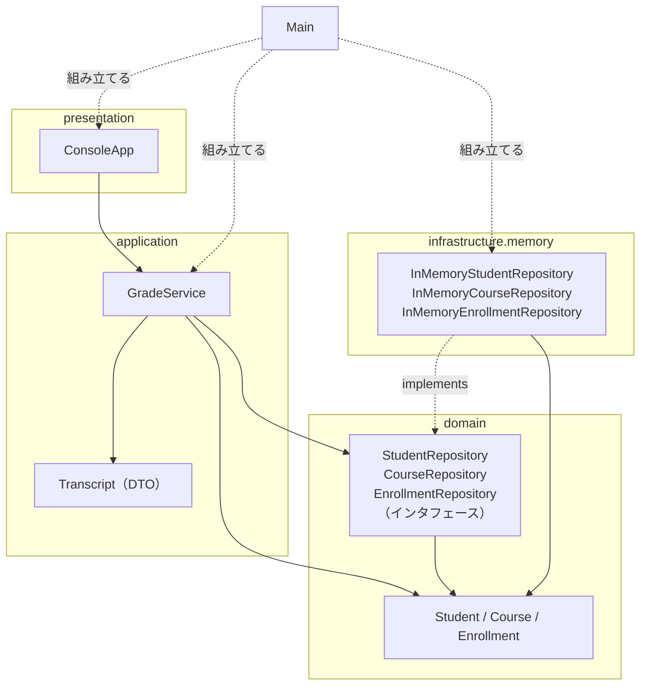
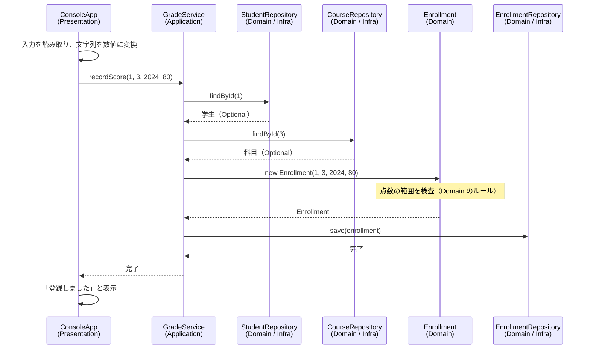

# 06. サンプル実装の読み方

[📖 4層アーキテクチャの目次](./00_はじめに.md#目次) ｜ [🏠 全体の目次](../README.md#目次)

[← 前へ：05 フレームワークとSpring](05_フレームワークとSpring.md) ｜ [次へ：07 Spring Bootで書き直す →](07_Spring_Bootで書き直す.md)

## この章のゴール
- サンプルシステム（`step1-memory`）の全体構成を、パッケージと図で説明できる
- どのクラスがどの層に属し、層の境目で何を受け渡しているか説明できる
- コードを読むときに、「層の約束」を守れているかを確認できる

## 目次

1. [サンプルシステムの概要](#1-サンプルシステムの概要)
2. [層とパッケージの対応](#2-層とパッケージの対応)
3. [全体の構成図](#3-全体の構成図)
4. [読む順番と注目ポイント](#4-読む順番と注目ポイント)
    - [Domain 層](#domain-層)
    - [Application 層](#application-層)
    - [Infrastructure 層](#infrastructure-層)
    - [Presentation 層](#presentation-層)
    - [Main](#main)
5. [処理の流れを追う](#5-処理の流れを追う)
6. [層の約束を確認する](#6-層の約束を確認する)
7. [次のステップ](#7-次のステップ)
8. [よくあるミス](#8-よくあるミス)

---

## 1. サンプルシステムの概要

[00 はじめに](00_はじめに.md#4-題材成績管理システム) で紹介した成績管理システムを、4 層に分けて実装したものです。保存先は**メモリ**（`Map` / `List`）なので、アプリを終了するとデータは消えます。そのかわり、データベースなどの準備がいらず、4 層の構造だけに集中できます。

| 項目 | 内容 |
|---|---|
| 場所 | サンプルリポジトリの `step1-memory/` |
| ユースケース | 学生を登録する / 成績を登録する / 成績一覧を表示する |
| 画面 | コンソール（メニューを選んで入力する） |
| 実行方法 | サンプルリポジトリの README を参照 |

> [!NOTE]
> **サンプル**：[`step1-memory/`](https://github.com/YTS0418/PRMN_SYSTEM_Sample/tree/main/step1-memory)（実行方法は [README](https://github.com/YTS0418/PRMN_SYSTEM_Sample/blob/main/README.md)）

> [!TIP]
> この章は**読み物**です。コードを書き写すのではなく、サンプルを IDE で開いて、この章の順に読み進めてください。

## 2. 層とパッケージの対応

| 層 | パッケージ | 主なファイル | 一言でいうと |
|---|---|---|---|
| Presentation | `presentation` | `ConsoleApp` | メニューと入出力 |
| Application | `application` | `GradeService`、`Transcript` | 3 つのユースケースの手順 |
| Domain | `domain` | `Student`、`Course`、`Enrollment`<br>`StudentRepository` など 3 つ | 業務のもの・ルール、保存の窓口 |
| Infrastructure | `infrastructure.memory` | `InMemoryStudentRepository` など 3 つ | 窓口の実装（メモリ） |
| （組み立て） | `grades` | `Main` | 部品をつないで起動する |

## 3. 全体の構成図

クラスの関係を、パッケージ（層）ごとにまとめた図です。矢印の向きは**依存の向き**（03 章）を表します。



- 矢印が**必ず Domain の方向**を向いていて、Domain からは外へ矢印が出ていません
- `GradeService` から `InMemory…` への矢印はありません（インタフェースだけを知っている）
- `Main` だけが、全部の層のクラスを知っています

## 4. 読む順番と注目ポイント

**内側（Domain）から外側へ**の順に読むと、依存の少ない部分から理解できます。

### Domain 層

読む順番：`Student` → `Course` → `Enrollment` → `…Repository`（3 つ）

| ファイル | 注目ポイント |
|---|---|
| `Student`、`Course` | `record` で書かれている。コンパクトコンストラクタで**作成時に検査**している |
| `Enrollment` | 点数の範囲検査（0〜100）と合格判定（60 点以上）が**ここにある**。`score` は `null` なら「履修中」 |
| `…Repository` | **メソッド宣言だけ**。`findById` は、見つからない場合を `Optional` で表す |

> [!NOTE]
> [`step1-memory/src/grades/domain/`](https://github.com/YTS0418/PRMN_SYSTEM_Sample/tree/main/step1-memory/src/grades/domain)

確認すること：**`import` に `grades.application` などが無い**こと（標準ライブラリの `java.util` のみ）。

### Application 層

読む順番：`Transcript` → `GradeService`

`GradeService` は、3 つのユースケースに対応するメソッドを持ちます。

| メソッド | ユースケース |
|---|---|
| `registerStudent` | 学生を登録する |
| `recordScore` | 成績を登録する |
| `transcript` | 成績一覧を作る |

```java
public void recordScore(int studentId, int courseId, int academicYear, Integer score) {
    findStudent(studentId);        // 学生がいなければ NoSuchElementException
    findCourse(courseId);          // 科目がいなければ NoSuchElementException
    enrollmentRepository.save(new Enrollment(studentId, courseId, academicYear, score));
}
```

注目ポイント：

- **手順を並べているだけ**。点数の範囲検査は書かれていない（`new Enrollment(…)` の中で行われる）
- 使っているのは `…Repository`（インタフェース）だけ。`new InMemory…` は無い
- `System.out.println` が無い。結果は戻り値で返す

`transcript` は、画面に必要な形にまとめて `Transcript`（DTO）で返します。

```java
public record Transcript(String studentName, List<Line> lines, double average) {
    public record Line(String courseTitle, int credits, int academicYear,
                       Integer score, boolean passed) { }
}
```

> [!NOTE]
> [`step1-memory/src/grades/usecase/`](https://github.com/YTS0418/PRMN_SYSTEM_Sample/tree/main/step1-memory/src/grades/usecase)

### Infrastructure 層

読む順番：`InMemoryStudentRepository` → 他の 2 つ

```java
public Student save(Student student) {
    Student saved = (student.id() == null) ? student.withId(nextId++) : student;
    data.put(saved.id(), saved);
    return saved;                  // id が付いた方を返す（record は変更できないため）
}
```

注目ポイント：

- `implements StudentRepository`（Domain のインタフェース）になっている
- `id` の採番を、実装クラスが担当している。データベースでは、データベース自身が自動採番する（データベース編）
- 「同じ（学生, 科目, 年度）は 1 件だけ」というルールを `InMemoryEnrollmentRepository` が**コードで**守っている。データベースでは**制約**で守る（データベース編 06 章）

> [!NOTE]
> [`step1-memory/src/grades/dataaccess/memory/`](https://github.com/YTS0418/PRMN_SYSTEM_Sample/tree/main/step1-memory/src/grades/dataaccess/memory)

### Presentation 層

`ConsoleApp` を読みます。

```java
try {
    // …（メニューの選択に応じて service のメソッドを呼ぶ）
} catch (NumberFormatException e) {
    System.out.println("数字で入力してください");          // 入力形式のエラー：ここの仕事
} catch (IllegalArgumentException | NoSuchElementException e) {
    System.out.println("エラー: " + e.getMessage());       // Domain / Application が投げた例外
}
```

注目ポイント：

- 文字列を数値に変換し（`Integer.parseInt`）、`GradeService` を呼んで、結果を表示するだけ
- 業務ルール（点数の範囲）の検査は無い。ルール違反は、**例外のメッセージを表示するだけ**
- `import` に `grades.infrastructure` が無い

> [!NOTE]
> [`step1-memory/src/grades/presentation/コンソール画面.java`](https://github.com/YTS0418/PRMN_SYSTEM_Sample/blob/main/step1-memory/src/grades/presentation/コンソール画面.java)

### Main

03 章・04 章で説明した「部品をつなぐ」クラスです。

- Infrastructure の部品（`InMemory…`）を作る → `GradeService` に渡す → `ConsoleApp` に渡す
- 科目のデータ（プログラミング基礎など）は、ここで `InMemoryCourseRepository` に渡している

> [!NOTE]
> [`step1-memory/src/grades/Main.java`](https://github.com/YTS0418/PRMN_SYSTEM_Sample/blob/main/step1-memory/src/grades/Main.java)

## 5. 処理の流れを追う

「成績を登録する」を実行したとき、どのクラスが何をしているかを図にします。



> [!NOTE]
> `(Domain / Infra)` と書いたのは、**インタフェースは Domain 層、実体は Infrastructure 層**にあるからです。`GradeService` から見ると、Domain 層のインタフェースを呼んでいるだけです。

点数に 150 を入力した場合は、`new Enrollment(…)` で例外が発生し、`ER.save` は呼ばれません。例外は `GradeService` を通り抜けて `ConsoleApp` に届き、次のように表示されます。

```
エラー: 点数は0〜100にしてください: 150
```

このエラーは Domain 層が出したものですが、**Presentation 層にも Application 層にも検査は書かれていません**。

## 6. 層の約束を確認する

### 層の境目で受け渡すもの

| 境目 | 受け渡すもの | 向き |
|---|---|---|
| Presentation → Application | 数値や文字列に変換した引数（`int studentId` など） | 呼び出し |
| Application → Presentation | `Transcript`（DTO）、`Student`（Domain のオブジェクト）、例外 | 戻り値 |
| Application → Domain | インタフェースのメソッド呼び出し、`Enrollment` の生成 | 呼び出し |
| Infrastructure → Domain | インタフェースの実装、`Student` などのオブジェクト | 実装・戻り値 |

### import で依存の向きを確認する

`import` 文を見れば、依存の向きを守れているかが分かります。

| 層 | import してよいもの | import してはいけないもの |
|---|---|---|
| domain | `java.util` など標準のみ | `grades.application`、`grades.infrastructure`、`grades.presentation` |
| application | `grades.domain` | `grades.infrastructure`、`grades.presentation` |
| infrastructure | `grades.domain` | `grades.application`、`grades.presentation` |
| presentation | `grades.application`、表示に使う `grades.domain` | `grades.infrastructure` |

> [!TIP]
> IDE の検索機能で `import grades.infrastructure` を検索し、ヒットするのが `Main` と `infrastructure` パッケージ内だけであることを確かめてみましょう。

## 7. 次のステップ

ここまでで、4 層の構造が理解できました。同じ成績管理システムは、サンプルリポジトリの中で、次のように発展していきます。

| サンプル | 内容 | 対応する資料 |
|---|---|---|
| `step1-memory` | 保存先が**メモリ**（この章で読んだもの） | 4層編 04・06 章 |
| `step2-jdbc` | 保存先を**PostgreSQL**（JDBC）に差し替えたもの | [データベース編 12 章](../データベース/12_JavaからDBを使う_JDBC.md) |
| `step3-spring` | **Spring Boot** で書き直したもの | [4層編 07 章](07_Spring_Bootで書き直す.md) |

`step1` から `step2` への差し替えで書き換えるのは、`Main` の `new InMemory…` を `new Jdbc…` に変える部分と、`infrastructure` に `Jdbc…` を追加する部分だけです。**ここで読んだ `GradeService`、`ConsoleApp`、Domain 層は 1 行も変更しません**。

> [!NOTE]
> データベース（PostgreSQL）の設計や SQL については、[データベース編](../データベース/00_はじめに.md) で扱います。

## 8. よくあるミス

| ミス | 原因・対処 |
|---|---|
| コードを全部読もうとして、途中で迷子になる | まず**図と表**で全体をつかむ。コードは「注目ポイント」だけ確認すれば十分 |
| `GradeService` に点数の検査を足したくなる | 検査は Domain 層（`Enrollment`）の仕事。画面や保存先が変わっても、ルールが残る |
| `ConsoleApp` から直接 `InMemory…Repository` を使いたくなる | 必ず `GradeService`（Application 層）を通す。層を飛ばさない |
| `Integer score` と `int score` を混同する | `null`（履修中）を表したいので、`Integer` を使っている |
| パッケージ名とフォルダ構成が合わず、コンパイルできない | `grades/domain/Student.java` のように、パッケージ名と同じフォルダに置く |

---

[← 前へ：05 フレームワークとSpring](05_フレームワークとSpring.md) ｜ [次へ：07 Spring Bootで書き直す →](07_Spring_Bootで書き直す.md)

[📖 4層アーキテクチャの目次](./00_はじめに.md#目次) ｜ [🏠 全体の目次](../README.md#目次)
