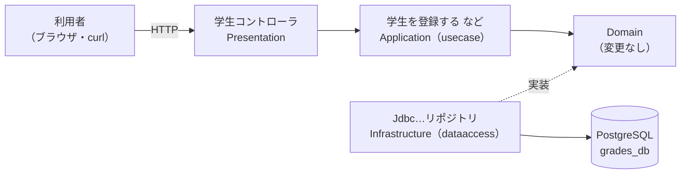
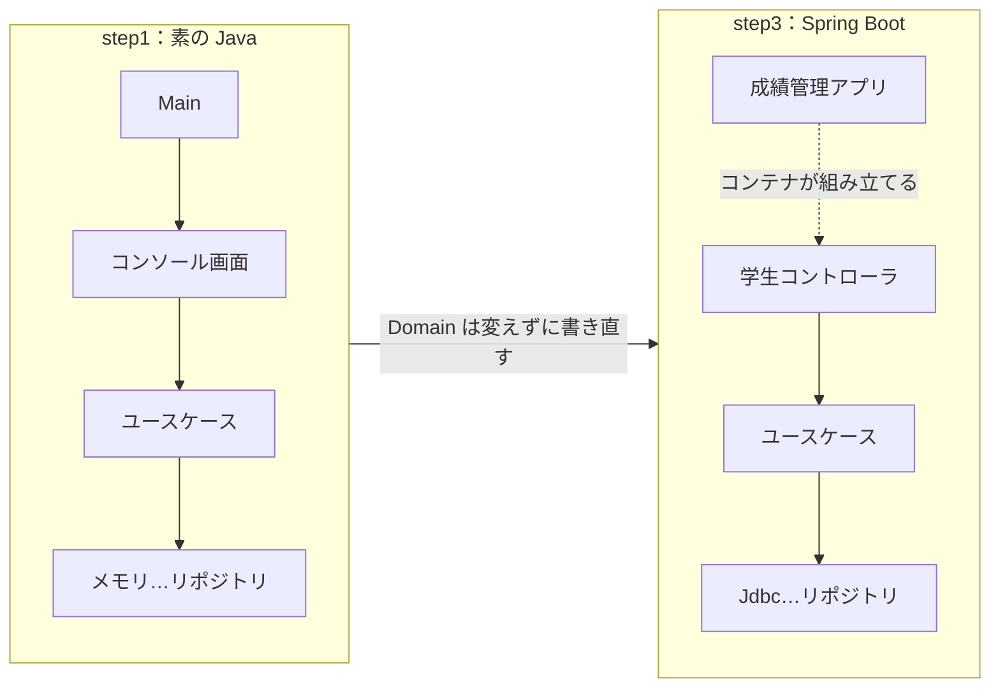

# 07. Spring Bootで書き直す

[📖 4層アーキテクチャの目次](./00_はじめに.md#目次) ｜ [🏠 全体の目次](../README.md#目次)

[← 前へ：06 サンプル実装の読み方](06_サンプル実装の読み方.md) ｜ [はじめに（目次）へ](00_はじめに.md)

## この章のゴール
- Spring Initializr で、Spring Boot のプロジェクトを作成できる
- 素の Java 版（step1）の各クラスが、Spring 版でどう変わるか（変わらないか）を対応表で説明できる
- `@RestController`・`@Service`・`@Repository` で 4 層を組み立てられる
- `JdbcClient` でリポジトリを実装し、`@Transactional` でトランザクションの境界を指定できる

> [!NOTE]
> 概念（フレームワークとは、DI コンテナとは、など）は [05 章](05_フレームワークとSpring.md) で説明しました。この章は、**実際に書く**ための章です。データベース（PostgreSQL）は、[データベース編](../データベース/00_はじめに.md) で作った `grades_db` をそのまま使います。

## 目次

1. [この章で作るもの](#1-この章で作るもの)
2. [プロジェクトの作成](#2-プロジェクトの作成)
3. [パッケージ構成](#3-パッケージ構成)
4. [設定ファイル](#4-設定ファイル)
5. [素の Java 版との対応](#5-素の-java-版との対応)
6. [Application 層：@Service と @Transactional](#6-application-層service-と-transactional)
7. [Infrastructure 層：@Repository と JdbcClient](#7-infrastructure-層repository-と-jdbcclient)
8. [Presentation 層：@RestController](#8-presentation-層restcontroller)
9. [エラーを HTTP の応答に変える](#9-エラーを-http-の応答に変える)
10. [動かして確かめる](#10-動かして確かめる)
11. [よくあるミス](#11-よくあるミス)

---

## 1. この章で作るもの

step1 は**コンソール**で操作するアプリケーションでした。Spring 版では、Presentation 層を **Web API**（REST）に置き換えます。URL にアクセスすると、JSON で結果が返ります。

| 機能（ユースケース） | HTTP | URL |
|---|---|---|
| 学生を登録する | `POST` | `/students` |
| 成績を登録する | `PUT` | `/students/{id}/enrollments` |
| 成績一覧を取得する | `GET` | `/students/{id}/transcript` |



> [!NOTE]
> **サンプル**：[`step3-spring/`](https://github.com/YTS0418/PRMN_SYSTEM_Sample/tree/main/step3-spring)

## 2. プロジェクトの作成

プロジェクトの雛形は、**Spring Initializr**（<https://start.spring.io/>）で作ります。画面で選ぶと、必要なファイルが入った zip をダウンロードできます。

| 項目 | 選ぶもの |
|---|---|
| Project | **Maven** |
| Language | **Java** |
| Spring Boot | 選べる**最新の安定版**（`SNAPSHOT` や `M1` などが付いていないもの） |
| Artifact | `grades` |
| Package name | **`grades`**（初期値から書き換える。ここで決めたパッケージの下に、起動クラスが作られる） |
| Packaging | Jar |
| Java | **25** |

<!-- 📷 SS: ../images/architecture/spring/spr-06-01-initializr.png -->
> 📷 **スクショ指定：`spr-06-01-initializr.png`**
> - 画面：[Spring Initializr](https://start.spring.io/) を開き、Project: Maven、Language: Java、Spring Boot は最新の安定版、Java: 25 を選んだ状態
> - 強調：Project、Language、Spring Boot のバージョン、Java のバージョンの選択をそれぞれ赤枠で囲み、番号①〜④を振る

右側の「ADD DEPENDENCIES」で、次の 3 つを追加します。

| 依存関係 | 目的 |
|---|---|
| **Spring Web** | Web API（Controller）を作る |
| **JDBC API** | `JdbcClient` など、JDBC を使いやすくする機能 |
| **PostgreSQL Driver** | PostgreSQL に接続する JDBC ドライバ（データベース編 12 章） |

<!-- 📷 SS: ../images/architecture/spring/spr-06-02-dependencies.png -->
> 📷 **スクショ指定：`spr-06-02-dependencies.png`**
> - 画面：Initializr の「ADD DEPENDENCIES」で Spring Web、JDBC API、PostgreSQL Driver を追加した状態
> - 強調：追加した 3 つの依存関係と、「GENERATE」ボタンを赤枠で囲む

「GENERATE」でダウンロードした zip を展開し、IDE（IntelliJ IDEA や VSCode）で開きます。

> [!NOTE]
> 依存関係の名前や、`pom.xml` に書かれる内容は、Spring Boot のバージョンによって変わることがあります。**Initializr が正しい組み合わせを作ってくれる**ので、手で書き換える必要はありません。

## 3. パッケージ構成

step1 と**同じ層のパッケージ**に、Spring 用のクラスを置きます（`usecase` が Application 層、`dataaccess` が Infrastructure 層です）。

```
src/main/java/grades/
├── 成績管理アプリ.java                 ← 起動クラス（step1 の Main に相当）
├── presentation/
│   ├── 学生コントローラ.java           ← REST の受け口（step1 の コンソール画面 に相当）
│   └── 例外ハンドラ.java               ← エラーを HTTP の応答に変える
├── usecase/
│   └── 学生を登録する.java, 成績を登録する.java, …   ← @Service を付ける（成績一覧.java などの DTO は付けない）
├── domain/                            ← 変更なし（Spring のアノテーションは 1 つも無い）
│   └── 学生.java, 科目.java, 履修.java, 履修一覧.java, …リポジトリ.java
└── dataaccess/
    └── jdbc/
        └── Jdbc学生リポジトリ.java, Jdbc科目リポジトリ.java, Jdbc履修リポジトリ.java
```

> [!WARNING]
> 起動クラス（`成績管理アプリ`）は、`grades` パッケージの**直下**に置きます。Spring は、起動クラスのパッケージ**以下**を、部品（`@Service` など）を探す範囲にするためです（05 章のコンポーネントスキャン）。

## 4. 設定ファイル

`src/main/resources/application.properties` に、データベースの接続先を書きます。

```properties
spring.datasource.url=jdbc:postgresql://localhost:5432/grades_db
spring.datasource.username=postgres
spring.datasource.password=${DB_PASSWORD}
```

- `${DB_PASSWORD}` は、**環境変数** `DB_PASSWORD` の値に置き換えられる。パスワードを設定ファイルに直接書かない
- これだけで、Spring Boot の**自動設定**が、データベース接続の部品（`DataSource`）と `JdbcClient` を用意する。`step2` で自分で書いた接続のコードは、不要になる

## 5. 素の Java 版との対応

step1 の各クラスが、Spring 版でどうなるかを整理します。

| 層 | step1（素の Java） | step3（Spring Boot） | 変更点 |
|---|---|---|---|
| **起動** | `Main`（`new` で組み立てる） | `成績管理アプリ`（`@SpringBootApplication`） | **組み立てのコードが不要**になる。DI コンテナが行う |
| **Presentation** | `コンソール画面`（コンソールの入出力） | `学生コントローラ`（`@RestController`） | 入出力が**コンソール → HTTP/JSON** に変わる |
| **Application** | `学生を登録する` など 5 つのユースケース、`成績一覧`（DTO） | 同じクラス | ユースケースに `@Service` と `@Transactional` を**付けるだけ**（DTO は変更なし） |
| **Domain** | `学生` `科目` `履修` `履修一覧` `…リポジトリ` | 同じ | **変更なし**（1 行も変えない） |
| **Infrastructure** | `メモリ…リポジトリ` | `Jdbc…リポジトリ`（`@Repository`、`JdbcClient`） | 保存先が**メモリ → PostgreSQL**。接続の処理は JdbcClient が代行 |



> [!TIP]
> **Domain 層がまったく変わらない**ことに注目してください（05 章 6 節）。業務のルールは、フレームワークや保存先が変わっても、そのまま使い続けられます。

## 6. Application 層：@Service と @Transactional

ユースケースのクラス（`学生を登録する` など）は、step1 のクラスに**アノテーションを付ける**だけです。

```java
@Service
public class 学生を登録する {
    // …（フィールドとコンストラクタは step1 と同じ。コンストラクタで リポジトリ を受け取る）

    @Transactional                                  // このメソッド全体が 1 つのトランザクション
    public 学生 実行する(String 氏名, int 学科ID, int 入学年度) {
        学生 登録する学生 = new 学生(null, 氏名, 学科ID, 入学年度);
        return 学生リポジトリ.保存する(登録する学生);
    }
}
```

> [!NOTE]
> **サンプル**：[`step3-spring/src/main/java/grades/usecase/学生を登録する.java`](https://github.com/YTS0418/PRMN_SYSTEM_Sample/blob/main/step3-spring/src/main/java/grades/usecase/学生を登録する.java)

### @Transactional

メソッドに `@Transactional` を付けると、Spring が**メソッドの開始時にトランザクションを開始し、正常に終わったら確定、例外が起きたら取り消し**ます。データベース編 11 章で説明した「トランザクションの境界を Application 層で決める」を、アノテーション 1 つで実現できます。

| 項目 | 内容 |
|---|---|
| 付ける場所 | Application 層（`@Service`）のメソッド。**ユースケース 1 つ = トランザクション 1 つ**（読み取りだけのユースケースには `@Transactional(readOnly = true)`） |
| 取り消されるとき | `RuntimeException`（実行時例外）が投げられたとき |
| 注意 | <ul><li>既定では、**チェック例外**（`IOException` など）では取り消されない</li><li>同じクラスの中から `this.メソッド()` で呼んでも、効かない（外から呼ばれたときだけ働く）</li></ul> |

> [!NOTE]
> データベース編 12 章の補足で、「素の JDBC では、Application 層が `Connection` を扱わずに境界を決める仕組みを自分で作る必要がある」と述べました。`@Transactional` は、それを肩代わりします。

## 7. Infrastructure 層：@Repository と JdbcClient

リポジトリの実装は、Domain 層のインタフェースを `implements` する点は同じです。SQL の実行には、データベース編 12 章（step2）と同じ **`JdbcClient`** を使います。step2 との違いは、`JdbcClient` を `Main` で作らず、**Spring Boot が用意して渡してくれる**ことです。

```java
@Repository
class Jdbc学生リポジトリ implements 学生リポジトリ {
    private final JdbcClient jdbcClient;                 // Spring Boot が用意してくれる部品

    Jdbc学生リポジトリ(JdbcClient jdbcClient) {           // コンストラクタインジェクション
        this.jdbcClient = jdbcClient;
    }

    @Override
    public Optional<学生> 探す(int 学生ID) {
        String sql = """
                SELECT student_id, name, department_id, enrolled_year
                FROM students
                WHERE student_id = :id
                """;
        return jdbcClient.sql(sql)
                .param("id", 学生ID)                      // :id に値を渡す（SQL インジェクションの心配なし）
                .query((rs, rowNum) -> 学生にする(rs))      // 行 → 学生。テーブルの列名（英語）との対応は、この層が受け持つ
                .optional();                              // 0 件なら Optional.empty()
    }
}
```

> [!NOTE]
> **サンプル**：[`step3-spring/src/main/java/grades/dataaccess/jdbc/Jdbc学生リポジトリ.java`](https://github.com/YTS0418/PRMN_SYSTEM_Sample/blob/main/step3-spring/src/main/java/grades/dataaccess/jdbc/Jdbc学生リポジトリ.java)

データベース編 12 章の補足にある、素の JDBC 版（約 13 行）と比べてみてください。

| | 素の JDBC（12 章の補足） | JdbcClient（step2・step3） |
|---|---|---|
| 接続の取得・解放 | 自分で書く（`try-with-resources`） | **不要**（Spring が管理） |
| プレースホルダ | `?` と番号 | `:名前`（名前付き） |
| `ResultSet` の読み取り | `while (rs.next())` を自分で書く | 行 → オブジェクトの変換だけを書く |
| 例外 | `SQLException`（チェック例外）を自分で包む | Spring が**実行時例外**に変換する（一意制約違反は `DuplicateKeyException` など） |

> [!TIP]
> 例外が自動で変換されるので、Application 層は `java.sql` を知らずに済みます。`SQLException` を上の層に漏らさない、という目的（データベース編 12 章）が、自動的に達成されます。

`@Repository` は、**この層の部品である**ことを表す名札です。Domain 層の `学生リポジトリ` インタフェースを実装したクラスなので、`学生を登録する` のコンストラクタが `学生リポジトリ` を要求すると、Spring がこのクラスを見つけて渡します。

## 8. Presentation 層：@RestController

step1 の `コンソール画面`（入力を読み取ってユースケースを呼び、結果を表示する）の役割を、Controller が担当します。**入力は HTTP のリクエスト、出力は JSON** です。

```java
@RestController
@RequestMapping("/students")
class 学生コントローラ {
    private final 学生を登録する 学生を登録する;
    private final 成績一覧を取得する 成績一覧を取得する;
    // …（コンストラクタ注入。ユースケースを受け取る）

    @PostMapping                                                   // POST /students
    学生の応答 学生を登録(@RequestBody 学生登録の入力 入力) {
        学生 登録した学生 = 学生を登録する.実行する(入力.氏名(), 入力.学科ID(), 入力.入学年度());
        return new 学生の応答(登録した学生.学生ID(), 登録した学生.氏名(), 登録した学生.学科ID(), 登録した学生.入学年度());
    }

    @GetMapping("/{id}/transcript")                                // GET /students/1/transcript
    成績一覧の応答 成績一覧を取得(@PathVariable("id") int 学生ID) { /* … */ }

    // 入出力用の DTO。@JsonProperty で、JSON のキー（英語）と日本語の項目名を結びつける
    record 学生登録の入力(@JsonProperty("name") String 氏名,
                   @JsonProperty("departmentId") int 学科ID,
                   @JsonProperty("enrolledYear") int 入学年度) { }
}
```

> [!NOTE]
> **サンプル**：[`step3-spring/src/main/java/grades/presentation/学生コントローラ.java`](https://github.com/YTS0418/PRMN_SYSTEM_Sample/blob/main/step3-spring/src/main/java/grades/presentation/学生コントローラ.java)

| アノテーション | 役割 |
|---|---|
| `@RestController` | このクラスが、HTTP の受け口であることを示す。戻り値は JSON に変換される |
| `@RequestMapping("/students")` | このクラスの URL の共通部分 |
| `@PostMapping` / `@GetMapping("/{id}/...")` | HTTP のメソッドと URL の対応づけ。`{id}` は URL の一部 |
| `@RequestBody` | リクエストの JSON を、Java のオブジェクト（`record`）に変換する |
| `@PathVariable` | URL の `{id}` の部分を、引数として受け取る |

Controller は、**入力を受け取り、ユースケースを呼び、結果を返す**だけです。step1 の `コンソール画面` と同様に、業務のルール（点数の範囲など）は書きません。`成績一覧`（DTO）は、`成績一覧の応答` という入出力用の `record` に詰め替えて、JSON にします。

> [!NOTE]
> URL（`/students`）と JSON のキー（`"name"` など）は、サンプルでは**英語のまま**です。クラス名・メソッド名・変数名は日本語なので、`@JsonProperty("name")` で「JSON のキー `name` は、Java の `氏名`」と結びつけています。

> [!TIP]
> 05 章で説明した「制御の反転」を、ここで体験しています。`main` から `成績一覧を取得` を呼ぶコードは、**どこにもありません**。URL にアクセスがあると、Spring が Controller のメソッドを呼びます。

> [!CAUTION]
> **セキュリティの視点**：この例の `GET /students/{id}/transcript` は、URL の `1` を `2` に変えるだけで、**誰でも他人の成績を見られます**。ログインした人が誰で、その人がこのデータを見てよいかを確かめる仕組み（**認証・認可**）がないためです。Web アプリの脆弱性をまとめた OWASP Top 10:2025 では、この「アクセス制御の不備」が 1 位です（[OWASP「A01:2025 Broken Access Control」](https://top10.owasp.org/2025/A01_2025-Broken_Access_Control)、閲覧日：2026-11-08）。本番のアプリケーションでは、Spring Security（[05 章](05_フレームワークとSpring.md)）などで認証・認可を加えます。

## 9. エラーを HTTP の応答に変える

step1 の `コンソール画面` は、例外を捕まえて「エラー: …」と表示していました。Web API では、**HTTP のステータスコード**で結果を伝えます。例外を応答に変換する役割は、Presentation 層に置きます。

```java
@RestControllerAdvice                                              // すべての Controller に共通の例外処理
class 例外ハンドラ {
    @ExceptionHandler(NoSuchElementException.class)                // 学生・科目が見つからない
    ResponseEntity<String> 見つからない(NoSuchElementException e) {
        return ResponseEntity.status(404).body(e.getMessage());
    }
    @ExceptionHandler(IllegalArgumentException.class)              // Domain の検査に違反（点数の範囲など）
    ResponseEntity<String> 入力がルールに合わない(IllegalArgumentException e) {
        return ResponseEntity.status(400).body(e.getMessage());
    }
    @ExceptionHandler(DataIntegrityViolationException.class)       // データベースの制約違反（存在しない学科の指定など）
    ResponseEntity<String> 制約に反する(DataIntegrityViolationException e) {
        return ResponseEntity.status(409).body("登録できませんでした。入力内容（学科の指定など）を確認してください");
    }
}
```

> [!NOTE]
> **サンプル**：[`step3-spring/src/main/java/grades/presentation/例外ハンドラ.java`](https://github.com/YTS0418/PRMN_SYSTEM_Sample/blob/main/step3-spring/src/main/java/grades/presentation/例外ハンドラ.java)

| 例外 | 発生元 | HTTP ステータス |
|---|---|---|
| `NoSuchElementException` | Application 層（学生・科目が存在しない） | `404 Not Found` |
| `IllegalArgumentException` | Domain 層（`履修` の点数の範囲など） | `400 Bad Request` |
| `DataIntegrityViolationException`（`DuplicateKeyException` を含む） | Spring（データベースの制約違反が変換されたもの） | `409 Conflict`（メッセージは固定の文に置き換える） |

> [!TIP]
> 例外を発生させる側（Domain / Application）は、**HTTP のことを知りません**。変換は Presentation 層だけで行うので、コンソール版と Web API 版で、Domain と Application を共通に使えます。

> [!CAUTION]
> **セキュリティの視点**：上の例で `e.getMessage()` を返してよいのは、Domain・Application で**自分で書いたメッセージ**（「点数は 0〜100 にしてください」など）だからです。`DataIntegrityViolationException` のようなデータベース由来の例外のメッセージには、SQL 文やテーブル名が含まれるので、**そのまま返さず**、短い文に置き換えます（上の `制約に反する` がそうしています）（データベース編 [12 章 9 節](../データベース/12_JavaからDBを使う_JDBC.md#9-例外の扱い)）。なお Spring Boot は、既定の設定では、捕まえなかった例外のスタックトレースやメッセージを応答に含めません（[Spring Boot「Common Application Properties」](https://docs.spring.io/spring-boot/appendix/application-properties/index.html)、閲覧日：2026-11-08）。開発中に表示する設定にした場合は、本番で戻します。

## 10. 動かして確かめる

### 起動

PostgreSQL が起動していて、`grades_db` にテーブルとサンプルデータが入っている（データベース編 07〜09 章）ことを確認し、環境変数 `DB_PASSWORD` を設定したうえで、プロジェクトのフォルダで起動します。

```bash
./mvnw spring-boot:run
```

IDE の場合は、`成績管理アプリ` の ▶ ボタンでも実行できます。ログに `Started 成績管理アプリ` と出れば起動成功です。組み込みの Web サーバーが、既定で 8080 番ポートで待ち受けています。

### リクエストを送る

`curl` コマンドや、ブラウザで確認します（`GET` はブラウザでも確認できます）。

```bash
curl http://localhost:8080/students/1/transcript
```

レスポンスのイメージです（Taro の成績一覧）。

```json
{
  "studentName": "Taro",
  "lines": [
    { "courseTitle": "プログラミング基礎", "credits": 2, "academicYear": 2024, "score": 80, "passed": true },
    { "courseTitle": "データベース", "credits": 2, "academicYear": 2025, "score": 72, "passed": true },
    { "courseTitle": "線形代数", "credits": 4, "academicYear": 2024, "score": 55, "passed": false }
  ],
  "average": 69.0
}
```

`成績一覧の応答` の `record` が、そのまま JSON になっていることが分かります。JSON のキー（`studentName`、`courseTitle` など）は英語ですが、Java の項目名は日本語（`氏名`、`科目名` など）で、`@JsonProperty` が対応づけています。ユースケースと Domain の `履修.合格している()` は、step1 のものと同じコードです。

> [!WARNING]
> `POST` や `PUT` のリクエストを `curl` で送る場合、JSON のクォートの書き方が **Windows のコマンドプロンプト／PowerShell／Git Bash で異なります**。サンプルの README に、環境ごとの書き方を載せます。

### 確認すること

- 存在しない学生（`/students/999/transcript`）で、`404` が返る
- 範囲外の点数（150 など）で、`400` が返り、メッセージに「点数は0〜100にしてください」と出る（**Domain 層が出したエラー**）
- 一度成功した成績の登録をやり直すと、**同じ（学生, 科目, 年度）は上書き**される（`ON CONFLICT`）

## 11. よくあるミス

| ミス | 原因・対処 |
|---|---|
| 起動時に `Failed to configure a DataSource` | `application.properties` の接続先が違う、または PostgreSQL が起動していない。URL、ユーザー名、パスワードを確認する |
| 起動時に `password authentication failed` | 環境変数 `DB_PASSWORD` が設定されていない、または間違っている |
| `No qualifying bean of type '学生リポジトリ'` | 実装クラスに `@Repository` が付いていない、または起動クラスのパッケージの外に置いている |
| Controller にアクセスしても `404` になる | 起動クラスと違うパッケージに置いている、`@RequestMapping` の URL が違う |
| `@Transactional` を付けたのに、取り消されない | チェック例外は取り消されない、または同じクラス内の呼び出しになっている |
| Domain のクラスに `@Component` などを付けてしまう | Domain は Spring に依存させない（05 章 6 節）。付けるのは Presentation / Application（`usecase`）/ Infrastructure（`dataaccess`）の部品だけ |
| ユースケースに `System.out.println` や HTTP の知識を書く | 表示・HTTP は Presentation 層。ユースケースは結果を返す |
| 8080 番ポートが使用中で起動できない | 別のアプリが使用中。`server.port=8081` を `application.properties` に書いて変更する |
| `GET` はできるが `POST` が `415` エラーになる | `Content-Type: application/json` ヘッダーが付いていない |

---

[← 前へ：06 サンプル実装の読み方](06_サンプル実装の読み方.md) ｜ [はじめに（目次）へ](00_はじめに.md)

[📖 4層アーキテクチャの目次](./00_はじめに.md#目次) ｜ [🏠 全体の目次](../README.md#目次)
