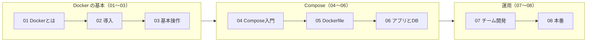
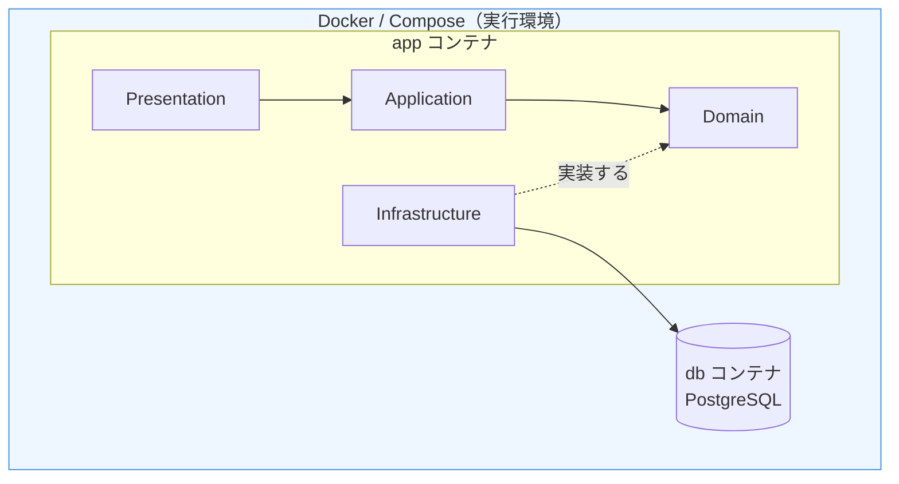

# Docker / Compose — はじめに

[📖 Dockerの目次](./00_はじめに.md#目次) ｜ [🏠 全体の目次](../README.md#目次)

「自分のパソコンでは動くのに、ほかの人のパソコンでは動かない」。チームで開発していると、必ず起こる問題です。**Docker** は、アプリケーションと、その動作に必要な環境（PostgreSQL、Java など）を**まとめて 1 つの箱に入れて**、どのパソコンでも同じように動かすための道具です。この資料では、Docker の基本から、**Docker Compose** で DB とアプリを一緒に動かす方法、そして本番に出すときの考え方までを学びます。

> [!WARNING]
> ベータ版です。内容は変更される可能性があります。コマンドや設定ファイルは、実機での動作確認を行っていません。公式のドキュメントも確認してください。

## 目次

1. [この資料について](#1-この資料について)
2. [章の構成](#2-章の構成)
3. [前提知識](#3-前提知識)
4. [4層の中での位置づけ](#4-4層の中での位置づけ)
5. [題材：成績管理システム](#5-題材成績管理システム)
6. [サンプルリポジトリ](#6-サンプルリポジトリ)
7. [各章の書き方](#7-各章の書き方)

---

## 1. この資料について

- 対象：データベース編 07 章（PostgreSQL 環境構築）まで終わっている人。Docker の知識は不要です
- 使用するもの：**Docker Desktop**（Windows / macOS）、**Docker Compose**、PostgreSQL 18、pgAdmin 4、Java 25 / Spring Boot
- ゴール：
  - Docker の**イメージ**と**コンテナ**の違いを説明できる
  - `docker run` で PostgreSQL を起動し、データを**ボリューム**で残せる
  - `compose.yaml` を読み書きして、DB と pgAdmin を **1 コマンドで起動**できる
  - Spring Boot アプリの **Dockerfile** を読み、イメージを作れる
  - アプリと DB を Compose でつないで動かせる
  - 本番に出すときに**何を変えるべきか**（秘密情報、公開するポート、HTTPS など）を説明できる

## 2. 章の構成

| 章 | タイトル | 内容 |
|---|---|---|
| 01 | [Dockerとは](01_Dockerとは.md) | 解決したい問題、イメージとコンテナ、仮想マシンとの違い |
| 02 | [Docker導入](02_Docker導入.md) | Docker Desktop のインストール、動作確認 |
| 03 | [Dockerの基本操作](03_Dockerの基本操作.md) | run / ps / logs / exec、ポート公開、ボリューム |
| 04 | [Docker Compose入門](04_Docker_Compose入門.md) | compose.yaml、PostgreSQL と pgAdmin の起動、初期データ |
| 05 | [Dockerfileとイメージ作成](05_Dockerfileとイメージ作成.md) | Dockerfile、マルチステージビルド、Spring Boot / Vaadin |
| 06 | [アプリとDBをComposeで動かす](06_アプリとDBをComposeで動かす.md) | サービス間の接続、設定の上書き、起動順序 |
| 07 | [チーム開発での使い方](07_チーム開発での使い方.md) | 運用のルール、データのリセット、掃除 |
| 08 | [本番デプロイの考え方](08_本番デプロイの考え方.md) | 開発と本番の違い、秘密情報、HTTPS、更新とロールバック |

## 3. 前提知識

- [データベース編 07 章](../データベース/07_PostgreSQL環境構築.md)：PostgreSQL、psql、pgAdmin の使い方。この資料では、これらを **Docker の中で動かす**形で再登場させます
- [4層アーキテクチャ編 07 章](../4層アーキテクチャ/07_Spring_Bootで書き直す.md)：Spring Boot のアプリと `application.properties`
- コマンドライン（ターミナル）の基本操作

> [!NOTE]
> Docker 資料は、アプリを**作る**資料ではありません。すでにあるアプリと DB を、**どう動かすか**を扱います。

## 4. 4層の中での位置づけ

Docker は、4 層のどれか 1 つの層ではなく、**全層をまとめて動かす土台**です。

4 層の考え方（依存の向き）は、Docker を使っても**変わりません**。変わるのは、アプリが DB を**どこに探しに行くか**（`localhost` ではなく、サービス名 `db`）だけです（[06 章](06_アプリとDBをComposeで動かす.md)）。

## 5. 題材：成績管理システム

他の資料と同じ成績管理システムを使います。

| 項目 | 値 |
|---|---|
| データベース名 | `grades_db` |
| DB ユーザー | `postgres`（学習用） |
| DB のポート | 5432 |
| アプリのポート | 8080 |
| Compose のサービス名 | DB は `db`、pgAdmin は `pgadmin`、アプリは `app` |

## 6. サンプルリポジトリ

資料の中の `compose.yaml` と Dockerfile は、要点を示す抜粋です。**完全版**は、サンプルリポジトリにまとめています。

| 場所 | 内容 | 対応する章 |
|---|---|---|
| `docker/compose.yaml` | DB（PostgreSQL）と pgAdmin を起動する | 04 章 |
| `docker/.env.example` | 環境変数の見本（パスワードは入れない） | 04 章 |
| `database/db/01_schema.sql`、`database/db/02_seed.sql` | 初回起動時に流す SQL（データベース編と共通） | 04 章 |
| `architecture/step3-spring/Dockerfile`、`.dockerignore` | アプリ（Spring Boot）のイメージの作り方 | 05 章 |
| `docker/compose.app.yaml` | アプリを加えた Compose（`compose.yaml` に重ねて使う） | 06 章 |
| `frontend/grades-vaadin/Dockerfile`、`docker/compose.vaadin.yaml` | Vaadin 版のイメージと Compose | 05 章 7 節 |

> [!NOTE]
> **サンプルリポジトリ**：[PRMN_SYSTEM_Sample](https://github.com/<ORG>/PRMN_SYSTEM_Sample)（URL は仮置きです。公開先が決まり次第、差し替えます）。動かし方は、サンプルの [`docker/README.md`](https://github.com/<ORG>/PRMN_SYSTEM_Sample/tree/main/docker) にあります。

## 7. 各章の書き方

各章は次の順で進みます。

1. **この章のゴール**：何ができるようになるか
2. **説明、図、表**：Mermaid の図とコマンド例を見ながら理解する
3. **サンプルへのリンク**：完全な設定ファイルは、サンプルリポジトリで確認する
4. **よくあるミス**

---

[次へ：01 Dockerとは →](01_Dockerとは.md)

[📖 Dockerの目次](./00_はじめに.md#目次) ｜ [🏠 全体の目次](../README.md#目次)
