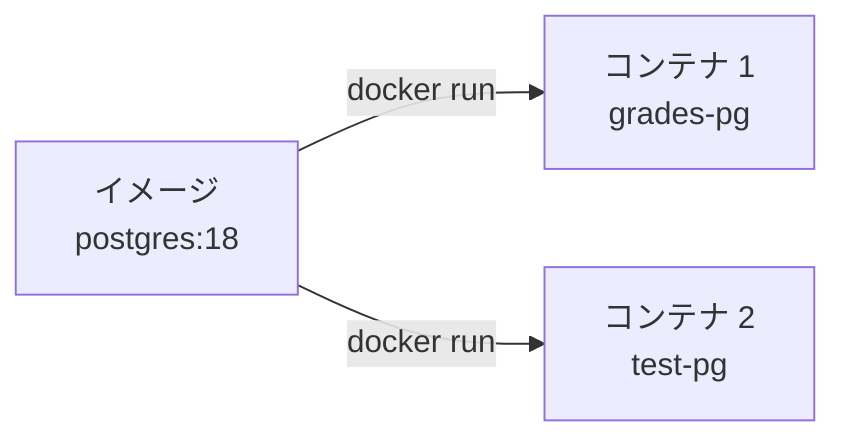
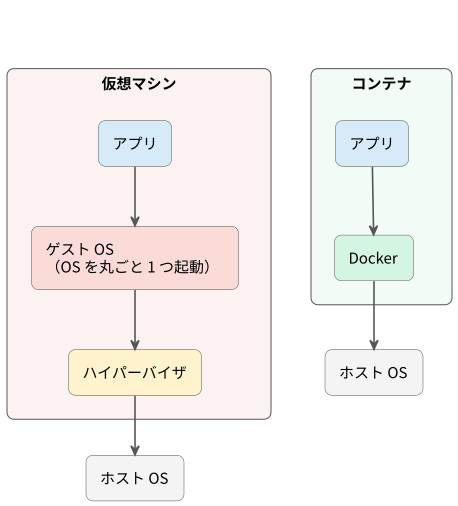
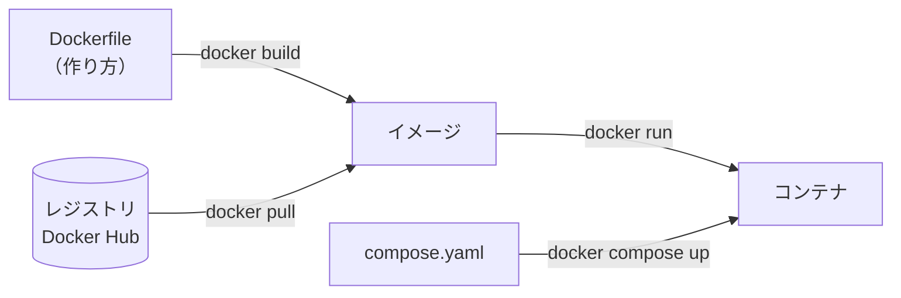

# 01. Docker とは

[📖 Docker の目次](./00_はじめに.md#目次) ｜ [🏠 全体の目次](../README.md#目次)

[← 前へ：00 はじめに](00_はじめに.md) ｜ [次へ：02 Docker 導入 →](02_Docker導入.md)

## この章のゴール
- Docker が解決する問題を説明できる
- **イメージ**と**コンテナ**の違いを説明できる
- 仮想マシンとの違いを、ざっくり説明できる
- Dockerfile、Compose、レジストリの役割を言える

## 目次

1. [解決したい問題](#1-解決したい問題)
2. [イメージとコンテナ](#2-イメージとコンテナ)
3. [仮想マシンとの違い](#3-仮想マシンとの違い)
4. [登場するもの](#4-登場するもの)
5. [よくある誤解](#5-よくある誤解)

---

## 1. 解決したい問題

成績管理システムを動かすには、次のものが必要です。

- PostgreSQL 18（DB）
- Java 25（アプリ）
- 正しい設定（DB 名、パスワード、ポート）

これを**メンバー全員が手作業でそろえる**と、次のような問題が起きます。

| 問題 | 例 |
|---|---|
| バージョンが違う | ある人は PostgreSQL 16、ある人は 18 |
| 設定が違う | DB 名やパスワードが人によって違い、接続できない |
| 手順が長い | 新しいメンバーが環境を作るのに半日かかる |
| 他のソフトと衝突する | すでに別の PostgreSQL が 5432 番ポートを使っている |

Docker を使うと、**環境の作り方をファイルに書いて**、全員が同じものを **1 コマンドで**用意できます。

## 2. イメージとコンテナ

Docker の中心になる言葉は、この 2 つです。

| 名前 | 例え | 内容 |
|---|---|---|
| **イメージ** | 設計図・インストーラ | アプリと環境を詰めた、**読み取り専用**のひな形 |
| **コンテナ** | 実際に動いているもの | イメージから作った、**動いているもの**（プロセス） |

1 つのイメージから、コンテナを**何個でも**作れます。コンテナを消しても、イメージは残ります。

> [!NOTE]
> クラスとインスタンスの関係に似ています（[Java 入門 06 章](../付録/Java入門/06_クラスとオブジェクト.md)）。イメージがクラス、コンテナがインスタンスです。

イメージの名前は、`postgres:18` のように **名前:タグ** で書きます。タグは主にバージョンを表します。タグを省略すると `latest`（最新）になりますが、**中身がいつの間にか変わる**ので、バージョンを書く習慣をつけてください。

## 3. 仮想マシンとの違い

環境を丸ごと分ける方法には、**仮想マシン（VM）** もあります。違いは次のとおりです。

| | 仮想マシン | コンテナ |
|---|---|---|
| 分けるもの | OS を丸ごと | **アプリと必要なもの**だけ（OS の核は共有） |
| 起動 | 数十秒〜数分 | 数秒 |
| サイズ | 数 GB | 数十〜数百 MB |

> [!NOTE]
> Windows と macOS では、Linux のコンテナを動かすために、裏で軽い Linux の仮想環境が動きます（Windows では **WSL 2**）。この資料では、あまり意識しなくて構いません。

## 4. 登場するもの

| 名前 | 役割 | 登場する章 |
|---|---|---|
| **Docker Engine** | コンテナを動かす本体 | 02 |
| **Docker Desktop** | Engine と、操作画面や WSL 連携をまとめたアプリ（Windows / macOS） | 02 |
| **レジストリ**（Docker Hub など） | イメージを置いておく場所。`postgres:18` はここから取ってくる | 03 |
| **Dockerfile** | イメージの**作り方**を書いたファイル | 05 |
| **Docker Compose** | 複数のコンテナの起動を、`compose.yaml` 1 つで管理する | 04・06 |

## 5. よくある誤解

| 誤解 | 実際 |
|---|---|
| コンテナを消してもデータは残る | **消える**。残したいデータは**ボリューム**に置く（[03 章](03_Dockerの基本操作.md#5-ボリュームでデータを残す)） |
| コンテナの中に入って設定を直せばよい | コンテナは**使い捨て**。直した内容は、作り直すと消える。設定は**ファイルに書く** |
| Docker を使えばセキュリティは安全 | 公開するポートや秘密情報の扱いを間違えると危険（[03 章](03_Dockerの基本操作.md#4-ポートを公開する)、[08 章](08_本番デプロイの考え方.md)） |
| Docker は本番専用の技術 | 開発環境をそろえる使い方のほうが、はるかに多い |

---

[← 前へ：00 はじめに](00_はじめに.md) ｜ [次へ：02 Docker 導入 →](02_Docker導入.md)

[📖 Docker の目次](./00_はじめに.md#目次) ｜ [🏠 全体の目次](../README.md#目次)
