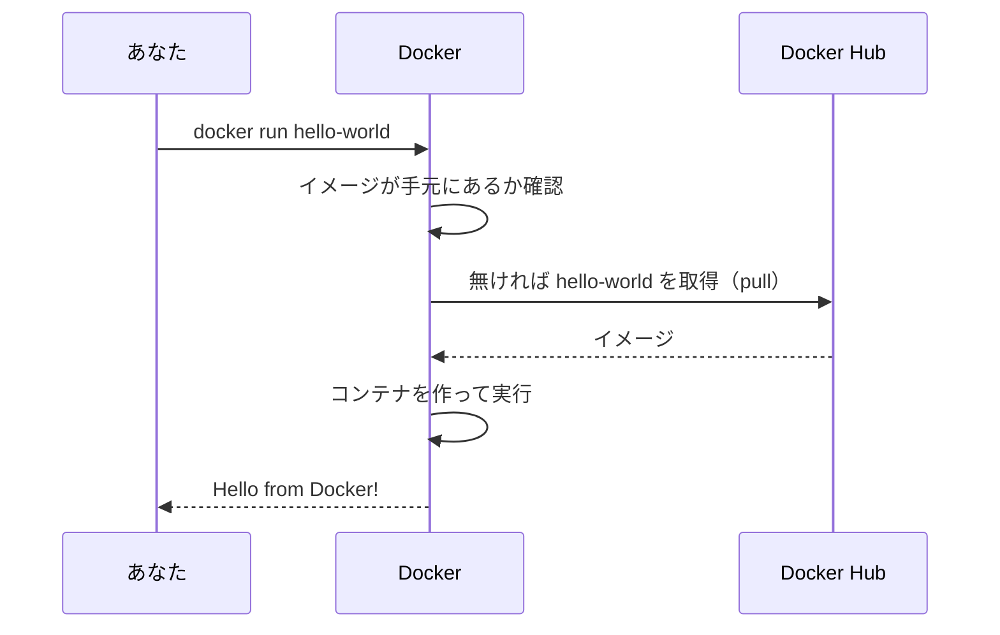

# 02. Docker 導入

[📖 Docker の目次](./00_はじめに.md#目次) ｜ [🏠 全体の目次](../README.md#目次)

[← 前へ：01 Docker とは](01_Dockerとは.md) ｜ [次へ：03 Docker の基本操作 →](03_Dockerの基本操作.md)

## この章のゴール
- Docker Desktop をインストールして、起動を確認できる
- `docker version` と `docker run hello-world` が動く
- Docker Desktop の利用条件（ライセンス）に注意すべき場面が分かる

## 目次

1. [Docker Desktop のライセンス](#1-docker-desktop-のライセンス)
2. [インストール（Windows）](#2-インストールwindows)
3. [他の環境：macOS / Linux](#3-他の環境macos--linux)
4. [動作を確認する](#4-動作を確認する)
5. [よくあるミス](#5-よくあるミス)

---

## 1. Docker Desktop のライセンス

Docker Desktop は、**無料で使える条件が決まっています**。大学での学習や、小規模な組織での利用は無料ですが、一定規模以上の企業が仕事で使う場合は有料のプランが必要です（[Docker Docs「Docker Desktop license agreement」](https://docs.docker.com/subscription/desktop-license/)、閲覧日：2026-11-19）。

> [!IMPORTANT]
> このプロジェクトの活動（教育・学習）では、無料の範囲に入ると考えられます。ただし、**インターン先や就職先の PC に入れる場合は、会社のルールに従ってください**。条件は変更されることがあるので、最新の公式ページを確認してください。

## 2. インストール（Windows）

### 事前に確認すること

- Windows 11（または対応する Windows 10）
- **仮想化**が有効になっている（多くの PC では既定で有効。タスクマネージャー → パフォーマンス → CPU で「仮想化：有効」と出る）

### 手順

1. [Docker Desktop の公式ダウンロードページ](https://www.docker.com/products/docker-desktop/)から、Windows 用のインストーラをダウンロードする
2. インストーラを実行する。「Use WSL 2 instead of Hyper-V」にチェックが入った状態（既定）のまま進める
3. インストールが終わったら、**再起動**する
4. スタートメニューから **Docker Desktop** を起動する。利用規約に同意する
5. アカウントのサインインは、**スキップしても構いません**（イメージの取得だけなら不要）

<!-- 📷 SS: ../images/docker/desktop/dkr-02-01-installer-wsl2.png -->
> 📷 **スクショ指定：`dkr-02-01-installer-wsl2.png`**
> - 画面：Docker Desktop インストーラの設定画面
> - 強調：「Use WSL 2 instead of Hyper-V」のチェックを赤枠で囲む

6. 画面左下に **Engine running**（緑のアイコン）と表示されれば、起動しています

<!-- 📷 SS: ../images/docker/desktop/dkr-02-02-engine-running.png -->
> 📷 **スクショ指定：`dkr-02-02-engine-running.png`**
> - 画面：Docker Desktop のメイン画面
> - 強調：左下の「Engine running」の表示を赤枠で囲む

> [!TIP]
> Docker Desktop は、ログイン時に自動で起動する設定になっていることがあります。メモリを使うので、使わない時間は、設定（歯車アイコン → General）で自動起動を切っても構いません。

## 3. 他の環境：macOS / Linux

### macOS

公式ダウンロードページから、Mac（Apple チップ / Intel）に合う Docker Desktop をインストールします。以降の手順は Windows と同じです。

### Linux

Linux では、Docker Desktop ではなく **Docker Engine** を直接インストールするのが一般的です。ディストリビューションごとに手順が違うので、公式の [Install Docker Engine](https://docs.docker.com/engine/install/) を見てください。Compose は、プラグイン（`docker compose`）として一緒に入ります。

## 4. 動作を確認する

ターミナル（PowerShell やコマンドプロンプト）で、次を実行します。

```bash
docker version
```

`Client` と `Server` の両方の情報が表示されれば成功です。`Server` が出ない場合は、Docker Desktop が起動していません。

次に、動作確認用のイメージを動かします。

```bash
docker run hello-world
```

`Hello from Docker!` というメッセージが出れば、導入は完了です。内部では、次のことが起きています。



最後に、Compose も使えることを確認します。

```bash
docker compose version
```

<!-- 📷 SS: ../images/docker/desktop/dkr-02-03-hello-world.png -->
> 📷 **スクショ指定：`dkr-02-03-hello-world.png`**
> - 画面：ターミナルで `docker run hello-world` を実行し、`Hello from Docker!` が表示された状態
> - 強調：実行したコマンドと `Hello from Docker!` の行を赤枠で囲む（ユーザー名が写らないようにする）

## 5. よくあるミス

| ミス | 原因・対処 |
|---|---|
| `docker: command not found`（見つからない） | インストール直後で、ターミナルを開き直していない。ターミナルを閉じて開き直す |
| `Cannot connect to the Docker daemon`、または `Server` が表示されない | Docker Desktop が起動していない。起動して、**Engine running** になるまで待つ |
| 起動時に WSL 2 のエラーが出る | WSL が古い、または無効。管理者権限の PowerShell で `wsl --update` を実行し、再起動する |
| 起動時に仮想化のエラーが出る | BIOS / UEFI で仮想化（Intel VT-x、AMD-V）が無効。有効にする |
| PC が重くなる | WSL 2 がメモリを多く使う。使わないときは Docker Desktop を終了する |

---

[← 前へ：01 Docker とは](01_Dockerとは.md) ｜ [次へ：03 Docker の基本操作 →](03_Dockerの基本操作.md)

[📖 Docker の目次](./00_はじめに.md#目次) ｜ [🏠 全体の目次](../README.md#目次)
