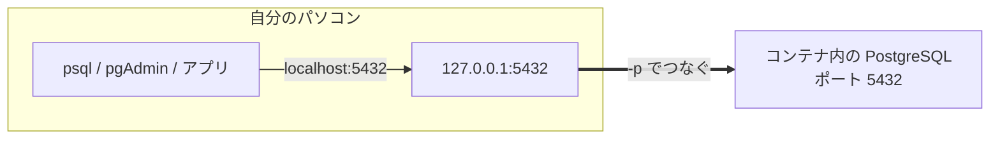
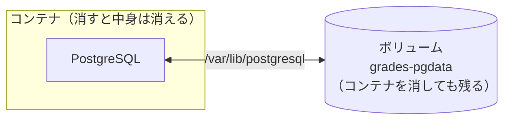

# 03. Dockerの基本操作

[📖 Dockerの目次](./00_はじめに.md#目次) ｜ [🏠 全体の目次](../README.md#目次)

[← 前へ：02 Docker導入](02_Docker導入.md) ｜ [次へ：04 Docker Compose入門 →](04_Docker_Compose入門.md)

## この章のゴール
- `docker run` で PostgreSQL のコンテナを起動し、`psql` で接続できる
- コンテナの一覧・停止・削除・ログの確認ができる
- ポートの公開と、環境変数の渡し方を説明できる
- **ボリューム**を使って、コンテナを消してもデータを残せる

## 目次

1. [PostgreSQL を起動する](#1-postgresql-を起動する)
2. [コンテナを操作する](#2-コンテナを操作する)
3. [コンテナの中で psql を使う](#3-コンテナの中で-psql-を使う)
4. [ポートを公開する](#4-ポートを公開する)
5. [ボリュームでデータを残す](#5-ボリュームでデータを残す)
6. [コマンド一覧](#6-コマンド一覧)
7. [よくあるミス](#7-よくあるミス)

---

## 1. PostgreSQL を起動する

[データベース編 07 章](../データベース/07_PostgreSQL環境構築.md#docker) で見た 1 行を、部品に分けて読み解きます。

```bash
docker run --name grades-pg -e POSTGRES_PASSWORD=postgres -e POSTGRES_DB=grades_db -p 127.0.0.1:5432:5432 -d postgres:18
```

| 部分 | 意味 |
|---|---|
| `docker run` | イメージからコンテナを作って起動する |
| `--name grades-pg` | コンテナに名前を付ける（省略すると、ランダムな名前になる） |
| `-e POSTGRES_PASSWORD=postgres` | **環境変数**を渡す。`postgres` ユーザーのパスワードになる（**必須**） |
| `-e POSTGRES_DB=grades_db` | 起動時に、このデータベースを作る |
| `-p 127.0.0.1:5432:5432` | ポートを公開する（[4 節](#4-ポートを公開する)） |
| `-d` | **バックグラウンド**で動かす（ターミナルを占有しない） |
| `postgres:18` | 使うイメージ（名前:タグ） |

初回は、イメージの取得（pull）が行われます。`Pulling from library/postgres` のように表示されるので、終わるまで待ちます。

> [!NOTE]
> PostgreSQL のイメージの設定項目（環境変数など）は、[Docker Hub の postgres のページ](https://hub.docker.com/_/postgres)にまとまっています（閲覧日：2026-11-19）。

## 2. コンテナを操作する

```bash
docker ps
```

**動いている**コンテナの一覧です。`STATUS` が `Up` なら動いています。停止中も含めて見るときは `docker ps -a` です。

```bash
docker logs grades-pg
```

コンテナのログを見ます。`database system is ready to accept connections` と出れば、起動できています。`-f` を付けると、新しいログを流し続けます（終了は `Ctrl + C`）。

```bash
docker stop grades-pg     # 停止
docker start grades-pg    # 再開
docker rm grades-pg       # 削除（先に停止が必要）
```

> [!WARNING]
> `docker rm` で**コンテナを消すと、中のデータも消えます**（[5 節](#5-ボリュームでデータを残す)のボリュームを使っていない場合）。`docker stop` では消えません。

イメージの一覧と削除は、次のとおりです。

```bash
docker images             # 手元のイメージの一覧
docker rmi postgres:18    # イメージの削除（それを使うコンテナが無いとき）
```

<!-- 📷 SS: ../images/docker/desktop/dkr-03-01-docker-ps.png -->
> 📷 **スクショ指定：`dkr-03-01-docker-ps.png`**
> - 画面：ターミナルで `docker ps` を実行し、`grades-pg` が `Up` で表示された状態
> - 強調：`grades-pg` の行（IMAGE、STATUS、PORTS）を赤枠で囲む

## 3. コンテナの中で psql を使う

PostgreSQL のイメージには、`psql` も入っています。`docker exec` で、**動いているコンテナの中**でコマンドを実行します。

```bash
docker exec -it grades-pg psql -U postgres -d grades_db
```

| 部分 | 意味 |
|---|---|
| `docker exec` | 動いているコンテナの中でコマンドを実行する |
| `-it` | キーボード入力を受け付ける（対話モード）。`psql` のように入力が必要なときに付ける |
| `grades-pg` | 対象のコンテナ名 |
| `psql -U postgres -d grades_db` | 実行するコマンド（データベース編 07 章 4 節と同じ） |

`grades_db=#` と表示されれば、接続できています。`\q` で終了します。コンテナは動いたままです。

> [!TIP]
> パソコンに `psql` や pgAdmin が入っていれば、`localhost:5432` に、いつもの手順で接続できます。ユーザー名は `postgres`、パスワードは `-e` で指定したものです。

SQL ファイルをコンテナに流し込むなら、次のようにします。

```bash
docker exec -i grades-pg psql -U postgres -d grades_db < db/01_schema.sql
```

> [!NOTE]
> `-i` だけ（`-t` なし）にするのは、ファイルの内容を**入力として渡す**ためです。PowerShell では `<` が使えないので、`Get-Content db/01_schema.sql | docker exec -i grades-pg psql -U postgres -d grades_db` と書きます。

## 4. ポートを公開する

コンテナの中は、**パソコンとは別のネットワーク**です。そのままでは、パソコンから `localhost:5432` でつなげません。`-p` で、**パソコン側のポート**と**コンテナ側のポート**をつなぎます。

```
-p 127.0.0.1:5432:5432
   └ パソコン側のアドレス:ポート : コンテナ側のポート
```



すでに別の PostgreSQL が 5432 番を使っているときは、パソコン側だけ変えます（`-p 127.0.0.1:5433:5432`）。接続するときは `localhost:5433` を使います。

> [!CAUTION]
> **セキュリティの視点**：`-p 5432:5432` のように `127.0.0.1:` を**付けない**と、同じネットワークにあるほかのコンピュータからも接続できる状態になります。簡単なパスワードの DB が外から見える状態は、自動で探し回るプログラムに見つかり、データを盗まれたり消されたりするおそれがあります。Docker 公式のドキュメントも、ポートの公開は既定では安全でないと注意しています（[Docker Docs「Port publishing and mapping」](https://docs.docker.com/engine/network/port-publishing/)、閲覧日：2026-11-19）。**学習では必ず `127.0.0.1:` を付けてください。**

## 5. ボリュームでデータを残す

コンテナを削除すると、中のデータは消えます。DB のデータを残すには、**ボリューム**を使います。ボリュームは、コンテナの外に作られる、Docker 管理の保存場所です。

```bash
docker run --name grades-pg -e POSTGRES_PASSWORD=postgres -e POSTGRES_DB=grades_db -p 127.0.0.1:5432:5432 -v grades-pgdata:/var/lib/postgresql -d postgres:18
```

`-v grades-pgdata:/var/lib/postgresql` は、「`grades-pgdata` という名前のボリュームを、コンテナの `/var/lib/postgresql` に取り付ける」という意味です。



コンテナを削除して、同じコマンドでもう一度作ると、**前のデータがそのまま見えます**。

```bash
docker rm -f grades-pg        # -f は、動いたままでも削除する
docker run ...                # 同じ -v を付けて、もう一度作る
```

ボリュームの確認と削除は、次のとおりです。

```bash
docker volume ls                    # ボリュームの一覧
docker volume rm grades-pgdata      # 削除（中のデータも消える）
```

> [!WARNING]
> **PostgreSQL 17 以前**のイメージでは、取り付け先が `/var/lib/postgresql/data` でした。**18 から `/var/lib/postgresql` に変わりました**（データの置き場所が、バージョンごとのフォルダになったため）。古い記事の `-v ...:/var/lib/postgresql/data` をそのまま `postgres:18` で使うと、データが残らなかったり、起動に失敗したりすることがあります（[Docker Hub「postgres」](https://hub.docker.com/_/postgres)、閲覧日：2026-11-19）。また、17 以前のデータが入ったボリュームを 18 で開くことはできません。**ボリューム名も、バージョンごとに分けて**おくと安全です。

> [!NOTE]
> ボリュームのほかに、パソコンのフォルダを直接取り付ける **バインドマウント**（`-v ./db:/docker-entrypoint-initdb.d`）もあります。SQL ファイルを渡すときなどに使います（[04 章](04_Docker_Compose入門.md#4-初期データを自動で入れる)）。

## 6. コマンド一覧

| コマンド | 内容 |
|---|---|
| `docker run` | イメージからコンテナを作って起動する |
| `docker ps` / `docker ps -a` | 動いている / すべてのコンテナの一覧 |
| `docker logs コンテナ名` | ログを見る（`-f` で追いかける） |
| `docker exec -it コンテナ名 コマンド` | 動いているコンテナの中でコマンドを実行する |
| `docker stop` / `start` / `restart` | 停止 / 開始 / 再起動 |
| `docker rm コンテナ名` | コンテナを削除（`-f` で強制） |
| `docker images` / `docker rmi` | イメージの一覧 / 削除 |
| `docker pull イメージ名:タグ` | イメージを取得する |
| `docker volume ls` / `rm` | ボリュームの一覧 / 削除 |
| `docker --help`、`docker run --help` | ヘルプ |

## 7. よくあるミス

| ミス | 原因・対処 |
|---|---|
| `Conflict. The container name "/grades-pg" is already in use` | 同じ名前のコンテナがすでにある。`docker rm grades-pg` で消すか、`docker start grades-pg` で再開する |
| `port is already allocated`、`address already in use` | パソコン側の 5432 番が使用中。パソコンに入れた PostgreSQL が動いているか、別のコンテナが使っている。`-p 127.0.0.1:5433:5432` のように変える |
| コンテナがすぐ終了する（`docker ps` に出ない） | `docker logs コンテナ名` で原因を見る。`POSTGRES_PASSWORD` の付け忘れが多い |
| 環境変数 `POSTGRES_PASSWORD` を変えたのにパスワードが変わらない | ボリュームに**すでにデータがある**と、初回起動時の設定は使われない。ボリュームを消して作り直す（データも消える） |
| `docker rm` したらデータが消えた | ボリュームを使っていなかった。[5 節](#5-ボリュームでデータを残す)のとおり `-v` を付ける |
| `docker exec` で `the input device is not a TTY` | PowerShell や MinTTY で対話モードが使えない。`winpty docker exec -it ...` を試すか、PowerShell / コマンドプロンプトで実行する |
| `docker exec` で `No such container` | コンテナが停止している。`docker ps -a` で確認して `docker start` する |

---

[← 前へ：02 Docker導入](02_Docker導入.md) ｜ [次へ：04 Docker Compose入門 →](04_Docker_Compose入門.md)

[📖 Dockerの目次](./00_はじめに.md#目次) ｜ [🏠 全体の目次](../README.md#目次)
