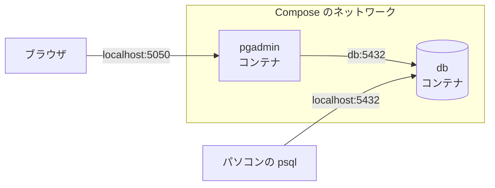

# 04. Docker Compose入門

[📖 Dockerの目次](./00_はじめに.md#目次) ｜ [🏠 全体の目次](../README.md#目次)

[← 前へ：03 Dockerの基本操作](03_Dockerの基本操作.md) ｜ [次へ：05 Dockerfileとイメージ作成 →](05_Dockerfileとイメージ作成.md)

## この章のゴール
- `docker run` の長いオプションを、`compose.yaml` に書き写せる
- PostgreSQL と pgAdmin を、`docker compose up` の 1 コマンドで起動できる
- 初回起動時に、テーブルとサンプルデータを自動で入れられる
- パスワードを `.env` に分け、Git に載せない運用ができる

## 目次

1. [なぜ Compose か](#1-なぜ-compose-か)
2. [compose.yaml を書く](#2-composeyaml-を書く)
3. [起動と停止](#3-起動と停止)
4. [初期データを自動で入れる](#4-初期データを自動で入れる)
5. [pgAdmin で接続する](#5-pgadmin-で接続する)
6. [パスワードを .env に分ける](#6-パスワードを-env-に分ける)
7. [コマンド一覧](#7-コマンド一覧)
8. [よくあるミス](#8-よくあるミス)

---

## 1. なぜ Compose か

[03 章](03_Dockerの基本操作.md)の `docker run` は、オプションが長く、**毎回打ち間違える**ものでした。しかも、DB と pgAdmin の 2 つを動かすなら、コマンドが 2 つ要ります。

**Docker Compose** は、複数のコンテナの設定を、**`compose.yaml` という 1 つのファイル**に書いて、まとめて起動・停止する仕組みです。ファイルを Git で共有すれば、**メンバー全員が同じ環境**を作れます。

| | docker run | Compose |
|---|---|---|
| 設定の書き場所 | コマンドの引数 | `compose.yaml`（Git で共有できる） |
| 複数のコンテナ | 1 つずつ起動 | `docker compose up` で全部 |
| ネットワーク | 自分で作る | 自動で作られる |

## 2. compose.yaml を書く

プロジェクトのフォルダに、`compose.yaml` を作ります。

```yaml
services:
  db:
    image: postgres:18
    environment:
      POSTGRES_DB: grades_db
      POSTGRES_PASSWORD: postgres
    ports:
      - "127.0.0.1:5432:5432"
    volumes:
      - pgdata:/var/lib/postgresql

  pgadmin:
    image: dpage/pgadmin4:latest
    environment:
      PGADMIN_DEFAULT_EMAIL: admin@example.com
      PGADMIN_DEFAULT_PASSWORD: admin
    ports:
      - "127.0.0.1:5050:80"
    depends_on:
      - db

volumes:
  pgdata:
```

[03 章](03_Dockerの基本操作.md)の `docker run` との対応は、次のとおりです。

| `docker run` | `compose.yaml` |
|---|---|
| `--name grades-pg`（コンテナ名） | `services:` の下の名前（`db`）。**この名前が、ほかのコンテナから見たホスト名**になる |
| `postgres:18` | `image: postgres:18` |
| `-e POSTGRES_DB=grades_db` | `environment:` の `POSTGRES_DB: grades_db` |
| `-p 127.0.0.1:5432:5432` | `ports:` の `"127.0.0.1:5432:5432"` |
| `-v grades-pgdata:/var/lib/postgresql` | `volumes:` の `pgdata:/var/lib/postgresql`（下の `volumes:` で宣言） |

> [!NOTE]
> 古い資料にある `version: "3.8"` という行は、現在の Compose では**不要**です（書いても無視されます）。ファイル名も、現在は `compose.yaml` が推奨です（[Docker Docs「Compose file」](https://docs.docker.com/compose/intro/compose-application-model/)、閲覧日：2026-11-19）。

> [!WARNING]
> YAML は、**インデント（字下げ）が意味を持ちます**。スペース 2 個ずつで、揃えてください。タブは使えません。`-` の後ろと、`:` の後ろには、スペースが 1 つ必要です。

> [!CAUTION]
> **セキュリティの視点**：ここでは、動かすことを優先して、パスワードを直接書きました。これは **[6 節](#6-パスワードを-env-に分ける)で `.env` に分けます**。また、ポートは必ず `127.0.0.1:` を付けます（[03 章 4 節](03_Dockerの基本操作.md#4-ポートを公開する)）。

> [!TIP]
> pgAdmin のイメージを `latest` にしているのは、学習用の簡便さのためです。チームで使うときは、バージョンタグを固定して、全員が同じものを使うようにします。

## 3. 起動と停止

`compose.yaml` があるフォルダで、次を実行します。

```bash
docker compose up -d
```

`-d` は、バックグラウンドで動かす指定です。初回は、イメージの取得のため時間がかかります。

```bash
docker compose ps         # 起動しているサービスの一覧
docker compose logs db    # db のログ（-f で追いかける）
docker compose stop       # 停止（コンテナは残る）
docker compose down       # 停止して、コンテナとネットワークを削除
```

> [!WARNING]
> `docker compose down` は、**コンテナを削除しますが、ボリューム（データ）は残します**。`docker compose down -v` と `-v` を付けると、**ボリュームも消えて、データが全部なくなります**。付けるのは、「最初からやり直したい」ときだけです。

<!-- 📷 SS: ../images/docker/desktop/dkr-04-01-containers-view.png -->
> 📷 **スクショ指定：`dkr-04-01-containers-view.png`**
> - 画面：Docker Desktop の「Containers」画面で、Compose のプロジェクト（フォルダ名）の下に `db` と `pgadmin` が動いている状態
> - 強調：プロジェクト名、`db` と `pgadmin` の行、STATUS（Running）を赤枠で囲む

## 4. 初期データを自動で入れる

PostgreSQL のイメージには、**初回起動時に、決まったフォルダの SQL を自動で実行する**機能があります。フォルダは `/docker-entrypoint-initdb.d` です。ここに、[データベース編](../データベース/07_PostgreSQL環境構築.md#7-サンプルの-sql-を実行する)で使った `01_schema.sql` と `02_seed.sql` を取り付けます。

```yaml
  db:
    image: postgres:18
    # ...（省略）
    volumes:
      - pgdata:/var/lib/postgresql
      - ../database/db/01_schema.sql:/docker-entrypoint-initdb.d/01_schema.sql:ro
      - ../database/db/02_seed.sql:/docker-entrypoint-initdb.d/02_seed.sql:ro
```

| 部分 | 意味 |
|---|---|
| `../database/db/01_schema.sql` | パソコン側のファイル（サンプルリポジトリの `database/db/`）。`compose.yaml` は `docker/` にあるので、1 つ上の階層から指す |
| `/docker-entrypoint-initdb.d/01_schema.sql` | コンテナ側の置き場所 |
| `:ro` | 読み取り専用（コンテナから書き換えられない） |

SQL は、**ファイル名の順**（`01` → `02`）に実行されます。`POSTGRES_DB: grades_db` で作られたデータベースの中で実行されます。

> [!IMPORTANT]
> この自動実行は、**データフォルダが空のとき（初回起動）だけ**です。2 回目以降は、ボリュームにデータがあるので、SQL は**実行されません**。SQL を直したあと、もう一度流したいときは、`docker compose down -v` でボリュームを消してから `up` します（データは消えます）。

## 5. pgAdmin で接続する

ブラウザで `http://localhost:5050` を開きます。`compose.yaml` に書いたメールアドレスとパスワードでログインします。

<!-- 📷 SS: ../images/docker/desktop/dkr-04-02-pgadmin-login.png -->
> 📷 **スクショ指定：`dkr-04-02-pgadmin-login.png`**
> - 画面：ブラウザで `localhost:5050` を開いた pgAdmin のログイン画面
> - 強調：アドレスバーの `localhost:5050` を赤枠で囲む

サーバーの登録は、[データベース編 07 章 5 節](../データベース/07_PostgreSQL環境構築.md#5-pgadmin-で接続する)と同じ手順です。ただし、**Host name/address だけ違います**。

| 項目 | 値 |
|---|---|
| Host name/address | **`db`**（`localhost` ではない） |
| Port | `5432` |
| Maintenance database | `grades_db` |
| Username | `postgres` |
| Password | `compose.yaml` に書いたもの |

`localhost` ではなく `db` と書く理由は、**pgAdmin もコンテナの中で動いている**からです。コンテナにとっての `localhost` は、**そのコンテナ自身**です。Compose は、サービス名（`db`）を、ほかのコンテナから見たホスト名として使えるようにしてくれます。



<!-- 📷 SS: ../images/docker/desktop/dkr-04-03-pgadmin-register.png -->
> 📷 **スクショ指定：`dkr-04-03-pgadmin-register.png`**
> - 画面：pgAdmin の「Register - Server」ダイアログの Connection タブ
> - 強調：Host name/address に `db` と入力した欄を赤枠で囲む（パスワード欄は空欄にする）

> [!TIP]
> パソコンに入れた psql や、IDE のデータベースツール（パソコン側で動くもの）は、これまでどおり `localhost:5432` につなぎます。**どこから見ているか**で、ホスト名が変わります。

## 6. パスワードを .env に分ける

`compose.yaml` にパスワードを直接書くと、**Git に載ってしまいます**。パスワードは、`.env` というファイルに分けます。Compose は、同じフォルダの `.env` を自動で読み込みます。

`.env`（Git に**載せない**）：

```
POSTGRES_PASSWORD=ここに自分で決めたパスワード
PGADMIN_PASSWORD=ここに別のパスワード
```

`compose.yaml` では、`${変数名}` で参照します。

```yaml
services:
  db:
    environment:
      POSTGRES_DB: grades_db
      POSTGRES_PASSWORD: ${POSTGRES_PASSWORD}
  pgadmin:
    environment:
      PGADMIN_DEFAULT_EMAIL: admin@example.com
      PGADMIN_DEFAULT_PASSWORD: ${PGADMIN_PASSWORD}
```

そして、`.gitignore` に `.env` を加えます。

```
.env
```

代わりに、**値を空にした見本** `.env.example` を Git に載せます。新しいメンバーは、これをコピーして `.env` を作り、パスワードを入れます。

`.env.example`（Git に**載せる**）：

```
POSTGRES_PASSWORD=
PGADMIN_PASSWORD=
```

```bash
cp .env.example .env     # Windows の PowerShell なら Copy-Item .env.example .env
```

> [!CAUTION]
> **セキュリティの視点**：`.env` を **一度でも Git にコミットすると、あとで消しても履歴に残ります**。GitHub に push したあとでは、パスワードを変えるしかありません。**`.gitignore` に `.env` を書いてから**、`.env` を作ってください。また、`.env.example` には**本物のパスワードを書きません**（見本として、`changeme` のような値も避け、空にします）。`${POSTGRES_PASSWORD}` が空のままだと、Compose は警告を出します。

> [!NOTE]
> アプリ側（Spring Boot）で `DB_PASSWORD` を環境変数で渡す方法は、[4層アーキテクチャ編 07 章 4 節](../4層アーキテクチャ/07_Spring_Bootで書き直す.md#4-設定ファイル)にあります。考え方は同じです。

## 7. コマンド一覧

| コマンド | 内容 |
|---|---|
| `docker compose up -d` | 全サービスを、バックグラウンドで起動 |
| `docker compose ps` | サービスの状態 |
| `docker compose logs -f サービス名` | ログを追いかける |
| `docker compose exec db psql -U postgres -d grades_db` | `db` の中で psql を実行 |
| `docker compose stop` / `start` | 停止 / 再開 |
| `docker compose down` | コンテナとネットワークを削除（データは残る） |
| `docker compose down -v` | 上に加えて、**ボリューム（データ）も削除** |
| `docker compose config` | `compose.yaml` の書き方と、`.env` の展開結果を確認する |

## 8. よくあるミス

| ミス | 原因・対処 |
|---|---|
| `yaml: line N: mapping values are not allowed` など、YAML のエラー | インデントやスペースの間違い。`docker compose config` で、場所を確認する |
| `no configuration file provided: not found` | `compose.yaml` のあるフォルダにいない。`cd` で移動する |
| `The "POSTGRES_PASSWORD" variable is not set` の警告 | `.env` が無い、または変数名の違い。`.env.example` から作る |
| SQL を直したのに、反映されない | 初期化は**初回だけ**。`docker compose down -v` で、ボリュームを消して作り直す |
| pgAdmin から `localhost` で接続できない | pgAdmin はコンテナの中にいる。Host には **`db`**（サービス名）を書く |
| `localhost:5050` が開かない | `docker compose ps` で `pgadmin` が動いているか確認する。ポート番号の確認もする |
| pgAdmin の起動時に、メールアドレスのエラー | `PGADMIN_DEFAULT_EMAIL` に、`.local` など使えないドメインを使っている。`example.com` のような一般的な形にする |
| `down -v` で、データが消えた | `-v` はボリュームも消す。データを残したいときは、付けない |
| 17 以前のデータを使っていたら、18 が起動しない | データの形式とフォルダが違う（[03 章 5 節](03_Dockerの基本操作.md#5-ボリュームでデータを残す)）。学習用なら、新しいボリュームで作り直す |

---

[← 前へ：03 Dockerの基本操作](03_Dockerの基本操作.md) ｜ [次へ：05 Dockerfileとイメージ作成 →](05_Dockerfileとイメージ作成.md)

[📖 Dockerの目次](./00_はじめに.md#目次) ｜ [🏠 全体の目次](../README.md#目次)
