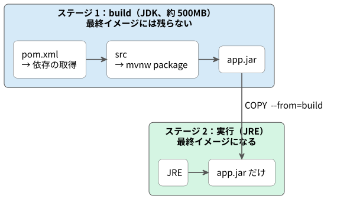

# 05. Dockerfileとイメージ作成

[📖 Dockerの目次](./00_はじめに.md#目次) ｜ [🏠 全体の目次](../README.md#目次)

[← 前へ：04 Docker Compose入門](04_Docker_Compose入門.md) ｜ [次へ：06 アプリとDBをComposeで動かす →](06_アプリとDBをComposeで動かす.md)

## この章のゴール
- Dockerfile の主な命令を読める
- **レイヤー**とキャッシュの仕組みを説明できる
- Spring Boot アプリを、**マルチステージビルド**でイメージにできる
- `.dockerignore` と、非 root ユーザーで動かす理由を説明できる
- Vaadin アプリで、**本番ビルド**が必要な理由を説明できる

## 目次

1. [Dockerfile とは](#1-dockerfile-とは)
2. [主な命令](#2-主な命令)
3. [レイヤーとキャッシュ](#3-レイヤーとキャッシュ)
4. [Spring Boot の Dockerfile](#4-spring-boot-の-dockerfile)
5. [ビルドして動かす](#5-ビルドして動かす)
6. [.dockerignore](#6-dockerignore)
7. [Vaadin の場合](#7-vaadin-の場合)
8. [よくあるミス](#8-よくあるミス)

---

## 1. Dockerfile とは

[04 章](04_Docker_Compose入門.md)では、**すでにあるイメージ**（`postgres:18`）を使いました。自分で作ったアプリを動かすには、**自分のイメージ**が要ります。その作り方を書いたファイルが **Dockerfile** です。


Dockerfile は、「ベースになるイメージから始めて、ファイルを入れて、コマンドを実行して、起動方法を決める」という**手順書**です。

## 2. 主な命令

| 命令 | 意味 | 例 |
|---|---|---|
| `FROM` | ベースにするイメージ。**最初に必ず書く** | `FROM eclipse-temurin:25-jre` |
| `WORKDIR` | 以降の作業フォルダ（なければ作る） | `WORKDIR /app` |
| `COPY` | パソコンのファイルを、イメージの中へコピー | `COPY pom.xml .` |
| `RUN` | **イメージを作る時に**コマンドを実行 | `RUN ./mvnw package` |
| `EXPOSE` | アプリが使うポートの**メモ**（公開はしない） | `EXPOSE 8080` |
| `USER` | 以降を実行するユーザー | `USER app` |
| `ENTRYPOINT` | **コンテナが起動した時に**実行するコマンド | `ENTRYPOINT ["java", "-jar", "app.jar"]` |

> [!NOTE]
> `RUN` は「イメージを作る時」、`ENTRYPOINT` は「コンテナを動かす時」です。混同しやすいので、注意してください。`EXPOSE` は説明用で、実際にパソコンから見えるようにするのは、`-p` や Compose の `ports:` です。

## 3. レイヤーとキャッシュ

Dockerfile の**命令 1 つにつき、イメージの 1 層**（レイヤー）ができます。ビルドは、前回と**同じ内容の命令は、キャッシュを使って飛ばします**。ただし、ある層が変わると、**それより後ろの層は、すべて作り直し**です。

そのため、**変わりにくいものを先に、変わりやすいものを後に**書きます。

| 順序 | 内容 | 変更の頻度 |
|---|---|---|
| 先 | `pom.xml` をコピーして、依存ライブラリを取得 | 低い（依存の追加時だけ） |
| 後 | `src/` をコピーして、ビルド | **高い**（コードを書くたび） |

こうすると、コードだけ変えたときは、時間のかかる**依存ライブラリの取得を飛ばせます**。

## 4. Spring Boot の Dockerfile

Java アプリは、ビルドに **JDK**（開発キット）が必要ですが、実行には **JRE**（実行環境）だけで足ります。ビルド用と実行用で**イメージを分ける**のが **マルチステージビルド**です。最終的なイメージには、JDK やソースコードが入りません。

```dockerfile
# ---- ステージ 1：ビルド ----
FROM eclipse-temurin:25-jdk AS build
WORKDIR /workspace

# 変わりにくいものを先に（キャッシュを効かせる）
COPY mvnw pom.xml ./
COPY .mvn .mvn
RUN ./mvnw dependency:go-offline

# 変わりやすいものを後に
COPY src src
RUN ./mvnw -DskipTests package

# ---- ステージ 2：実行 ----
FROM eclipse-temurin:25-jre
WORKDIR /app

# 一般ユーザーを作って、そのユーザーで動かす
RUN useradd --system --no-create-home app
USER app

COPY --from=build /workspace/target/*.jar app.jar

EXPOSE 8080
ENTRYPOINT ["java", "-jar", "app.jar"]
```



| 部分 | 意味 |
|---|---|
| `FROM ... AS build` | このステージに `build` という名前を付ける |
| `RUN ./mvnw dependency:go-offline` | 依存ライブラリだけを先に取得する（キャッシュされる層になる） |
| `-DskipTests` | イメージのビルド中はテストを飛ばす（テストは別の場で実行する。品質編で扱う予定） |
| `COPY --from=build ...` | 前のステージで作った `jar` だけを、持ってくる |
| `useradd` と `USER app` | 一般ユーザーで実行する（下の注意） |

> [!CAUTION]
> **セキュリティの視点**：コンテナの中のプロセスは、何も指定しないと **root（最高権限）** で動きます。アプリに脆弱性があって乗っ取られたとき、root だと被害が大きくなります。**一般ユーザーで動かす**（`USER`）のが基本です。

> [!NOTE]
> ベースイメージ（`eclipse-temurin`）のタグは、Java のバージョンに合わせます。この資料は Java 25 を使います。タグの種類は [Docker Hub の eclipse-temurin](https://hub.docker.com/_/eclipse-temurin) で確認します（閲覧日：2026-11-19）。**`latest` は使わず、バージョンを固定**します。

## 5. ビルドして動かす

Dockerfile のあるフォルダ（サンプルの `architecture/step3-spring/`）で、イメージを作ります。

```bash
docker build -t grades-app:1.0 .
```

| 部分 | 意味 |
|---|---|
| `-t grades-app:1.0` | イメージの名前:タグ |
| `.` | ビルドに使うフォルダ（**ビルドコンテキスト**。ここにあるファイルが `COPY` の対象になる） |

動かしてみます。DB はまだ用意していないので、ここでは**起動のログだけ**確認します（DB が無いので、**必ず**起動に失敗して止まります。**止まるのが正常**です。DB との接続は、[06 章](06_アプリとDBをComposeで動かす.md)）。

```bash
docker run --rm -p 127.0.0.1:8080:8080 grades-app:1.0
```

`--rm` は、停止したときに、コンテナを自動で削除する指定です。

## 6. .dockerignore

`docker build` は、`.` の中身を**まるごと** Docker に送ります。不要なファイルが多いと、遅くなり、**秘密情報が混ざる**おそれがあります。**`.dockerignore`** に書いたファイルは、送られません（`.gitignore` と同じ考え方です）。

```
target/
.git/
.idea/
.vscode/
.env
*.md
```

> [!CAUTION]
> **セキュリティの視点**：`COPY . .` のように**すべてコピー**する Dockerfile で、`.env` が `.dockerignore` に無いと、**パスワードがイメージの中に入ります**。イメージは、あとで共有・公開することがあるので、**秘密情報は、イメージに入れず、実行時に環境変数で渡します**（[06 章](06_アプリとDBをComposeで動かす.md#3-設定を環境変数で上書きする)）。

## 7. Vaadin の場合

Vaadin を使うアプリでは、**本番用のビルド**が必要です。IDE で動かす開発モードは、画面のためのファイルを実行時に作るため、**本番には向きません**。

- Maven では、`production` プロファイルを付けてビルドします（`./mvnw -Pproduction package`）。画面用の JavaScript を、**ビルド時にまとめて最適化**します
- ビルド中に、**Node.js** が自動でダウンロードされるため、ビルドに時間がかかります
- Dockerfile の `RUN` 行は、次のように変えます

```dockerfile
RUN ./mvnw -Pproduction -DskipTests package
```

- `production` プロファイルは、プロジェクトの `pom.xml` に定義されている必要があります（Vaadin の公式スターターには、含まれています）。無い場合は、公式ドキュメントに従って追加します

> [!NOTE]
> 手順の詳細や、バージョンによる違いは、[Vaadin Docs「Production Build」](https://vaadin.com/docs/latest/production/production-build)を確認してください（閲覧日：2026-11-19）。Vaadin 版の Dockerfile は、サンプルの `frontend/grades-vaadin/Dockerfile` にあります（`-Pproduction` でビルドします）。Compose で動かすには、`docker/compose.vaadin.yaml` を使います。

## 8. よくあるミス

| ミス | 原因・対処 |
|---|---|
| `COPY failed: file not found` | `COPY` の元が、ビルドコンテキスト（`.`）の外にある、または `.dockerignore` で除外されている |
| コードを 1 行直しただけで、毎回依存ライブラリを取得し直す | `COPY . .` を先に書いている。`pom.xml` → 依存の取得 → `src` の順にする |
| `./mvnw: Permission denied` | `mvnw` に実行権限が無い（Windows で作ったとき）。`RUN chmod +x mvnw` を足すか、`git update-index --chmod=+x mvnw` |
| `./mvnw: not found`、`bad interpreter` | `mvnw` の改行コードが CRLF になっている。`.gitattributes` で `mvnw text eol=lf` を指定する |
| `no main manifest attribute` | Spring Boot のプラグインで作った `jar` ではない。`pom.xml` に `spring-boot-maven-plugin` があるか確認する |
| 実行すると、コンテナがすぐ終了する | `docker logs` を見る。DB に接続できない、ポートが使用中などが多い |
| イメージが巨大 | 1 つのステージで JDK のまま動かしている。マルチステージにする |
| `ENTRYPOINT` を文字列で書いたら、停止の合図が効かない | `["java", "-jar", "app.jar"]` のように**配列**で書く（シェルを経由しない） |

---

[← 前へ：04 Docker Compose入門](04_Docker_Compose入門.md) ｜ [次へ：06 アプリとDBをComposeで動かす →](06_アプリとDBをComposeで動かす.md)

[📖 Dockerの目次](./00_はじめに.md#目次) ｜ [🏠 全体の目次](../README.md#目次)
