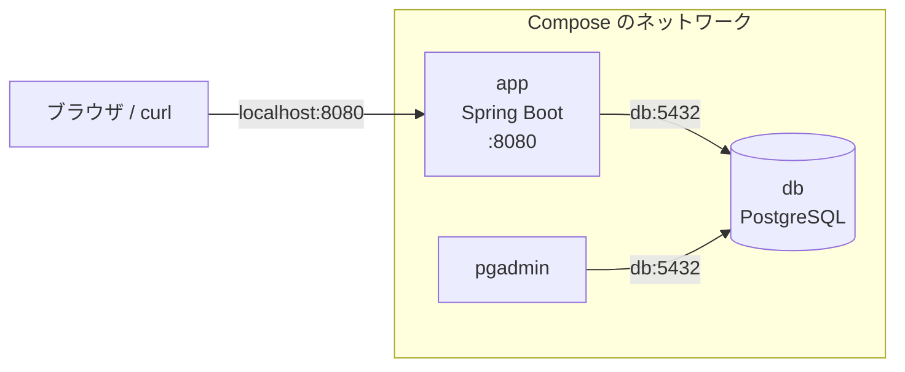
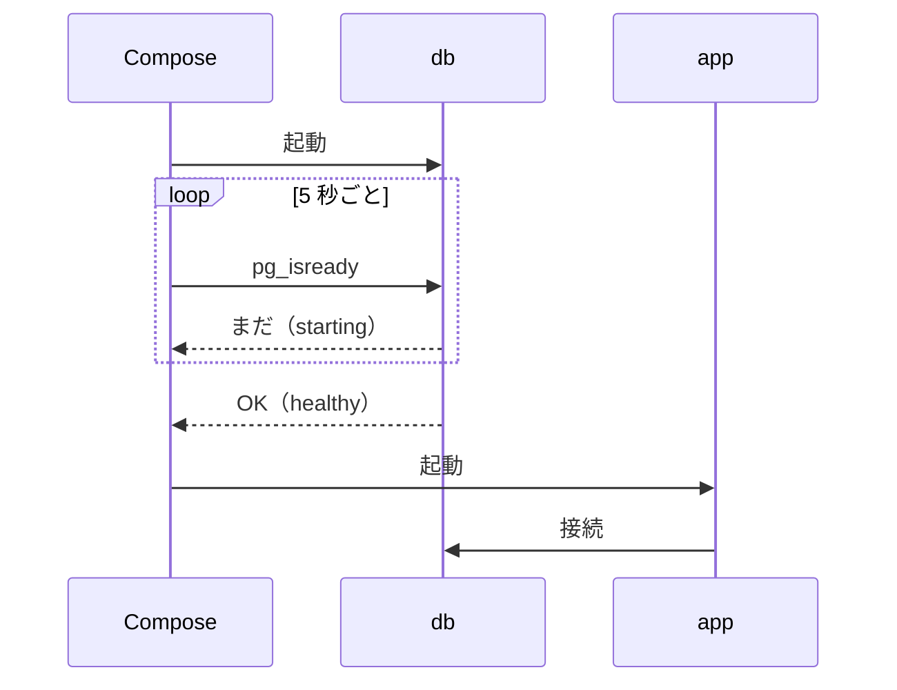

# 06. アプリとDBをComposeで動かす

[📖 Dockerの目次](./00_はじめに.md#目次) ｜ [🏠 全体の目次](../README.md#目次)

[← 前へ：05 Dockerfileとイメージ作成](05_Dockerfileとイメージ作成.md) ｜ [次へ：07 チーム開発での使い方 →](07_チーム開発での使い方.md)

## この章のゴール
- `compose.yaml` に、アプリ（`app`）のサービスを加えられる
- コンテナの中から DB へは、`localhost` ではなく**サービス名**で接続すると説明できる
- `application.properties` の値を、**環境変数で上書き**できる
- DB の起動を待ってから、アプリを起動できる（`healthcheck`）

## 目次

1. [全体像](#1-全体像)
2. [app サービスを加える](#2-app-サービスを加える)
3. [設定を環境変数で上書きする](#3-設定を環境変数で上書きする)
4. [DB の起動を待つ](#4-db-の起動を待つ)
5. [起動して確かめる](#5-起動して確かめる)
6. [アプリだけ作り直す](#6-アプリだけ作り直す)
7. [よくあるミス](#7-よくあるミス)

---

## 1. 全体像

[04 章](04_Docker_Compose入門.md)の `db` と `pgadmin` に、**`app`** を加えます。



アプリのコードは、**変えません**。変えるのは、**接続先の設定だけ**です。

| | 接続先 |
|---|---|
| IDE で動かしたアプリ → Compose の DB | `jdbc:postgresql://localhost:5432/grades_db` |
| **コンテナの**アプリ → Compose の DB | `jdbc:postgresql://db:5432/grades_db` |

コンテナにとっての `localhost` は、**そのコンテナ自身**です（[04 章 5 節](04_Docker_Compose入門.md#5-pgadmin-で接続する)）。アプリのコンテナから `localhost:5432` を見ても、DB はいません。

## 2. app サービスを加える

サンプルでは、`compose.yaml` を**汚さない**ために、アプリの設定を別ファイル `compose.app.yaml` に分けます。`compose.yaml` に**重ねて**使います。

`compose.app.yaml`：

```yaml
services:
  app:
    build: ./step3-spring
    environment:
      SPRING_DATASOURCE_URL: jdbc:postgresql://db:5432/grades_db
      SPRING_DATASOURCE_USERNAME: postgres
      SPRING_DATASOURCE_PASSWORD: ${POSTGRES_PASSWORD}
    ports:
      - "127.0.0.1:8080:8080"
    depends_on:
      db:
        condition: service_healthy
```

| 部分 | 意味 |
|---|---|
| `build: ./step3-spring` | イメージを、このフォルダの Dockerfile から作る（[05 章](05_Dockerfileとイメージ作成.md)）。`image:` の代わりに書く |
| `environment:` | アプリに渡す環境変数（[3 節](#3-設定を環境変数で上書きする)） |
| `ports:` | `127.0.0.1:8080:8080`。ブラウザなどから見える（パソコン側だけ） |
| `depends_on` | `db` が**健康**になるまで、起動を待つ（[4 節](#4-db-の起動を待つ)） |

2 つのファイルを重ねて起動します。

```bash
docker compose -f compose.yaml -f compose.app.yaml up -d --build
```

`-f` を複数並べると、**後ろのファイルが、前のファイルに足される**形で合成されます。`--build` は、イメージを作り直す指定です。

> [!TIP]
> 毎回 `-f` を 2 つ打つのは面倒です。`.env` に `COMPOSE_FILE=compose.yaml:compose.app.yaml` と書くと、`docker compose up -d --build` だけで、2 つが合成されます（Windows では区切りが `;` です）。

## 3. 設定を環境変数で上書きする

`application.properties` には、[4層アーキテクチャ編 07 章](../4層アーキテクチャ/07_Spring_Bootで書き直す.md#4-設定ファイル)で、次のように書きました。

```properties
spring.datasource.url=jdbc:postgresql://localhost:5432/grades_db
spring.datasource.username=postgres
spring.datasource.password=${DB_PASSWORD}
```

Spring Boot には、**環境変数で、設定ファイルの値を上書きできる**決まりがあります。プロパティ名を、**大文字にして、`.` を `_` に変える**と、その名前の環境変数が優先されます。

| `application.properties` | 環境変数 |
|---|---|
| `spring.datasource.url` | `SPRING_DATASOURCE_URL` |
| `spring.datasource.username` | `SPRING_DATASOURCE_USERNAME` |
| `spring.datasource.password` | `SPRING_DATASOURCE_PASSWORD` |
| `server.port` | `SERVER_PORT` |

これで、**同じ jar（同じイメージ）**のまま、IDE では `localhost`、Compose では `db` と、**環境ごとに接続先を切り替えられます**。設定を変えるたびに、イメージを作り直す必要はありません。

> [!NOTE]
> 上書きの優先順位や、書き方の詳細は、[Spring Boot Docs「Externalized Configuration」](https://docs.spring.io/spring-boot/reference/features/external-config.html)にあります（閲覧日：2026-11-19）。

> [!CAUTION]
> **セキュリティの視点**：パスワードは、**イメージの中にも、`compose.yaml` にも書きません**。`.env` から `${POSTGRES_PASSWORD}` で渡します（[04 章 6 節](04_Docker_Compose入門.md#6-パスワードを-env-に分ける)）。`docker inspect` や、環境変数の一覧には、値が見えるので、**コンテナに入れる人を限る**ことも大切です（[08 章](08_本番デプロイの考え方.md#3-秘密情報の扱い)）。

## 4. DB の起動を待つ

`depends_on` だけでは、`db` の**コンテナが起動した**ことしか待ちません。PostgreSQL が**接続を受け付けるまで**には、さらに数秒かかります。その間にアプリが接続しようとして、**失敗して終了する**ことがあります。

そこで、`db` に **ヘルスチェック**を付けます。「`pg_isready` が成功したら、健康」と定義します。

`compose.yaml` の `db` に追加：

```yaml
  db:
    image: postgres:18
    # ...（省略）
    healthcheck:
      test: ["CMD-SHELL", "pg_isready -U postgres -d grades_db"]
      interval: 5s
      timeout: 3s
      retries: 10
```

| 部分 | 意味 |
|---|---|
| `test` | 健康かを調べるコマンド（`pg_isready` は、PostgreSQL の標準ツール） |
| `interval` | 何秒ごとに調べるか |
| `retries` | 何回失敗したら、不健康とするか |

`app` の `depends_on` で `condition: service_healthy` と書くと、**`db` が健康になってから、`app` が起動**します。



## 5. 起動して確かめる

```bash
docker compose -f compose.yaml -f compose.app.yaml up -d --build
docker compose ps
```

`STATUS` が、`db` は `healthy`、`app` は `running`（`Up`）になれば成功です。アプリのログを見ます。

```bash
docker compose logs -f app
```

`Started GradesApplication` と出れば、起動しています。[4層アーキテクチャ編 07 章 10 節](../4層アーキテクチャ/07_Spring_Bootで書き直す.md#10-動かして確かめる)の `curl` で、確かめます。

```bash
curl http://localhost:8080/students
```

学生の一覧が返れば、**コンテナのアプリが、コンテナの DB にアクセスできています**。

<!-- 📷 SS: ../images/docker/desktop/dkr-06-01-compose-app.png -->
> 📷 **スクショ指定：`dkr-06-01-compose-app.png`**
> - 画面：Docker Desktop の「Containers」画面で、`db`（healthy）、`pgadmin`、`app` の 3 つが動いている状態
> - 強調：3 つのサービス名と、`db` の healthy の表示を赤枠で囲む

## 6. アプリだけ作り直す

コードを直したあと、**`app` だけ**作り直して起動し直すには、サービス名を付けます。DB は、そのまま動き続けます。

```bash
docker compose -f compose.yaml -f compose.app.yaml up -d --build app
```

> [!TIP]
> 開発中に何度もコードを直すときは、毎回イメージを作り直すと遅くなります。**DB だけ Compose、アプリは IDE で動かす**やり方が便利です（[07 章](07_チーム開発での使い方.md#1-2-つの使い方)）。

## 7. よくあるミス

| ミス | 原因・対処 |
|---|---|
| `Connection refused`（アプリのログ） | 接続先が `localhost` のまま。`SPRING_DATASOURCE_URL` を、`db` を指すようにする |
| `password authentication failed` | `.env` の `POSTGRES_PASSWORD` が、**DB の初回作成時**と違う。ボリュームのデータは、最初のパスワードで作られている。`down -v` で作り直す |
| `UnknownHostException: db` | `app` と `db` が、**別の Compose プロジェクト**にいる。2 つの `compose` ファイルを、**同じコマンドで**重ねて起動する |
| 環境変数を変えたのに、反映されない | `up -d` を、もう一度実行する（設定が変わったコンテナだけ、作り直される）。イメージの中身を変えたときは `--build` を付ける |
| `app` が `db` より先に起動して失敗する | `healthcheck` と `condition: service_healthy` が無い |
| 8080 番ポートが使用中 | IDE で動かしたアプリが、まだ動いている。停止する |
| `no such service: app` | `-f compose.app.yaml` を付け忘れた |
| `compose.app.yaml` の変更が `compose.yaml` と食い違う | `docker compose -f compose.yaml -f compose.app.yaml config` で、**合成した結果**を確認する |

---

[← 前へ：05 Dockerfileとイメージ作成](05_Dockerfileとイメージ作成.md) ｜ [次へ：07 チーム開発での使い方 →](07_チーム開発での使い方.md)

[📖 Dockerの目次](./00_はじめに.md#目次) ｜ [🏠 全体の目次](../README.md#目次)
