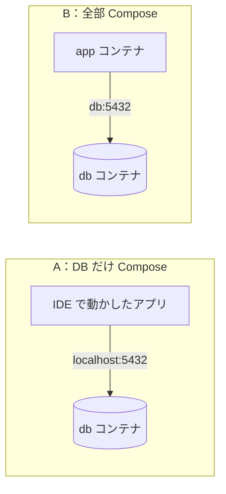

# 07. チーム開発での使い方

[📖 Dockerの目次](./00_はじめに.md#目次) ｜ [🏠 全体の目次](../README.md#目次)

[← 前へ：06 アプリとDBをComposeで動かす](06_アプリとDBをComposeで動かす.md) ｜ [次へ：08 本番デプロイの考え方 →](08_本番デプロイの考え方.md)

## この章のゴール
- 「DB だけ Compose」と「全部 Compose」を、場面で使い分けられる
- Git に**載せるもの・載せないもの**を区別できる
- データのリセットと、ディスクの掃除ができる
- 困ったときの戻り方が分かる

## 目次

1. [2 つの使い方](#1-2-つの使い方)
2. [Git に載せるもの・載せないもの](#2-git-に載せるもの載せないもの)
3. [新しいメンバーの参加手順](#3-新しいメンバーの参加手順)
4. [データのリセット](#4-データのリセット)
5. [ディスクの掃除](#5-ディスクの掃除)
6. [チームで決めておくこと](#6-チームで決めておくこと)
7. [よくあるミス](#7-よくあるミス)

---

## 1. 2 つの使い方

アプリを書いている最中と、動作を確認するときでは、向いたやり方が違います。

| | A：DB だけ Compose | B：全部 Compose |
|---|---|---|
| アプリの実行 | **IDE**（▶ ボタン）で動かす | `app` コンテナで動かす |
| DB の実行 | Compose の `db` | Compose の `db` |
| 接続先 | `localhost:5432` | `db:5432` |
| コードの反映 | 速い（IDE が再起動するだけ） | 遅い（イメージを作り直す） |
| デバッグ | IDE のデバッガをそのまま使える | 設定が要る |
| 向く場面 | **普段の開発** | 本番に近い形での動作確認、他の人への見せ方 |



**普段は A**、「マージする前に、Docker でも動くか」を確かめるときに **B** を使うのがおすすめです。A のときは、`docker compose up -d db`（`db` だけ起動）が便利です。

```bash
docker compose up -d db          # DB だけ起動（A）
docker compose up -d pgadmin     # 必要なら pgAdmin も
```

> [!NOTE]
> A では、`application.properties` の `localhost:5432` のまま動きます（[4層アーキテクチャ編 07 章](../4層アーキテクチャ/07_Spring_Bootで書き直す.md#4-設定ファイル)）。パスワードは、環境変数 `DB_PASSWORD` に、`.env` と同じ値を設定します。

## 2. Git に載せるもの・載せないもの

| 載せる | 載せない |
|---|---|
| `compose.yaml`、`compose.app.yaml` | **`.env`**（パスワードが入る） |
| `Dockerfile`、`.dockerignore` | ビルドの成果物（`target/`） |
| `.env.example`（**値は空**） | Docker のボリュームの中身（Git の管理外） |
| `db/01_schema.sql`、`db/02_seed.sql` | |

> [!CAUTION]
> **セキュリティの視点**：`.env` を載せない仕組みは、**`.gitignore` に書いて、はじめて働きます**。新しくリポジトリを作ったときは、`.env` を作る**前**に、`.gitignore` を確認してください。うっかりコミットしたときは、**すぐにパスワードを変え**、メンターに相談します（履歴から消すのは、あとからでは大変です）。

## 3. 新しいメンバーの参加手順

Docker の利点は、**手順が短い**ことです。新しいメンバーは、次のとおりです。

1. [02 章](02_Docker導入.md)のとおり、Docker Desktop を入れる
2. リポジトリを clone する（[Git 資料 00](../Git/00_Git導入・初期設定.md)）
3. `.env.example` をコピーして `.env` を作り、パスワードを入れる（**パスワードは、本人が決める**。チームで共有する必要はない）
4. `docker compose up -d`
5. `http://localhost:5050`（pgAdmin）、または `psql` で、DB を確認する

この手順を、サンプルリポジトリの `README` に書いておくと、**質問が減ります**。

## 4. データのリセット

DB のデータを、**最初の状態に戻したい**ことがあります（テストで汚した、SQL を直したなど）。

```bash
docker compose down -v      # コンテナとボリューム（データ）を削除
docker compose up -d        # もう一度作る → 初期化 SQL が、もう一度流れる
```

> [!WARNING]
> `down -v` は、**そのプロジェクトのボリュームを、すべて消します**。ほかの大事なデータを、同じ Compose に入れていないか、確認してから実行してください。

[04 章 4 節](04_Docker_Compose入門.md#4-初期データを自動で入れる)のとおり、初期化 SQL は**初回起動時だけ**なので、このやり方でリセットします。

## 5. ディスクの掃除

Docker を使い続けると、**使わないイメージやコンテナ**が増えて、ディスクを圧迫します。

```bash
docker system df            # 何が、どれだけ容量を使っているか
docker image prune          # タグの無い（使われていない）イメージを削除
docker container prune      # 停止中のコンテナを削除
```

| コマンド | 消えるもの | 注意 |
|---|---|---|
| `docker image prune` | タグの無いイメージ | 安全 |
| `docker container prune` | **停止中**のコンテナ | 停止中の DB コンテナも消える（ボリュームは残る） |
| `docker volume prune` | **どのコンテナからも使われていない**ボリューム | **DB のデータが消えうる**。普段は実行しない |
| `docker system prune -a` | 使っていないものすべて | 広範囲に消える。理解してから実行する |

> [!CAUTION]
> `docker volume prune` と `docker system prune --volumes` は、**停止中の DB のデータ**も消します。コンテナを `stop` しているだけのときは、ボリュームが「使われていない」と判断されます。**よく分からないうちは、実行しない**でください。

## 6. チームで決めておくこと

| 決めること | 例 |
|---|---|
| イメージのバージョン | `postgres:18`、`eclipse-temurin:25-jre` のように**固定**し、更新は PR で行う |
| ポート番号 | 5432、5050、8080。**パソコン側は `127.0.0.1:` を付ける**ことを、全員の約束にする |
| パスワード | 各自が `.env` に設定（共有しない）。**学習用**の簡単なものも、外に公開しない |
| 使い方 | 普段は A（DB だけ Compose）、マージ前に B で確認する、など |
| 手順書の場所 | サンプルの `README` に、起動・リセットの手順を書く |

## 7. よくあるミス

| ミス | 原因・対処 |
|---|---|
| 他のメンバーと、DB の中身が違う | 各自のボリュームは別物。**SQL（`db/`）を Git で共有**し、変更はそこに書く。手で直した内容は、共有されない |
| スキーマを変えたのに、他のメンバーの DB に反映されない | 初期化 SQL は初回だけ。**`down -v` で作り直してもらう**か、マイグレーション（Flyway など。データベース編 [08 章](../データベース/08_SQL_DDL.md)で紹介）を導入する |
| `.env` をコミットした | すぐにパスワードを変える。メンターに相談する |
| Docker Desktop を終了したら、DB につながらない | コンテナが止まっている。Docker Desktop を起動し、`docker compose up -d` する |
| ディスクの容量が足りない | `docker system df` で確認し、[5 節](#5-ディスクの掃除)の掃除をする |
| パソコンの PostgreSQL と、Docker の PostgreSQL が、混ざる | どちらも 5432 番を使おうとしている。片方を停止するか、`.env` の `DB_PORT` を `5433` にする（[04 章 6 節](04_Docker_Compose入門.md#6-パスワードを-env-に分ける)） |

---

[← 前へ：06 アプリとDBをComposeで動かす](06_アプリとDBをComposeで動かす.md) ｜ [次へ：08 本番デプロイの考え方 →](08_本番デプロイの考え方.md)

[📖 Dockerの目次](./00_はじめに.md#目次) ｜ [🏠 全体の目次](../README.md#目次)
