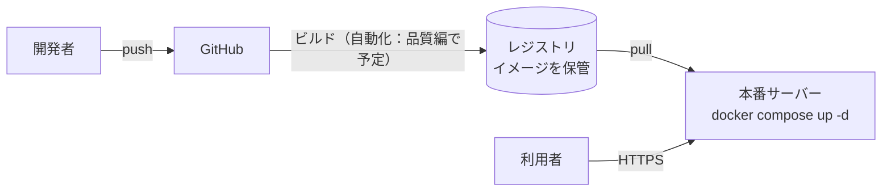
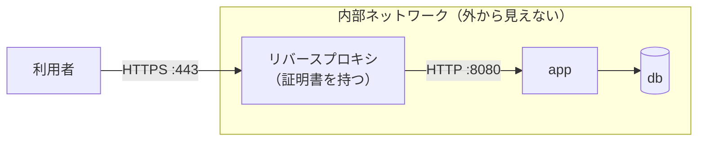
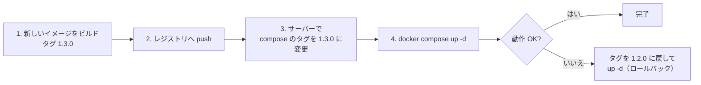

# 08. 本番デプロイの考え方

[📖 Dockerの目次](./00_はじめに.md#目次) ｜ [🏠 全体の目次](../README.md#目次)

[← 前へ：07 チーム開発での使い方](07_チーム開発での使い方.md)

## この章のゴール
- 「開発用の設定」を、そのまま本番に使ってはいけない理由を説明できる
- 本番に出す前に**確認すべきこと**を、チェックリストで言える
- 秘密情報、公開するポート、HTTPS、バックアップ、更新の**考え方**を説明できる

> [!NOTE]
> この章は、**考え方の紹介**です。特定のクラウドやサーバーの操作手順は扱いません。実際に本番へ出すときは、配備先の公式ドキュメントと、メンターの確認が必要です。

## 目次

1. [開発と本番の違い](#1-開発と本番の違い)
2. [イメージを配布する](#2-イメージを配布する)
3. [秘密情報の扱い](#3-秘密情報の扱い)
4. [公開するもの・しないもの](#4-公開するものしないもの)
5. [HTTPS とリバースプロキシ](#5-https-とリバースプロキシ)
6. [データの保護](#6-データの保護)
7. [ログと監視](#7-ログと監視)
8. [更新とロールバック](#8-更新とロールバック)
9. [Vaadin で気をつけること](#9-vaadin-で気をつけること)
10. [本番前のチェックリスト](#10-本番前のチェックリスト)

---

## 1. 開発と本番の違い

これまでの設定は、**自分のパソコンで試す**ためのものでした。本番は、**他人が使い、インターネットから攻撃されうる**場所です。

| | 開発（この資料の前半） | 本番 |
|---|---|---|
| 使う人 | 自分とチーム | **利用者**（見知らぬ人も含む） |
| パスワード | 学習用の簡単なもの | **推測されない、長いもの** |
| DB のポート | `127.0.0.1` に公開 | **公開しない** |
| 通信 | HTTP | **HTTPS** |
| データ | 消えてもよい | **消えると困る**（バックアップが必要） |
| 止まったら | 起動し直せばよい | **利用者が困る**（監視・復旧が必要） |
| イメージ | 手元でビルド | **決まった手順で作り、タグを付けて保管** |



## 2. イメージを配布する

本番のサーバーで、ソースコードから毎回ビルドするのは避けます。**ビルド済みのイメージ**を、**レジストリ**に置いて、サーバーはそれを `pull` します。

| 考え方 | 理由 |
|---|---|
| **ビルドは 1 回**、そのイメージを、どの環境でも使う | 「テストしたものと、本番のものが違う」を防ぐ |
| タグに**バージョン**を付ける（`grades-app:1.2.0`） | どのバージョンが動いているか分かる。戻せる |
| **`latest` は本番で使わない** | 何が動くか、分からなくなる |
| イメージに**秘密情報を入れない** | イメージは共有・保管される（[05 章 6 節](05_Dockerfileとイメージ作成.md#6-dockerignore)） |

> [!NOTE]
> **CPU の種類に注意します**。Apple チップ（M1 など）の Mac でビルドしたイメージは、**arm64** 用になり、多くの本番サーバー（**amd64**）では動きません。本番に出すイメージは、`docker build --platform linux/amd64 -t grades-app:1.2.0 .` のように、動かす先の CPU を指定してビルドします（Windows や Intel の Mac は、すでに amd64 です）。サーバーの CPU は、事前に確認してください。

レジストリには、Docker Hub のほか、GitHub に付属する **GitHub Container Registry**（`ghcr.io`）などがあります。公開範囲（**public / private**）は、必ず確認します。**private にすべきイメージを public にすると、中身が誰でも取得できます**。

## 3. 秘密情報の扱い

パスワードや API キーなどの**秘密情報**は、次の順に気をつけます。

| 方法 | 安全性 | 説明 |
|---|---|---|
| コードや `compose.yaml` に直接書く | ✕ 危険 | Git の履歴に残る |
| イメージに入れる | ✕ 危険 | イメージを取得した人に見える |
| `.env` で、実行時に渡す | △ 最低限 | **サーバー上にだけ置き、Git に載せない**。ファイルの権限を絞る |
| Docker の **secrets**、クラウドの**シークレット管理**サービス | ○ 望ましい | 専用の仕組みで、必要なコンテナにだけ渡す |

> [!CAUTION]
> **セキュリティの視点**：**開発用のパスワードを、本番に流用しません**。本番のパスワードは、**本番でだけ**生成し、パスワード管理ツールなど、**チームの外に漏れない場所**に保管します。漏れたときは、**すぐ変える**手順（ローテーション）を、決めておきます。

## 4. 公開するもの・しないもの

本番で、**外から見えてよいのは、利用者が使う入口だけ**です。

| サービス | 外に公開 | 理由 |
|---|---|---|
| **リバースプロキシ**（[5 節](#5-https-とリバースプロキシ)） | ○（80 / 443 番） | 利用者の入口 |
| `app`（Spring Boot） | ✕ | プロキシ経由でだけ見せる |
| **`db`（PostgreSQL）** | **✕ 絶対に公開しない** | `ports:` を**書かない**。`app` からは、Compose のネットワーク内で `db:5432` で届く |
| `pgadmin` | ✕（原則） | 管理用。必要なら SSH で入るなど、限られた経路だけ |

開発では、パソコンの psql や IDE から見るために、`ports:` で `db` を公開しました。**本番の `compose` では、`db` に `ports:` を書きません**。書かなくても、同じ Compose の `app` からは接続できます（[06 章](06_アプリとDBをComposeで動かす.md)）。

> [!CAUTION]
> **セキュリティの視点**：インターネットに公開した 5432 番ポートは、**自動で探し回るプログラムに、すぐ見つかります**。さらに、Docker は、`ports:` で公開したものを、サーバーのファイアウォール設定を**すり抜けて**公開してしまうことがあります（Docker が、ファイアウォールの規則を自分で書き換えるため）。**`ports:` に書かない**ことが、最も確実です（[Docker Docs「Packet filtering and firewalls」](https://docs.docker.com/engine/network/packet-filtering-firewalls/)、閲覧日：2026-11-19）。

## 5. HTTPS とリバースプロキシ

HTTP は、通信の中身が**そのまま読めます**。ログインのパスワードなどが、途中で盗み見られます。本番は **HTTPS**（暗号化された通信）にします。

アプリ自身に、証明書を持たせることもできますが、一般的には、前に **リバースプロキシ**（Nginx、Caddy、Traefik など）を置きます。



| 役割 | 内容 |
|---|---|
| **HTTPS の終端** | 証明書を持ち、暗号化・復号をする。アプリは、HTTP のまま動ける |
| **振り分け** | 1 つのサーバーで、複数のアプリを、ドメインごとに振り分ける |
| **防御** | 不正なリクエストの制限など、アプリの手前で守る |

証明書は、**Let's Encrypt**（無料）などで取得でき、Caddy のように、**取得と更新を自動で行う**ものもあります。ドメイン名の取得も必要です。

## 6. データの保護

本番の DB のデータは、**消えると取り返しがつきません**。

| 対策 | 内容 |
|---|---|
| **バックアップ** | 定期的に、`pg_dump` などで、DB の中身をファイルに書き出す。**サーバーとは別の場所**に保管する |
| **復元の確認** | バックアップは、**復元できて初めて意味がある**。復元の練習を、定期的にする |
| **ボリュームの扱い** | `down -v` を、**本番では打たない**。誤操作を防ぐ運用ルールを決める |
| **バージョンアップ** | PostgreSQL のメジャーバージョンを上げるときは、**データの移行が必要**（[03 章 5 節](03_Dockerの基本操作.md#5-ボリュームでデータを残す)）。必ず事前に練習する |

```bash
# DB コンテナの中で pg_dump を実行し、パソコン（サーバー）側のファイルに保存する例
docker compose exec -T db pg_dump -U postgres grades_db > backup.sql
```

## 7. ログと監視

コンテナは、**アプリのログを、標準出力に出す**のが基本です。`docker compose logs` で見られます。

| 見るもの | 内容 |
|---|---|
| ログ | エラーや、不審なアクセスを見つける。**パスワードや個人情報を、ログに出さない** |
| 死活監視 | アプリが動いているか。`healthcheck`（[06 章](06_アプリとDBをComposeで動かす.md#4-db-の起動を待つ)）の考え方を、`app` にも使う |
| 再起動 | `restart: unless-stopped` を付けると、異常終了したり、サーバーを再起動したりしたあとに、自動で復帰する |
| ディスク | ログやボリュームが、ディスクを埋めない（[07 章](07_チーム開発での使い方.md#5-ディスクの掃除)） |

## 8. 更新とロールバック

新しいバージョンを出す手順は、**元に戻せる**ことが大切です。



| 考え方 | 内容 |
|---|---|
| **タグで戻す** | 前のバージョンのイメージが残っていれば、タグを戻して `up -d` するだけで戻せる |
| **DB の変更に注意** | アプリは戻せても、**テーブルの変更は戻らない**。スキーマを変える更新は、バックアップを取ってから行い、**古いアプリでも動く**変更にする（マイグレーションツール：Flyway など） |
| **自動化** | 手作業は、ミスのもと。ビルド・テスト・配備を自動化する（CI/CD。開発環境・品質編で扱う予定） |

## 9. Vaadin で気をつけること

Vaadin（Flow）は、画面の状態をサーバー側の「**セッション**」に持ちます。次の点が、本番の設計に影響します。

| 点 | 内容 |
|---|---|
| **本番ビルド** | 本番用の jar は、`production` プロファイルで作る（[05 章 7 節](05_Dockerfileとイメージ作成.md#7-vaadin-の場合)） |
| **セッション** | `app` を**複数台に増やす**と、同じ利用者のリクエストを、同じ台に送り続ける設定（スティッキーセッション）が要る。まずは 1 台で始める |
| **リバースプロキシ** | Vaadin は、画面の更新に、通信を長く保つ仕組み（WebSocket など）を使う。プロキシが対応している設定にする |

詳細は、[フロントエンド編 A2 章](../フロントエンド/A2_本番ビルドとデプロイ.md)と、[Vaadin Docs「Production」](https://vaadin.com/docs/latest/production)で確認してください（閲覧日：2026-11-19）。

## 10. 本番前のチェックリスト

| 確認 | ✓ |
|---|---|
| 開発用のパスワードを、本番に使っていない | ☐ |
| `.env` や秘密情報が、Git・イメージに入っていない | ☐ |
| `db` に `ports:` を書いていない（外から DB が見えない） | ☐ |
| 外に公開するのは、リバースプロキシだけ | ☐ |
| HTTPS になっている | ☐ |
| イメージのタグが、`latest` ではなく、バージョンになっている | ☐ |
| コンテナを、一般ユーザー（root 以外）で動かしている | ☐ |
| バックアップを取っていて、復元の練習をした | ☐ |
| ログに、パスワードや個人情報が出ていない | ☐ |
| 更新が失敗したときの、戻し方を決めている | ☐ |
| 開発用の機能（デバッグ表示など）を、切っている | ☐ |
| メンターが、構成を確認した | ☐ |

> [!IMPORTANT]
> 利用者の**個人情報**（学生の成績など）を扱うシステムを、本番に出す前には、**大学や組織のルール**（情報セキュリティポリシー、個人情報の取り扱い）の確認が必要です。技術的な準備だけでは、公開してはいけません。

---

[← 前へ：07 チーム開発での使い方](07_チーム開発での使い方.md)

[📖 Dockerの目次](./00_はじめに.md#目次) ｜ [🏠 全体の目次](../README.md#目次)
