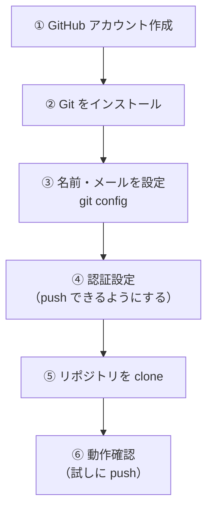
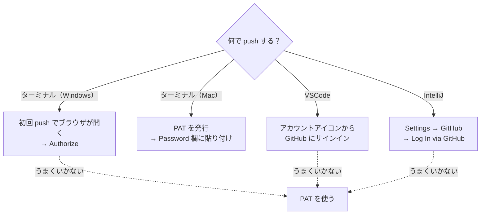
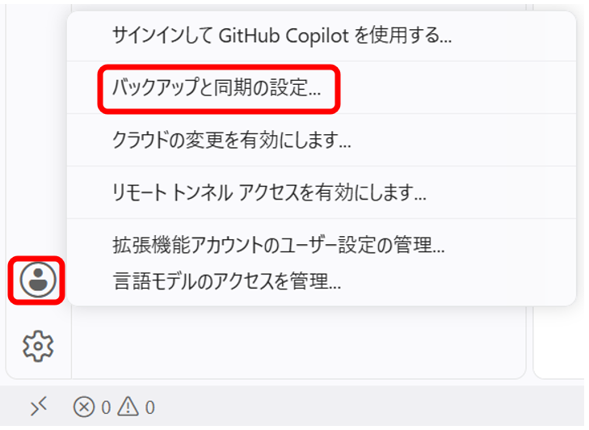
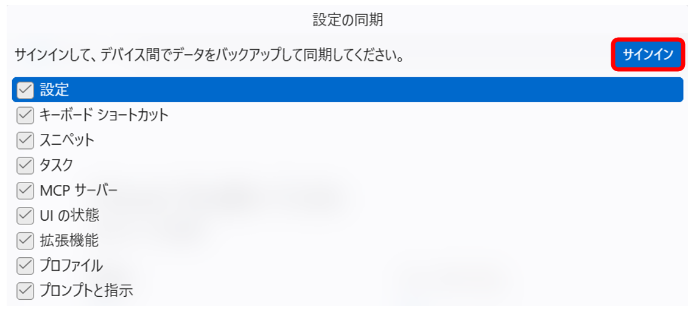
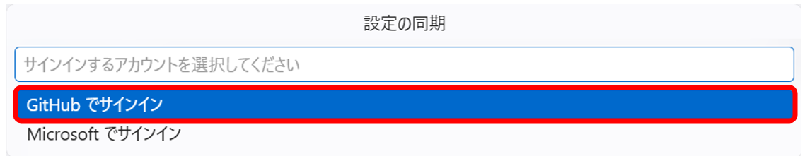
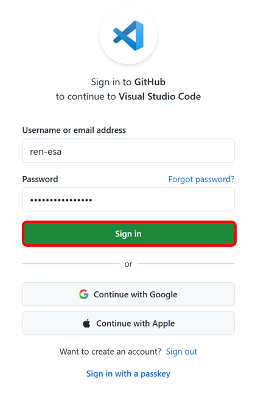
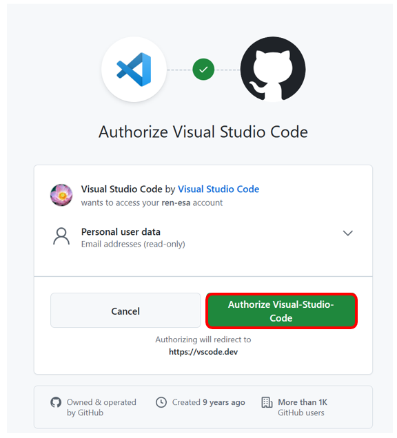
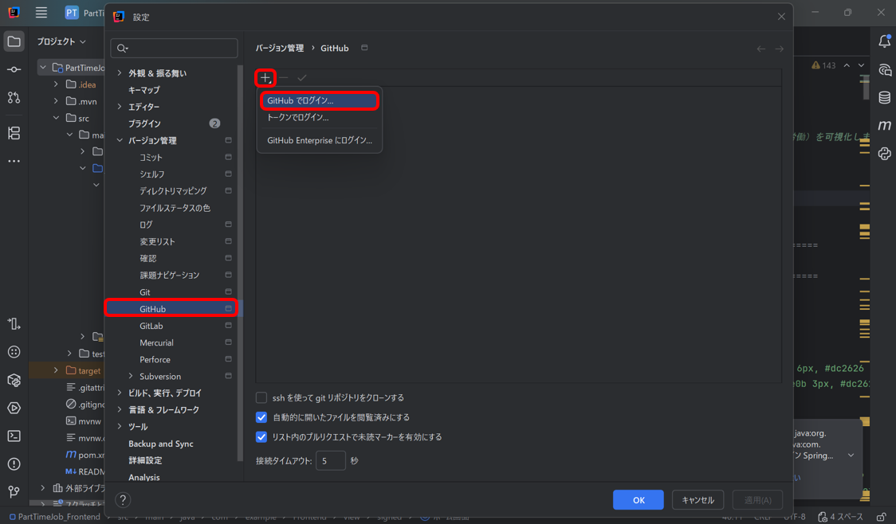
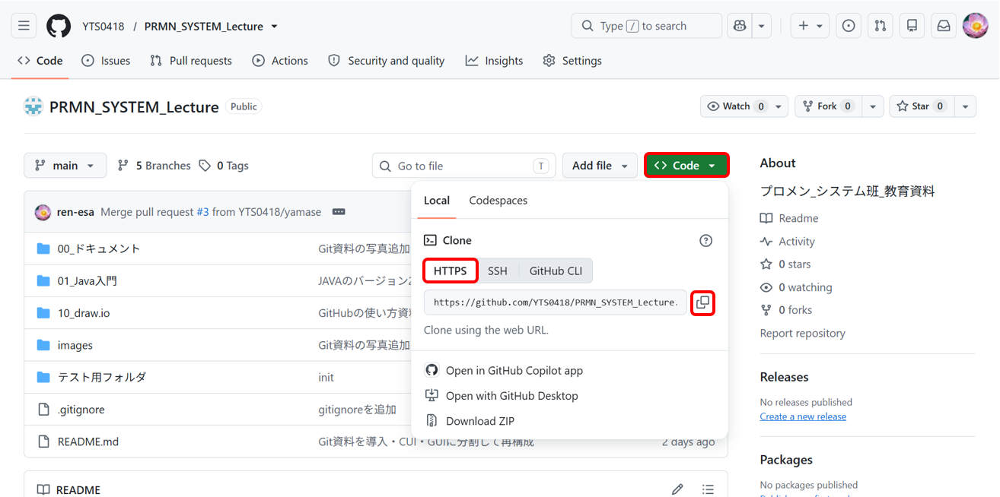

# 00. Git 導入・初期設定

[📖 Git資料の目次](./00_Git導入・初期設定.md#git-資料の構成) ｜ [🏠 全体の目次](../README.md#目次)

次へ → [01. Git の仕組みと用語](./01_Gitの仕組みと用語.md)

Git / GitHub を使い始めるための**最初の1回だけ**行う準備です。<br>終わったら、この資料はもう読まなくて大丈夫です（PC を買い替えたときなどに見返してください）。

## Git 資料の構成


| 資料 | 内容 |
|---|---|
| **00 導入・初期設定**（この資料） | インストール・アカウント・認証・clone |
| [01 Git の仕組みと用語](./01_Gitの仕組みと用語.md) | Git とは何か、用語、データの流れ |
| [02 CUI 基本編](./02_CUI基本編.md) | 毎日の作業（add / commit / push / pull / ブランチ） |
| [03 CUI 応用編](./03_CUI応用編.md) | main への追従、取り消し、プルリクエスト |
| [04 GUI VSCode編](./04_GUI_VSCode編.md) | VSCode のボタン操作で同じことをする |
| [05 GUI IntelliJ編](./05_GUI_IntelliJ編.md) | IntelliJ IDEA のボタン操作で同じことをする |
| [06 CUIとGUIの使い分け](./06_CUIとGUIの使い分け.md) | GUI でできないこと・困ったときの戻り方 |

> **CUI と GUI の関係について**<br>
> この資料では、まず **CUI（コマンド）で仕組みを理解**し、そのうえで **GUI（ボタン操作）** を説明します。<br>GUI はボタンの裏で同じコマンドを実行しているだけなので、コマンドを知っていると「今このボタンで何が起きたか」が分かり、迷わなくなります。

## 目次

- [00. Git 導入・初期設定](#00-git-導入初期設定)
  - [Git 資料の構成](#git-資料の構成)
  - [目次](#目次)
  - [1. 準備の全体像](#1-準備の全体像)
  - [2. GitHub アカウントの作成](#2-github-アカウントの作成)
  - [3. Git のインストール](#3-git-のインストール)
    - [Windows の場合](#windows-の場合)
    - [Mac の場合](#mac-の場合)
  - [4. 名前とメールアドレスの設定](#4-名前とメールアドレスの設定)
  - [5. GitHub への認証設定](#5-github-への認証設定)
    - [5-0. Personal Access Token (PAT) の発行手順](#5-0-personal-access-token-pat-の発行手順)
    - [5-1. ターミナル（Windows）](#5-1-ターミナルwindows)
    - [5-2. ターミナル（Mac）](#5-2-ターミナルmac)
    - [5-3. VSCode](#5-3-vscode)
    - [5-4. IntelliJ IDEA](#5-4-intellij-idea)
      - [方法1：ブラウザでログイン（おすすめ）](#方法1ブラウザでログインおすすめ)
      - [方法2：PAT でログイン（方法1がうまくいかない場合）](#方法2pat-でログイン方法1がうまくいかない場合)
  - [6. リポジトリを clone する](#6-リポジトリを-clone-する)
    - [ターミナルの場合](#ターミナルの場合)
    - [VSCode / IntelliJ の場合](#vscode--intellij-の場合)
  - [7. 動作確認](#7-動作確認)
  - [8. リポジトリを作る](#8-リポジトリを作る)
    - [方法1：GitHub で作って clone する（おすすめ）](#方法1github-で作って-clone-するおすすめ)
    - [方法2：手元のフォルダを Git 管理にして push する](#方法2手元のフォルダを-git-管理にして-push-する)
    - [作成できたか確認する](#作成できたか確認する)
  - [9. main ブランチを保護する](#9-main-ブランチを保護する)
    - [設定手順](#設定手順)
    - [設定するとどうなる？](#設定するとどうなる)

---

## 1. 準備の全体像



---

## 2. GitHub アカウントの作成

Git の設定（[4章](#4-名前とメールアドレスの設定)）で **GitHub に登録したメールアドレス**を使うため、先にアカウントを作成します。

1. https://github.com を開き、**Sign up** をクリックする。
2. **メールアドレス**・パスワード・ユーザー名を入力する。
3. 認証パズルを解き、メールに届く**確認コード**を入力する。
4. アンケート画面などは「Skip」でOK。
5. 作成したら、**ユーザー名**と**登録したメールアドレス**を控えておく。

> **メールアドレスを公開したくない場合**<br>
> GitHub の **Settings → Emails** で「Keep my email addresses private」にチェックを入れると、`ユーザー名@users.noreply.github.com` 形式の非公開用アドレスが発行されます。4章ではこのアドレスを使ってもOKです。

---

## 3. Git のインストール

まず、すでにインストールされているか確認します。ターミナル（Windows は PowerShell）で次を実行し、バージョンが表示されればインストール済みです（[4章](#4-名前とメールアドレスの設定)へ進んでOK）。

```bash
git --version
```

「command not found」や「'git' は、内部コマンドまたは外部コマンド…として認識されていません」と出た場合は、下の手順でインストールします。

### Windows の場合

1. 公式サイト https://git-scm.com/download/win を開く（自動でダウンロードが始まります。始まらない場合は「Click here to download manually」をクリック）。
2. ダウンロードした `Git-x.x.x-64-bit.exe` を実行する。
3. インストーラーの画面は基本的にすべて **「Next」** のままでOK。最後に「Install」→「Finish」をクリック。
4. **開いているターミナル／VSCode／IntelliJ をいったんすべて閉じて、開き直す**（開き直さないと認識されません）。
5. `git --version` でバージョンが表示されれば完了。

> **winget を使う方法（コマンドでインストール）**
> ```powershell
> winget install --id Git.Git -e --source winget
> ```

### Mac の場合

**方法A：Xcode Command Line Tools（一番かんたん・おすすめ）**

1. ターミナルで `git --version` を実行する。
2. 未インストールの場合は「コマンドライン・デベロッパ・ツールが必要です」というダイアログが出るので **「インストール」** をクリックする（出ない場合は `xcode-select --install` を実行）。
3. 数分待ち、再度 `git --version` でバージョンが表示されれば完了。

**方法B：Homebrew を使う**

```bash
brew install git
```

> インストール後、ターミナルを開き直してから `git --version` で確認してください。

---

## 4. 名前とメールアドレスの設定

コミットに「誰が書いたか」が記録されるため、最初に登録します。メールアドレスは **2章で GitHub に登録したもの**を使います。

```bash
git config --global user.name "あなたの名前"
git config --global user.email "GitHubに登録したメールアドレス"
```

あわせて、最初のブランチ名を `main` にする設定もしておきます（新しくリポジトリを作るときに使われます）。

```bash
git config --global init.defaultBranch main
```

設定の確認:

```bash
git config --global --list
```

```
user.name=あなたの名前
user.email=xxxx@example.com
init.defaultbranch=main
```

---

## 5. GitHub への認証設定

GitHub は Git 操作での**パスワード認証を廃止**しています。そのため `git push` するには、次のいずれかで本人確認が必要です。**clone や pull だけなら（公開リポジトリは）不要**ですが、push の時点で必ず求められます。

**使う道具によって設定方法が違う**ので、自分が使うものの手順を読んでください。複数の道具を使う人は、それぞれ設定が必要になることがあります。

| 使う道具 | 認証の方法 | 難易度 |
|---|---|---|
| [ターミナル（Windows）](#5-1-ターミナルwindows) | Git Credential Manager<br>（Git に同梱。初回 push 時にブラウザが開く） | ★ かんたん |
| [ターミナル（Mac）](#5-2-ターミナルmac) | Personal Access Token (PAT) を Password 欄に入力 → Keychain に保存 | ★★ やや手間 |
| [VSCode](#5-3-vscode) | VSCode から GitHub にサインイン（ブラウザで承認） | ★ かんたん |
| [IntelliJ IDEA](#5-4-intellij-idea) | 設定で GitHub アカウントを追加（ブラウザ or PAT） | ★ かんたん |

> どの道具でも、うまくいかないときの最終手段は **PAT**（[5-0](#5-0-personal-access-token-pat-の発行手順)）です。



### 5-0. Personal Access Token (PAT) の発行手順

パスワードの代わりに使う「合言葉」を自分で発行します。

1. GitHub にログインし、右上のアイコン → **Settings** を開く。
2. 左メニューの一番下 **Developer settings** → **Personal access tokens** → **Tokens (classic)** を選ぶ。
3. **Generate new token (classic)** をクリックする。
4. 次のように入力する。
   - **Note**：`講義用PC`、 `VSCode(MacBook)`など用途が分かる名前
   - **Expiration**：`90 days` など
   - **Select scopes**：**`repo`** にチェック（IntelliJ IDEA で使う場合は、加えて **`gist`**・**`read:org`** にもチェック）
5. **Generate token** をクリックする。
6. 表示された `ghp_xxxxxxxx...` を**必ずその場でコピー**する（**この画面を閉じると二度と表示されません**）。

> [!WARNING]
> **トークンはパスワードと同じ扱いです**
> - 他人に教えない／ファイルやコミットに書かない／スクリーンショットに写さない
> - 流出したら、同じ画面から **Delete** してすぐ無効化する

> 🔒 **セキュリティの視点**：トークンを作るときは、**有効期限を付け**（`No expiration` を選ばない）、**必要な権限（スコープ）だけ**にチェックします（[GitHub Docs「個人用アクセス トークンを管理する」](https://docs.github.com/ja/authentication/keeping-your-account-and-data-secure/managing-your-personal-access-tokens)）。GitHub アカウント自体も、[2 要素認証](https://docs.github.com/ja/authentication/securing-your-account-with-two-factor-authentication-2fa)を有効にしておきます（いずれも閲覧日：2026-11-08）。パソコンがウイルスに感染すると、保存されたパスワードやトークンは、まとめて盗まれます。
> 実例：2026 年、マネーフォワードは、業務用の GitHub の認証情報が漏れ、リポジトリを第三者にコピーされたと公表しました（[マネーフォワード 第一報](https://corp.moneyforward.com/news/info/20260501-mf-press-1/)、2026-05-01、閲覧日：2026-11-08）。2025 年には、日本経済新聞社の社員の**私物のパソコン**がウイルスに感染して業務用チャット（Slack）の認証情報が漏れ、約 1 万 7 千人分の情報が流出した可能性があると公表されました（[日本経済新聞社のお知らせ](https://www.nikkei.co.jp/nikkeiinfo/news/information/1393.html)、2025-11-04、閲覧日：2026-11-08）。

### 5-1. ターミナル（Windows）

Git for Windows には **Git Credential Manager** が同梱されているため、特別な設定は不要です。

1. リポジトリのフォルダで `git push` を実行する。
2. 初回だけ **ブラウザのログイン画面（またはダイアログ）** が自動で開く。
3. **Sign in with your browser** を選び、GitHub にログインして **Authorize** をクリックする。
4. push が成功すれば完了。以降は入力不要。

> ログイン画面が出ずに失敗する場合は、Mac と同じく PAT を使います。

### 5-2. ターミナル（Mac）

Mac のターミナルでは多くの場合 **Password: と聞かれる**ので、PAT を使います。

1. [5-0](#5-0-personal-access-token-pat-の発行手順) の手順で PAT を発行し、コピーしておく。
2. `git push` を実行し、次のように聞かれたら入力する。

```
Username for 'https://github.com': GitHubのユーザー名
Password for 'https://...@github.com': ← ここにトークンを貼り付ける
```

**パスワードではなくトークンを貼り付けます**（入力しても画面には何も表示されませんが、貼り付けられています）。

3. Mac では **Keychain に保存**され、2回目以降は入力不要です。保存されない場合は次を確認します。

```bash
git config --global credential.helper               # osxkeychain と表示されればOK
git config --global credential.helper osxkeychain   # 何も表示されない場合に実行
```

> 認証情報が古くなってエラーが続くときは、「キーチェーンアクセス」アプリで `github.com` を検索して削除すると、次の push で再入力できます。

### 5-3. VSCode

1. VSCode の左下にある **アカウント** アイコン（人型）をクリックする。
   
2. **「GitHub でサインイン」**（Sign in with GitHub）を選ぶ。
   - 出てこない場合は、ソース管理で push / 同期を実行すると「GitHub にサインインしますか？」と出るので **許可** する。<br>
   
   
3. ブラウザが開くので GitHub にログインし、**Authorize Visual Studio Code** をクリックする。
   
   
4. 「VS Code を開きますか？」と出たら **開く** を選ぶ。
5. アカウントアイコンに自分のユーザー名が表示されれば完了。

> VSCode の認証は基本的に **VSCode のボタン操作用**です。VSCode の統合ターミナルから `git push` する場合は、5-1 / 5-2 の設定が必要になることがあります。

### 5-4. IntelliJ IDEA

#### 方法1：ブラウザでログイン（おすすめ）

1. 設定画面を開く。
   - **Windows**：`File` → `Settings`（`Ctrl + ,`）
   - **Mac**：`IntelliJ IDEA` → `Settings`（`⌘ + ,`）
2. 左メニューの **Version Control** → **GitHub** を開く。
3. **＋** ボタン → **Log In via GitHub** をクリックする。
4. ブラウザが開くので GitHub にログインし、**Authorize in GitHub** をクリックする。
5. アカウント一覧に自分のユーザー名が表示されれば完了。**OK** で閉じる。



#### 方法2：PAT でログイン（方法1がうまくいかない場合）

1. [5-0](#5-0-personal-access-token-pat-の発行手順) の手順で PAT を発行する（スコープは `repo`・`gist`・`read:org`）。
2. 手順 3 で **Log In with Token...** を選ぶ。
3. **Token** 欄に PAT を貼り付けて **Add Account** をクリックする。

---

## 6. リポジトリを clone する

GitHub 上のリポジトリを、自分の PC に丸ごとコピーします（**最初に1回だけ**）。

### ターミナルの場合

保存したい場所（例：`ドキュメント` フォルダ）に移動してから実行します。

```bash
cd ~/Documents
git clone https://github.com/YTS0418/PRMN_SYSTEM_Lecture.git
cd PRMN_SYSTEM_Lecture
```

> [!WARNING]
> **OneDrive など同期フォルダの中に clone するのは避けましょう** <br>同期のタイミングで Git の管理ファイルが壊れることがあります。

clone する URL は、GitHub のリポジトリページの緑色の **Code** ボタンから コピーできます。



### VSCode / IntelliJ の場合

ボタン操作で clone することもできます。手順はそれぞれ [04 VSCode編](./04_GUI_VSCode編.md#2-clone-する) / [05 IntelliJ編](./05_GUI_IntelliJ編.md#2-clone-する) を参照してください。

---

## 7. 動作確認

clone したフォルダで次を実行し、エラーが出なければ準備完了です。

```bash
git status
```

```
On branch main
Your branch is up to date with 'origin/main'.

nothing to commit, working tree clean
```

自分のリポジトリを新しく作りたい場合は、[8章](#8-リポジトリを作る)を参照してください。

---

## 8. リポジトリを作る

リポジトリを新しく作る方法です。作り方は2通りあります。迷ったら**方法1**を選んでください。

| 方法 | 向いているケース |
| --- | --- |
| 方法1：GitHub で作って clone する | これから新しく始める |
| 方法2：手元のフォルダを Git 管理にして push する | すでに手元にあるフォルダ・プログラムを GitHub に上げたい |

### 方法1：GitHub で作って clone する（おすすめ）

1. GitHub 右上の **＋** → **New repository** をクリックする。
2. **Repository name** にリポジトリの名前（例：`my-repository`）を入力する。
3. **Public**（誰でも見られる）か **Private**（自分だけ）を選ぶ。
4. **Add a README file** にチェックを入れる。
5. **Create repository** をクリックする。
6. 6章と同じ手順で clone する。

```bash
git clone https://github.com/自分のユーザー名/my-repository.git
cd my-repository
```

### 方法2：手元のフォルダを Git 管理にして push する

すでにあるフォルダを、あとから Git 管理にする方法です。

**① GitHub に空のリポジトリを作る**

方法1の手順1〜3と同じですが、**README などのチェックは入れずに**（空のまま）Create repository します。

**② 手元のフォルダで Git を始める**

対象のフォルダに移動して実行します。

```bash
cd my-repository
git init
git add .
git commit -m "first commit"
git branch -M main
```

| コマンド | 意味 |
| --- | --- |
| `git init` | このフォルダを Git 管理にする（`.git` フォルダができる） |
| `git add .` | フォルダ内のファイルをコミット対象にする |
| `git commit -m "..."` | 最初の記録を作る |
| `git branch -M main` | ブランチ名を `main` にする |

**③ GitHub のリポジトリとつないで push する**

```bash
git remote add origin https://github.com/自分のユーザー名/my-repository.git
git push -u origin main
```

`git remote add origin` は「このリポジトリの送り先（GitHub）を `origin` という名前で登録する」コマンドです。`-u` を付けた初回の push だけ、以降は `git push` だけで送れるようになります。

> [!WARNING]
> **すでに Git 管理されているフォルダの中に、さらに `git init` しないでください** <br>リポジトリの中にリポジトリができてしまい、混乱の原因になります。迷ったら `git status` を実行し、`fatal: not a git repository` と出るフォルダでだけ `git init` します。

### 作成できたか確認する

```bash
git status
git remote -v
```

`git remote -v` に GitHub の URL が表示されれば、GitHub とつながっています。

---

## 9. main ブランチを保護する

8章で作ったリポジトリでは、最初は main に直接 push できてしまいます。うっかり main を壊さないように、**リポジトリを作ったら最初に main ブランチの保護設定をする**ことをおすすめします。

GitHub の **ブランチ保護ルール**を設定すると、main への変更は**ブランチを作ってプルリクエスト（PR）を出し、マージする**という流れに限定されます。

### 設定手順

1. リポジトリの **Settings** → **Branches**（または **Rules** → **Rulesets**）を開く。
2. **Add branch ruleset**（または Add rule）をクリックし、対象に `main` を指定する。
3. 次の項目を有効にする。
   - **Require a pull request before merging**（PR を必須にする）
   - 必要に応じて **Require approvals**（レビューの承認を必須にする）
   - **Block force pushes**（force push を禁止する）
7. **Create** をクリックして保存する。

### 設定するとどうなる？

main に直接 push しようとすると、次のようにエラーになります。これは設定が効いている証拠なので、慌てなくて大丈夫です。

```
remote: error: GH013: Repository rule violations found for refs/heads/main.
```

変更したいときは、ブランチを作って push し、GitHub 上で PR を作成してマージします（手順は [02 CUI基本編](./02_CUI基本編.md) 以降で学びます）。

> 💡 **自分ひとりのリポジトリでは「承認（Require approvals）」は入れなくてOK** <br>自分で出した PR は自分では承認できないため、必須にするとマージできなくなります。チームで開発するときに、レビュー担当者の承認を必須にしましょう。

> [!WARNING]
> **Private リポジトリでは、無料プランだとルールが使えない場合があります** <br>設定画面に有料プランの案内が出たときは、Public リポジトリにするか、「main に直接 push しない」ことを自分で守りましょう。

---

次へ → [01. Git の仕組みと用語](./01_Gitの仕組みと用語.md)

[📖 Git資料の目次](./00_Git導入・初期設定.md#git-資料の構成) ｜ [🏠 全体の目次](../README.md#目次)
