# 05. GUI IntelliJ編

[📖 Git資料の目次](./00_Git導入・初期設定.md#git-資料の構成) ｜ [🏠 全体の目次](../README.md#目次)

← 前へ [03. CUI 応用編](./03_CUI応用編.md) ｜ VSCode を使う人は → [04. GUI VSCode編](./04_GUI_VSCode編.md) ｜ 次へ → [06. CUIとGUIの使い分け](./06_CUIとGUIの使い分け.md)

[02 CUI 基本編](./02_CUI基本編.md)・[03 CUI 応用編](./03_CUI応用編.md)でコマンドで行った操作を、**IntelliJ IDEA のボタン操作**で行います。各操作の見出しの下に「**CUI でいうと**」を書いているので、コマンドと見比べながら進めてください。

> **前提**
> - [00 導入編](./00_Git導入・初期設定.md#5-4-intellij-idea)で IntelliJ IDEA に GitHub アカウントを登録済み
> - **New UI**（2023.2 以降の標準の見た目）を前提にしています。Classic UI の場合は、上部メニューの `Git`（または `VCS`）から同じ操作を探してください
> - **日本語表示**（Japanese Language Pack プラグイン）を前提にしています。英語表示の場合は、下の「[メニュー名の英和対応表](#メニュー名の英和対応表)」を参考にしてください
> - 日本語化の手順：`設定`（Settings）→ `プラグイン`（Plugins）→ `Marketplace` で「Japanese Language Pack」を検索してインストールし、IDE を再起動する

> **GUI で分からなくなったら**
> 左下の **ターミナル** を開いて `git status` を実行しましょう。今の状態がはっきり分かります。IntelliJ ではできない操作の一覧は [06 CUIとGUIの使い分け](./06_CUIとGUIの使い分け.md) にまとめています。

## 目次

1. [画面の見方](#1-画面の見方)
    - [ファイルの色の意味](#ファイルの色の意味)
2. [clone する](#2-clone-する)
3. [変更と差分を確認する](#3-変更と差分を確認する)
4. [コミットする](#4-コミットする)
5. [push と pull](#5-push-と-pull)
    - [push する](#push-する)
    - [pull する](#pull-する)
    - [fetch する](#fetch-する)
6. [履歴を見る](#6-履歴を見る)
7. [ブランチを作る・切り替える](#7-ブランチを作る切り替える)
    - [7-1. ブランチを作る](#7-1-ブランチを作る)
    - [7-2. ブランチを切り替える](#7-2-ブランチを切り替える)
    - [7-3. 未コミットの変更があるときのダイアログ](#7-3-未コミットの変更があるときのダイアログ)
8. [最新の main を取り込む（マージ）](#8-最新の-main-を取り込むマージ)
9. [コンフリクトを解決する](#9-コンフリクトを解決する)
    - [マージ... の3画面エディタ](#マージ-の3画面エディタ)
    - [解決したら](#解決したら)
10. [取り消す](#10-取り消す)
    - [自分だけのブランチで push を取り消す（force push）](#自分だけのブランチで-push-を取り消すforce-push)
11. [変更を退避する（スタッシュ・シェルフ）](#11-変更を退避するスタッシュシェルフ)
    - [スタッシュ](#スタッシュ)
    - [シェルフ（IntelliJ 独自）](#シェルフintellij-独自)
12. [プルリクエストを使う](#12-プルリクエストを使う)
    - [PR を作る](#pr-を作る)
    - [PR をレビューする](#pr-をレビューする)
13. [コマンドとの対応表](#13-コマンドとの対応表)

---

## 1. 画面の見方

Git の操作は、主に次の4か所で行います。

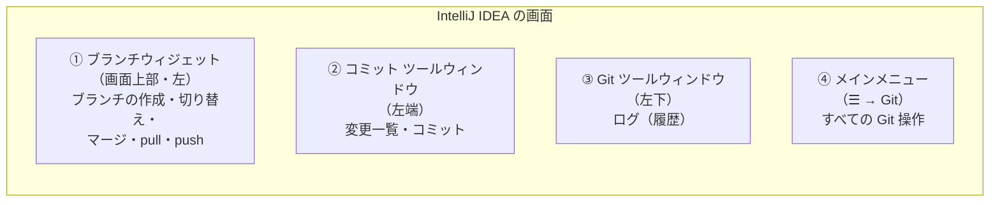

| 場所 | 開き方 | できること | CUI でいうと |
|---|---|---|---|
| ① ブランチウィジェット | 画面上部のブランチ名をクリック | ブランチの作成・切り替え、マージ、Update / Commit / Push | `switch` / `merge` / `pull` / `push` |
| ② Commit ツールウィンドウ | 左端のコミットアイコン（`Alt + 0` / Mac は `⌘ + 0`） | 変更の確認、コミット、Amend、Shelf | `status` / `add` / `commit` |
| ③ Git ツールウィンドウ | 左下の Git アイコン（`Alt + 9` / Mac は `⌘ + 9`） | 履歴（Log）、コミットの右クリックで取り消し操作 | `log` /  `revert` / `reset` |
| ④ メインメニュー | 左上の **☰** → **Git** | すべての Git 操作 | — |

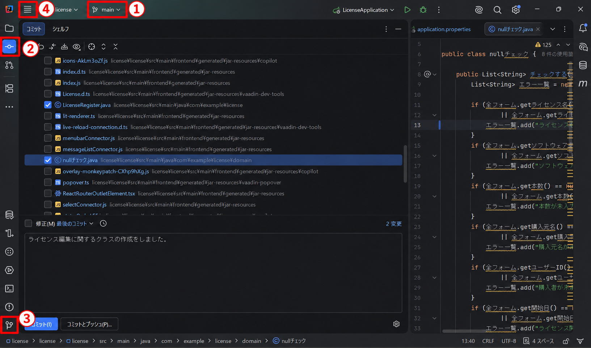

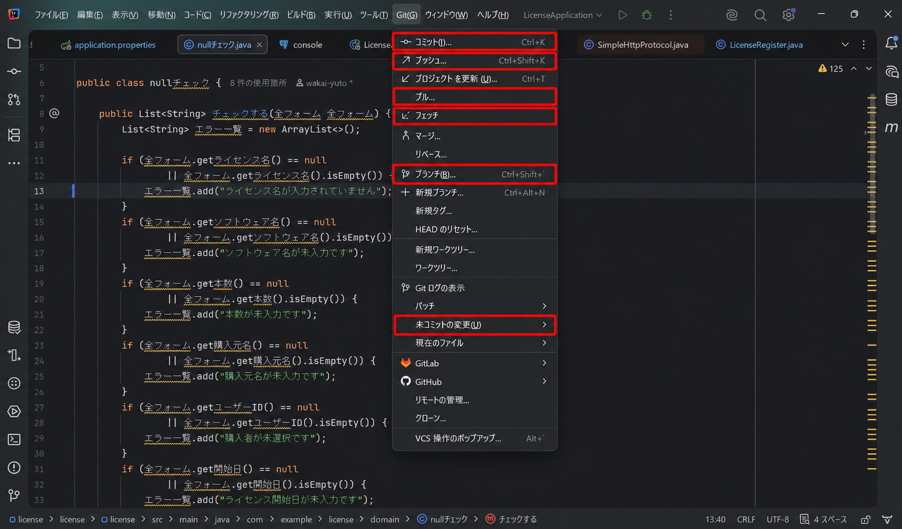

> **ボタンが見つからないとき**は、`Shift` を2回押して出る **どこでも検索** で `push` や `branch` などと検索すると、操作を探せます。

### ファイルの色の意味

プロジェクトツリーや コミット ツールウィンドウでは、ファイル名の色で状態が分かります。

| 色 | 意味 | CUI の `status` でいうと |
|---|---|---|
| **青** | 変更あり | `modified` |
| **緑** | 新規追加（Git の管理対象に追加済み） | `new file` |
| **赤茶** | 未追跡（Git 管理外） | `Untracked files` |
| **灰色** | `.gitignore` で無視されている | （表示されない） |
| **赤** | コンフリクト中 | `both modified` |

---

## 2. clone する

> **CUI でいうと**：`git clone URL`

1. ウェルカム画面で **リポジトリをクローン**（ウェルカム画面が出ない場合は ☰ → `ファイル` → `新規` → `バージョン管理からプロジェクト...`）をクリックする。
2. 左の **GitHub** を選ぶと、登録したアカウントのリポジトリ一覧が表示される（URL を直接入力する場合は **リポジトリー URL** を選ぶ）。
3. 対象のリポジトリを選び、**ディレクトリ**（保存先）を指定して **クローン** をクリックする。

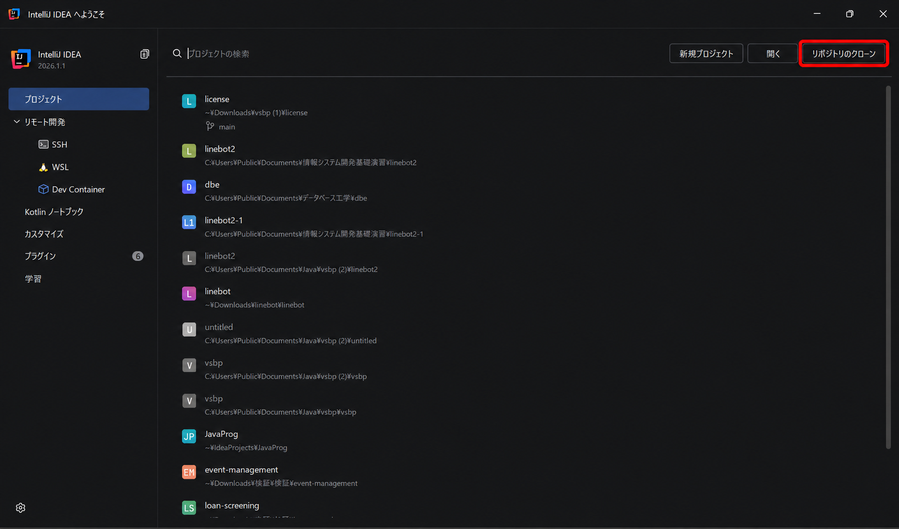

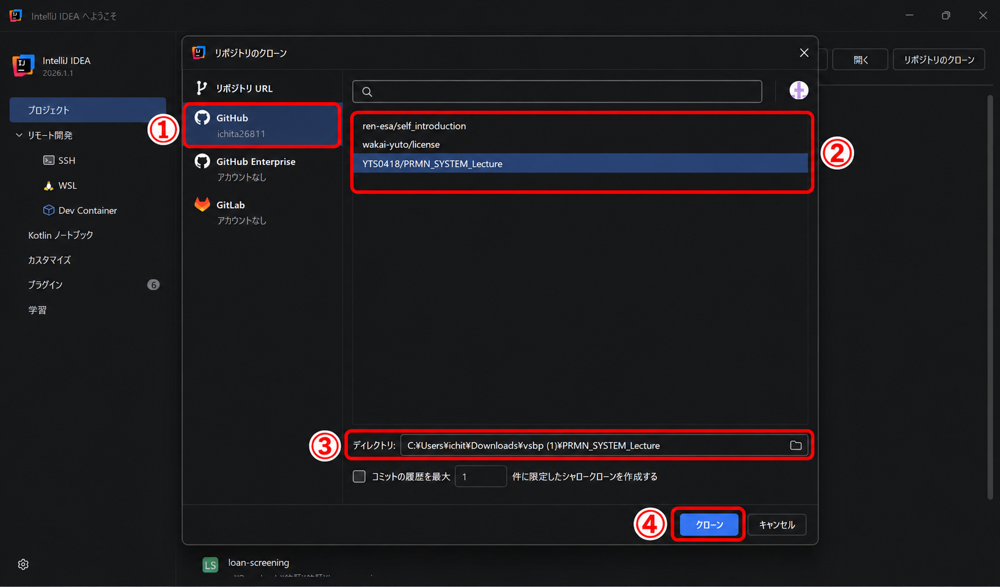

> [!WARNING]
> OneDrive などの同期フォルダの中は避けましょう（[00 導入編 6章](./00_Git導入・初期設定.md#6-リポジトリを-clone-する)）。

---

## 3. 変更と差分を確認する

> **CUI でいうと**：`git status` / `git diff`

左端の **コミットアイコン** をクリックして コミット ツールウィンドウを開くと、変更されたファイルが一覧で表示されます。

- **変更**：変更したファイル
- **バージョン管理外のファイル**：新しく作った、まだ Git 管理外のファイル

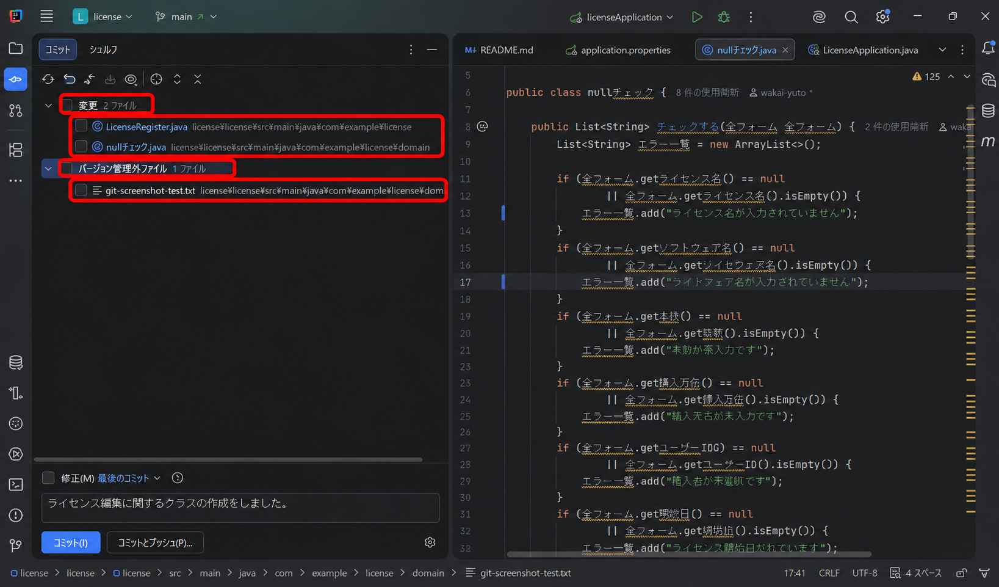

ファイルを**ダブルクリック**すると、**左に変更前・右に変更後**の差分が表示されます。

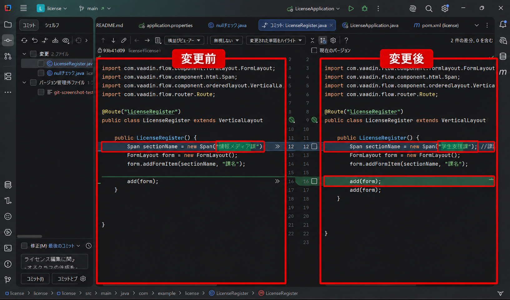

> エディタの行番号の横にも、色の帯（緑：追加、青：変更、灰色の三角：削除）が表示されます。クリックすると、その場で差分の確認や取り消しができます。

---

## 4. コミットする

> **CUI でいうと**：`git add` → `git commit -m "メッセージ"`

IntelliJ では、**ステージの代わりにチェックボックス**でコミットするファイルを選びます。

1. コミット ツールウィンドウで、コミットしたいファイルに**チェックを入れる**（`git add` に相当）。
   - 新しく作ったファイルは **バージョン管理外のファイル** にあるので、チェックを入れる（またはファイルを右クリック → **VCS に追加**）。
   - ファイルを新規作成した直後に「ファイルを Git に追加しますか？」と聞かれた場合は **追加** を選んでもよい。
2. 下の **コミットメッセージ** 欄に内容を書く。
3. **コミット** をクリックする（push まで行うなら **コミットしてプッシュ...**）。

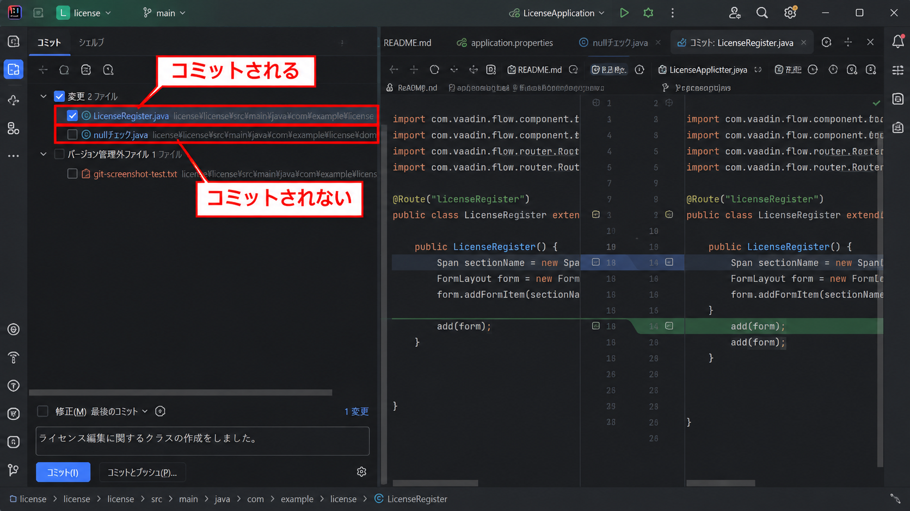

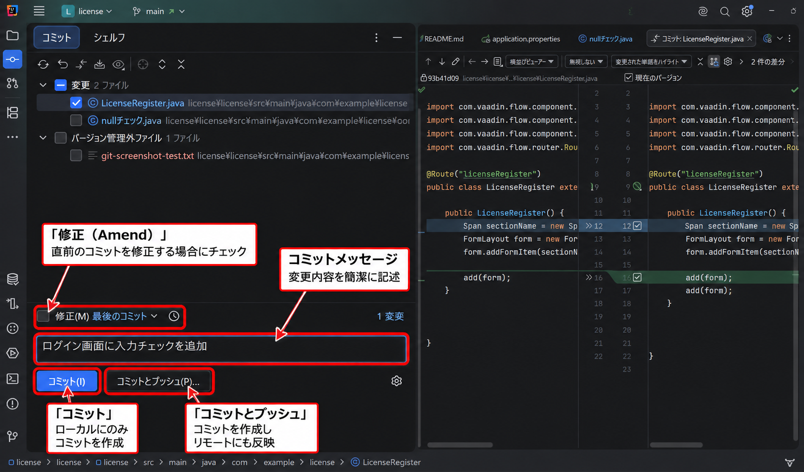

> **行単位でコミットする**：差分ビューで、変更ブロックの横にあるチェックボックスを外すと、その部分だけコミットから除外できます（CUI よりかんたんです）。

> **ステージを使いたい場合**：☰ → `設定` → `バージョン管理` → `Git` の **ステージングエリアを有効にする** にチェックを入れると、VSCode や CUI と同じ「ステージ」方式に切り替えられます。CUI との対応を意識したい人は試してみてください。

---

## 5. push と pull

> **CUI でいうと**：`git push` / `git pull`

### push する

1. 上部のブランチウィジェット → **プッシュ...**、または ☰ → `Git` → `プッシュ...`（`Ctrl + Shift + K` / Mac は `⌘ + Shift + K`）。
2. 左に送るコミットの一覧、右にそのコミットで変わるファイルが表示される。内容を確認して **プッシュ** をクリックする。

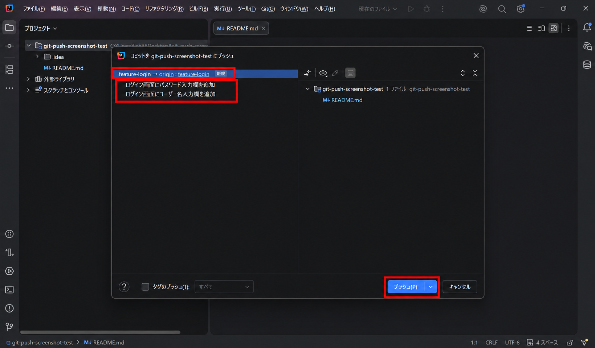

> **初めて push するブランチ**も、同じ プッシュ ダイアログでそのまま **プッシュ** をクリックすれば OK です（`-u origin ブランチ名` 相当の設定は自動で行われます）。ダイアログ内に **新規** と表示されます。

### pull する

上部のブランチウィジェット → **更新**（`Ctrl + T` / Mac は `⌘ + T`）、または ☰ → `Git` → `プル...`。

- **プロジェクトを更新**（更新）は、今いるブランチに GitHub の最新を取り込みます。初回は方式を聞かれるので **マージ** を選びます。

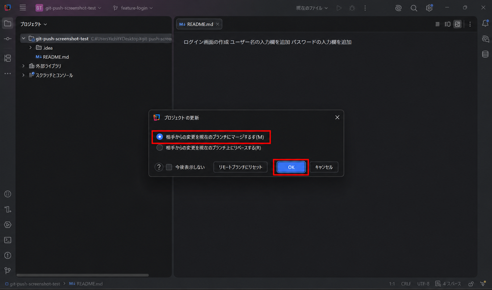

### fetch する

☰ → `Git` → **フェッチ**。GitHub の状態を確認だけします（ファイルは変わりません）。

---

## 6. 履歴を見る

> **CUI でいうと**：`git log --oneline --graph --all`

左下の **Git** アイコン（`Alt + 9` / Mac は `⌘ + 9`）→ **ログ** タブを開くと、すべてのブランチの履歴がグラフで表示されます。

- 左：ブランチの一覧（HEAD / ローカル / リモート）
- 中央：コミットの一覧とグラフ
- 右：選んだコミットで変更されたファイル

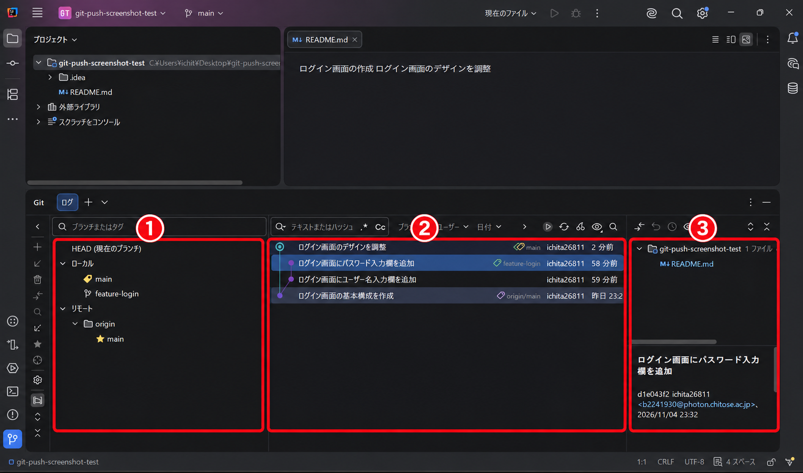

> 上部の検索欄や **ブランチ** / **ユーザー** / **日付** / **パス** のフィルターで、履歴を絞り込めます。

**ファイル単位の履歴**は、ファイルを右クリック → **Git** → **履歴を表示** で確認できます。

---

## 7. ブランチを作る・切り替える

> **CUI でいうと**：`git switch -c 名前` / `git switch 名前`

### 7-1. ブランチを作る

> 作る前に、main に切り替えて **更新** し、最新にしておきましょう（[02 基本編 5章](./02_CUI基本編.md#5-ブランチを使う)）。

1. 画面上部の **ブランチ名**（例：`main`）をクリックする。
2. **新規ブランチ...** を選ぶ。
3. ブランチ名（例：`feature-login`）を入力し、**ブランチをチェックアウト** にチェックが入っていることを確認して **作成** をクリックする（作成と同時に切り替わる）。

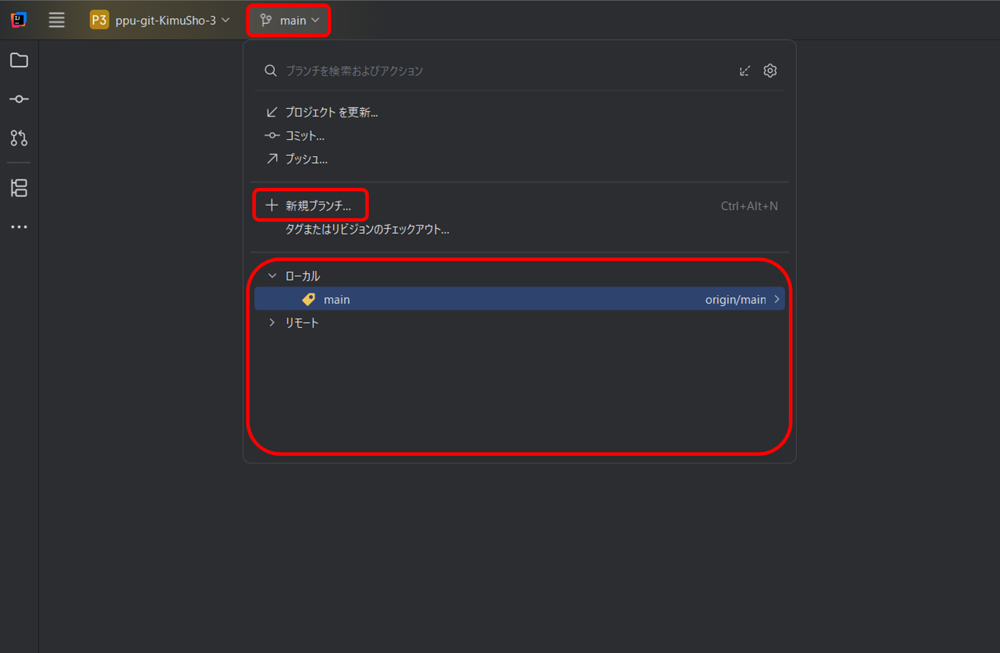

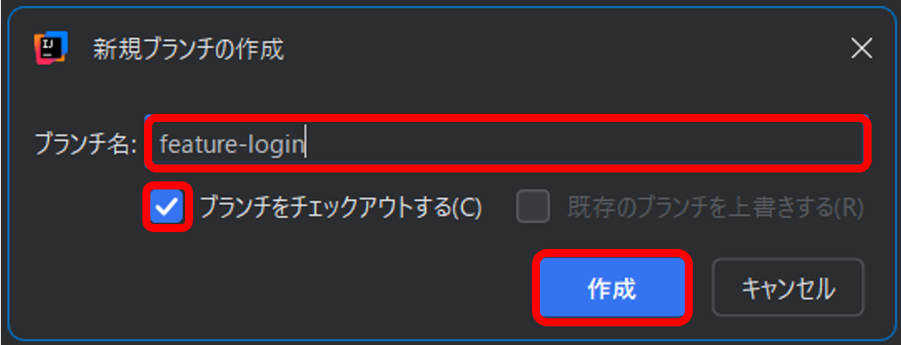

### 7-2. ブランチを切り替える

1. 上部の **ブランチ名** をクリックする。
2. 一覧から移動したいブランチにマウスを乗せ、サブメニューから **チェックアウト** を選ぶ。
   - **リモート** にある `origin/〇〇` を チェックアウト すると、手元に同じ名前のブランチが作られて切り替わります。

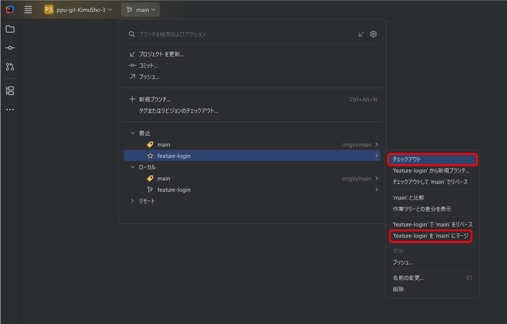
※8章で利用します

### 7-3. 未コミットの変更があるときのダイアログ

未コミットの変更が切り替え先とぶつかる場合、次のダイアログが表示されます。

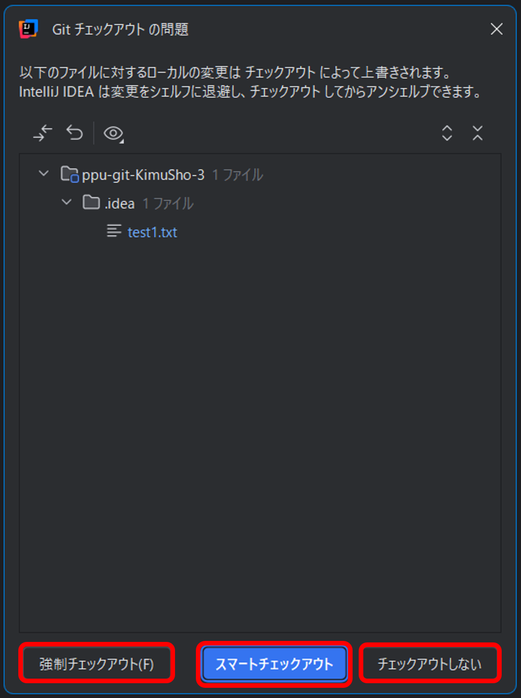

| 選択肢 | 何が起きるか | CUI でいうと | 使う場面 |
|---|---|---|---|
| **スマートチェックアウト** | 変更を退避して切り替え、**切り替え後に自動で戻す** | `git stash` → `git switch` → `git stash pop` | 変更を持ったまま移動したいとき |
| **強制チェックアウト** | 変更を**破棄**して切り替える | `git switch -f` | 変更が不要なとき**だけ** |
| **チェックアウトしない** | 切り替えをやめる | — | 迷ったとき（先にコミットする） |

> [!WARNING]
> **強制チェックアウト で破棄した変更は、Git では元に戻せません**（IntelliJ の **ローカル履歴** で救える場合があります → [06 CUIとGUIの使い分け](./06_CUIとGUIの使い分け.md)）。

> スマートチェックアウト で使う退避方式（スタッシュ / シェルフ）は、☰ → `設定` → `バージョン管理` → `Git` の **Clean working tree using** で選べます。

---

## 8. 最新の main を取り込む（マージ）

> **CUI でいうと**：`git fetch` → `git merge origin/main`（[03 応用編 2章](./03_CUI応用編.md#2-自分のブランチを最新の-main-に合わせる)）

1. 上部のブランチ名が **自分のブランチ**（例：`feature-login`）になっていることを確認する。
2. ☰ → `Git` → **フェッチ** で GitHub の最新を取ってくる。
3. 上部のブランチ名をクリックし、**リモート** → **origin/main** にマウスを乗せる。
4. サブメニューから **'origin/main' を 'feature-login' にマージ** を選ぶ。
5. コンフリクトがなければマージ完了。**プッシュ...** で push する。

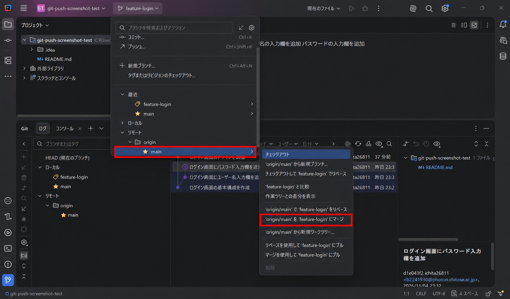

> [!WARNING]
> **向きに注意**：メニューの文字が「'取り込むブランチ' を '今いるブランチ' にマージ」になっているか必ず確認しましょう。

> 同じサブメニューにある **'feature-login' を 'origin/main' にリベース** は、[03 応用編 3章](./03_CUI応用編.md#3-参考rebase-で合わせる)の rebase です。慣れるまでは マージを使いましょう。

---

## 9. コンフリクトを解決する

> **CUI でいうと**：ファイルを編集して印を消す → `git add` → `git commit`（[02 基本編 7章](./02_CUI基本編.md#7-コンフリクトを解決する)）

マージや 更新 でコンフリクトが起きると、**競合** ダイアログが表示されます。

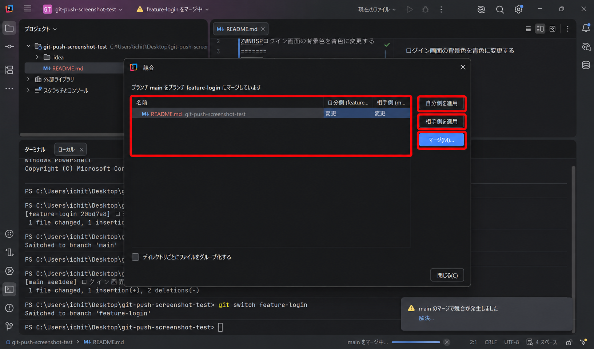

| ボタン | 意味 |
|---|---|
| **自分の変更を採用** | ファイル全体を自分側の内容にする |
| **相手の変更を採用** | ファイル全体を相手側（取り込んだブランチ）の内容にする |
| **マージ...** | 3画面のエディタで、箇所ごとに選ぶ（おすすめ） |

### マージ... の3画面エディタ

1. 対象ファイルを選び、**マージ...** をクリックする。
2. 3つに分かれた画面が開く。
   - 左：**自分の変更**（Your version）　／　中央：**結果**（保存される内容）　／　右：**相手の変更**（Their version）
3. 各変更の横にある **»**（左の内容を採用）・**«**（右の内容を採用）・**×**（その変更を採用しない）をクリックして取り込む。中央の結果は直接編集もできる。
4. 上部の **左を採用** / **右を採用** で、まとめて片方を採用することもできる。
5. 内容を確認して **適用** をクリックする。

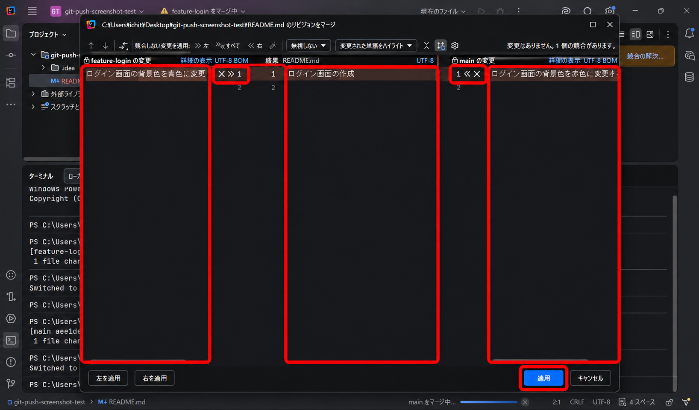

### 解決したら

すべてのファイルを解決すると、マージのコミットが作られます。コミットされずに コミット ツールウィンドウに変更が残っている場合は、メッセージ（自動で入っています）を確認して **コミット** します。最後に **プッシュ...** で push します。

> **マージをやめたい**（CUI の `git merge --abort`）：☰ → `Git` → **マージを中止** を選びます（コンフリクト中のみ表示されます）。

---

## 10. 取り消す

> **CUI でいうと**：`git restore` / `git commit --amend` / `git reset` / `git revert`（[03 応用編 4章](./03_CUI応用編.md#4-コミットやプッシュを取り消す)）

IntelliJ は、**Git ツールウィンドウの ログ でコミットを右クリック**すると、多くの取り消し操作ができます。

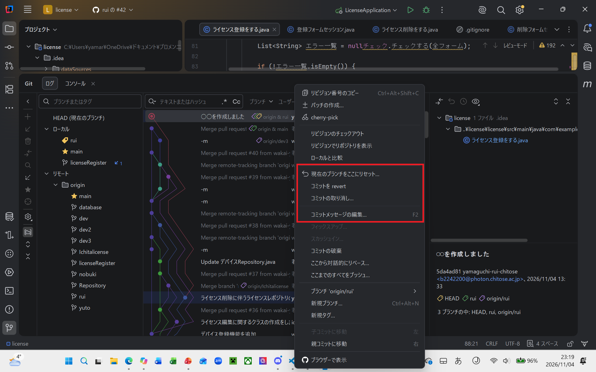

| やりたいこと | IntelliJ での操作 | CUI でいうと |
|---|---|---|
| 編集を取り消す（コミット前） | コミット ツールウィンドウでファイルを右クリック → **ロールバック...** ⚠️ | `git restore ファイル名` |
| コミットから外す（コミット前） | チェックを外す | `git restore --staged` |
| 直前のコミットを直す（push 前） | コミット ツールウィンドウの **修正（Amend）** にチェックを入れてコミット | `git commit --amend` |
| 直前のコミットのメッセージを直す（push 前） | ログ でコミットを右クリック → **コミットメッセージを編集...** | `git commit --amend -m` |
| 直前のコミットを取り消す（push 前） | ログ でコミットを右クリック → **コミットを元に戻す...**（変更は残る） | `git reset --soft HEAD~1` |
| 任意のコミットまで戻す（push 前） | ログ で戻したいコミットを右クリック → **現在のブランチをここまでリセット...** → モードを選ぶ | `git reset --soft / --mixed / --hard` |
| push 済みのコミットを打ち消す | ログ でコミットを右クリック → **コミットを取り消す** → 自動で打ち消すコミットができるので プッシュ | `git revert コミットID` |

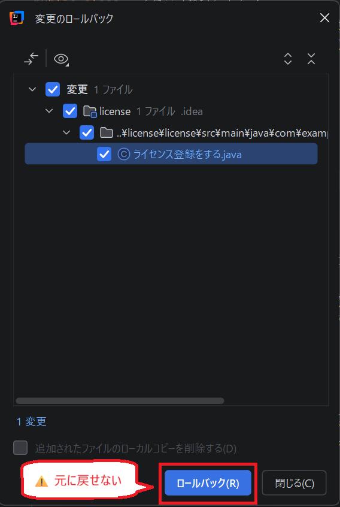

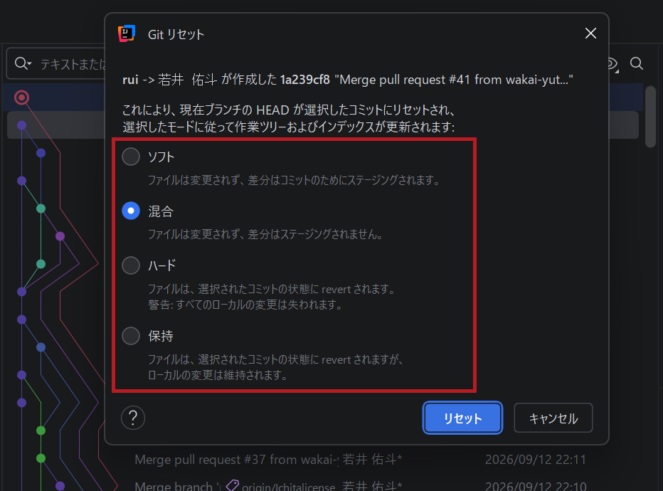

> Reset のモードの意味は [03 応用編 4-3](./03_CUI応用編.md#4-3-コミットをなかったことにするresetpush-前のみ) と同じです（**Keep** は「未コミットの変更を残したまま、ぶつからない範囲で巻き戻す」モード）。まずは **Soft** を使いましょう。

### 自分だけのブランチで push を取り消す（force push）

> **CUI でいうと**：`git reset` → `git push --force-with-lease`（[03 応用編 4-5](./03_CUI応用編.md#4-5-自分だけのブランチで-push-を取り消すreset--force-push)）

1. ログ で **現在のブランチをここまでリセット...**（または コミットを元に戻す...）で取り消す。
2. **プッシュ...** を開き、**プッシュ** ボタンの横の ▼ → **強制プッシュ** を選ぶ（IntelliJ は自動で `--force-with-lease` 相当の安全な方法で上書きします）。

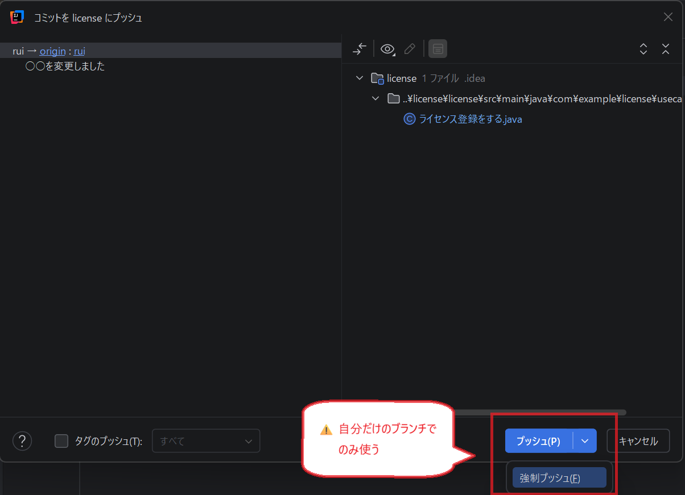

> [!WARNING]
> main など他の人も使うブランチでは、強制プッシュ せずに **コミットを取り消す** を使いましょう。IntelliJ は初期設定で main への 強制プッシュ を禁止しています（`設定` → `バージョン管理` → `Git` の **保護されたブランチ**）。

---

## 11. 変更を退避する（スタッシュ・シェルフ）

> **CUI でいうと**：`git stash -u` / `git stash pop`（[03 応用編 5章](./03_CUI応用編.md#5-作業を一時的に退避するstash)）

IntelliJ には、Git の **スタッシュ** と、IntelliJ 独自の **シェルフ** の2つの退避方法があります。どちらでもかまいませんが、CUI と対応させたい場合はスタッシュを使いましょう。

### スタッシュ

- **退避**：☰ → `Git` → `未コミットの変更` → **変更をスタッシュ...** → メッセージを入力して **スタッシュを作成**
- **戻す**：☰ → `Git` → `未コミットの変更` → **スタッシュ解除...** → 一覧から選んで **スタッシュをポップ**（戻して削除）または **スタッシュを適用**（戻して残す）

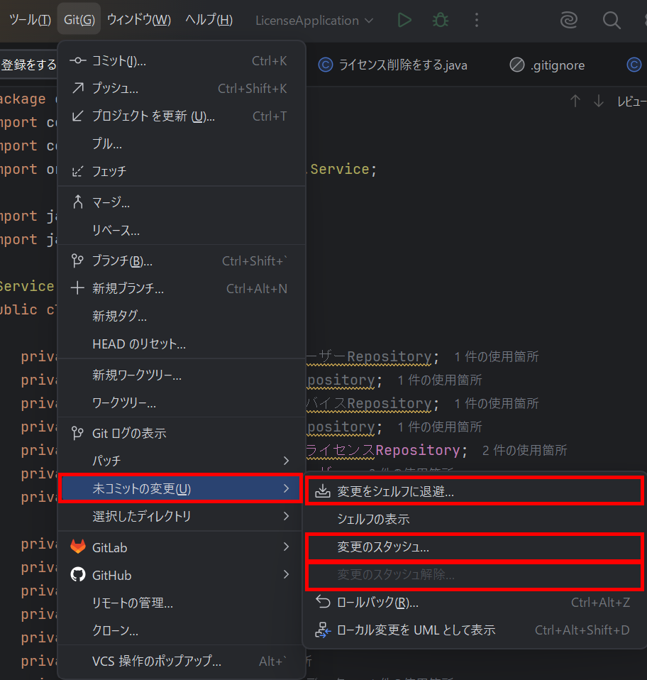

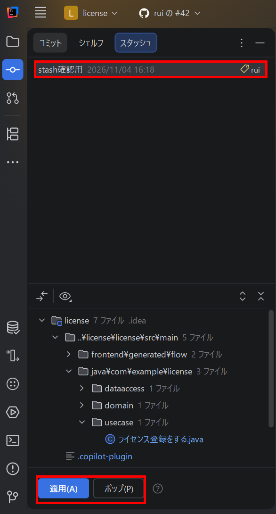

### シェルフ（IntelliJ 独自）

- **退避**：コミット ツールウィンドウでファイルを右クリック → **変更をシェルブ...**（ファイルを選んで退避できる）
- **戻す**：コミット ツールウィンドウの **シェルフ** タブを開き、対象を右クリック → **シェルブ解除...**

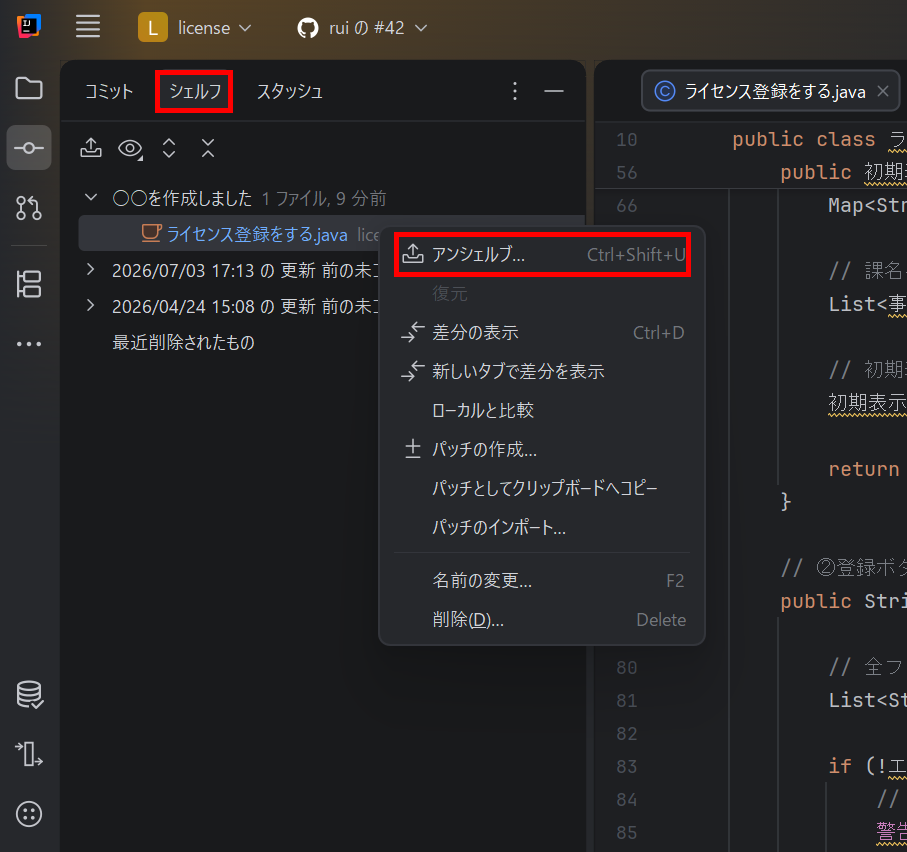

---

## 12. プルリクエストを使う

> **CUI でいうと**：CUI ではなく GitHub の Web 画面で行う操作です（[03 応用編 6章](./03_CUI応用編.md#6-プルリクエストを使う)）。

PR は **GitHub の Web 画面で操作するのが基本**です（手順は 03 応用編を参照）。IntelliJ IDEA には GitHub 連携が標準で入っているので、IDE の中から PR の作成やレビューもできます。

### PR を作る

1. 自分のブランチを push しておく。
2. ☰ → `Git` → `GitHub` → **プルリクエストを作成...**（または左端の **プルリクエスト** アイコン → **＋**）を選ぶ。
3. 取り込み先（**main**）と自分のブランチ、タイトル・説明を入力し、**プルリクエストを作成** をクリックする。

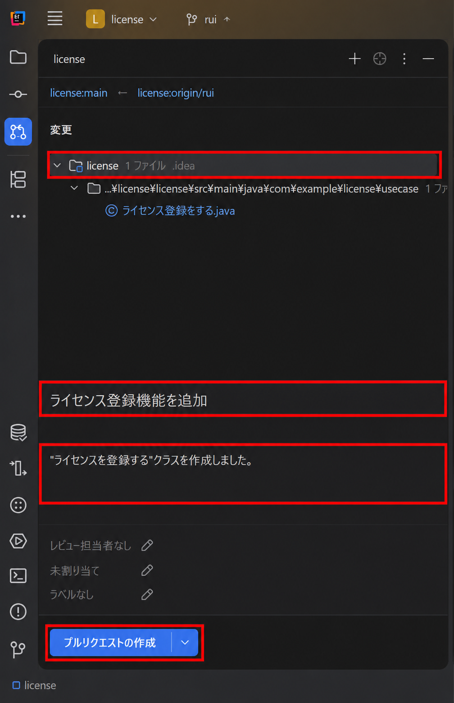

### PR をレビューする

1. 左端の **プルリクエスト** アイコンをクリックし、一覧から対象の PR を選ぶ。
2. 変更ファイルをダブルクリックすると差分が開き、行の横の **＋**（吹き出し）からコメントを書ける。
3. **チェックアウト** で PR のブランチに切り替えると、手元で動かして確認できる。

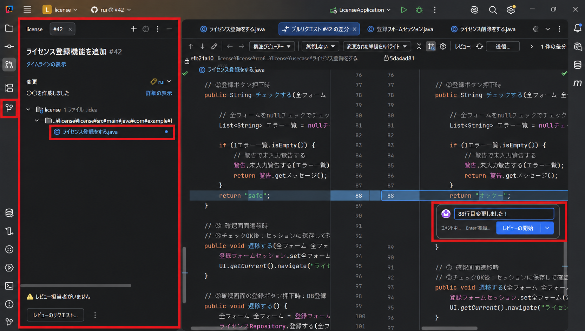

> マージ方式の選択やブランチの削除は、Web 画面のほうが分かりやすいです。慣れるまでは **作成は IntelliJ でも Web でもOK、レビューとマージは Web** がおすすめです。

---

## 13. コマンドとの対応表

| コマンド | IntelliJ IDEA での操作 |
|---|---|
| `git clone` | ウェルカム画面の **リポジトリをクローン** |
| `git status` | コミット ツールウィンドウの変更一覧・ファイルの色 |
| `git diff` | 変更ファイルをダブルクリック |
| `git add` | コミット ツールウィンドウでファイルに**チェック** |
| `git restore` | ファイルを右クリック → **ロールバック...** |
| `git commit -m` | メッセージを入力して **コミット** |
| `git commit --amend` | **修正（Amend）** にチェックを入れてコミット |
| `git push` | ブランチウィジェット → **プッシュ...**（`Ctrl + Shift + K`） |
| `git pull` | ブランチウィジェット → **更新**（`Ctrl + T`） |
| `git fetch` | ☰ → Git → **フェッチ** |
| `git log --graph --all` | Git ツールウィンドウ → **ログ** |
| `git switch -c 名前` | ブランチウィジェット → **新規ブランチ...** |
| `git switch 名前` | ブランチウィジェット → ブランチ → **チェックアウト** |
| `git merge origin/main` | ブランチウィジェット → リモート → origin/main → **マージ** |
| `git merge --abort` | ☰ → Git → **マージを中止** |
| `git reset` | ログ で右クリック → **コミットを元に戻す...** / **現在のブランチをここまでリセット...** |
| `git revert` | ログ で右クリック → **コミットを取り消す** |
| `git push --force-with-lease` | プッシュ ダイアログの ▼ → **強制プッシュ** |
| `git stash` / `pop` | ☰ → Git → 未コミットの変更 → **変更をスタッシュ...** / **スタッシュ解除...** |
| `git reflog` など | できない → [06 CUIとGUIの使い分け](./06_CUIとGUIの使い分け.md) |

### メニュー名の英和対応表

英語表示で使う人や、ネットで調べるときのための対応表です。訳はバージョンによって少し異なることがあります。

| 日本語表示 | 英語表示 |
|---|---|
| コミット / コミットしてプッシュ... | Commit / Commit and Push... |
| プッシュ... / プル... / フェッチ | Push... / Pull... / Fetch |
| プロジェクトを更新 | Update Project |
| 新規ブランチ... / チェックアウト | New Branch... / Checkout |
| スマートチェックアウト / 強制チェックアウト / チェックアウトしない | Smart Checkout / Force Checkout / Don't Checkout |
| 変更 / バージョン管理外のファイル | Changes / Unversioned Files |
| ロールバック... | Rollback... |
| コミットを元に戻す... / コミットを取り消す | Undo Commit... / Revert Commit |
| 現在のブランチをここまでリセット... | Reset Current Branch to Here... |
| 強制プッシュ | Force Push |
| 変更をスタッシュ... / スタッシュ解除... | Stash Changes... / Unstash Changes... |
| 変更をシェルブ... / シェルブ解除... | Shelve Changes... / Unshelve... |
| 自分の変更を採用 / 相手の変更を採用 | Accept Yours / Accept Theirs |
| マージを中止 | Abort Merge |

---

← 前へ [03. CUI 応用編](./03_CUI応用編.md) ｜ VSCode を使う人は → [04. GUI VSCode編](./04_GUI_VSCode編.md) ｜ 次へ → [06. CUIとGUIの使い分け](./06_CUIとGUIの使い分け.md)

[📖 Git資料の目次](./00_Git導入・初期設定.md#git-資料の構成) ｜ [🏠 全体の目次](../README.md#目次)
