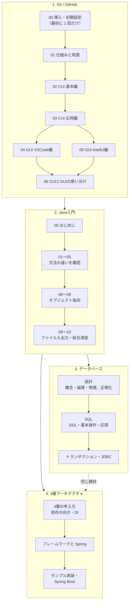

# PRMN_SYSTEM_Lecture

公立千歳科学技術大学のプロジェクトメンバー（システム班）向けの教育資料です。

## この資料の使い方

まず **1. Git / GitHub** で、メンバー間でドキュメントやソースコードを共有・共同編集する方法を身につけます。次に **2. Java入門** で、プログラミングの基礎を学びます。Java入門を終えたあとは、システム開発の基礎として **3. データベース** と **4. 4層アーキテクチャ** の資料があります。

| 資料 | 対象 |
|---|---|
| [1. Git / GitHub](#1-git--github) | 全員（最初に学ぶ） |
| [2. Java入門](#2-java入門) | Java を初めて学ぶ人（目安：全 10 章で約 16 時間） |
| [3. データベース](#3-データベース) | Java入門を終えた人（目安：全 12 章で約 20 時間） |
| [4. 4層アーキテクチャ](#4-4層アーキテクチャ) | Java入門を終えた人（目安：全 6 章で約 9.5 時間） |

3 と 4 は同じ題材（成績管理システム）でつながっています。動く完成コードは、別のリポジトリ（サンプルシステム）にまとめています。

## 学習の流れ

- 04 と 05 は、普段使う IDE に合わせて**どちらか一方**を読めば大丈夫です。
- Java 入門は、06〜08 章（オブジェクト指向）に一番時間をかけてください。
- データベースと 4層アーキテクチャは、同じ成績管理システムを題材にしています。互いの用語（Infrastructure 層、SQL など）を参照している箇所があります。

## 資料の書き方について

本リポジトリのドキュメントは、基本的に Markdown（マークダウン）で記述します。

> Markdown とは、シンプルな記号を使って文章の構造や装飾を指定できる「軽量マークアップ言語」のことです。

書き方は [マークダウンチートシート](/共通/マークダウンチートシート.md) にまとめてあります。

## 目次

### 1. Git / GitHub

プロジェクトの活動では、メンバー間でドキュメントやソースコードを共有し、共同で編集する場面が欠かせません。そこで必要になるのが、変更の履歴を残しながら安全に作業を進めるための仕組みである **Git** と、それをチーム開発の場として使えるようにする **GitHub** です。

読み進める順番は次のとおりです。

1. **00 導入・初期設定** を済ませる（最初に 1 回だけ）
2. **CUI（コマンド）で仕組みを理解**する（01〜03）
3. **GUI（ボタン操作）** に移る（04・05）
4. 困ったときは 06 を見る

| 資料 | 内容 |
|---|---|
| [00 Git導入・初期設定](/Git/00_Git導入・初期設定.md) | インストール、アカウント、認証、clone（最初に 1 回） |
| [01 Gitの仕組みと用語](/Git/01_Gitの仕組みと用語.md) | Git とは、データの流れ、用語集 |
| [02 CUI基本編](/Git/02_CUI基本編.md) | add / commit / push / pull、ブランチ、マージ、コンフリクト |
| [03 CUI応用編](/Git/03_CUI応用編.md) | 最新の main への追従、コミットや push の取り消し、プルリクエスト |
| [04 GUI VSCode編](/Git/04_GUI_VSCode編.md) | VSCode のボタン操作 |
| [05 GUI IntelliJ編](/Git/05_GUI_IntelliJ編.md) | IntelliJ IDEA のボタン操作 |
| [06 CUIとGUIの使い分け](/Git/06_CUIとGUIの使い分け.md) | GUI でできない操作、困ったときの戻り方 |

### 2. Java入門

Java を初めて学ぶ人向けの資料です。C 言語・Python を学習済みであることを前提に、対比を交えながらコード付きで解説します。まずは [はじめに](/付録/Java入門/00_はじめに.md) から読んでください。

| 章 | 内容 |
|---|---|
| [00 はじめに](/付録/Java入門/00_はじめに.md) | 資料の概要、学習の流れ、サンプルコードの実行方法 |
| [01 Javaとは・環境構築](/付録/Java入門/01_Javaとは・環境構築.md) | JDK のインストール、Hello World |
| [02 基本文法・変数と型](/付録/Java入門/02_基本文法・変数と型.md) | 変数、型、文字列、入出力 |
| [03 演算子と制御構文](/付録/Java入門/03_演算子と制御構文.md) | if / switch / for / while |
| [04 配列とコレクション](/付録/Java入門/04_配列とコレクション.md) | 配列、ArrayList、HashMap、HashSet |
| [05 メソッド](/付録/Java入門/05_メソッド.md) | メソッド、オーバーロード、static、値渡し |
| [06 クラスとオブジェクト](/付録/Java入門/06_クラスとオブジェクト.md) | オブジェクト指向の基本 |
| [07 継承とポリモーフィズム](/付録/Java入門/07_継承とポリモーフィズム.md) | 継承、抽象クラス、インタフェース |
| [08 例外処理](/付録/Java入門/08_例外処理.md) | try-catch、throws |
| [09 ファイル入出力・標準ライブラリ](/付録/Java入門/09_ファイル入出力・標準ライブラリ.md) | ファイル操作、日付、乱数 |
| [10 総合演習](/付録/Java入門/10_総合演習.md) | 成績管理プログラムの作成 |

### 3. データベース

アプリケーションが扱うデータを、安全に・正しく保存するための資料です。**設計**（概念設計・論理設計・物理設計、正規化）から、**SQL**、**トランザクション**、Java からの利用（**JDBC**）までを、PostgreSQL を使って学びます。題材は成績管理システムです。まずは [はじめに](/データベース/00_はじめに.md) から読んでください。

| 章 | 内容 |
|---|---|
| [00 はじめに](/データベース/00_はじめに.md) | 資料の概要、学習の流れ、4層の中での位置づけ |
| [01 データベースとは](/データベース/01_データベースとは.md) | DB と DBMS、リレーショナルデータベース、SQL の種類 |
| [02 データベース設計の流れ](/データベース/02_データベース設計の流れ.md) | 概念・論理・物理の 3 段階、要件の整理 |
| [03 概念設計とER図](/データベース/03_概念設計とER図.md) | エンティティ、リレーションシップ、ER 図の描き方 |
| [04 論理設計](/データベース/04_論理設計.md) | ER 図からテーブルへ、キーの種類、関数従属 |
| [05 正規化](/データベース/05_正規化.md) | 更新・挿入・削除の異常、第 1〜第 3 正規形 |
| [06 物理設計](/データベース/06_物理設計.md) | データ型、制約、インデックス |
| [07 PostgreSQL環境構築](/データベース/07_PostgreSQL環境構築.md) | インストール、psql、pgAdmin |
| [08 SQL：テーブルの作成（DDL）](/データベース/08_SQL_DDL.md) | CREATE / ALTER / DROP |
| [09 SQL：基本操作](/データベース/09_SQL_基本操作.md) | INSERT / SELECT / UPDATE / DELETE、NULL |
| [10 SQL：応用](/データベース/10_SQL_応用.md) | 集計、JOIN、サブクエリ、VIEW |
| [11 トランザクション](/データベース/11_トランザクション.md) | ACID、COMMIT / ROLLBACK、同時実行、ロック |
| [12 JavaからDBを使う（JDBC）](/データベース/12_JavaからDBを使う_JDBC.md) | JDBC、PreparedStatement、Repository の実装 |

### 4. 4層アーキテクチャ

アプリケーションを **Presentation / Application / Domain / Infrastructure** の 4 つの層に分けて設計する考え方を学ぶ資料です。フレームワークと **Spring Boot** の考え方、他のフレームワークとの違いも扱います。題材はデータベース編と同じ成績管理システムで、動く完成コードは別のサンプルリポジトリ（`step1-memory` / `step2-jdbc` / `step3-spring`）にまとめています。まずは [はじめに](/4層アーキテクチャ/00_はじめに.md) から読んでください。

| 章 | 内容 |
|---|---|
| [00 はじめに](/4層アーキテクチャ/00_はじめに.md) | 資料の概要、題材、サンプルリポジトリとの役割分担 |
| [01 なぜ層に分けるのか](/4層アーキテクチャ/01_なぜ層に分けるのか.md) | 1 つにまとめたコードの問題点、関心の分離 |
| [02 4層の役割](/4層アーキテクチャ/02_4層の役割.md) | 各層の責務、置くもの・置かないもの、パッケージ構成 |
| [03 依存の向きとインタフェース](/4層アーキテクチャ/03_依存の向きとインタフェース.md) | 依存の方向、依存性逆転、コンストラクタ注入 |
| [04 フレームワークとSpring](/4層アーキテクチャ/04_フレームワークとSpring.md) | ライブラリとの違い、Spring / Spring Boot、他のフレームワークとの比較 |
| [05 サンプル実装の読み方](/4層アーキテクチャ/05_サンプル実装の読み方.md) | 素の Java で作った 4 層の成績管理（保存先はメモリ）を読み解く |
| [06 Spring Bootで書き直す](/4層アーキテクチャ/06_Spring_Bootで書き直す.md) | 同じ構造を Spring Boot で書く |

> 📦 **サンプルリポジトリ**：[PRMN_SYSTEM_Sample](https://github.com/<ORG>/PRMN_SYSTEM_Sample)（URL は仮置きです）

## 資料を修正・追加するとき

修正や追加は、`main` ブランチに直接 push せず、自分のブランチを作ってプルリクエストで提出してください。手順は [03 CUI応用編](/Git/03_CUI応用編.md) を参照してください。
