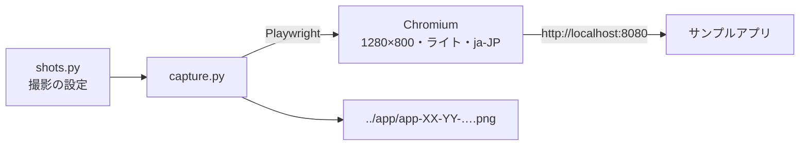

# 画面の自動撮影

フロントエンド資料の、アプリの画面（`app-…`）を、**Playwright** で、自動撮影するスクリプトです。サンプルを起動して、URL にアクセスし、必要な操作をして、**赤枠と番号を付けて**、PNG に保存します。一覧は、[撮影リスト](/images/frontend/撮影リスト.md) にあります。

> [!NOTE]
> このスクリプトは、サンプルの**中身（Java のコード）には依存しません**。URL と、画面上の見た目（ラベルの文字）だけを使うので、サンプルのフォルダの構成が、変わっても、動きます。

## 用意するもの

```bash
python3 -m venv .venv && . .venv/bin/activate
pip install playwright
playwright install chromium
```

## 実行の手順

1. サンプル（Vaadin 版）を起動する（撮影用のデータが入った状態。`http://localhost:8080`）
2. このフォルダで、スクリプトを実行する

```bash
python3 capture.py --base-url http://localhost:8080          # すべて
python3 capture.py --only app-05-01-input-components         # 1 枚だけ
```

画像は、`../app/` に保存されます。

## 仕組み

| ファイル | 内容 |
|---|---|
| `shots.py` | **撮影の設定の一覧**（ファイル名、URL、ログインのユーザー、操作、赤枠を付ける場所、画面の幅） |
| `capture.py` | 一覧を読み、ブラウザを操作して、撮影する。赤枠と番号は、ページに **CSS と要素を注入**して付ける |



## 撮影の条件

- ビューポート 1280×800（`app-04-02` の `-02` だけ 480 幅）、ライトテーマ、ロケール `ja-JP`
- アニメーションを止める（CSS で `transition` / `animation` を無効にする）
- 赤枠は 3px、番号は赤い丸の中に白い文字（①②…）
- 撮影用のユーザー（`teacher01`、`student01`）は、**講義用の仮のもの**。パスワードは、環境変数（`CAPTURE_PASSWORD`）で渡し、**ファイルには書かない**

## 新しい画像を追加するとき

1. 資料に、📷 スクショ指定のブロックを書く
2. `shots.py` に、設定を 1 つ追加する
3. [撮影リスト](/images/frontend/撮影リスト.md) に、行を足す
4. 撮影して、資料のブロックを、画像の 1 行に置き換える

## 注意

- 撮影は、**開発用の仮のデータだけ**で行う。本物の学生の氏名・成績を、写さない
- Vaadin のバージョンを上げたら、全部撮り直す（見た目が変わる）
- 手動撮影の画像（`vdn-…`、`ide-…`）は、このスクリプトの対象外
