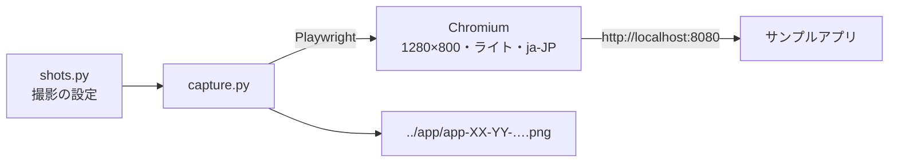

# 画面の自動撮影

フロントエンド資料の、アプリの画面（`app-…`）を、**Playwright** で、自動撮影するスクリプトです。サンプルを起動して、URL にアクセスし、必要な操作をして、**赤枠と番号を付けて**、PNG に保存します。一覧は、[撮影リスト](/images/frontend/撮影リスト.md) にあります。

> [!NOTE]
> このスクリプトは、サンプルの**中身（Java のコード）には依存しません**。URL と、画面上の見た目（ラベルの文字）だけを使うので、サンプルのフォルダの構成が、変わっても、動きます。

## 用意するもの

```bash
python3 -m venv .venv && . .venv/bin/activate
pip install playwright pillow       # Pillow は、撮影後の検査（枠の位置の確認）に使う
playwright install chromium          # Chromium を入れる。Chrome が入っているなら、次の行でもよい
export CAPTURE_BROWSER_CHANNEL=chrome  # 入れた Chrome を使う場合だけ（Playwright の Chromium を使うなら不要）
```

## 実行の手順

1. サンプル（Vaadin 版、`frontend/grades-vaadin/`）を、**本番モード**で起動する。撮影用のデータ（`frontend/db/` の SQL）が入った状態にする

```bash
cd ../../../../PRMN_SYSTEM_Sample/frontend/grades-vaadin     # サンプルのリポジトリ
./mvnw -Pproduction -DskipTests clean package
java -jar target/grades-vaadin-0.0.1-SNAPSHOT.jar            # http://localhost:8080
```

2. このフォルダで、撮影用の仮のパスワードを環境変数に入れて、スクリプトを実行する

```bash
export CAPTURE_PASSWORD='grades-sample'                       # サンプルの、仮のパスワード（コードには書かない）
python3 capture.py                                            # すべて（テーマの比較は除く）
python3 capture.py --only app-05-01                           # 名前が app-05-01 で始まるものだけ
```

画像は、`../app/` に保存されます。

> [!TIP]
> **本番モードで撮影する**のがおすすめです。開発モードでは、画面の隅に、「App is running in development mode」の表示が出て、画像に写ってしまいます。

### テーマの比較（`app-13-01`）

テーマを変えた、2 つのアプリが必要です。

1. 既定のテーマのアプリを、8080 番で起動する（上の手順）
2. 起動クラス（`成績管理アプリ`）に `@StyleSheet(Lumo.STYLESHEET)` を付けたコピーを作り、`--server.port=8081` で起動する
3. 次のように実行する

```bash
python3 capture.py --alt-url lumo=http://localhost:8081 --only app-13
```

### 部品の見本の画面

`app-04`、`app-05` の画像は、サンプルの `部品見本ビュー`（`/demo/components`）を撮っています。業務の画面ではなく、資料の画像のための画面です。

## 仕組み

| ファイル | 内容 |
|---|---|
| `shots.py` | **撮影の設定の一覧**（ファイル名、URL、ログインのユーザー、操作、赤枠を付ける場所、画面の幅） |
| `capture.py` | 一覧を読み、ブラウザを操作して、撮影する。赤枠と番号は、ページに **CSS と要素を注入**して付ける |



## 撮影の条件

- ビューポート 1280×800（`app-04-02` の `-02` だけ 480 幅）、ライトテーマ、ロケール `ja-JP`
- アニメーションを止める（CSS で `transition` / `animation` を無効にする）
- 赤枠は 3px、番号は赤い丸の中に白い文字（①②…）。ダイアログや通知（最前面に出る部品）の上にも出るよう、赤枠も、最前面（`popover`）に出す
- 撮影用のユーザー（`teacher01`、`student01`）は、**講義用の仮のもの**。パスワードは、環境変数（`CAPTURE_PASSWORD`）で渡す

## 作業の流れ（画像を足す・直すとき）

```bash
python3 capture.py --only parts/button --sheet   # 1. 撮影。失敗した画像は出力されない。_check/ に、枠の周囲の確認用の画像ができる
python3 fix_img_widths.py --write                # 2. 章の画像を、実寸の幅（）にする
python3 gen_legend.py --write                    # 3. 番号の説明の表を、shots.py の label から作る
python3 gen_legend.py --check                    #    番号と表の一致を確認
python3 check_snippets.py                        # 4. 章のコードと、サンプルの見本のコードの一致を確認
python3 gen_shotlist.py                          # 5. 撮影リストを作り直す
```

## 新しい画像を追加するとき

1. サンプルの見本の画面に、コードを足す（`// snippet: 名前` 〜 `// end snippet`。要素に `見本("名前", …)` で id を付ける）
2. `shots.py` に、設定を 1 つ足す（番号は、章の本文が説明するものだけ）
3. 撮影し、章に、コードブロック（`<!-- snippet: 名前 -->`）と画像を置く
4. 上の「作業の流れ」の 2〜5 を実行する

## 注意

- 撮影は、**開発用の仮のデータだけ**で行う。本物の学生の氏名・成績を、写さない
- 赤枠は、画面の部品の位置から、自動で計算します。ずれたり、文字に重なったりしたときは、`shots.py` のセレクタを直します
- 撮影に失敗した 1 枚があっても、ほかの撮影は続けます（最後に、失敗した枚数を表示します）
- Vaadin のバージョンを上げたら、全部撮り直す（見た目が変わる）
- 手動撮影の画像（`vdn-…`、`ide-…`）は、このスクリプトの対象外
