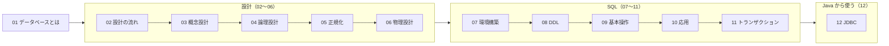
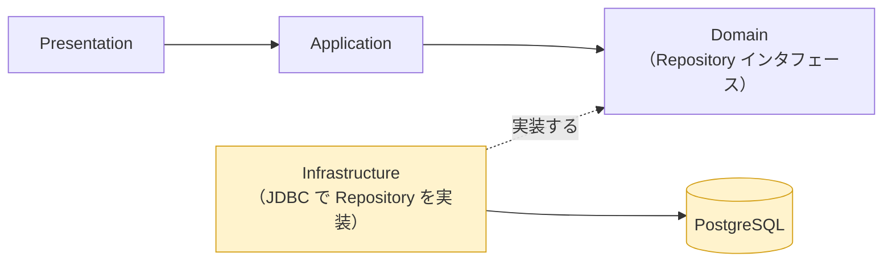
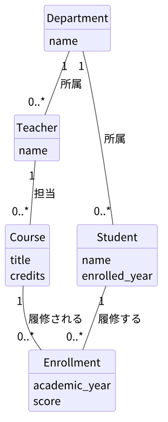

# データベース — はじめに

[📖 データベースの目次](./00_はじめに.md#目次) ｜ [🏠 全体の目次](../README.md#目次)

アプリケーションが扱うデータを、安全に・正しく・長く保存するための仕組みが**データベース**です。この資料では、データベースの**設計**（概念設計 → 論理設計 → 物理設計、正規化）から、**SQL**、そして **Java からの利用**（JDBC）までを、一通り学びます。題材は、[4層アーキテクチャ編](../4層アーキテクチャ/00_はじめに.md) と同じ**成績管理システム**です。

## 目次

1. [この資料について](#1-この資料について)
2. [章の構成](#2-章の構成)
3. [前提知識](#3-前提知識)
4. [4層の中での位置づけ](#4-4層の中での位置づけ)
5. [題材：成績管理データベース](#5-題材成績管理データベース)
6. [サンプルリポジトリ](#6-サンプルリポジトリ)
7. [各章の書き方](#7-各章の書き方)

---

## 1. この資料について

- 対象：Java の基礎を理解している人（必要なら [付録：Java入門](../付録/Java入門/00_はじめに.md) を参照）。データベースの知識は不要です
- 使用する DBMS：**PostgreSQL 18**。コードは実機での動作確認は行っていません
- ゴール：
  - 要件から**概念設計・論理設計・物理設計**の順にデータベースを設計できる
  - **正規化**（第 1〜第 3 正規形）の手順を説明し、表を分解できる
  - PostgreSQL を使い、**SQL**（作成・登録・検索・更新・削除・結合・集計）を書ける
  - **トランザクション**の必要性を説明できる
  - Java から JDBC を使ってデータベースを操作できる

## 2. 章の構成

| 章 | タイトル | 内容 |
|---|---|---|
| 01 | [データベースとは](01_データベースとは.md) | DB と DBMS、リレーショナルデータベース、SQL の種類 |
| 02 | [データベース設計の流れ](02_データベース設計の流れ.md) | 概念・論理・物理の 3 段階、各段階の成果物 |
| 03 | [概念設計とER図](03_概念設計とER図.md) | エンティティ、リレーションシップ、ER 図 |
| 04 | [論理設計](04_論理設計.md) | ER 図からテーブルへ、キーの種類 |
| 05 | [正規化](05_正規化.md) | 更新時の不具合、第 1〜第 3 正規形 |
| 06 | [物理設計](06_物理設計.md) | データ型、制約、インデックス |
| 07 | [PostgreSQL環境構築](07_PostgreSQL環境構築.md) | インストール、psql、pgAdmin |
| 08 | [SQL：テーブルの作成（DDL）](08_SQL_DDL.md) | CREATE / ALTER / DROP |
| 09 | [SQL：基本操作](09_SQL_基本操作.md) | INSERT / SELECT / UPDATE / DELETE |
| 10 | [SQL：応用](10_SQL_応用.md) | 集計、結合、サブクエリ、ビュー |
| 11 | [トランザクション](11_トランザクション.md) | ACID、COMMIT / ROLLBACK、同時実行 |
| 12 | [JavaからDBを使う（JDBC）](12_JavaからDBを使う_JDBC.md) | JDBC、JdbcClient、Repository の実装 |

02〜06 章は**設計**、07〜11 章は**SQL と DBMS の操作**、12 章は **Java との接続**です。5 章の**正規化**が、設計の中心になります。

## 3. 前提知識

- Java の基本（付録 Java入門 01〜09 章）。12 章でクラスとインタフェースを使います
- 4層アーキテクチャ編で説明する用語（**Infrastructure 層**、**Repository**）を、この資料では説明なしに使います。分からなくなったら [02 4層の役割](../4層アーキテクチャ/02_4層の役割.md) を参照してください
- コマンドライン（ターミナル）の基本操作

## 4. 4層の中での位置づけ

4 層のうち、データベースを**直接扱うのは Infrastructure 層だけ**です。この資料は、その Infrastructure 層の中身を掘り下げます。

他の層は、それぞれ別の資料で扱います。全体の対応は [4層アーキテクチャ編 00 章](../4層アーキテクチャ/00_はじめに.md#5-各層の資料との関係) を参照してください。

| この資料の章 | 4層との関係 |
|---|---|
| 02〜06 | Domain 層の「もの」（学生・科目・履修）を、保存できる形に設計する |
| 07〜11 | Infrastructure 層が発行する SQL と、DBMS の仕組みを学ぶ |
| 12 | Infrastructure 層に、JDBC を使った Repository の実装を追加する |

## 5. 題材：成績管理データベース

4層アーキテクチャ編では、保存先がメモリでした。この資料では、同じ成績管理システムの保存先を、**データベース**に置き換えることを目指します。

扱うデータは、学生・科目・履修に、学科と教員を加えた 5 つです。

この図（ER 図）がどのように作られるかを、03〜05 章で順に見ていきます。

## 6. サンプルリポジトリ

資料の中の SQL は、要点を示す短い例だけです。**テーブル定義とサンプルデータの完全版**と、Java のコードは、サンプルリポジトリにまとめています。

| 場所 | 内容 | 対応する章 |
|---|---|---|
| `db/01_schema.sql` | テーブル定義（DDL） | 06・08 章 |
| `db/02_seed.sql` | サンプルデータ | 09・10 章 |
| `step2-jdbc/` | JdbcClient で保存先をデータベースにした成績管理 | 12 章 |

> [!NOTE]
> **サンプルリポジトリ**：[PRMN_SYSTEM_Sample](https://github.com/YTS0418/PRMN_SYSTEM_Sample)

> [!NOTE]
> 07 章で環境を作ったあと、`db/01_schema.sql` と `db/02_seed.sql` を流すと、以降の章の SQL を同じデータで試せます。

## 7. 各章の書き方

各章は次の順で進みます。

1. **この章のゴール**：何ができるようになるか
2. **説明、図、表**：ER 図（mermaid）や表を見ながら、考え方を理解する。SQL は要点の短い例だけ
3. **サンプルへのリンク**：全体のコードは、サンプルリポジトリで確認する
4. **よくあるミス**

---

[次へ：01 データベースとは →](01_データベースとは.md)

[📖 データベースの目次](./00_はじめに.md#目次) ｜ [🏠 全体の目次](../README.md#目次)
