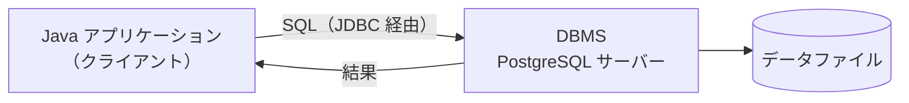
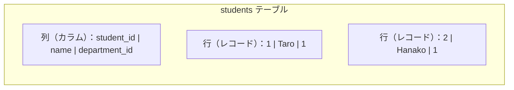

# 01. データベースとは

[📖 データベースの目次](./00_はじめに.md#目次) ｜ [🏠 全体の目次](../README.md#目次)

[← 前へ：00 はじめに](00_はじめに.md) ｜ [次へ：02 データベース設計の流れ →](02_データベース設計の流れ.md)

## この章のゴール
- ファイル保存では困る場面を説明できる
- データベース、DBMS、リレーショナルデータベースの違いが分かる
- テーブル・行・列・主キー・外部キーといった基本用語を使える
- SQL の 4 つの種類（DDL / DML / DCL / TCL）を説明できる

## 目次

1. [ファイル保存の限界](#1-ファイル保存の限界)
2. [データベースと DBMS](#2-データベースと-dbms)
3. [リレーショナルデータベース](#3-リレーショナルデータベース)
4. [テーブルの用語](#4-テーブルの用語)
5. [SQL とは](#5-sql-とは)
6. [主な DBMS と PostgreSQL](#6-主な-dbms-と-postgresql)
7. [よくあるミス](#7-よくあるミス)

---

## 1. ファイル保存の限界

成績管理のデータを、`students.csv` のようなファイルに保存する方法があります（付録 Java 入門 10 章の成績管理プログラムも、この方法です）。小さなプログラムなら十分ですが、データが増えたり、複数の人が使ったりすると困ることが出てきます。

| 困りごと | 具体例 |
|---|---|
| **探すのが遅い** | 「Taro の成績」を探すために、全行を読む必要がある |
| **一部だけ更新できない** | 1 人の点数を変えるだけでも、ファイル全体を書き直す |
| **同時に使えない** | 2 人が同時に保存すると、片方の変更が消える |
| **正しさを守れない** | 点数に `abc` が入っていても、ファイルは気にしない。同じ学生が二重に入ることもある |
| **途中で止まると壊れる** | 書き込み中にアプリが落ちると、データが中途半端になる |
| **データ同士の関係を扱いにくい** | 「学生」「科目」「履修」を別々のファイルにすると、つなぎ合わせる処理を自分で書く |

これらを**まとめて解決する仕組み**が、データベースです。

## 2. データベースと DBMS

| 用語 | 意味 |
|---|---|
| **データベース**（DB） | 整理されて保存されたデータの集まり |
| **DBMS**（Database Management System） | データベースを管理するソフトウェア。保存・検索・更新・同時アクセスの制御などを担当する |
| **RDBMS** | リレーショナルデータベースを管理する DBMS（PostgreSQL、MySQL など） |

普段「データベースを使う」と言うときは、DBMS というソフトウェアに SQL を送って、データの操作を頼むことを指します。

アプリケーションは、データを**直接ファイルとして**触りません。必ず DBMS を通します。



- アプリケーションは**クライアント**、DBMS は**サーバー**です（別のコンピュータにあってもよい）
- 保存先のファイルの形式や、検索の方法は、DBMS が引き受けます。アプリケーションは「何がほしいか」を SQL で伝えるだけです

DBMS が代わりにやってくれること：

- **高速な検索**（インデックス：06 章）
- **データの正しさの保証**（制約：06 章）
- **途中で止まっても壊れない仕組み**（トランザクション：11 章）
- **複数のユーザーの同時アクセスの制御**
- **ユーザーごとの権限管理**

## 3. リレーショナルデータベース

**リレーショナルデータベース**（RDB）は、データを**表**（テーブル）の形で持ち、表と表を**関連づけて**扱うデータベースです。現在、業務システムで最も広く使われています。

たとえば成績管理では、次の 3 つの表に分けます。

**students（学生）**

| student_id | name | department_id |
|---|---|---|
| 1 | Taro | 1 |
| 2 | Hanako | 1 |

**courses（科目）**

| course_id | title | credits |
|---|---|---|
| 1 | プログラミング基礎 | 2 |
| 2 | データベース | 2 |

**enrollments（履修）**

| student_id | course_id | academic_year | score |
|---|---|---|---|
| 1 | 1 | 2024 | 80 |
| 2 | 1 | 2024 | 95 |

`enrollments` の `student_id` と `course_id` は、他の表の ID を指しています。この「ID でつなぐ」関係が、**リレーション**（関連）です。名前や科目名を何度も書かずに、ID だけを持つことで、データの重複と間違いを防ぎます（正規化：05 章）。

> RDB の「リレーショナル」は、表と表の「関連（リレーションシップ）」のことだと誤解されがちですが、もともとは数学の「関係（relation）」＝表のことです。ここでは「表で持つデータベース」と覚えておけば十分です。

## 4. テーブルの用語



| 用語 | 別名 | 意味 |
|---|---|---|
| **テーブル** | 表、リレーション | データを入れる表。1 種類のもの（学生など）を 1 つのテーブルにする |
| **行** | レコード、タプル | 1 件分のデータ（学生 1 人） |
| **列** | カラム、属性、フィールド | データの項目（名前、学科など） |
| **主キー**（PK） | Primary Key | 行を**1 つに特定する**列（または列の組）。重複せず、空にならない（例：`student_id`） |
| **外部キー**（FK） | Foreign Key | **他のテーブルの主キーを指す**列。テーブル同士をつなぐ（例：`department_id`） |
| **スキーマ** | | テーブルや列の構造の定義 |
| **NULL** | | 「値がない」ことを表す特別な値（0 や空文字とは違う） |

> 💡 Java との対応：**テーブルはクラス**、**行はオブジェクト（インスタンス）**、**列はフィールド**のイメージです。4 層では、Infrastructure 層が「行 ⇔ Domain 層のオブジェクト」の変換を担当します（12 章）。

## 5. SQL とは

**SQL**（エスキューエル）は、リレーショナルデータベースを操作するための言語です。次のような、「何がほしいか」を書く宣言的な言語です。

```sql
SELECT name FROM students WHERE department_id = 1;   -- 学科 1 の学生の名前を取り出す
```

Java のように「どう処理するか（ループなど）」は書きません。どう探すかは DBMS が決めます。

SQL は、目的によって 4 種類に分類されます。

| 分類 | 名前 | 役割 | 主な命令 | 章 |
|---|---|---|---|---|
| **DDL** | Data Definition Language | 構造（テーブル）を**定義**する | `CREATE` `ALTER` `DROP` | 08 |
| **DML** | Data Manipulation Language | データを**操作**する | `SELECT` `INSERT` `UPDATE` `DELETE` | 09・10 |
| **DCL** | Data Control Language | **権限**を制御する | `GRANT` `REVOKE` | （本資料では扱わない） |
| **TCL** | Transaction Control Language | **トランザクション**を制御する | `BEGIN` `COMMIT` `ROLLBACK` | 11 |

> アプリケーションが日常的に発行するのは DML です。DDL は、テーブルを作る・変えるときに使います。

## 6. 主な DBMS と PostgreSQL

| DBMS | 特徴 |
|---|---|
| **PostgreSQL** | オープンソース。標準 SQL への準拠度が高く、機能が豊富。学習にも実務にも向く |
| MySQL / MariaDB | オープンソース。Web アプリケーションでの利用が多い |
| SQLite | サーバー不要で、1 つのファイルで動く。小規模・組み込み向け |
| Oracle Database | 商用。大規模な業務システムで多い |
| SQL Server | 商用（Microsoft）。Windows 環境で多い |

この資料では **PostgreSQL** を使います。SQL の基本は DBMS が違ってもほぼ共通なので、ここで学んだことは他の DBMS でも使えます（ただし、データ型や一部の構文は DBMS ごとに違います）。

> 💡 RDB 以外にも、データをキーと値の組で持つもの（Redis など）や、JSON の文書で持つもの（MongoDB など）といった **NoSQL** があります。この資料では扱いませんが、「データの形と使い方に応じて選ぶ」ものです。成績管理のように、データ同士の関係と正しさが大切な場面では、RDB が向いています。

## 7. よくあるミス

| ミス | 原因・対処 |
|---|---|
| データベースと DBMS を同じものだと思う | データベースは**データ**、DBMS は**それを管理するソフト**。PostgreSQL は DBMS |
| NULL を 0 や空文字と同じに考える | NULL は「値がない（未設定・不明）」。比較や集計での扱いが違う（09 章） |
| SQL は DBMS が違っても全く同じだと思う | 基本は共通だが、データ型や一部の構文は違う。使っている DBMS のドキュメントを確認する |
| 「DB を使えば何でも速くなる」と考える | 設計が悪かったり、インデックスがなかったりすると遅くなる（06 章） |

---

[← 前へ：00 はじめに](00_はじめに.md) ｜ [次へ：02 データベース設計の流れ →](02_データベース設計の流れ.md)

[📖 データベースの目次](./00_はじめに.md#目次) ｜ [🏠 全体の目次](../README.md#目次)
