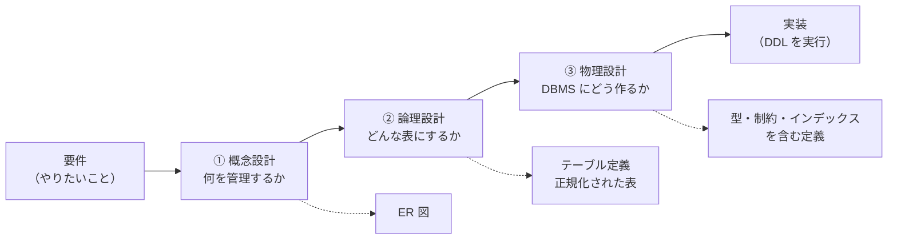

# 02. データベース設計の流れ

[📖 データベースの目次](./00_はじめに.md#目次) ｜ [🏠 全体の目次](../README.md#目次)

[← 前へ：01 データベースとは](01_データベースとは.md) ｜ [次へ：03 概念設計とER図 →](03_概念設計とER図.md)

## この章のゴール
- データベースを先に設計する理由を説明できる
- **概念設計・論理設計・物理設計**の 3 段階それぞれで、何を決めるのかを説明できる
- 各段階の成果物（ER 図・テーブル定義・DDL）と、依存するものの違いが分かる
- 成績管理システムの要件を整理できる

## 目次

1. [なぜ設計が必要か](#1-なぜ設計が必要か)
2. [設計の 3 段階](#2-設計の-3-段階)
3. [題材の要件](#3-題材の要件)
4. [同じ「学生」が 3 段階でどう変わるか](#4-同じ学生が-3-段階でどう変わるか)
5. [用語の注意：3 層スキーマとの違い](#5-用語の注意3-層スキーマとの違い)
6. [設計の進め方のコツ](#6-設計の進め方のコツ)
7. [よくあるミス](#7-よくあるミス)

---

## 1. なぜ設計が必要か

テーブルは、思いついた順に作ることもできます。しかし、データベースの設計は**後から直すのが特に難しい**部分です。

| 理由 | 説明 |
|---|---|
| **データが入ったあとでは直しにくい** | テーブルの構造を変えると、すでに入っているデータの移行が必要になる |
| **アプリケーション全体に影響する** | テーブルの形が変わると、SQL と Java のコード（Infrastructure 層）が全部変わる |
| **不具合が静かに起きる** | 設計が悪いと、矛盾したデータが少しずつ溜まり、気づいたときには手遅れになる（05 章） |

そこで、いきなりテーブルを作らず、**段階を踏んで設計**します。

## 2. 設計の 3 段階

データベース設計は、「現実の世界」から「実際のデータベース」へ、抽象度を下げながら 3 段階で進めます。



| 段階 | 決めること | 成果物 | DBMS への依存 | 章 |
|---|---|---|---|---|
| **① 概念設計** | 管理したい**もの**（エンティティ）と、その**関係** | **ER 図** | なし | 03 |
| **② 論理設計** | **テーブル**と列、**キー**、正規化 | テーブル定義書（論理 ER 図） | なし（RDB の形式には依存） | 04・05 |
| **③ 物理設計** | **データ型**、**制約**、**インデックス**、命名 | DDL（`CREATE TABLE` など） | **あり**（PostgreSQL 向けなど） | 06・08 |

ポイントは、**「何を」から「どう」へ**と具体的になっていくことです。

- 概念設計では、「学生が科目を履修する」と**業務の言葉**で考える
- 論理設計では、それを「students, courses, enrollments という表」と**表の言葉**で考える
- 物理設計では、「`student_id` は `INTEGER`」と**DBMS の言葉**で考える

> [!TIP]
> 先に概念設計をするのは、**DBMS の細かい事情に引きずられずに、業務そのものに集中する**ためです。同じ ER 図から、PostgreSQL 用にも MySQL 用にも作れます。

## 3. 題材の要件

成績管理システムの要件を、文章で整理します。**設計はここから始まります**。

> [!NOTE]
> 実際の開発では、要件は**ユーザーの要求をユースケースに落とし込む**作業（[上流工程](../上流工程/00_はじめに.md)）で整理されます。この資料では、その結果を簡略化した文章を、設計の出発点として使います。

> [!NOTE]
> 要件のほかに、**ドメインモデル**（ドメイン設計・実装編（作成予定））があれば、それも設計の入力にできます。違いは [03 章](03_概念設計とER図.md#ドメインモデルとの違い) を参照してください。

> 1. 大学には複数の**学科**がある。学科には名前がある
> 2. **学生**は、1 つの学科に所属する。名前と入学年度を管理する
> 3. **教員**は、1 つの学科に所属する。名前を管理する
> 4. **科目**には、科目名と単位数（1〜4）がある。科目は、1 人の教員が担当する
> 5. 学生は、複数の科目を**履修**できる。同じ科目を、別の年度に**再履修**することもある
> 6. 履修には、**年度**と**点数**（0〜100）を記録する。履修中で、まだ点数がないこともある
> 7. 同じ学生が、同じ年度に、同じ科目を二重に履修することはない
> 8. 学生ごとに、履修した科目と点数の一覧、平均点を見たい

この要件が、4層アーキテクチャ編のユースケース（学生を登録する / 成績を登録する / 成績一覧を表示する）にもつながっています。

## 4. 同じ「学生」が 3 段階でどう変わるか

「学生」に関する情報が、各段階でどのように表されるかを並べます。

| 段階 | 「学生」の表し方 |
|---|---|
| ① 概念設計 | エンティティ **Student**。属性は「名前」「入学年度」。**学科に所属する**という関係がある |
| ② 論理設計 | テーブル `students(student_id, name, department_id, enrolled_year)`。主キーは `student_id`、`department_id` は外部キー |
| ③ 物理設計 | `student_id INTEGER ... PRIMARY KEY`、`name VARCHAR(50) NOT NULL`、`enrolled_year SMALLINT CHECK (... >= 2000)` |

各段階で、**前の段階で決めたことを引き継ぎ**、新しい情報を加えています。

```sql
-- ③ 物理設計の成果物（イメージ）。完全版は 08 章とサンプルの db/01_schema.sql
CREATE TABLE students (
    student_id    INTEGER GENERATED BY DEFAULT AS IDENTITY PRIMARY KEY,
    name          VARCHAR(50) NOT NULL,
    department_id INTEGER     NOT NULL REFERENCES departments (department_id),
    enrolled_year SMALLINT    NOT NULL CHECK (enrolled_year >= 2000)
);
```

> [!NOTE]
> **サンプル**：[`db/01_schema.sql`](https://github.com/<ORG>/PRMN_SYSTEM_Sample/blob/main/db/01_schema.sql)

## 5. 用語の注意：3 層スキーマとの違い

データベースの教科書には、**3 層スキーマ**（ANSI/SPARC の 3 層アーキテクチャ）という別の分類も出てきます。名前が似ているので、混同しないでください。

| | 3 層スキーマ | 設計の 3 段階（この資料） |
|---|---|---|
| 何の分類か | **完成したデータベースの見え方**の分類 | データベースを**作る手順**の分類 |
| 構成 | 外部スキーマ（利用者から見た形）<br>概念スキーマ（全体の論理構造）<br>内部スキーマ（物理的な格納方法） | 概念設計 → 論理設計 → 物理設計 |
| 目的 | データの**独立性**（見え方を変えても、他に影響しない） | 設計の**抽象度**を段階的に下げる |

どちらも「概念・論理・物理」に近い言葉が出てきますが、**意味する範囲が少し違う**ことだけ覚えておけば十分です。

## 6. 設計の進め方のコツ

- **要件の文章から名詞と動詞を拾う**：名詞 → エンティティや属性の候補、動詞 → 関係の候補（03 章）
- **業務の人に確認する**：「再履修はあるか」のような疑問を、設計の早い段階で解消する
- **何度も行き来する**：論理設計をしていて、概念設計の見落としに気づくことは普通にある
- **ER 図は共有物**：図にしておくと、チームで認識を合わせやすい

> [!NOTE]
> 実際のシステム開発では、データベース設計は、要件定義や基本設計・詳細設計といった上流工程の一部として行われます。概念設計は業務の整理（基本設計寄り）、物理設計は実装に近い詳細（詳細設計寄り）、といったおおまかな対応があります。

## 7. よくあるミス

| ミス | 原因・対処 |
|---|---|
| いきなり `CREATE TABLE` を書き始める | まず要件を整理し、ER 図で全体を確認する |
| 概念設計の段階で、データ型や長さを悩む | それは物理設計（06 章）で決める。概念設計では「何を管理するか」に集中する |
| ER 図を一度描いたら変えないと思う | 設計の途中で修正するのは普通。データが入る**前**ならいくらでも直せる |
| 画面や帳票をそのままテーブルにする | 画面の都合ではなく、管理したい「**もの**」を基準に考える（05 章の正規化で詳しく見る） |

---

[← 前へ：01 データベースとは](01_データベースとは.md) ｜ [次へ：03 概念設計とER図 →](03_概念設計とER図.md)

[📖 データベースの目次](./00_はじめに.md#目次) ｜ [🏠 全体の目次](../README.md#目次)
