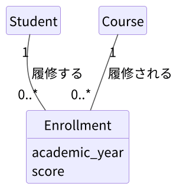
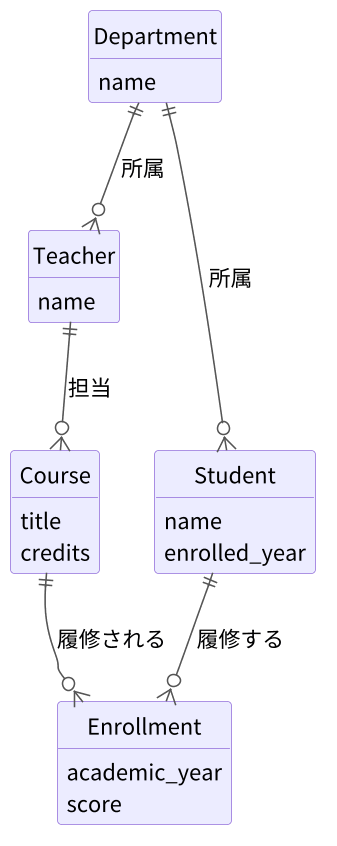

# 03. 概念設計とER図

[📖 データベースの目次](./00_はじめに.md#目次) ｜ [🏠 全体の目次](../README.md#目次)

[← 前へ：02 データベース設計の流れ](02_データベース設計の流れ.md) ｜ [次へ：04 論理設計 →](04_論理設計.md)

## この章のゴール
- 要件の文章から、エンティティ・属性・リレーションシップを拾い出せる
- 多重度（カーディナリティ。1 対 1、1 対多、多対多）を判断できる
- 多対多の関係を、関連エンティティで解消できる
- UML のクラス図の表記で ER 図を描ける。鳥の足記法（IE 記法）の図も読める

## 目次

1. [概念設計とは](#1-概念設計とは)
2. [要件から候補を拾う](#2-要件から候補を拾う)
3. [ER 図の要素](#3-er-図の要素)
4. [多重度（カーディナリティ）](#4-多重度カーディナリティ)
5. [多対多の解消](#5-多対多の解消)
6. [成績管理の ER 図](#6-成績管理の-er-図)
7. [補足：鳥の足記法（IE 記法）](#7-補足鳥の足記法ie-記法)
8. [概念設計のチェックポイント](#8-概念設計のチェックポイント)
9. [よくあるミス](#9-よくあるミス)

---

## 1. 概念設計とは

**概念設計**は、データベースで管理したい「**もの**」と、その「**関係**」を洗い出して、**ER 図**（Entity-Relationship Diagram）で表す作業です。テーブルや型のことはまだ考えません。「学生」「科目」といった**業務の言葉**だけで考えます。

ER 図には複数の書き方があります。この資料では、**UML のクラス図の表記**で描きます。エンティティを**箱**で、リレーションシップを**線**で表し、線の両端に書いた数字で**多重度**を示します（4 節）。よく使われるもう 1 つの書き方、**鳥の足記法**（IE 記法）は、7 節で補足します。

### ドメインモデルとの違い

業務の「もの」を整理する図には、**ドメインモデル**（上流・ドメイン設計・実装の資料で作る図）もあります。どちらも箱と線で描きますが、目的が違います。

| | ドメインモデル | 概念設計の ER 図（この章） |
|---|---|---|
| 目的 | 業務の「**もの**」と**ルール**を、プログラムで表すために整理する | **保存するデータ**の構造を整理する |
| 注目すること | 振る舞い（合格かの判定など）、値の意味、不変のルール | 何を・どれだけ保存するか（属性、多重度） |
| 担当する層 | Domain 層 | Infrastructure 層（データベース） |

ドメインモデルがあれば、それを出発点にして ER 図を描けます。ただし、**そのまま同じにはなりません**。たとえば、「合格か」は履修（Enrollment）の振る舞いですが、点数から計算できるので、データベースには保存しません（保存すると、点数と食い違うおそれがあるためです）。ドメインモデルについては、ドメイン設計・実装編（作成予定）を参照してください。ドメインモデルがない場合は、次の 2 節のように、要件の文章から直接拾っても構いません。

## 2. 要件から候補を拾う

[02 章](02_データベース設計の流れ.md#3-題材の要件)の要件文から、**名詞**と**動詞**に注目します。

| 要件の表現 | 種類 | 候補 |
|---|---|---|
| 学科、学生、教員、科目 | 名詞（独立して存在するもの） | **エンティティ** |
| 名前、入学年度、単位数、科目名 | 名詞（そのものの性質） | **属性** |
| 学生は学科に**所属**する | 動詞 | **リレーションシップ**（学生 — 学科） |
| 教員は学科に**所属**する | 動詞 | リレーションシップ（教員 — 学科） |
| 科目は教員が**担当**する | 動詞 | リレーションシップ（教員 — 科目） |
| 学生は科目を**履修**する | 動詞 | リレーションシップ（学生 — 科目）… ただし年度と点数がある |

「年度」と「点数」は、学生の性質でも科目の性質でもありません。「**学生が、その科目を、その年度に履修したときの点数**」です。この扱いは、[5. 多対多の解消](#5-多対多の解消)で考えます。

## 3. ER 図の要素

| 要素 | 意味 | 成績管理の例 | 図での表し方 |
|---|---|---|---|
| **エンティティ** | 管理したい「もの」。区別できる存在 | 学生、科目、学科、教員 | 長方形（箱）。名前は単数形（`Student`） |
| **属性** | エンティティの性質 | 学生の名前、科目の単位数 | 箱の中の項目（`name`）。型は書かない |
| **リレーションシップ** | エンティティ同士の関係 | 学生は学科に**所属**する | エンティティをつなぐ線。線に名前を付け、線の両端に多重度を書く |

> エンティティは、後で**テーブル**になります。属性は**列**に、リレーションシップは**外部キー**や**中間テーブル**になります（04 章）。

## 4. 多重度（カーディナリティ）

リレーションシップで、「**1 つに対していくつ対応するか**」を**多重度**（カーディナリティ）といいます。**両方向**から確認するのがコツです。

| 種類 | 意味 | 成績管理の例 |
|---|---|---|
| **1 対 1** | 一方が 1 つに対し、他方も 1 つ | （例：学生と学生証。今回は無し） |
| **1 対 多** | 一方が 1 つに対し、他方は複数 | 学科 1 つに、学生は**複数**所属。学生 1 人の学科は**1 つ** |
| **多 対 多** | どちらも複数 | 学生 1 人が複数の科目を履修し、科目 1 つを複数の学生が履修する |

確認のしかた（学生と学科）：

- 「**1 つの学科**に、学生は何人所属するか？」→ 複数（0 人以上）
- 「**1 人の学生**は、何個の学科に所属するか？」→ 1 つだけ

→ 学科 : 学生 ＝ **1 対 多**

### 必須か任意か

もう 1 つ、**最低でも関連があるか**（必須か任意か）も区別します。UML では、「**最小..最大**」の形の数字で表します。`*` は「いくつでも」です。

| 多重度 | 意味 |
|---|---|
| `1` | ちょうど 1 つ（必ず 1 つ） |
| `0..1` | 0 または 1 つ |
| `0..*`（`*` だけでも可） | 0 以上（いくつでも、なくてもよい） |
| `1..*` | 1 以上（最低 1 つ） |

例：学科側が `1`、学生側が `0..*` なら、「学生は必ず 1 つの学科に所属し、学科には 0 人以上の学生がいる」。

> 💡 線の端の数字は、**その端にある箱**が、反対側の 1 つに対していくつ対応するかを表します。学科と学生の線では、学生側の `0..*` が「学科 1 つに対して、学生が 0 人以上」を表します。

## 5. 多対多の解消

学生と科目は、**多対多**です。

しかし、リレーショナルデータベースでは、**多対多を直接表せません**（1 つの列に複数の値を入れられないため）。そこで、間に**関連エンティティ**を置き、**2 つの 1 対多**に分解します。

この `Enrollment`（履修）は、単なる「つなぎ」ではありません。**自分自身の属性**（年度、点数）を持つ、れっきとしたエンティティです。

| Enrollment の属性 | 説明 |
|---|---|
| academic_year | 履修した年度 |
| score | 点数（履修中は NULL） |

> 💡 **関連が属性を持つなら、関連をエンティティにする**。「年度」「点数」は、学生にも科目にも属さない、「履修」という出来事の性質です。再履修（同じ学生が同じ科目を別の年度に履修）も、履修を 1 件ずつ記録すれば自然に表せます。

## 6. 成績管理の ER 図

要件から導いた、概念設計の成果物です。属性は、キー（ID）を除いて書きます（キーは論理設計：04 章）。型も書きません（型は物理設計：06 章）。

エンティティと日本語の対応：

| エンティティ | 意味 | 属性 |
|---|---|---|
| Department | 学科 | name（学科名） |
| Teacher | 教員 | name（名前） |
| Student | 学生 | name（名前）、enrolled_year（入学年度） |
| Course | 科目 | title（科目名）、credits（単位数） |
| Enrollment | 履修 | academic_year（年度）、score（点数） |

線の読み方：Department と Student の「所属」の線（学科側が `1`、学生側が `0..*`）は、「学科 1 つに対して、学生は 0 人以上所属する。学生 1 人は、ちょうど 1 つの学科に所属する」です。

> 💡 UML のクラス図は、本来は**プログラムのクラス**を描く図です（4層アーキテクチャ編や 12 章の Repository の図）。ER 図として使うときは、箱の 3 段目（メソッド）を省きます。

## 7. 補足：鳥の足記法（IE 記法）

ER 図の表記法には、この資料で使う **UML のクラス図の表記**のほか、**鳥の足記法**（IE 記法。線の端がフォークの形）や Chen 記法（四角形・ひし形・楕円）など、いくつかの流儀があります。鳥の足記法は、pgAdmin の ERD ツール（08 章）や、Markdown で図を描く mermaid の `erDiagram` などで使われているので、読めるようにしておきましょう。

6 節の ER 図を、同じ配置のまま 2 つの表記で描くと、次のようになります。

| UML のクラス図の表記（この資料） | 鳥の足記法 |
|---|---|
|  |  |

違うのは、**線の端の書き方**だけです。箱と線の構造は変わりません。鳥の足記法では、`o` は 0、`|` は 1、`{` は多（鳥の足）を表します。

| 意味 | UML の多重度 | 鳥の足記法 |
|---|---|---|
| ちょうど 1 つ | `1` | `\|\|`（縦線 2 本） |
| 0 または 1 つ | `0..1` | `\|o` / `o\|`（縦線と丸） |
| 0 以上 | `0..*`（`*` だけでも可） | `o{` / `}o`（丸と鳥の足） |
| 1 以上 | `1..*` | `\|{` / `}\|`（縦線と鳥の足） |

- **記号を書く位置の考え方は同じ**です。どちらも、線の端の記号は「**その端にある箱**が、反対側の 1 つに対していくつ対応するか」を表します。たとえば Student 側の `0..*` と `o{` は、どちらも「学科 1 つに対して、学生は 0 人以上」です（4 節）。
- UML は、**数字で書く**ので、`2..5` のような細かい数も書けます。鳥の足記法は、**形で数を表す**ので、図をぱっと見て「多」の側がわかります。

> 💡 mermaid の `erDiagram` では、`Department ||--o{ Student : "所属"` のように、線の端の記号を文字で書きます。ただし、`erDiagram` は属性に**型を書く必要がある**（`string name`）ため、型を決めない概念設計の図には向きません。この資料の ER 図は、PlantUML で描いた画像を使っています（元のファイルは [`images/database/diagram/`](../images/database/diagram/) の `*.puml`）。

## 8. 概念設計のチェックポイント

ER 図ができたら、次の点を確認します。

- **エンティティは「1 種類のもの」を表しているか**：1 つの箱に複数種類のものを詰め込んでいないか
- **すべての線に、両方向の多重度があるか**
- **多対多が残っていないか**（関連エンティティで解消済みか）
- **要件の文章と見比べて、取りこぼしがないか**（要件の 1〜8 が全部図で表せているか）
- **同じ情報が、複数のエンティティに重複していないか**

## 9. よくあるミス

| ミス | 原因・対処 |
|---|---|
| 「点数」を学生の属性にしてしまう | 点数は、**学生 × 科目 × 年度**で決まる。学生だけでは決まらない。履修エンティティの属性にする |
| 多対多の線を引いたまま終わる | 関連エンティティで 2 つの 1 対多に分ける |
| 「学科名」を学生の属性にしてしまう | 学科は独立した「もの」。学科のエンティティを作り、学生は学科に所属する関係にする（正規化：05 章） |
| 線の一方の多重度しか考えない | 「A から見て B はいくつ」と「B から見て A はいくつ」を両方確認する |
| 概念設計で ID や型まで決めようとする | ID（キー）は論理設計、型は物理設計。ここでは「何を管理するか」に集中する |

---

[← 前へ：02 データベース設計の流れ](02_データベース設計の流れ.md) ｜ [次へ：04 論理設計 →](04_論理設計.md)

[📖 データベースの目次](./00_はじめに.md#目次) ｜ [🏠 全体の目次](../README.md#目次)
