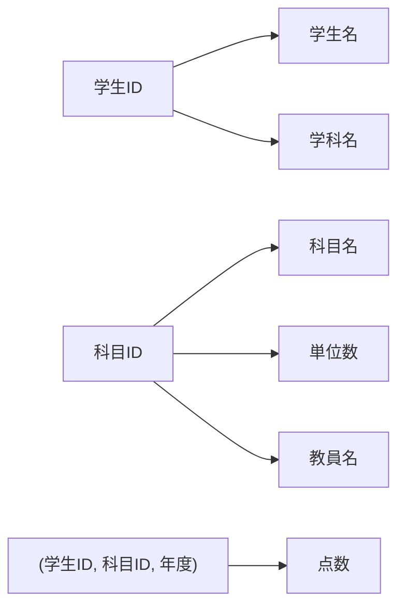
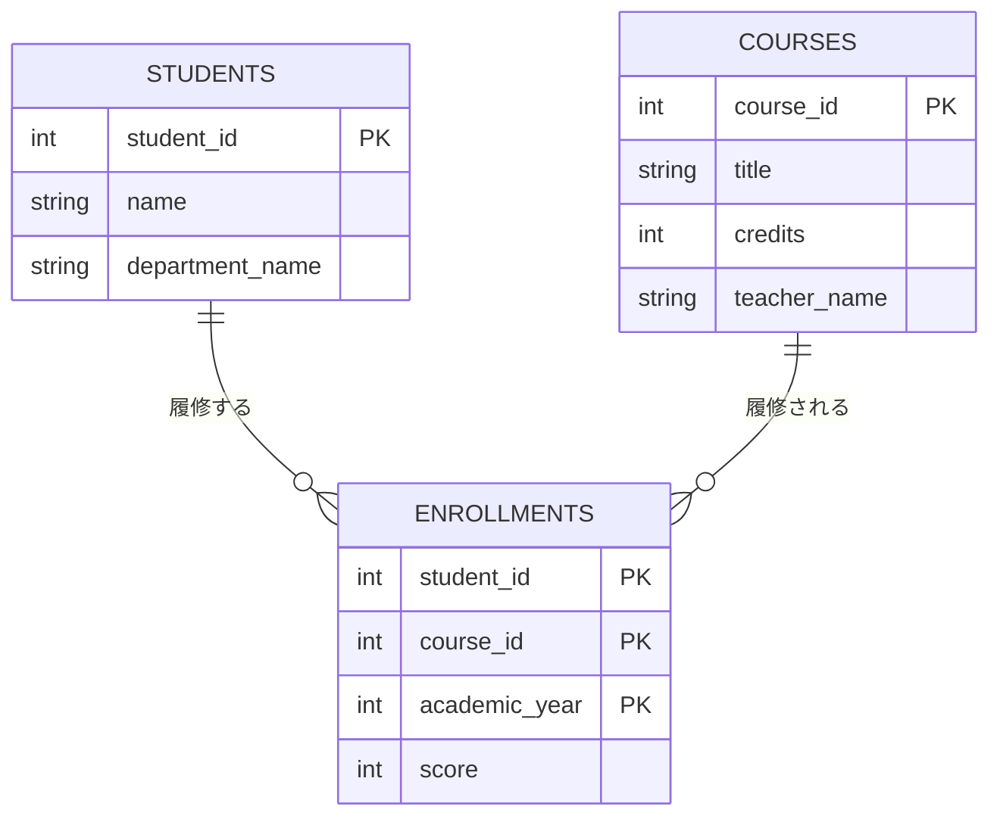
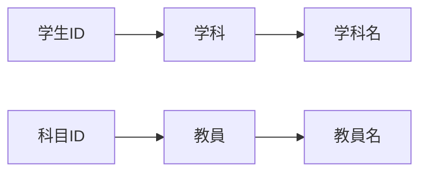
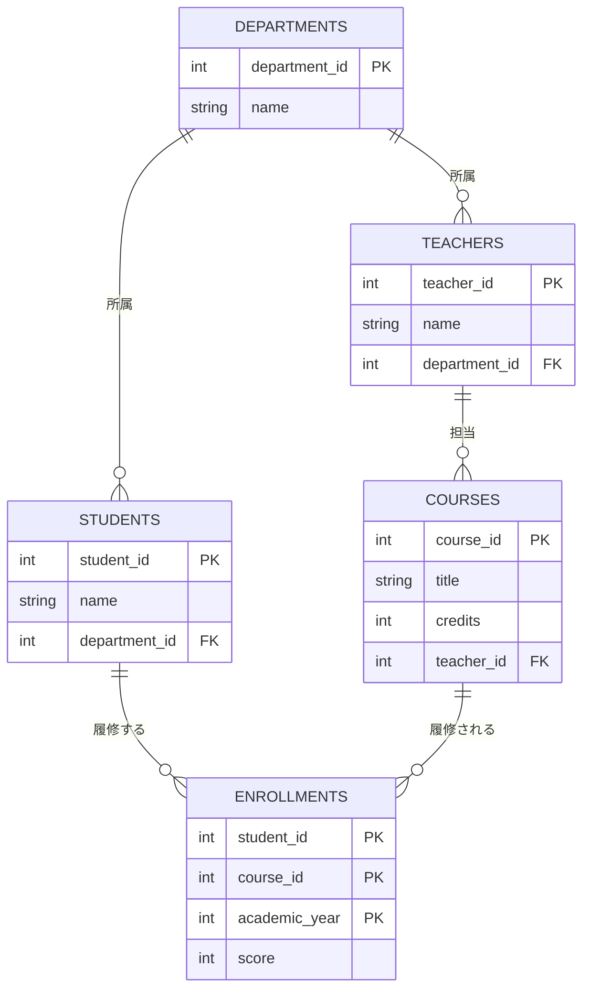
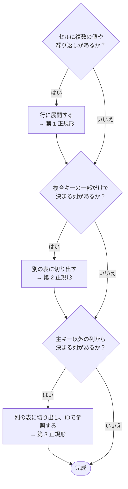

# 05. 正規化

[📖 データベースの目次](./00_はじめに.md#目次) ｜ [🏠 全体の目次](../README.md#目次)

[← 前へ：04 論理設計](04_論理設計.md) ｜ [次へ：06 物理設計 →](06_物理設計.md)

## この章のゴール
- 表に「全部入り」で情報を入れると起きる不具合（更新・挿入・削除の異常）を説明できる
- 第 1・第 2・第 3 正規形の条件を説明し、表を段階的に分解できる
- 正規化の結果が、04 章で作ったテーブルと一致することを確認できる
- あえて正規化しない（非正規化する）場面があることを知る

## 目次

1. [正規化とは](#1-正規化とは)
2. [出発点：全部入りの表](#2-出発点全部入りの表)
3. [全部入りの表で起きる 3 つの異常](#3-全部入りの表で起きる-3-つの異常)
4. [第 1 正規形（1NF）](#4-第-1-正規形1nf)
5. [第 2 正規形（2NF）](#5-第-2-正規形2nf)
6. [第 3 正規形（3NF）](#6-第-3-正規形3nf)
7. [正規化の結果と 04 章のテーブル](#7-正規化の結果と-04-章のテーブル)
8. [異常が解消されたことを確認する](#8-異常が解消されたことを確認する)
9. [ボイス・コッド正規形（補足）](#9-ボイスコッド正規形補足)
10. [あえて正規化しない場合](#10-あえて正規化しない場合)
11. [正規化のまとめ](#11-正規化のまとめ)
12. [よくあるミス](#12-よくあるミス)

---

## 1. 正規化とは

**正規化**は、表を**「1 つの事実は、1 か所にだけ書く」形**に分解する作業です。データの重複をなくし、更新・挿入・削除のときに**矛盾が起きない**ようにします。

正規化には段階があり、番号が上がるほど条件が厳しくなります。実務では、**第 3 正規形**までを目指すのが一般的です。


> 関数従属（`X → Y`：X が決まれば Y が 1 つに決まる）の考え方は、[04 章](04_論理設計.md#8-関数従属)で説明しました。この章で使います。

## 2. 出発点：全部入りの表

画面や帳票（成績表）をそのまま表にすると、次のような**全部入りの表**になりがちです。この表を出発点にします。

**履修一覧表**（主キー：学生ID + 科目ID + 年度）

| 学生ID | 学生名 | 学科名 | 科目ID | 科目名 | 単位数 | 教員名 | 年度 | 点数 |
|---|---|---|---|---|---|---|---|---|
| 1 | Taro | 情報システム学科 | 1 | プログラミング基礎 | 2 | 佐藤 健 | 2024 | 80 |
| 1 | Taro | 情報システム学科 | 2 | データベース | 2 | 鈴木 恵 | 2025 | 72 |
| 1 | Taro | 情報システム学科 | 3 | 線形代数 | 4 | 高橋 誠 | 2024 | 55 |
| 2 | Hanako | 情報システム学科 | 1 | プログラミング基礎 | 2 | 佐藤 健 | 2024 | 95 |
| 2 | Hanako | 情報システム学科 | 2 | データベース | 2 | 鈴木 恵 | 2025 | 88 |
| 3 | Jiro | 電子工学科 | 3 | 線形代数 | 4 | 高橋 誠 | 2023 | 60 |
| 3 | Jiro | 電子工学科 | 4 | 電気回路 | 2 | 高橋 誠 | 2024 | 45 |

> 入学年度などの列は、見やすさのために省略しています。

同じ情報（Taro の学科名、プログラミング基礎の単位数など）が、**何度も繰り返し**書かれていることに注目してください。

## 3. 全部入りの表で起きる 3 つの異常

重複があると、データを変更するときに問題が起きます。これを**異常**といいます。

### 更新異常

「情報システム学科」を「情報システム工学科」に名称変更したいとします。

- Taro の 3 行と Hanako の 2 行、**合計 5 行すべて**を書き換える必要がある
- 1 行でも直し忘れると、**同じ学科なのに名前が 2 通り**ある矛盾したデータになる

### 挿入異常

新しい科目「有機化学」を登録したいとします。

- この表は「履修」ごとの行なので、**誰も履修していない科目は入れられない**
- 無理に入れようとすると、主キーの一部である学生IDと年度が空になってしまう（主キーは空にできない）

### 削除異常

Jiro が「電気回路」の履修を取り消したとします。

- 電気回路を履修しているのは Jiro だけなので、その行を削除すると、**電気回路という科目の情報（科目名・単位数・教員）まで消えてしまう**

| 異常 | 起きること | 原因 |
|---|---|---|
| 更新異常 | 一部だけ更新されて、矛盾する | 同じ情報が複数行に重複している |
| 挿入異常 | 関連する他の情報がないと登録できない | 異なる「もの」が 1 つの表に混ざっている |
| 削除異常 | 別の情報まで一緒に消える | 同上 |

**根本の原因は、「学生」「科目」「履修」という別々の「もの」の情報が、1 つの表に混ざっていること**です。正規化は、これを分けていく作業です。

## 4. 第 1 正規形（1NF）

> **第 1 正規形の条件**：すべてのセルが**単一の値**であること（1 つのセルに複数の値や、繰り返し項目がない）。

### 非正規形の例

成績表を、学生ごとに 1 行でまとめると、こうなりがちです。

| 学生ID | 学生名 | 履修科目（科目名 / 年度 / 点数） |
|---|---|---|
| 1 | Taro | プログラミング基礎 / 2024 / 80<br>データベース / 2025 / 72<br>線形代数 / 2024 / 55 |
| 2 | Hanako | プログラミング基礎 / 2024 / 95<br>データベース / 2025 / 88 |

「履修科目」のセルに**複数の値（繰り返し）**が入っています。これでは、「線形代数を履修した学生は？」「点数が 60 未満のものは？」といった検索が、SQL で素直に書けません。

### 第 1 正規形にする

繰り返しの部分を**行に展開**して、1 つのセルに 1 つの値だけが入るようにします。展開した結果が、[2. 出発点](#2-出発点全部入りの表)の表です。

| | |
|---|---|
| 主キー | (学生ID, 科目ID, 年度) |
| 状態 | **第 1 正規形を満たしている**。ただし、まだ [3. の 3 つの異常](#3-全部入りの表で起きる-3-つの異常)は起きる |

## 5. 第 2 正規形（2NF）

> **第 2 正規形の条件**：第 1 正規形であり、かつ、**主キーの一部だけで決まる列（部分関数従属）がない**こと。

主キーが**複数の列**（複合キー）のときに問題になる条件です。

### 関数従属を調べる

主キー (学生ID, 科目ID, 年度) に対して、各列が何で決まるかを調べます。



| 列 | 何で決まるか | 判定 |
|---|---|---|
| 学生名、学科名 | **学生ID だけ** | ✕ 主キーの一部だけで決まる（部分関数従属） |
| 科目名、単位数、教員名 | **科目ID だけ** | ✕ 主キーの一部だけで決まる（部分関数従属） |
| 点数 | 学生ID + 科目ID + 年度の**全部** | ○ |

> 点数は、「どの学生が、どの科目を、いつ履修したか」の**3 つが揃って初めて決まります**。一方、学生名は学生ID だけで決まり、科目や年度は関係ありません。

### 分解する

**主キーの一部で決まる列を、それを決める列と一緒に、別の表に切り出します**。

**学生**（主キー：学生ID）

| 学生ID | 学生名 | 学科名 |
|---|---|---|
| 1 | Taro | 情報システム学科 |
| 2 | Hanako | 情報システム学科 |
| 3 | Jiro | 電子工学科 |

**科目**（主キー：科目ID）

| 科目ID | 科目名 | 単位数 | 教員名 |
|---|---|---|---|
| 1 | プログラミング基礎 | 2 | 佐藤 健 |
| 2 | データベース | 2 | 鈴木 恵 |
| 3 | 線形代数 | 4 | 高橋 誠 |
| 4 | 電気回路 | 2 | 高橋 誠 |

**履修**（主キー：学生ID + 科目ID + 年度）

| 学生ID | 科目ID | 年度 | 点数 |
|---|---|---|---|
| 1 | 1 | 2024 | 80 |
| 1 | 2 | 2025 | 72 |
| 1 | 3 | 2024 | 55 |
| 2 | 1 | 2024 | 95 |
| 2 | 2 | 2025 | 88 |
| 3 | 3 | 2023 | 60 |
| 3 | 4 | 2024 | 45 |



### 2NF で解決したこと

| 異常 | 結果 |
|---|---|
| 挿入異常 | 解決。科目の表があるので、**誰も履修していない「有機化学」も登録できる** |
| 削除異常 | 解決。履修の行を削除しても、**科目の情報は残る** |
| 更新異常 | **まだ残っている**。学科名は、Taro と Hanako の 2 行に重複している。教員名「高橋 誠」も、2 つの科目に重複している |

## 6. 第 3 正規形（3NF）

> **第 3 正規形の条件**：第 2 正規形であり、かつ、**主キー以外の列から決まる列（推移的関数従属）がない**こと。

### 推移的関数従属を調べる

2NF の表にも、まだ重複が残っています。

- **学生**：学生ID → 学科名。しかし、学科名は「学科」という**別の「もの」の情報**。学科が決まれば学科名が決まる（**学科 → 学科名**）
- **科目**：科目ID → 教員名。同様に、教員名は「教員」という別の「もの」の情報（**教員 → 教員名**）



学生ID から学科名へは、**「学科」を経由して間接的に**決まります。これが推移的関数従属です。

> 2NF の時点では、「学科名」や「教員名」が文字列として直接入っているため、「学科」「教員」を識別する **ID が存在しません**。まず **学科ID・教員ID** を導入して、「別のもの」として切り出せる形にします。

### 分解する

**学科**、**教員**を独立した表にし、学生と科目からは **ID で参照**します。

**学科**（主キー：学科ID）

| 学科ID | 学科名 |
|---|---|
| 1 | 情報システム学科 |
| 2 | 電子工学科 |

**教員**（主キー：教員ID）

| 教員ID | 教員名 | 学科ID |
|---|---|---|
| 1 | 佐藤 健 | 1 |
| 2 | 鈴木 恵 | 1 |
| 3 | 高橋 誠 | 2 |

> 教員の所属学科（学科ID）は、要件 3「教員は学科に所属する」から追加した列です。元の全部入りの表にはありませんでしたが、「教員」を独立した表にしたので、教員自身の情報として持たせます。

**学生**（主キー：学生ID ／ 学科ID は学科への外部キー）

| 学生ID | 学生名 | 学科ID |
|---|---|---|
| 1 | Taro | 1 |
| 2 | Hanako | 1 |
| 3 | Jiro | 2 |

**科目**（主キー：科目ID ／ 教員ID は教員への外部キー）

| 科目ID | 科目名 | 単位数 | 教員ID |
|---|---|---|---|
| 1 | プログラミング基礎 | 2 | 1 |
| 2 | データベース | 2 | 2 |
| 3 | 線形代数 | 4 | 3 |
| 4 | 電気回路 | 2 | 3 |

**履修**は 2NF のときと同じです。



これで、**学科名は学科の表に 1 回だけ**、**教員名は教員の表に 1 回だけ**書かれるようになりました。更新異常も解決です。

## 7. 正規化の結果と 04 章のテーブル

正規化で得た表を、[04 章の論理設計](04_論理設計.md#5-論理-er-図)と比べてみましょう。

| 項目 | 正規化の結果 | 04 章の論理設計 |
|---|---|---|
| テーブル | 学科・教員・学生・科目・履修の **5 つ** | 同じ **5 つ** |
| 関連 | 学科→学生、学科→教員、教員→科目、学生→履修、科目→履修 | **同じ** |
| 履修の主キー | (学生ID, 科目ID, 年度) の複合キー | `enrollment_id`（代理キー）+ `UNIQUE (学生, 科目, 年度)` |

主キーの付け方（複合キーか代理キーか）だけが違い、**テーブルの構成は一致**します。概念設計から ER 図を丁寧に作ると、ほとんどの場合、自然と正規化された形になります。正規化は、その形が正しいかを**検査する道具**としても使えます。

> 💡 **逆から使う**：既存の Excel の表や、他人が作った画面のデータを、データベースにするときは、この章のように**全部入りの表から出発して分解**します。ER 図から作る方法と、正規化から作る方法は、同じ結果にたどり着きます。

## 8. 異常が解消されたことを確認する

3NF の表で、[3. で見た 3 つの操作](#3-全部入りの表で起きる-3-つの異常)をやり直します。

```sql
-- 更新：学科名の変更は、学科の表の 1 行だけ
UPDATE departments SET name = '情報システム工学科' WHERE department_id = 1;

-- 挿入：誰も履修していない科目も、科目の表に単独で登録できる
INSERT INTO courses (title, credits, teacher_id) VALUES ('有機化学', 2, 3);

-- 削除：履修を取り消しても、科目の情報は残る
DELETE FROM enrollments WHERE student_id = 3 AND course_id = 4 AND academic_year = 2024;
```

| 操作 | 全部入りの表 | 正規化後 |
|---|---|---|
| 学科名の変更 | 5 行を更新（直し忘れで矛盾） | **1 行**を更新 |
| 履修者のいない科目の登録 | できない | **できる** |
| 履修の取り消し | 科目の情報も消える | 科目の情報は**残る** |

> SQL の書き方は 08〜10 章で学びます。ここでは「1 行で済む」ことだけ確認してください。

## 9. ボイス・コッド正規形（補足）

第 3 正規形でも、まれに異常が残ることがあります。それを取り除いたのが**ボイス・コッド正規形**（BCNF）です。

> **BCNF の条件**：すべての関数従属 `X → Y` で、**X が候補キー**であること。

例：「ある教員は 1 つの科目だけを担当する」というルールの、**指導**の表を考えます。

| 学生 | 科目 | 教員 |
|---|---|---|
| Taro | データベース | 鈴木 恵 |
| Hanako | データベース | 鈴木 恵 |
| Taro | 電気回路 | 高橋 誠 |

- 候補キー：(学生, 科目) と (学生, 教員)
- 関数従属：**教員 → 科目**（教員が決まれば科目が決まる）

「教員」は候補キーではないのに、「科目」を決めています。そのため、鈴木 恵 の担当科目が変わると、複数行を書き換える必要があります。

**分解**：担当（教員, 科目）と、指導（学生, 教員）に分けます。

実務では、ここまで意識することは多くありません。「第 3 正規形で十分なことがほとんどだが、さらに厳しい条件もある」と知っておけば十分です。

## 10. あえて正規化しない場合

正規化は、**書き込み（更新・挿入・削除）の正しさ**を守る代わりに、**読み込み（検索）で表を結合する手間**が増えます。そのため、次のような場合に、あえて**非正規化**（重複を許す）することがあります。

| 場面 | 例 |
|---|---|
| **過去の時点の値を残したい** | 成績表に、履修した**当時の**科目名や学科名を残したい（後で科目名が変わっても、過去の成績表は当時のまま） |
| **集計結果を持っておきたい** | 学生ごとの平均点を、毎回計算せず列として持つ（件数が膨大で、速さが必要なとき） |
| **読み取り専用のレポート用** | 分析用に、結合済みの全部入りの表を別に作る |

ただし、次のことを守ります。

- **まず正規化する**。そのうえで、**理由があるときだけ**崩す
- 重複させた値は、**どう更新を同期するか**を決めておく
- 「検索が少し面倒だから」という理由では、崩さない（SQL の結合 JOIN で十分に対応できる：10 章）

## 11. 正規化のまとめ

| 正規形 | 条件 | 取り除くもの | 違反の見つけ方 |
|---|---|---|---|
| **第 1 正規形** | セルが単一の値 | 繰り返し項目 | 1 つのセルに複数の値が入っていないか |
| **第 2 正規形** | 部分関数従属がない | 主キーの**一部**で決まる列 | 複合キーの表で、キーの一部だけで決まる列がないか |
| **第 3 正規形** | 推移的関数従属がない | 主キー**以外**の列で決まる列 | 「A → B → C」と間接的に決まる列がないか |
| BCNF（補足） | 決める側がすべて候補キー | 候補キーでない列が決める列 | 候補キーでない列が、キーの一部を決めていないか |

正規化の手順を、判断の流れとして整理します。



一言でまとめると、「**主キーが決まれば他の列が決まる。そしてそれ以外の理由では決まらない**」状態です。

> 有名な覚え方：「キーに関して（1NF）、キー全体に関して（2NF）、キー以外に関して（3NF）、すべて関数従属している」

## 12. よくあるミス

| ミス | 原因・対処 |
|---|---|
| 主キーが 1 列の表で、第 2 正規形の問題を探す | 第 2 正規形は**複合キー**のときだけ問題になる。主キーが 1 列なら、自動的に満たす |
| 分解したら、元に戻せない | 分解するときは、**外部キー（ID）を残す**。結合（JOIN）すれば元の表に戻せるようにする |
| 同じ意味の列を、別の表にコピーする | 他の表では ID で参照する。名前などのコピーは作らない |
| 「学科名」のような文字列で参照してしまう | 名前は変わりうる。**ID で参照**する（04 章） |
| 正規化しすぎて、表が増えすぎたと感じる | 表が増えるのは自然なこと。検索の面倒は JOIN と VIEW（10 章）で解決する |
| 3NF にしたら、もう設計は完璧だと思う | 正規化は**重複による異常を防ぐ**だけ。要件を満たしているか、制約や型は適切かは、別に確認する |

---

[← 前へ：04 論理設計](04_論理設計.md) ｜ [次へ：06 物理設計 →](06_物理設計.md)

[📖 データベースの目次](./00_はじめに.md#目次) ｜ [🏠 全体の目次](../README.md#目次)
