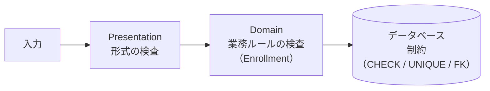

# 06. 物理設計

[📖 データベースの目次](./00_はじめに.md#目次) ｜ [🏠 全体の目次](../README.md#目次)

[← 前へ：05 正規化](05_正規化.md) ｜ [次へ：07 PostgreSQL環境構築 →](07_PostgreSQL環境構築.md)

## この章のゴール
- 論理設計の各列に、PostgreSQL のデータ型を割り当てられる
- 制約（主キー・外部キー・NOT NULL・UNIQUE・CHECK・DEFAULT）の役割を説明できる
- 外部キーの `ON DELETE` の違いを説明し、選べる
- インデックスの仕組みと、作るべき列の見分け方が分かる
- アプリケーション側の検査と、データベース側の制約の役割分担を説明できる

## 目次

1. [物理設計とは](#1-物理設計とは)
2. [命名規約](#2-命名規約)
3. [データ型](#3-データ型)
4. [成績管理の列の型](#4-成績管理の列の型)
5. [制約](#5-制約)
6. [外部キーと ON DELETE](#6-外部キーと-on-delete)
7. [制約をデータベースに持たせる理由](#7-制約をデータベースに持たせる理由)
8. [インデックス](#8-インデックス)
9. [自動採番](#9-自動採番)
10. [物理設計の成果物](#10-物理設計の成果物)
11. [よくあるミス](#11-よくあるミス)

---

## 1. 物理設計とは

**物理設計**は、論理設計で作ったテーブル定義を、**実際の DBMS（ここでは PostgreSQL）で動く形**に具体化する作業です。

| 決めること | 内容 |
|---|---|
| **名前** | テーブル・列・制約・インデックスの名前の付け方 |
| **データ型** | 各列を、DBMS のどの型にするか |
| **制約** | データの正しさを DBMS に守らせる仕組み |
| **インデックス** | 検索を速くする仕組み |

ここで決めたことが、そのまま `CREATE TABLE` 文（DDL：08 章）になります。

## 2. 命名規約

名前の付け方は、チームで統一します。この資料では次のルールを使います。

| 対象 | ルール | 例 |
|---|---|---|
| テーブル名 | 英小文字・**複数形**・スネークケース | `students`、`enrollments` |
| 列名 | 英小文字・スネークケース | `enrolled_year`、`academic_year` |
| 主キー | `テーブル名の単数形_id` | `student_id`、`course_id` |
| 外部キー | **参照先の主キーと同じ名前** | `students.department_id` ← `departments.department_id` |
| インデックス | `idx_テーブル名_列名` | `idx_enrollments_course_id` |

- **日本語の名前は付けない**。常に英数字と `_` を使う（引用符が必要になり、扱いにくい）
- **`user`、`order`、`group` など、SQL の予約語は避ける**（`users` のように複数形にするなど）
- スネークケース（`enrolled_year`）にする理由：PostgreSQL は、引用符で囲まない名前を**小文字に変換する**ため、`enrolledYear` のような大文字混じりは扱いにくい

> 💡 Java 側の名前（`enrolledYear`、キャメルケース）とは、**違う規約になります**。この変換は Infrastructure 層（12 章）が担当します。

## 3. データ型

PostgreSQL でよく使う型です。

| 用途 | 型 | 説明 |
|---|---|---|
| 整数 | `SMALLINT` | 約 ±3 万。小さい値（年度、点数、単位数）に |
| | `INTEGER` | 約 ±21 億。ID など、**迷ったらこれ** |
| | `BIGINT` | 約 ±922 京。件数が非常に多い ID に |
| 小数（正確） | `NUMERIC(p, s)` | 精度を保証する。**金額**に使う。p は全体の桁数、s は小数部の桁数 |
| 小数（近似） | `REAL` / `DOUBLE PRECISION` | 誤差が出る。科学計算向き。**金額には使わない** |
| 文字列 | `VARCHAR(n)` | 最大 n 文字までの文字列 |
| | `TEXT` | 長さに制限のない文字列 |
| 真偽 | `BOOLEAN` | `TRUE` / `FALSE` |
| 日付・時刻 | `DATE` | 日付のみ |
| | `TIMESTAMP` | 日付と時刻（タイムゾーンなし） |
| | `TIMESTAMPTZ` | 日付と時刻（**タイムゾーンつき**）。時刻の記録は、基本的にこちら |
| その他 | `UUID` | 世界で一意な ID |
| | `JSONB` | JSON 形式のデータ |

### Java の型との対応

JDBC（12 章）で値をやり取りするときの対応です。

| Java | PostgreSQL |
|---|---|
| `int` / `Integer` | `INTEGER` |
| `short` / `Short` | `SMALLINT` |
| `long` / `Long` | `BIGINT` |
| `String` | `VARCHAR(n)` / `TEXT` |
| `boolean` | `BOOLEAN` |
| `LocalDate` | `DATE` |
| `LocalDateTime` | `TIMESTAMP` |
| `BigDecimal` | `NUMERIC` |

> [!WARNING]
> Java の `int`（基本型）は `null` になれません。**`NULL` を許す列**（成績管理の `score`）は、Java 側では `Integer`（ラッパー型）で受けます。4層アーキテクチャ編の `Enrollment` が `Integer score` だった理由です。

## 4. 成績管理の列の型

論理設計のテーブル定義書（[04 章](04_論理設計.md#6-テーブル定義書)）の各列に、型と理由を決めます。

| 列 | 型 | 理由 |
|---|---|---|
| 各テーブルの ID | `INTEGER` | 数十億件は超えない。自動採番（9. 参照） |
| `departments.name` | `VARCHAR(50)` | 学科名は 50 文字で十分 |
| `teachers.name`、`students.name` | `VARCHAR(50)` | 人名は 50 文字で十分 |
| `students.enrolled_year` | `SMALLINT` | 年度（2024 など）は小さい整数で足りる |
| `courses.title` | `VARCHAR(100)` | 科目名は長めになりうる |
| `courses.credits` | `SMALLINT` | 1〜4 の小さい整数 |
| `enrollments.academic_year` | `SMALLINT` | 年度 |
| `enrollments.score` | `SMALLINT` | 0〜100。NULL を許す |

> 💡 **`VARCHAR(n)` の n は、データベース上の上限**です。PostgreSQL では `TEXT` でも性能はほとんど変わりません。長さに意味のある上限（業務上の決まり）があれば `VARCHAR(n)`、なければ `TEXT`、と使い分けます。

## 5. 制約

**制約**は、「この列にはこういう値しか入れてはいけない」というルールを、DBMS に守らせる仕組みです。ルールに反する登録・更新は、**DBMS がエラーにして拒否**します。

| 制約 | 意味 | 成績管理での使い方 | 守る要件 |
|---|---|---|---|
| **PRIMARY KEY** | 行を特定する。重複・NULL 不可 | `student_id` など、各テーブルの ID | 全テーブル |
| **FOREIGN KEY**（`REFERENCES`） | 他のテーブルに存在する値だけを許す | `students.department_id` は、存在する学科だけ | 要件 2〜5 |
| **NOT NULL** | 空（NULL）を許さない | `name`、`credits` など、必須の列 | 要件 2〜4 |
| **UNIQUE** | 重複を許さない | `departments.name`、(`student_id`, `course_id`, `academic_year`) | 要件 7 |
| **CHECK** | 条件式を満たす値だけを許す | `score BETWEEN 0 AND 100`、`credits BETWEEN 1 AND 4` | 要件 4・6 |
| **DEFAULT** | 値を省略したときの初期値 | （今回は使わない。例：登録日時に現在時刻） | |

**`score` に NOT NULL を付けない**のは、要件 6「履修中で、まだ点数がないこともある」があるからです。NULL を許す列は、**要件で必要な列だけ**にします。

```sql
-- CHECK 制約は、NULL を拒否しない（NULL のときは検査をスキップする）
score SMALLINT CHECK (score BETWEEN 0 AND 100)    -- NULL（履修中）は OK、150 や -1 はエラー
```

> 💡 **迷ったら NOT NULL**。NULL を許すと、「値がない」場合の処理を、SQL でも Java でも毎回考える必要が出てきます（09 章）。

## 6. 外部キーと ON DELETE

外部キーは、[04 章](04_論理設計.md#7-参照整合性)で説明した**参照整合性**を守ります。「参照される側の行を削除・更新したとき、どうするか」を `ON DELETE` で指定します。

| 指定 | 動作 | 向いている場面 |
|---|---|---|
| `RESTRICT` / `NO ACTION`（既定） | 参照している行があれば、**削除を拒否**する | 消してはいけない大事なデータ（科目、学科） |
| `CASCADE` | 参照している行も**一緒に削除**する | 親がいなくなれば意味のない子データ（学生の履修） |
| `SET NULL` | 参照している列を **NULL にする**（その列が NULL 可のとき） | 参照が無くなっても、データ自体は残したい |

成績管理での決め方：

| 外部キー | 指定 | 理由 |
|---|---|---|
| `enrollments.student_id` → `students` | **CASCADE** | 学生を削除したら、その学生の履修記録も不要 |
| `enrollments.course_id` → `courses` | **RESTRICT** | 履修記録がある科目を消すと、成績の記録が失われる。消せないようにする |
| `students.department_id` → `departments` | RESTRICT（既定） | 学生がいる学科は削除できない |
| `courses.teacher_id` → `teachers` | RESTRICT（既定） | 担当科目がある教員は削除できない |

> [!WARNING]
> `CASCADE` は便利ですが、**1 回の削除で大量のデータが消える**可能性があります。本当に「親がなければ子は不要」なものにだけ使います。

## 7. 制約をデータベースに持たせる理由

点数の範囲（0〜100）の検査は、すでに 4 層アーキテクチャ編で、Domain 層の `Enrollment` に書きました。データベースにも `CHECK` 制約を書くのは、二重で無駄に見えるかもしれません。

| | Domain 層の検査（Java） | データベースの制約 |
|---|---|---|
| 役割 | **ルールの本体**。分かりやすいエラーメッセージを出す | **最後の砦**。何があっても不正なデータを入れさせない |
| 守れる範囲 | この Java アプリを**通した**操作 | **すべての**操作（別のアプリ、手作業の SQL、バグのあるコード） |
| 具体例 | 画面に「点数は 0〜100 にしてください」と表示する | 不正な値の INSERT をエラーにする |



- **ふつうは Domain 層の検査で止まる**ので、データベースの制約が働くことはほとんどない
- それでも、制約があることで、**バグや想定外の経路があっても、壊れたデータが保存されない**

特に **UNIQUE**（二重履修の防止）や **FOREIGN KEY**（存在しない学生への履修）のように、**他のデータとの関係が絡む**ルールは、アプリ側の検査だけでは**同時実行で破られる**ことがあります（11 章）。データベースの制約で、確実に守ります。

## 8. インデックス

**インデックス**（索引）は、本の巻末の索引のように、**ある列の値から行を素早く探す**ための仕組みです。

| | インデックスなし | インデックスあり |
|---|---|---|
| 検索の方法 | 全行を端から順に調べる | 索引をたどって、該当の行に直行する |
| 件数が増えると | 件数に比例して遅くなる | あまり遅くならない |

PostgreSQL の既定のインデックスは **B-tree**（木構造）で、値の完全一致や大小比較、並べ替えを速くします。

### 自動で作られるもの

| 種類 | インデックス |
|---|---|
| PRIMARY KEY | 自動で作られる |
| UNIQUE | 自動で作られる（`UNIQUE (student_id, course_id, academic_year)` は、`student_id` で探すときにも使える） |
| **FOREIGN KEY** | **自動では作られない**（PostgreSQL の注意点） |

成績管理では、「科目 → 履修者」を探す検索のために、`enrollments.course_id` にインデックスを作ります。

```sql
CREATE INDEX idx_enrollments_course_id ON enrollments (course_id);
```

### 作る列の見分け方

- **WHERE や JOIN の条件によく使う列**（特に外部キー）
- 件数が多いテーブルの列

### 作りすぎない

| インデックスの代償 | 説明 |
|---|---|
| 書き込みが遅くなる | INSERT / UPDATE / DELETE のたびに、索引も更新する |
| 容量を使う | インデックスもディスクを使う |

> 💡 数十件のテーブルでは、インデックスの効果はほとんど出ません（全行を調べても一瞬）。**実際に遅くなってから**、`EXPLAIN` で検索の計画を確認して追加するのが基本です。

## 9. 自動採番

ID を自動で振る方法です。PostgreSQL では、**IDENTITY 列**を使います。

| 書き方 | 説明 |
|---|---|
| `GENERATED ALWAYS AS IDENTITY` | **常に**自動採番。INSERT で値を指定するとエラー |
| `GENERATED BY DEFAULT AS IDENTITY` | 通常は自動採番。**値を指定してもよい**（サンプルデータの投入など） |
| `SERIAL` | 古い書き方。新しいコードでは IDENTITY を推奨 |

> [!WARNING]
> `BY DEFAULT` で ID を指定して INSERT した場合、**次の自動採番の値は更新されません**。そのあと自動採番に任せると、すでに使った ID とぶつかってエラーになります。サンプルデータの投入では、`setval` で採番の位置を合わせ直します（09 章）。

この資料では、サンプルデータを ID つきで投入するので、`GENERATED BY DEFAULT AS IDENTITY` を使います。

## 10. 物理設計の成果物

ここまでの内容を反映した、`enrollments` の定義です（これが DDL の元になります）。

```sql
CREATE TABLE enrollments (
    enrollment_id INTEGER GENERATED BY DEFAULT AS IDENTITY PRIMARY KEY,
    student_id    INTEGER  NOT NULL REFERENCES students (student_id) ON DELETE CASCADE,
    course_id     INTEGER  NOT NULL REFERENCES courses (course_id)   ON DELETE RESTRICT,
    academic_year SMALLINT NOT NULL,
    score         SMALLINT CHECK (score BETWEEN 0 AND 100),   -- NULL = 履修中
    UNIQUE (student_id, course_id, academic_year)
);
```

| 行 | 設計の内容 |
|---|---|
| `enrollment_id ... PRIMARY KEY` | 代理キー（04 章）、自動採番（9.） |
| `student_id ... ON DELETE CASCADE` | 外部キー、学生と連動して削除（6.） |
| `course_id ... ON DELETE RESTRICT` | 外部キー、科目は消させない（6.） |
| `score ... CHECK` | 範囲の制約。NULL を許す（5.） |
| `UNIQUE (...)` | 二重履修の防止（要件 7） |

5 つのテーブル全体の定義は、サンプルリポジトリにあります。

> 📦 **サンプル**：[`db/01_schema.sql`](https://github.com/YTS0418/PRMN_SYSTEM_Sample/blob/main/db/01_schema.sql)

次の 07 章で PostgreSQL を準備し、08 章でこの定義を実際に実行します。

## 11. よくあるミス

| ミス | 原因・対処 |
|---|---|
| 金額や成績の平均に `REAL` / `DOUBLE PRECISION` を使う | 誤差が出る。正確さが必要なら `NUMERIC` |
| すべての文字列を `VARCHAR(255)` にする | 255 に意味はない。業務上の上限を考えて決める（意味のある上限がなければ `TEXT`） |
| 何でも NULL 可にする | 必須の列には `NOT NULL`。NULL を許すのは、要件上「値がない」状態があるときだけ |
| `CHECK` で NULL が弾かれると思う | `CHECK` は NULL を弾かない。NULL を禁止するには `NOT NULL` も付ける |
| 外部キーの列に、インデックスが自動で付くと思う | PostgreSQL では自動で作られない。結合や検索に使うなら、自分で作る |
| インデックスを全部の列に付ける | 書き込みが遅くなり、容量も使う。使う列にだけ付ける |
| `ON DELETE CASCADE` を何にでも付ける | 意図せず大量のデータが消える。親がなければ意味のない子データにだけ使う |
| Domain 層で検査しているので、制約は不要だと考える | 制約は最後の砦。アプリを通らない操作や、同時実行にも効く |
| `GENERATED ALWAYS` の列に、ID を指定して INSERT する | エラーになる。値を指定したいなら `BY DEFAULT` |

---

[← 前へ：05 正規化](05_正規化.md) ｜ [次へ：07 PostgreSQL環境構築 →](07_PostgreSQL環境構築.md)

[📖 データベースの目次](./00_はじめに.md#目次) ｜ [🏠 全体の目次](../README.md#目次)
