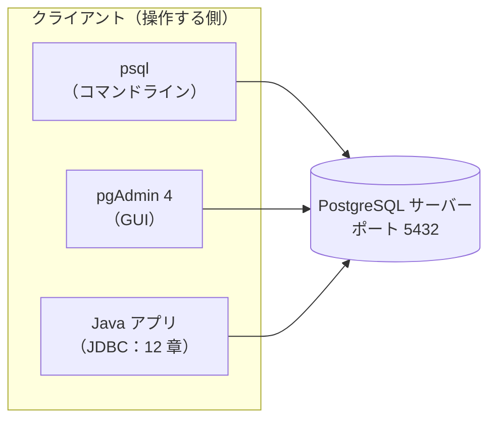
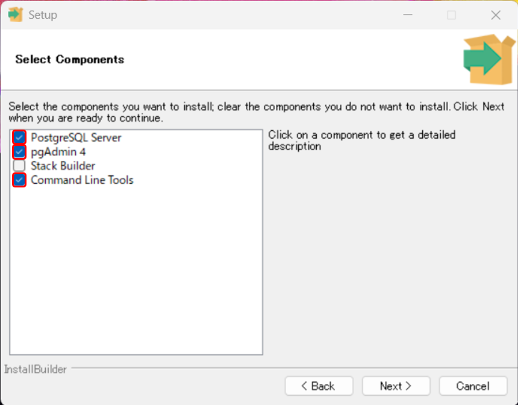
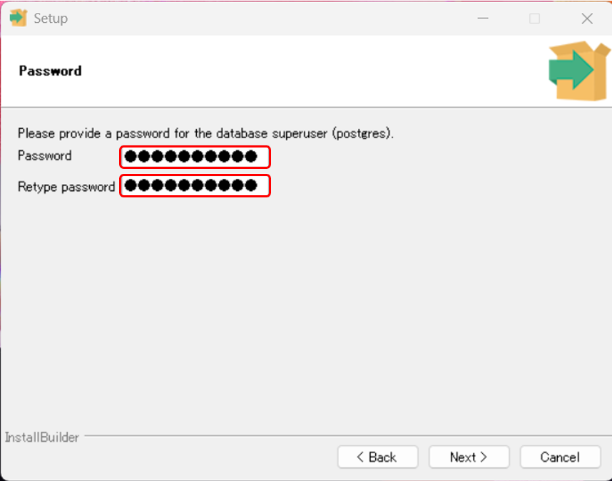
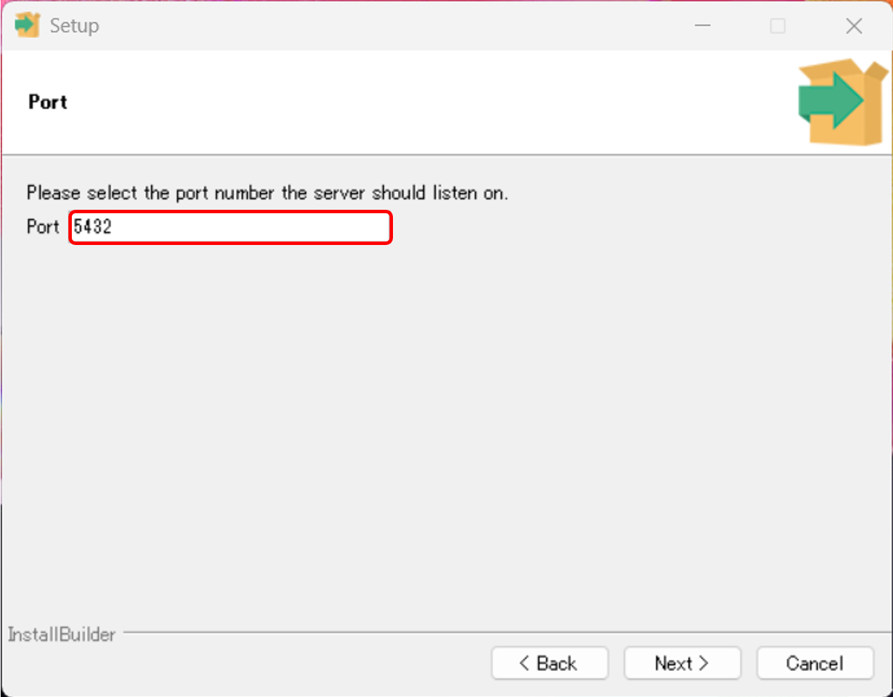
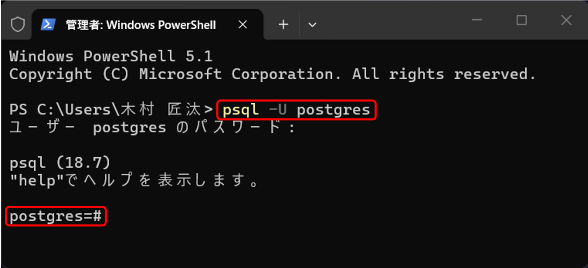
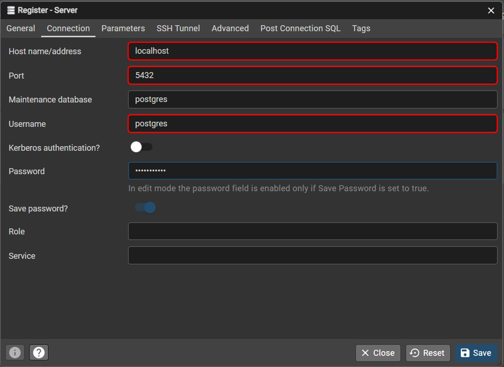
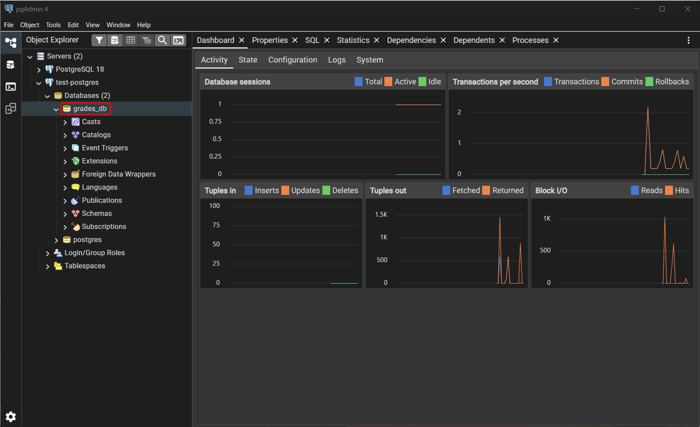
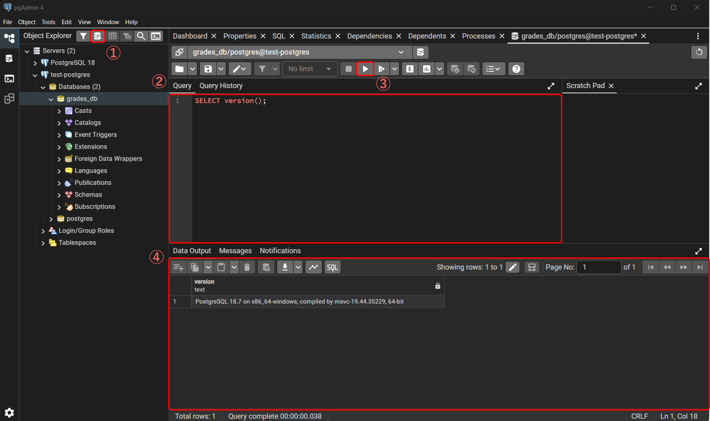

# 07. PostgreSQL環境構築

[📖 データベースの目次](./00_はじめに.md#目次) ｜ [🏠 全体の目次](../README.md#目次)

[← 前へ：06 物理設計](06_物理設計.md) ｜ [次へ：08 SQL：テーブルの作成（DDL） →](08_SQL_DDL.md)

## この章のゴール
- PostgreSQL をインストールして、起動を確認できる
- コマンドラインツール（psql）と GUI ツール（pgAdmin）で接続できる
- 学習用のデータベース `grades_db` を作成できる
- サンプルの SQL ファイルを実行できる

## 目次

1. [全体像](#1-全体像)
2. [PostgreSQL のインストール（Windows）](#2-postgresql-のインストールwindows)
3. [他の方法：macOS / Docker](#3-他の方法macos--docker)
4. [psql で接続する](#4-psql-で接続する)
5. [pgAdmin で接続する](#5-pgadmin-で接続する)
6. [データベースを作成する](#6-データベースを作成する)
7. [サンプルの SQL を実行する](#7-サンプルの-sql-を実行する)
8. [よくあるミス](#8-よくあるミス)

---

## 1. 全体像

用意するものは、**PostgreSQL のサーバー**と、それを操作する**クライアント**です。



| 名前 | 役割 |
|---|---|
| **PostgreSQL サーバー** | データを保管し、SQL を実行する本体（常に起動しておく） |
| **psql** | コマンドラインから SQL を実行するツール。インストーラに付属 |
| **pgAdmin 4** | ブラウザ風の画面で、データベースを操作できる GUI ツール。インストーラに付属 |

この資料では、**SQL を試すときは psql か pgAdmin のどちらか**を使います。使いやすいほうで構いません。

> [!NOTE]
> サーバーは、パソコンの中で動く**常駐プログラム**です。インストールすると、Windows の起動時に自動で立ち上がるのが普通です。

## 2. PostgreSQL のインストール（Windows）

1. [PostgreSQL 公式サイトのダウンロードページ](https://www.postgresql.org/download/windows/)から、Windows 用のインストーラ（EDB 提供）をダウンロードする
2. ダウンロードしたインストーラを実行する
3. 画面の案内に従って進める。**次の 3 か所だけ注意**してください

### コンポーネントの選択

次の 3 つにチェックを入れます（Stack Builder は不要です）。



### パスワードの設定

`postgres` ユーザー（データベースの管理者）の**パスワード**を決めます。



> [!WARNING]
> **このパスワードは忘れないでください**。接続のたびに必要です。学習用のパソコンでも、推測されにくいものにしましょう。

> [!CAUTION]
> **セキュリティの視点**：Docker の例（3 節）の `postgres` のような簡単なパスワードは、**自分のパソコンの中から接続する**ときに限って使います。設定ファイル（`postgresql.conf` の `listen_addresses`、`pg_hba.conf`）を書き換えて、**ほかのコンピュータからの接続を許可しない**でください。

### ポート番号

通常は、既定の **5432** のままにします。



それ以外（インストール先、ロケールなど）は、既定のままで構いません。インストールが終わると、サーバーが自動で起動します。

## 3. 他の方法：macOS / Docker

### macOS

Homebrew が使える場合の例です。

```bash
brew install postgresql@18
brew services start postgresql@18
```

### Docker

Docker が使える場合、1 つのコマンドでサーバーを用意できます（パスワードは学習用の例です）。

```bash
docker run --name grades-pg -e POSTGRES_PASSWORD=postgres -p 127.0.0.1:5432:5432 -d postgres:18
```

> [!NOTE]
> この方法は、**クライアント（psql など）は別に用意**します。動作確認は行っていません。公式のドキュメントも確認してください。

> [!CAUTION]
> **セキュリティの視点**：`-p 5432:5432` のように書くと、**同じネットワークにあるほかのコンピュータからも**接続できる状態になります。Docker の公式ドキュメントも、ポートの公開は既定では安全でないと注意しています。上の例のように `127.0.0.1:` を付けると、そのパソコンからしか接続できません（[Docker Docs「Port publishing and mapping」](https://docs.docker.com/engine/network/port-publishing/)、閲覧日：2026-11-08）。簡単なパスワードのデータベースを外から接続できる状態にすると、自動で探し回るプログラムに見つかり、データを盗まれたり消されたりするおそれがあります。

## 4. psql で接続する

ターミナル（Windows ではコマンドプロンプトや PowerShell）で、次のコマンドを実行します。

```bash
psql -U postgres
```

パスワードを聞かれるので、インストール時に決めたものを入力します（入力しても画面には表示されません）。



```sql
SELECT version();
```

### psql のメタコマンド

`\`（バックスラッシュ）で始まるものは、SQL ではなく **psql 自身のコマンド**で、`;` は不要です。

| コマンド | 内容 |
|---|---|
| `\l` | データベースの一覧 |
| `\c データベース名` | 別のデータベースに接続し直す |
| `\dt` | テーブルの一覧 |
| `\d テーブル名` | テーブルの構造（列・制約・インデックス） |
| `\i ファイル名` | SQL ファイルを実行する |
| `\?` | コマンドの一覧（ヘルプ） |
| `\q` | psql を終了する |

> [!TIP]
> `psql` が「コマンドが見つかりません」と表示される場合は、PostgreSQL の `bin` フォルダ（例：`C:\Program Files\PostgreSQL\18\bin`）を、環境変数 `PATH` に追加します。

## 5. pgAdmin で接続する

1. スタートメニューから **pgAdmin 4** を起動する（初回は、pgAdmin 自身のマスターパスワードを求められることがある）
2. 左の「Servers」を右クリック → **Register → Server...** を選ぶ
3. 「General」タブで名前を付ける（例：`local-postgres`）
4. 「Connection」タブで、次を入力する

| 項目 | 値 |
|---|---|
| Host name/address | `localhost` |
| Port | `5432` |
| Maintenance database | `postgres` |
| Username | `postgres` |
| Password | インストール時のパスワード |



5. 「Save」を押すと、左のツリーにサーバーが表示される

> [!NOTE]
> pgAdmin の画面は、既定では英語です。この資料の説明も、英語の表示に合わせています。

## 6. データベースを作成する

PostgreSQL は、1 つのサーバーの中に**複数のデータベース**を持てます。学習用に、`grades_db` という名前のデータベースを作ります。

### psql の場合

```sql
CREATE DATABASE grades_db;
```

作成したら、`\c grades_db` で接続先を切り替えます。

### pgAdmin の場合

1. 左のツリーで **Databases** を右クリック → **Create → Database...**
2. Database に `grades_db` と入力して「Save」



### Query Tool を開く

`grades_db` を選択した状態で、上部の **Query Tool** ボタン（または右クリック → Query Tool）を開くと、SQL を入力して実行できる画面になります。



> [!TIP]
> Query Tool では、SQL を書いて **F5**（または ▶ ボタン）を押すと実行されます。複数の文があるときは、実行したい部分を選択してから実行します。

## 7. サンプルの SQL を実行する

サンプルリポジトリの `db/` フォルダに、テーブル定義とサンプルデータがあります。

| ファイル | 内容 | 使う章 |
|---|---|---|
| `db/01_schema.sql` | テーブルの定義 | 08 章 |
| `db/02_seed.sql` | サンプルデータ | 09・10 章 |

> [!NOTE]
> **サンプル**：[`db/`](https://github.com/<ORG>/PRMN_SYSTEM_Sample/tree/main/db)

### psql で実行する

ファイルのあるフォルダに移動して、次を実行します。

```bash
psql -U postgres -d grades_db -f db/01_schema.sql
```

`-d` は接続するデータベース、`-f` は実行する SQL ファイルです。すでに psql に入っている場合は、`\i db/01_schema.sql` でも実行できます。

### pgAdmin で実行する

Query Tool の「Open File」ボタンでファイルを開き、実行します。

> [!NOTE]
> 08 章では、`01_schema.sql` の中身を読み解きながら実行します。ここでは、まず**動くことの確認**だけで構いません。

## 8. よくあるミス

| ミス | 原因・対処 |
|---|---|
| `psql` が見つからない | `bin` フォルダが `PATH` に無い。環境変数に追加するか、フルパスで実行する |
| `connection refused`（接続が拒否された） | サーバーが起動していない、またはポートが違う。Windows の「サービス」で `postgresql-x64-18` のようなサービスが実行中か確認する |
| `password authentication failed` | パスワードが違う。インストール時に決めたものを確認する |
| SQL を入力しても、何も実行されない | 文末の `;` を忘れている。psql は `;` が来るまで入力が続くと考える |
| `database "grades_db" does not exist` | 作成していない、またはスペルミス。`\l` で一覧を確認する |
| 日本語が文字化けする（Windows の psql） | コンソールの文字コードの違い。`\encoding UTF8` を実行する。それでも直らない場合は pgAdmin を使う |
| 5432 番ポートが使用中 | 別の PostgreSQL がすでに動いている。ポートを変えるか、もう一方を停止する |
| `postgres` ユーザーのパスワードを忘れた | 再設定には手順が必要。学習用なら、再インストールが早い場合もある |

---

[← 前へ：06 物理設計](06_物理設計.md) ｜ [次へ：08 SQL：テーブルの作成（DDL） →](08_SQL_DDL.md)

[📖 データベースの目次](./00_はじめに.md#目次) ｜ [🏠 全体の目次](../README.md#目次)
