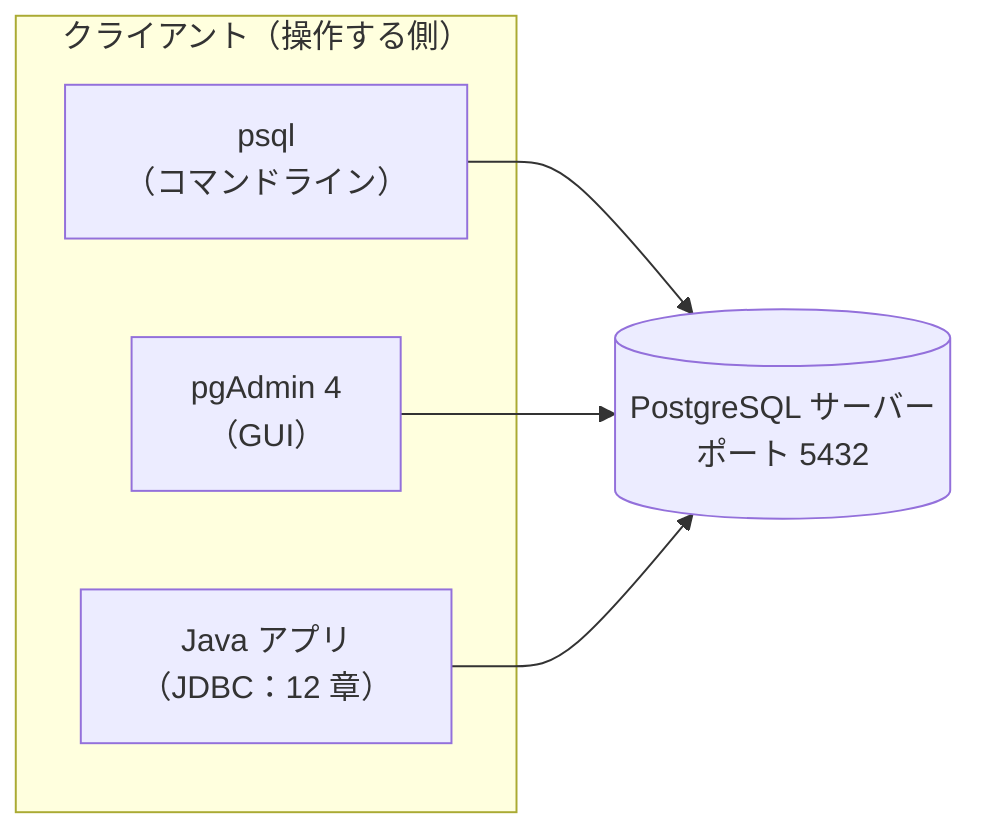
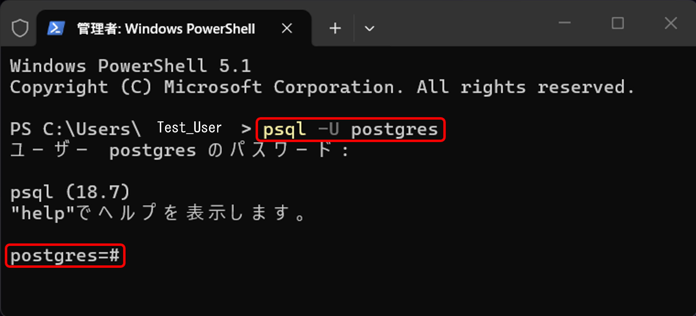
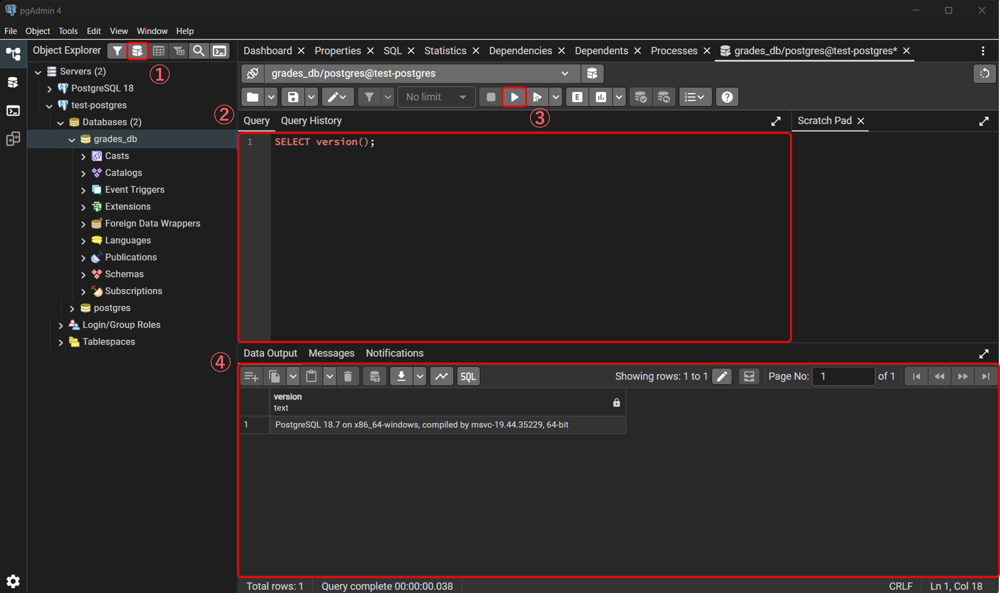

# 07. PostgreSQL環境構築

[📖 データベースの目次](./00_はじめに.md#目次) ｜ [🏠 全体の目次](../README.md#目次)

[← 前へ：06 物理設計](06_物理設計.md) ｜ [次へ：08 SQL：テーブルの作成（DDL） →](08_SQL_DDL.md)

## この章のゴール
- PostgreSQL をインストールして、起動を確認できる
- コマンドラインツール（psql）と GUI ツール（pgAdmin）で接続できる
- 学習用のデータベース `grades_db` を作成できる
- サンプルの SQL ファイルを実行できる

## 目次

1. [全体像](#1-全体像)
2. [PostgreSQL のインストール（Windows）](#2-postgresql-のインストールwindows)
3. [他の方法：macOS / Docker](#3-他の方法macos--docker)
4. [psql で接続する](#4-psql-で接続する)
5. [pgAdmin で接続する](#5-pgadmin-で接続する)
6. [データベースを作成する](#6-データベースを作成する)
7. [サンプルの SQL を実行する](#7-サンプルの-sql-を実行する)
8. [psql が見つからないときの対処（PATH の設定）](#8-psql-が見つからないときの対処path-の設定)
9. [よくあるミス](#9-よくあるミス)

---

## 1. 全体像

用意するものは、**PostgreSQL のサーバー**と、それを操作する**クライアント**です。



| 名前 | 役割 |
|---|---|
| **PostgreSQL サーバー** | データを保管し、SQL を実行する本体（常に起動しておく） |
| **psql** | コマンドラインから SQL を実行するツール。インストーラに付属 |
| **pgAdmin 4** | ブラウザ風の画面で、データベースを操作できる GUI ツール。インストーラに付属 |

この資料では、**SQL を試すときは psql か pgAdmin のどちらか**を使います。使いやすいほうで構いません。

> [!NOTE]
> サーバーは、パソコンの中で動く**常駐プログラム**です。インストールすると、Windows の起動時に自動で立ち上がるのが普通です。

## 2. PostgreSQL のインストール（Windows）

1. [PostgreSQL 公式サイトのダウンロードページ](https://www.postgresql.org/download/windows/)から、Windows 用のインストーラ（EDB 提供）をダウンロードする
2. ダウンロードしたインストーラを実行する
3. 画面の案内に従って進める。**次の 3 か所だけ注意**してください

### コンポーネントの選択

次の 3 つにチェックを入れます（Stack Builder は不要です）。

- **PostgreSQL Server**（データベース本体）
- **pgAdmin 4**（操作画面。5 節で使います）
- **Command Line Tools**（`psql` コマンド。4 節で使います）


### パスワードの設定

`postgres` ユーザー（データベースの管理者）の**パスワード**を決めます。


> [!WARNING]
> **このパスワードは忘れないでください**。接続のたびに必要です。学習用のパソコンでも、推測されにくいものにしましょう。

> [!CAUTION]
> **セキュリティの視点**：Docker の例（3 節）の `postgres` のような簡単なパスワードは、**自分のパソコンの中から接続する**ときに限って使います。設定ファイル（`postgresql.conf` の `listen_addresses`、`pg_hba.conf`）を書き換えて、**ほかのコンピュータからの接続を許可しない**でください。

### ポート番号

通常は、既定の **5432** のままにします。


それ以外（インストール先、ロケールなど）は、既定のままで構いません。インストールが終わると、サーバーが自動で起動します。

## 3. 他の方法：macOS / Docker

### macOS

Homebrew が使える場合の例です。

```bash
brew install postgresql@18
brew services start postgresql@18
```

### Docker

Docker が使える場合、1 つのコマンドでサーバーを用意できます（パスワードは学習用の例です）。

```bash
docker run --name grades-pg -e POSTGRES_PASSWORD=postgres -p 127.0.0.1:5432:5432 -d postgres:18
```

> [!NOTE]
> この方法は、**クライアント（psql など）は別に用意**します。動作確認は行っていません。公式のドキュメントも確認してください。

> [!TIP]
> Docker のインストールから、データの保存（ボリューム）、`compose.yaml` で PostgreSQL と pgAdmin をまとめて起動する方法までは、[Docker / Compose 編](../Docker/00_はじめに.md)で扱います。

> [!CAUTION]
> **セキュリティの視点**：`-p 5432:5432` のように書くと、**同じネットワークにあるほかのコンピュータからも**接続できる状態になります。Docker の公式ドキュメントも、ポートの公開は既定では安全でないと注意しています。上の例のように `127.0.0.1:` を付けると、そのパソコンからしか接続できません（[Docker Docs「Port publishing and mapping」](https://docs.docker.com/engine/network/port-publishing/)、閲覧日：2026-11-08）。簡単なパスワードのデータベースを外から接続できる状態にすると、自動で探し回るプログラムに見つかり、データを盗まれたり消されたりするおそれがあります。

## 4. psql で接続する

ターミナル（Windows ではコマンドプロンプトや PowerShell）で、次のコマンドを実行します。

```bash
psql -U postgres
```

パスワードを聞かれるので、インストール時に決めたものを入力します（入力しても画面には表示されません）。



```sql
SELECT version();
```

### psql のメタコマンド

`\`（バックスラッシュ）で始まるものは、SQL ではなく **psql 自身のコマンド**で、`;` は不要です。

| コマンド | 内容 |
|---|---|
| `\l` | データベースの一覧 |
| `\c データベース名` | 別のデータベースに接続し直す |
| `\dt` | テーブルの一覧 |
| `\d テーブル名` | テーブルの構造（列・制約・インデックス） |
| `\i ファイル名` | SQL ファイルを実行する |
| `\?` | コマンドの一覧（ヘルプ） |
| `\q` | psql を終了する |

> [!TIP]
> `psql` が「コマンドが見つかりません」と表示される場合は、PostgreSQL の `bin` フォルダ（例：`C:\Program Files\PostgreSQL\18\bin`）を、環境変数 `PATH` に追加します。手順は [8 節](#8-psql-が見つからないときの対処path-の設定)で説明します。

## 5. pgAdmin で接続する

1. スタートメニューから **pgAdmin 4** を起動する（初回は、pgAdmin 自身のマスターパスワードを求められることがある）
2. 左の「Servers」を右クリック → **Register → Server...** を選ぶ
3. 「General」タブで名前を付ける（例：`local-postgres`）
4. 「Connection」タブで、次を入力する

| 項目 | 値 |
|---|---|
| Host name/address | `localhost` |
| Port | `5432` |
| Maintenance database | `postgres` |
| Username | `postgres` |
| Password | インストール時のパスワード |


5. 「Save」を押すと、左のツリーにサーバーが表示される

> [!NOTE]
> pgAdmin の画面は、既定では英語です。この資料の説明も、英語の表示に合わせています。

## 6. データベースを作成する

PostgreSQL は、1 つのサーバーの中に**複数のデータベース**を持てます。学習用に、`grades_db` という名前のデータベースを作ります。

### psql の場合

```sql
CREATE DATABASE grades_db;
```

作成したら、`\c grades_db` で接続先を切り替えます。

### pgAdmin の場合

1. 左のツリーで **Databases** を右クリック → **Create → Database...**
2. Database に `grades_db` と入力して「Save」


### Query Tool を開く

`grades_db` を選択した状態で、上部の **Query Tool** ボタン（または右クリック → Query Tool）を開くと、SQL を入力して実行できる画面になります。



> [!TIP]
> Query Tool では、SQL を書いて **F5**（または ▶ ボタン）を押すと実行されます。複数の文があるときは、実行したい部分を選択してから実行します。

## 7. サンプルの SQL を実行する

サンプルリポジトリの `database/db/` フォルダに、テーブル定義とサンプルデータがあります。

| ファイル | 内容 | 使う章 |
|---|---|---|
| `database/db/01_schema.sql` | テーブルの定義 | 08 章 |
| `database/db/02_seed.sql` | サンプルデータ | 09・10 章 |

> [!NOTE]
> **サンプル**：[`database/db/`](https://github.com/YTS0418/PRMN_SYSTEM_Sample/tree/main/database/db)

### psql で実行する

サンプルリポジトリ（[PRMN_SYSTEM_Sample](https://github.com/YTS0418/PRMN_SYSTEM_Sample)）を clone してあるものとします。まだなら、先に `git clone` してください（clone の方法は [Git 編 00 章 6 節](../Git/00_Git導入・初期設定.md#6-リポジトリを-clone-する)を参照）。そのリポジトリの**ルート**（`database` フォルダがある場所）にターミナルで移動して、次を実行します。

```bash
psql -U postgres -d grades_db -f database/db/01_schema.sql
```

`-d` は接続するデータベース、`-f` は実行する SQL ファイルです。すでに psql に入っている場合は、`\i database/db/01_schema.sql` でも実行できます。

### pgAdmin で実行する

Query Tool の「Open File」ボタンでファイルを開き、実行します。

> [!NOTE]
> 08 章では、`01_schema.sql` の中身を読み解きながら実行します。ここでは、まず**動くことの確認**だけで構いません。

## 8. psql が見つからないときの対処（PATH の設定）

Windows では、インストーラが `psql` の場所を `PATH` に**自動では追加しません**。そのため、インストール直後に `psql -U postgres` を実行すると、エラーになる人が多くいます。**受講者の多くが一度は遭遇する**ので、落ち着いて、この節を上から順に進めてください。

> [!NOTE]
> この節は、**環境変数を初めて触る人**を前提に書いています。意味が分からない言葉が出てきたら、「8-1」の説明に戻ってください。

### 8-1. 何が起きているのか

#### エラーメッセージの例

使っているターミナルによって、表示される文章が違います。**どれも同じ原因**です。

| 使っているツール | 表示されるメッセージの例 |
|---|---|
| コマンドプロンプト | `'psql' は、内部コマンドまたは外部コマンド、操作可能なプログラムまたはバッチ ファイルとして認識されていません。` |
| PowerShell | `psql : 用語 'psql' は、コマンドレット、関数、スクリプト ファイル、または操作可能なプログラムの名前として認識されません。` |
| macOS / Linux（bash・zsh） | `command not found: psql` |

#### 用語の説明

| 用語 | 意味 |
|---|---|
| **ターミナル** | 文字でパソコンに命令を出す画面。Windows ではコマンドプロンプトや PowerShell のこと |
| **コマンド** | ターミナルで打つ命令。`psql` もその 1 つ |
| **フォルダの場所（パス）** | ファイルがある場所を表す文字列。例：`C:\Program Files\PostgreSQL\18\bin` |
| **環境変数** | Windows が覚えておく**設定項目**。「名前」と「値」のセットで、パソコン全体や、ログインしているユーザーに対して設定できる |
| **`Path`（PATH）環境変数** | 環境変数のうちの 1 つ。**コマンドを探しに行くフォルダの一覧**が入っている |

#### 原因

`psql` と打って Enter を押すと、Windows は「`psql.exe` というプログラムはどこにあるか」を探します。ただし、**パソコン中のフォルダを全部探すわけではありません**。探すのは、`Path` 環境変数に書かれたフォルダだけです。

`psql.exe` は PostgreSQL の `bin` フォルダの中にありますが、そのフォルダが `Path` に書かれていないので、「見つからない」と言われます。

> [!TIP]
> たとえるなら、`Path` は「探してよい場所のメモ」です。本は図書館にあるのに、メモに図書館が書かれていないので、見つけてもらえていない状態です。PostgreSQL が壊れているわけではないので、再インストールは不要です。

#### 対処の選び方

やることは、「`Path` に `bin` フォルダを書き足す」ことです（手順 C）。そのために、まず `bin` フォルダの場所を調べます（手順 A）。

| 方法 | 内容 | こんな人向け |
|---|---|---|
| 手順 B | 場所を全部書いて実行する。設定は変えない | 今すぐ 1 回だけ試したい |
| 手順 C | `Path` に追加する。1 回設定すれば、ずっと `psql` だけで動く | **学習を続ける人（おすすめ）** |

### 手順 A：`bin` フォルダの場所を調べる

1. キーボードの **Windows キー + E** を押して、エクスプローラー（フォルダを見る画面）を開く
2. 画面上部のアドレスバー（フォルダの場所が表示されている細長い欄）をクリックし、次を入力して Enter を押す

   ```text
   C:\Program Files\PostgreSQL
   ```

3. `18` のような**数字のフォルダ**（PostgreSQL のバージョン）が表示されるので、ダブルクリックして開く。複数ある場合は、インストールしたものを選ぶ
4. 中にある **`bin` フォルダ**をダブルクリックして開く
5. 一覧の中に **`psql`**（または `psql.exe`）があることを確認する。`bin` の中には、ほかにもたくさんのファイルが並んでいます
6. アドレスバーの**空いている場所をクリック**する。パスが文字として選択された状態になる
7. **Ctrl + C** を押して、コピーする

   次のような文字列がコピーできていれば成功です。

   ```text
   C:\Program Files\PostgreSQL\18\bin
   ```

> [!NOTE]
> 手順 6 で、アドレスバーが `Program Files > PostgreSQL > 18 > bin` のように「>」で区切って表示されることがあります。その場合は、**欄の中をクリックする**と、`C:\...` の形に切り替わります。

> [!WARNING]
> `C:\Program Files\PostgreSQL` が見つからない場合は、次のどれかです。
> - インストールが最後まで終わっていない（インストーラをもう一度実行する）
> - 別の場所を指定してインストールした（インストール時に選んだ場所を探す）
> - `bin` の中に `psql.exe` が無い（インストール時の「Command Line Tools」のチェックが外れていた。インストーラをもう一度実行して追加する）

### 手順 B：フルパスで実行する（設定を変えたくないとき）

**フルパス**とは、場所を省略せずに全部書いた形のことです。場所を全部書けば、`Path` の設定が無くても実行できます。

パスには**空白**（`Program Files` の間）が入っているため、**全体をダブルクォート `"` で囲みます**。

**コマンドプロンプトの場合**

```bat
"C:\Program Files\PostgreSQL\18\bin\psql.exe" -U postgres
```

**PowerShell の場合**（先頭に `&` と半角スペースが必要です）

```powershell
& "C:\Program Files\PostgreSQL\18\bin\psql.exe" -U postgres
```

`18` の部分は、手順 A で調べた、自分のバージョンの数字に置き換えてください。

> [!WARNING]
> PowerShell で `&` を付け忘れると、文字列として扱われてエラーになります。また、`psql` を使うたびにこの長い文字を打つ必要があります。学習を続けるなら、手順 C をおすすめします。

### 手順 C：環境変数 Path に追加する（おすすめ）

一度設定すれば、以後は `psql` と打つだけで実行できます。画面の名前は、Windows のバージョンで少し違いますが、次の順で進めれば同じ画面にたどり着きます。

#### C-1. 環境変数の編集画面を開く

1. キーボードの **Windows キー**を押して、スタートメニューを開く
2. そのまま「**環境変数**」と入力する（検索欄をクリックしなくても、入力すれば検索されます）
3. 候補に出る **「環境変数を編集」**（または **「システム環境変数の編集」**）をクリックする
4. 「**システムのプロパティ**」というウィンドウが開く。下のほうにある **「環境変数(N)...」** ボタンをクリックする

> [!NOTE]
> 手順 3 で、**「システム環境変数の編集」** を選んだ場合は、**「システムのプロパティ」の「詳細設定」タブ**が開きます。その下にある「環境変数(N)...」ボタンを押してください。

#### C-2. Path を選んで「編集」を押す

「環境変数」ウィンドウは、**上下 2 つの一覧**に分かれています。

1. **上側の「ユーザー環境変数」**の一覧から、変数名が **`Path`** の行をクリックして選ぶ（選ぶと行が青く反転する）
2. 上側の **「編集(E)...」** ボタンをクリックする

> [!WARNING]
> **下側の「システム環境変数」ではなく、上側の「ユーザー環境変数」**を使ってください。下側は、パソコン全体に関わる設定で、間違えると他のソフトが動かなくなるおそれがあります。上側は、自分のアカウントだけに効くので、安全に試せます。
>
> 上側に `Path` の行が**無い**場合は、**「新規(N)...」** を押して、変数名に `Path`、変数値に手順 A でコピーしたパスを入力して OK を押します。その場合は、C-3 は飛ばして C-4 に進みます。

#### C-3. bin フォルダのパスを 1 行追加する

「環境変数名の編集」ウィンドウが開きます。**すでに何行かのパスが並んでいます**（例：`%USERPROFILE%\AppData\Local\Microsoft\WindowsApps` など）。**これは消さずに、そのまま残します**。

1. 右側の **「新規(N)」** ボタンをクリックする。一覧の一番下に、**入力できる空の行**が現れる
2. その行に、手順 A でコピーしたパスを **Ctrl + V** で貼り付ける

   ```text
   C:\Program Files\PostgreSQL\18\bin
   ```

3. 貼り付けた行が、**`bin` で終わっている**こと（`psql.exe` まで入っていない）を確認する
4. **「OK」**をクリックする

> [!NOTE]
> 古い Windows では、「編集」を押すと、**1 行の長い入力欄**が開くことがあります。その場合は、**欄の一番最後**に、`;`（セミコロン）を 1 つ書いてから、続けてパスを貼り付けます。パスとパスは `;` で区切るルールです。
>
> 例：`既存のパス...;C:\Program Files\PostgreSQL\18\bin`
>
> 既存の文字は、**消さずに**そのままにしてください。

#### C-4. すべてのウィンドウを「OK」で閉じる

「環境変数名の編集」を OK で閉じたあと、**「環境変数」ウィンドウも「OK」**、**「システムのプロパティ」も「OK」** で閉じます。

> [!WARNING]
> **途中で「キャンセル」や右上の × で閉じると、変更が保存されません**。最後のウィンドウまで、必ず「OK」を押してください。

#### C-5. ターミナルを開き直して確認する

> [!WARNING]
> **一番忘れやすい手順です**。環境変数の変更は、**すでに開いているターミナルには反映されません**。**開いていたコマンドプロンプト、PowerShell、VSCode や IntelliJ のターミナルを、すべて閉じて**から、新しく開き直します。VSCode や IntelliJ は、**アプリ自体を終了して**起動し直してください。

1. **Windows キー**を押し、「**cmd**」と入力して、「コマンド プロンプト」を開く（PowerShell を使いたい人は、「powershell」と入力する）
2. 黒い画面（またはブルーの画面）に、次を入力して Enter を押す

   ```bash
   psql --version
   ```

3. 次のように**バージョンが表示されれば成功**です

   ```text
   psql (PostgreSQL) 18.0
   ```

   数字は、インストールしたバージョンによって違います。

成功したら、4 節に戻って `psql -U postgres` を実行してください。

### うまくいかないとき

症状ごとに、確認することを表にしました。

| 症状 | 原因と対処 |
|---|---|
| 設定したのに、同じエラーが出る | ほとんどが**ターミナルを開き直していない**ことが原因。すべてのターミナルを閉じて、新しく開き直す。それでも直らなければ、**パソコンを再起動**する |
| `Path` に何を書いたか分からなくなった | もう一度、C-1 → C-2 と進み、`Path` の「編集」を開いて、一覧の中身を確認する。**`C:\Program Files\PostgreSQL\18\bin` が 1 行で入っていれば正しい** |
| 一覧に追加した行が、`bin` の後ろに `\psql.exe` まで付いている | その行を選んで「編集」を押し、`\psql.exe` を消す。登録するのは**フォルダまで**で、ファイル名は不要 |
| バージョン番号（`18`）が実際と違う | 手順 A に戻り、エクスプローラーで見えたフォルダ名を確認して、一致させる |
| 間違えて、既存の行を消した、または書き換えた | 「環境変数名の編集」ウィンドウで **「キャンセル」** を押せば、保存前の状態に戻る。保存してしまった場合は、手順 B で当面しのぎつつ、先生や詳しい人に相談する |
| `Path` が編集できない（ボタンが押せない） | 上側の「ユーザー環境変数」を使っているか確認する。それでもできないときは、手順 B を使う |
| 設定が合っているか確かめたい | コマンドプロンプトで `where psql` を実行する。`C:\Program Files\PostgreSQL\18\bin\psql.exe` と表示されれば、見つかっている。PowerShell では `Get-Command psql` を使う |
| `psql: error: connection to server ... failed` など、別のエラーが出た | **`psql` 自体は見つかっています**。PATH の問題は解決しており、次は 9 節の表で、そのエラー文を探す |

### macOS（Homebrew）の場合

`brew install postgresql@18` では、`psql` の場所が `Path` に自動では追加されないことがあります。ターミナルで、次の 3 行を**順に**実行します。

```bash
echo 'export PATH="$(brew --prefix postgresql@18)/bin:$PATH"' >> ~/.zshrc
source ~/.zshrc
psql --version
```

| 行 | 意味 |
|---|---|
| 1 行目 | 設定ファイル `~/.zshrc` の末尾に、「`bin` フォルダを `PATH` に加える」という 1 行を追記する |
| 2 行目 | 追記した設定を、今開いているターミナルに読み込ませる（ターミナルを開き直すのと同じ） |
| 3 行目 | バージョンが表示されれば成功 |

> [!NOTE]
> `zsh` 以外のシェルを使っている場合は、`~/.zshrc` をそのシェルの設定ファイル（例：`~/.bash_profile`）に読み替えてください。分からないときは、ターミナルで `echo $SHELL` を実行し、`/bin/zsh` と表示されれば `zsh` です。

### Docker の場合

Docker の例（3 節）では、**パソコン側に `psql` は入りません**。そのため、`PATH` を設定しても `psql` は使えません。次のように、**コンテナの中にある `psql`** を呼び出します。

```bash
docker exec -it grades-pg psql -U postgres
```

> [!NOTE]
> この方法で `.sql` ファイルを実行する場合は、ファイルをコンテナに渡す必要があります。迷うときは、5 節の pgAdmin を使うのが簡単です。

## 9. よくあるミス

| ミス | 原因・対処 |
|---|---|
| `psql` が見つからない | `bin` フォルダが `PATH` に無い。環境変数に追加するか、フルパスで実行する（[8 節](#8-psql-が見つからないときの対処path-の設定)に手順あり） |
| `connection refused`（接続が拒否された） | サーバーが起動していない、またはポートが違う。Windows の「サービス」で `postgresql-x64-18` のようなサービスが実行中か確認する |
| `password authentication failed` | パスワードが違う。インストール時に決めたものを確認する |
| SQL を入力しても、何も実行されない | 文末の `;` を忘れている。psql は `;` が来るまで入力が続くと考える |
| `database "grades_db" does not exist` | 作成していない、またはスペルミス。`\l` で一覧を確認する |
| 日本語が文字化けする、または `.sql` ファイルを流すと一部の `INSERT` が失敗して外部キーのエラーになる（Windows の psql） | コンソールの文字コードの違い。対話画面では `\encoding UTF8` を実行する。`-f` でファイルを流すときは、先に環境変数 `PGCLIENTENCODING` を `UTF8` にする（コマンドプロンプトは `set PGCLIENTENCODING=UTF8`、PowerShell は `$env:PGCLIENTENCODING = 'UTF8'`）。それでも直らない場合は pgAdmin を使う |
| 5432 番ポートが使用中 | 別の PostgreSQL がすでに動いている。ポートを変えるか、もう一方を停止する |
| `postgres` ユーザーのパスワードを忘れた | 再設定には手順が必要。学習用なら、再インストールが早い場合もある |

---

[← 前へ：06 物理設計](06_物理設計.md) ｜ [次へ：08 SQL：テーブルの作成（DDL） →](08_SQL_DDL.md)

[📖 データベースの目次](./00_はじめに.md#目次) ｜ [🏠 全体の目次](../README.md#目次)
