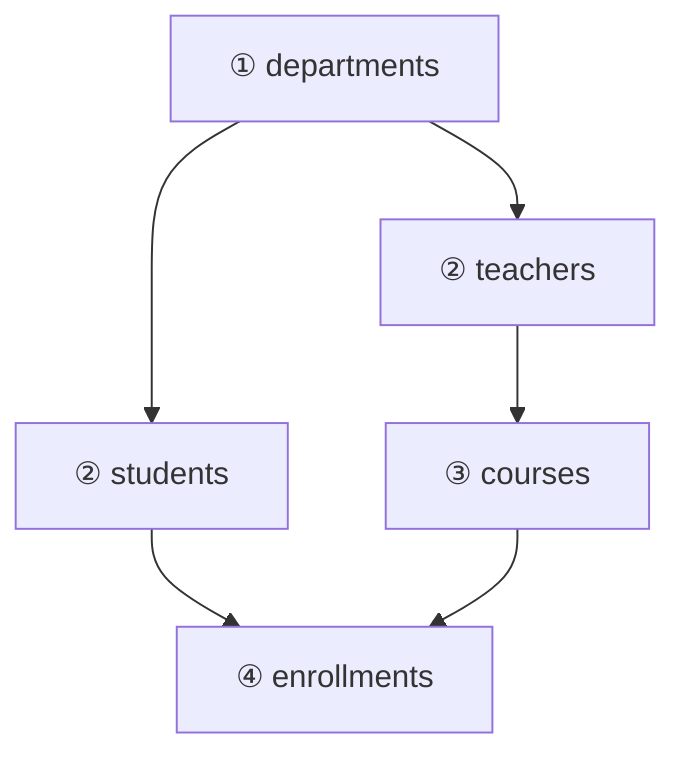

# 08. SQL：テーブルの作成（DDL）

[📖 データベースの目次](./00_はじめに.md#目次) ｜ [🏠 全体の目次](../README.md#目次)

[← 前へ：07 PostgreSQL環境構築](07_PostgreSQL環境構築.md) ｜ [次へ：09 SQL：基本操作 →](09_SQL_基本操作.md)

## この章のゴール
- `CREATE TABLE` で、主キー・外部キー・各種制約つきのテーブルを作れる
- 外部キーがあるテーブルを、正しい順序で作成・削除できる
- `ALTER TABLE` でテーブルの構造を変更できる
- `DROP TABLE` の危険性を理解している
- 物理設計（06 章）の内容が、DDL のどこに現れるか読み取れる

## 目次

1. [DDL とは](#1-ddl-とは)
2. [CREATE TABLE](#2-create-table)
3. [作る順序と消す順序](#3-作る順序と消す順序)
4. [制約の書き方](#4-制約の書き方)
5. [ALTER TABLE](#5-alter-table)
6. [DROP TABLE](#6-drop-table)
7. [作成したテーブルを確認する](#7-作成したテーブルを確認する)
8. [01_schema.sql を読む](#8-01_schemasql-を読む)
9. [スキーマ変更の管理](#9-スキーマ変更の管理)
10. [よくあるミス](#10-よくあるミス)

---

## 1. DDL とは

**DDL**（Data Definition Language）は、テーブルなど**データを入れる「器」の構造を定義する** SQL です。

| 命令 | 内容 |
|---|---|
| `CREATE` | 作る（テーブル、インデックスなど） |
| `ALTER` | 変更する |
| `DROP` | 削除する |

> データそのものを扱う命令（`INSERT` `SELECT` など）は DML で、09 章から扱います。

## 2. CREATE TABLE

もっとも単純な、学科テーブルから見てみましょう。

```sql
CREATE TABLE departments (
    department_id INTEGER GENERATED BY DEFAULT AS IDENTITY PRIMARY KEY,
    name          VARCHAR(50) NOT NULL UNIQUE
);
```

書き方は次のとおりです。

```
CREATE TABLE テーブル名 (
    列名 型 [制約],
    列名 型 [制約],
    ...
);
```

| 部分 | 意味 |
|---|---|
| `department_id INTEGER` | 列名と型（06 章で決めたもの） |
| `GENERATED BY DEFAULT AS IDENTITY` | 自動採番（06 章） |
| `PRIMARY KEY` | 主キー |
| `NOT NULL` | 空を許さない |
| `UNIQUE` | 重複を許さない |

外部キーを持つテーブルは、`REFERENCES 参照先テーブル (列)` を付けます。

```sql
CREATE TABLE teachers (
    teacher_id    INTEGER GENERATED BY DEFAULT AS IDENTITY PRIMARY KEY,
    name          VARCHAR(50) NOT NULL,
    department_id INTEGER     NOT NULL REFERENCES departments (department_id)
);
```

> `department_id ... REFERENCES departments (department_id)` は、「この列の値は、`departments` テーブルの `department_id` に存在するものだけ」という意味です。

## 3. 作る順序と消す順序

外部キーは、**参照先のテーブルが先に存在していないと作れません**。そのため、テーブルの作成順序が決まります。



| 操作 | 順序 | 理由 |
|---|---|---|
| **作る** | ① departments → ② teachers・students → ③ courses → ④ enrollments | 参照される側（親）を先に作る |
| **消す** | ④ enrollments → ③ courses → ② teachers・students → ① departments | 参照する側（子）を先に消す。親を先に消すと、外部キーに違反する |

> 💡 矢印は「参照される → 参照する」の向きです。**矢印の元（親）から作り、矢印の先（子）から消す**と覚えてください。

## 4. 制約の書き方

制約の書き方には 2 通りあります。

| | 列制約 | テーブル制約 |
|---|---|---|
| 書く場所 | 列の定義の**後ろ** | 列の定義の**後**に、独立して書く |
| 対象 | その列 1 つ | 1 つ以上の列（複数列にも使える） |
| 例 | `name VARCHAR(50) NOT NULL` | `UNIQUE (student_id, course_id, academic_year)` |

複数の列を組み合わせる制約は、**テーブル制約**でしか書けません。履修テーブルの例です。

```sql
CREATE TABLE enrollments (
    enrollment_id INTEGER GENERATED BY DEFAULT AS IDENTITY PRIMARY KEY,
    student_id    INTEGER  NOT NULL REFERENCES students (student_id) ON DELETE CASCADE,
    course_id     INTEGER  NOT NULL REFERENCES courses (course_id)   ON DELETE RESTRICT,
    academic_year SMALLINT NOT NULL,
    score         SMALLINT CHECK (score BETWEEN 0 AND 100),
    UNIQUE (student_id, course_id, academic_year)     -- テーブル制約（複数列）
);
```

### 制約に名前を付ける

制約には `CONSTRAINT 名前` で名前を付けられます。名前がないと、PostgreSQL が自動で付けた名前になります。**エラーメッセージや後から制約を削除するときに、名前が役立ちます**。

```sql
CONSTRAINT uq_enrollments_student_course_year UNIQUE (student_id, course_id, academic_year)
```

> 💡 命名規約の例：`pk_テーブル名`、`fk_テーブル名_列名`、`uq_テーブル名_列名`、`ck_テーブル名_列名`。このサンプルでは、読みやすさのため、名前を付けずに書いています。

## 5. ALTER TABLE

作ったあとにテーブルの構造を変更するには、`ALTER TABLE` を使います。

```sql
ALTER TABLE students ADD COLUMN email VARCHAR(100);                    -- 列を追加
ALTER TABLE students ADD CONSTRAINT uq_students_email UNIQUE (email);  -- 制約を追加
ALTER TABLE students ALTER COLUMN name TYPE VARCHAR(100);              -- 型を変更
ALTER TABLE students RENAME COLUMN name TO full_name;                  -- 列名を変更
ALTER TABLE students DROP COLUMN email;                                -- 列を削除
```

| 操作 | 構文 |
|---|---|
| 列の追加 | `ADD COLUMN 列名 型` |
| 列の削除 | `DROP COLUMN 列名` |
| 列名の変更 | `RENAME COLUMN 旧 TO 新` |
| 型の変更 | `ALTER COLUMN 列名 TYPE 新しい型` |
| NOT NULL の追加・解除 | `ALTER COLUMN 列名 SET NOT NULL` / `DROP NOT NULL` |
| 制約の追加・削除 | `ADD CONSTRAINT 名前 ...` / `DROP CONSTRAINT 名前` |
| テーブル名の変更 | `RENAME TO 新しい名前` |

> ⚠️ **すでにデータが入っているテーブルの変更には注意が必要**です。たとえば、既存の行がある状態で `ADD COLUMN email VARCHAR(100) NOT NULL` とすると、既存の行の `email` が空になるため、エラーになります。**列を NULL 可で追加 → データを埋める → `SET NOT NULL`** という手順を踏みます。

## 6. DROP TABLE

```sql
DROP TABLE IF EXISTS enrollments;          -- 存在しなくてもエラーにしない
DROP TABLE departments CASCADE;            -- 他のテーブルからの参照も、まとめて切る
```

> [!WARNING]
> **`DROP TABLE` は、テーブルとその中のデータを丸ごと削除し、元に戻せません。** 本番のデータベースでは、実行前に必ず確認してください。

| 指定 | 動作 |
|---|---|
| （なし） | 他のテーブルから参照されていると、エラーで拒否される |
| `CASCADE` | 参照している**外部キー制約**や、ビューも一緒に削除される（参照している側の**テーブル自体は削除されない**） |
| `IF EXISTS` | テーブルが存在しなくてもエラーにしない |

テーブルは残したまま、**中身のデータだけを空にする**には、`TRUNCATE` を使います。

```sql
TRUNCATE TABLE enrollments;
```

## 7. 作成したテーブルを確認する

作成後は、**意図どおりの構造になっているか**を確認します。

| 方法 | 内容 |
|---|---|
| `\dt` | psql：テーブルの一覧 |
| `\d students` | psql：列、型、制約、インデックス、参照している外部キー |
| pgAdmin | 左のツリーで **Schemas → public → Tables** を展開する |

<!-- 📷 SS: ../images/database/pgadmin/pga-08-01-tables-list.png -->
> 📷 **スクショ指定：`pga-08-01-tables-list.png`**
> - 画面：Object Explorer で `grades_db` → Schemas → public → Tables を展開し、5 つのテーブルが見える状態（右側に `students` のプロパティ）
> - 強調：5 つのテーブル名（departments / teachers / students / courses / enrollments）を赤枠で囲む

### ER 図を自動で描く

pgAdmin には、既存のテーブルから **ER 図を自動で描く機能**があります。`public` スキーマを右クリックし、**ERD For Schema** を選びます。設計（03・04 章）のとおりにできているかを、図で確認できます。

<!-- 📷 SS: ../images/database/pgadmin/pga-08-02-erd-tool.png -->
> 📷 **スクショ指定：`pga-08-02-erd-tool.png`**
> - 画面：`public` スキーマを右クリック → 「ERD For Schema」で開いた ER 図
> - 強調：5 つのテーブルと、それらをつなぐ外部キーの線を赤枠で囲む

## 8. 01_schema.sql を読む

サンプルの `db/01_schema.sql` は、ここまでの内容を 1 つにまとめたものです。

> 📦 **サンプル**：[`db/01_schema.sql`](https://github.com/<ORG>/PRMN_SYSTEM_Sample/blob/main/db/01_schema.sql)

| 部分 | 内容 | 関連する章 |
|---|---|---|
| 冒頭の `DROP TABLE IF EXISTS ... CASCADE` | 何度でも流し直せるよう、先に消す | 6 節 |
| `departments` → `teachers` → `students` → `courses` → `enrollments` | 親から順に作る | 3 節 |
| `GENERATED BY DEFAULT AS IDENTITY` | 自動採番。ID を指定した投入も可能 | 06 章 |
| `CHECK`、`UNIQUE`、`NOT NULL` | 要件を守る制約 | 06 章 |
| `ON DELETE CASCADE / RESTRICT` | 外部キーの動作 | 06 章 |
| 末尾の `CREATE INDEX` | `course_id` で履修を探す検索を速くする | 06 章 |

読んで、**04 章のテーブル定義書と見比べてください**。列・キー・NULL 可否が、すべて対応しているはずです。

## 9. スキーマ変更の管理

実際の開発では、テーブルの構造を**少しずつ変更し続けます**。そのとき、「いつ・何を変えたか」を記録しておかないと、環境ごとに構造が食い違ってしまいます。

- DDL を**ファイルとして保存し、Git で管理**する（このサンプルの `db/` のように）
- 変更は、`ALTER TABLE` を書いたファイルを**順番に追加**していく（元のファイルは書き換えない）
- 専用のツール（**Flyway**、**Liquibase** など）で、変更の適用を自動化する。Spring Boot とも連携できる

> この資料では、学習のしやすさのため、「全部消して作り直す」`01_schema.sql` を使います。**本番のデータベースでは、このやり方は絶対にしません**。

## 10. よくあるミス

| ミス | 原因・対処 |
|---|---|
| `relation "departments" does not exist`（外部キーの作成時） | 参照先のテーブルが先に作られていない。作成順序を見直す |
| `cannot drop table departments because other objects depend on it` | 他のテーブルが参照している。子を先に消すか、`CASCADE` を付ける（影響を確認してから） |
| `CREATE TABLE` が `already exists` でエラーになる | すでに作成済み。`DROP TABLE IF EXISTS` で消してから作る |
| 最後の列の後ろに `,` を付けてしまう | 最後の定義の後ろにカンマは付けない（文法エラー） |
| 文字列に `"`（ダブルクォート）を使う | SQL の文字列は `'`（シングルクォート）。`"` は名前を囲むときに使う |
| 既存のデータがあるのに `NOT NULL` の列を追加する | NULL 可で追加し、値を埋めてから `SET NOT NULL` にする |
| 本番のデータベースに `DROP TABLE` を実行する | 接続先を必ず確認する。学習用と本番を取り違えない |

---

[← 前へ：07 PostgreSQL環境構築](07_PostgreSQL環境構築.md) ｜ [次へ：09 SQL：基本操作 →](09_SQL_基本操作.md)

[📖 データベースの目次](./00_はじめに.md#目次) ｜ [🏠 全体の目次](../README.md#目次)
